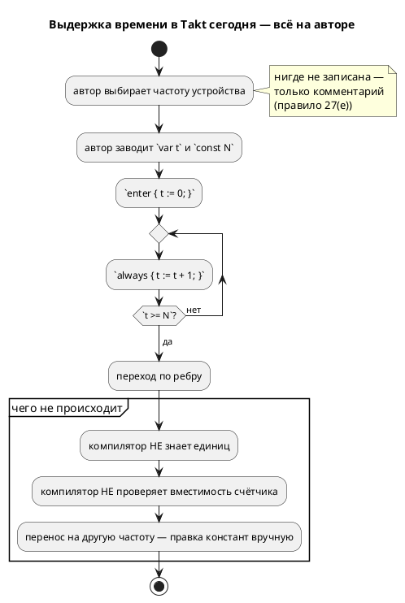
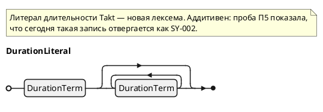

Источник: [docs/features/0134-language-time-model.md](https://github.com/Pastor/Takt/blob/3c154a13d979b18312a1250ebfbe3db2fa5247d3/docs/features/0134-language-time-model.md)

Полный текст по ссылке. Ниже начало карточки.

# Фича: Модель времени в языке: литерал длительности и частота такта

- **Номер:** 0134
- **Статус:** ГОТОВО (0134-01…09 + 0134-04b сделаны: синтаксис, тип `duration`,
  симулятор, цели `c`/`c-hal`, `rust`, `st`/`st-at`, `sv` в **обоих** профилях,
  выдержка `after Nt`/`after Nms`, контракт частоты `--tick-hz`/`SE-069`/`SE-070` с
  CLI-частью 0134-08, **периодический блок `every`** (0134-09))
- **Долг задач…08:** каждая, добавив время своей цели,
  **дополняет** приложение «Порождённый код примера» разделом о порождённом коде
  времени этой цели (по образцу цели `c`) — запрос заказчика 2026-07-28.
- ✅ **Долг закрыт задачей:** временная ветка в проверке примеров снята —
  пример раздела «Механизмы времени» компилируется целью `c`.
- **Зависит от:** [единая семантика переполнения целых во всех целях](0127-int-overflow-semantics.md) — **закрыта 2026-07-27**
- **Tier:** 1
- **Связанные issue (анализ):** кандидат блока 2 `FEATURES.md` + **пробел № 1 из 15** и раздел 11.6 отчёта [`docs/DIFF.md`](../DIFF.md)

## Стадии жизненного цикла

Все стадии — **разделы этой карточки**: «Архитектура (ADR)»,
«Анализ», «Разработка», «Тест-план», «Отчёт о тестировании», «Итог».
Отдельным артефактом остаются только исправления —
[`docs/fixes/`](../fixes/README.md) (при необходимости `0134-YY-*`).

## Краткое описание

Ввести в язык **длительность**: сегодня время моделируется счётчиком тактов
вручную, а частота живёт в комментарии. Это главный разрыв языка с отраслью:
длительность не переносится между устройствами с разной частотой, не проверяется
и молча ломается при переполнении счётчика.

> Фича зарегистрирована из бэклога кандидатов (отобрана заказчиком 2026-07-27); далее проходит жизненный цикл по своду.

## Что известно на входе

Сравнительный анализ ([`docs/DIFF.md`](../DIFF.md), разделы 10.4 и 11.6) даёт
шесть механизмов выражения времени; **своих средств нет лишь у четырёх языков из
26**, включая Takt. Ключевой факт против довода «Takt порождает RTL, значит
времени быть не может»: **SpinalHDL порождает такой же синтезируемый RTL и при
этом принимает `Timeout(3 ms)`**, пересчитывая длительность в такты по частоте
области тактирования; VHDL и SystemVerilog вводят частоту параметром
(`generic CLK_HZ`) и вычисляют число тактов константой; у Clash период такта
входит **в тип** домена.

свод(е) свода уже **вынуждает** автора сообщать частоту комментарием — то
есть требование сформулировано, а языкового средства под него нет.

## Направление решения (наметка, не решение)

Раздел 11.6 отчёта разбирает **пять** вариантов (A — оставить как есть,
B/B′ — литерал длительности + частота такта флагом либо объявлением в модели,
C — декларативные `after`/`every` на рёбрах, D — таймер как объект языка,
E — часы и инварианты локаций в духе UPPAAL) и рекомендует **B (+B′) как ядро →
C как сахар → D → E только под требование доказывать временные свойства**.

Требования, обязательные при любом выборе (там же, 11.6.2): пересчёт
«длительность → такты» в **одном** общем слое; непредставимая длительность —
**ошибка компиляции** по образцу `SE-058`, а не округление; печать фактически
заложенной частоты; признание флага **вторым** осознанным исключением из
принципа «CLI не меняет логику» (первое — `--float-as-q`, действие A-7 [q-арифметика через нативный float и флаг генерации (embedded ↔ float)](0096-fixed-point-native-float.md)); аддитивность (ручные счётчики
продолжают работать).

**Конфликт, который обязан решить ADR:** штатный `TON` цели `st` отсчитывает
реальное время среды исполнения, а не циклы, — если `st` пойдёт через `TON`, а
остальные цели через счётчик тактов, **потактовая эквивалентность целей
перестанет существовать**. Три развязки перечислены в 11.6.2.

Окончательный выбор — за стадиями **архитектуры** (ADR) и **анализа**: раздел
выше фиксирует то, что уже проверено, а не предрешает реализацию.

## Решения заказчика (2026-07-27) и что из них вышло

Выбор сделан **не** по рекомендации отчёта: заказчик задал гибрид, в котором
**источник времени внешний — как и такт**, а частота нужна лишь там, где источника
нет. Принято в [ADR](0134-language-time-model.md#архитектура-adr):

| Вопрос | Решение заказчика |
|---|---|
| Объём | **B + B′ + C** (литерал + частота как свойство модели + `after`/`every`), гибридом: механизм **включается только при использовании**, тактирование всегда внешнее |
| Форма литерала | `3s`, `500ms`, `1m30s` (слитно) |
| Неделимая длительность | **ошибка компиляции** (без округления) |
| `TON` в цели `st` | **(б) — да, штатный `TON`** |

Реализация времени — функция «сколько прошло от запуска модели» с квантом
**1 мс** (ограничение реализации источника); в `c`/`rust` — библиотечные часы по
умолчанию с возможностью переопределить в коде; во встраиваемом случае — расчёт от
тактирования с **явной** частотой (define или константа).

**Пробы стадии архитектуры сняли конфликт, объявленный отчётом:** `TON`
детерминирован под инжектированным временем, поэтому цель `st` **остаётся** в
потактовой сверке (П1–П3 ADR); зеркально — физическое время в цели `sv` запрещено,
потому что `#delay` **молча** проходит оба её проверки (П4).

## Документирование

**Требуется, в большом объёме.** Анализ ([модель времени в языке: литерал длительности и частота такта](0134-language-time-model.md#анализ))
уточнил объём: фича правит **существующие** разделы `book/` — `02-lexical`
(литералы длительности и частоты), `03-types` (тип `duration`), **`11-execution`**
(ядро: два профиля, внешний источник времени, точность в один такт,
`after`/`every`), `15-diagnostics` + приложение «Ошибки и предупреждения»
(`SE-063…065`).

**Уточнено 2026-07-28 по запросу заказчика:** заведён **отдельный раздел**
«Механизмы времени» (`book/src/12-time/`) — [раздел документа: механизмы времени](0141-book-time-section.md),
как требует свод. Правки существующих разделов остаются за этой фичей в
той части, что раздел 12 не покрывает (единицы в «Лексической структуре», тип в
«Типах данных», коды в приложении «Ошибки и предупреждения»).

свод(е) свода пересматривается: оно описывает обходной путь, который эта
фича снимает. Версия языка растёт.

## Архитектура (ADR)

- **Status:** Accepted
- **Date:** 2026-07-27
- **Authors:** Архитектор + Системный аналитик + Дизайнер языка
- **Related issues:** [Фича](0134-language-time-model.md); опирается на
  [ADR](0127-int-overflow-semantics.md#архитектура-adr) (обёртка беззнакового определена),
  [ADR](0096-fixed-point-native-float.md#архитектура-adr) (прецедент осознанного исключения из
  принципа «CLI не меняет логику»), [ADR](0061-fixed-point-type.md#архитектура-adr) (прецедент
  «непредставимый литерал — ошибка, а не округление»)

### Context

Своих средств выражения времени у Takt нет: физическая длительность моделируется
ручным счётчиком тактов, а частота живёт в комментарии — этого прямо **требует**
свод(е) свода. Сравнительный анализ ([`docs/DIFF.md`](../DIFF.md), разделы
10.4 и 11.6) показывает, что так устроены лишь **четыре языка из 26** (Takt, SMC,
StateSmith, Ragel), и называет это разрывом № 1 из 15.

Довод «Takt порождает синтезируемый RTL, значит времени быть не может» отчёт
опровергает: SpinalHDL порождает такой же RTL и принимает `Timeout(3 ms)`, VHDL и
SystemVerilog вводят частоту параметром (`generic CLK_HZ`), у Clash период такта
входит в тип домена.

#### Поток «как есть»

#### Что проверено пробами при подготовке этого ADR

Решение опирается не на память, а на пробы (инструменты — `iec2c` MatIEC,
`yosys` 0.67, `verilator` 5.050, `taktc` из рабочего дерева):

| № | Проба | Результат |
|---|---|---|
| **П1** | `FUNCTION_BLOCK` с экземпляром `TON`, `PT := T#3s`, чтение `.Q` → `iec2c` | **Принято** (`rc = 0`). Штатный таймер IEC цели `st` доступен. |
| **П2** | Откуда `TON` берёт время | Из глобали `extern TIME __CURRENT_TIME;` (`iec_std_lib.h:55`), то есть **источник внешний и подменяемый**. В харнессе сверки `conformance_st_tests.rs` эта глобаль **уже объявлена** (`TIME __CURRENT_TIME;`) и просто стоит в нуле. |
| **П3** | Прогон `TON` под **инжектированным** временем (1 с на такт) | Детерминирован: дверь открылась на такте 1 (t = 1 с), закрылась на такте 4 (t = 4 с) — ровно `START + 3s`. **Потактовая сверка цели `st` с таймером сохранима.** |
| **П4** | `#3ms` внутри `always_ff` → `yosys synth` и `verilator --lint-only -Wall` | **Оба проверки принимают молча**: yosys синтезирует модуль (2 ячейки), проигнорировав задержку; verilator не говорит ни слова. Физическое время в RTL — ловушка ровно того класса, который проект ловит сверками. |
| **П5** | `var x := 3s;` сегодняшним `taktc` | `SY-002` «нераспознанный токен `'s'`». Литерал длительности **аддитивен**: он занимает синтаксис, который сегодня отвергается. |

П3 важнее прочего: отчёт `DIFF.md` (11.6.2) утверждал, что `TON` в цели `st`
**уничтожает** потактовую эквивалентность целей. Проба показывает, что это верно
лишь для часов реального мира; при инжектированном источнике времени трасса
воспроизводима, и конфликт снимается не выбором «`TON` или сверка», а **общим
правилом: источник времени — внешний и подменяемый, как и такт**.

П4 — зеркальный вывод для цели `sv`: физического времени в RTL быть не должно
**потому, что оба проверки его не ловят**.

### Decision Drivers

1. **Тактирование внешнее — язык не завязывается на значение частоты** (решение
   заказчика). Модель тактируется снаружи; при потактовой отладке частоты может не
   быть вовсе. Значит частота — **не** обязательная часть модели времени, а
   параметр одного из профилей.
2. **Механизм включается только при использовании** (решение заказчика; свод).
   Модель без времени обязана давать **байт-в-байт** прежний вывод во всех целях.
3. **Пересчёт — в одном слое** (T1 отчёта). Прецеденты: `enum_facts`, `bit_vector`,
   `lower_float`. Разъехавшись, цели дадут разные длительности — класс дефекта,
   который проект ловит сверками.
4. **Непредставимое — ошибка компиляции, а не округление** (T2; решение
   заказчика). Прецедент — `SE-058` для fixed-point.
5. **Потактовая сверка целей — главный проверка качества проекта**  и
   обязана пережить введение времени.
6. **Источник времени переопределяется в целевом коде** (решение заказчика): по
   умолчанию — библиотечная функция, но пользователь вправе подставить свою.
7. **Обёртка беззнакового определена** ([ADR](0127-int-overflow-semantics.md#архитектура-adr)),
   поэтому «истекло ли» через **разность** счётчиков корректно при переполнении.
   Это и была настоящая причина зависимости 0134 → 0127.

### Considered Options

#### Option A. Оставить как есть (M1 отчёта)

**Pros:**
- Ноль работы и ноль риска.

**Cons:**
- Разрыв № 1 остаётся открытым; непереносимость между частотами.
- Ничего не проверяется; свод(е) продолжает требовать комментария вместо
  языковой конструкции.

#### Option B. Компилятор пересчитывает длительность в такты (M2, рекомендация отчёта)

Литерал `3s` + частота (`--tick-hz`, `clock 1kHz;`) → константа тактов.

**Pros:**
- Минимальное изменение семантики; работает на всех целях без времени выполнения.
- Проверки на компиляции; прямые прецеденты (SpinalHDL, VHDL/SV, Chisel, Clash).

**Cons:**
- **Противоречит драйверу 1**: частота становится обязательной, а при потактовой
  отладке её нет.
- На ПЛК точность плывёт вместе с временем цикла, хотя среда исполнения знает
  настоящее время и штатный `TON` (П1) его даёт.

#### Option H. Гибрид: внешний источник времени + профиль тактов там, где источника нет — **выбрано**

Время получается **функцией** («сколько прошло от запуска модели»), как такт —
снаружи. Там, где источника времени нет (голое железо, RTL), тот же литерал
пересчитывается в такты по **явно** заданной частоте.

**Pros:**
- Удовлетворяет всем семи драйверам.
- На ПЛК даёт штатный `TON` (П1) **без** потери сверки (П3).
- В цели `sv` не соблазняет физическим временем (П4).
- Частота нужна только там, где она действительно есть.

**Cons:**
- Два профиля вместо одного — различие обязано быть видно в диагностике,
  документации и трассе; сверка ведётся **внутри** профиля.

#### Option D. Таймер как объект языка (M3)

**Pros:**
- Отменяемые тайм-ауты, несколько таймеров в состоянии, прямая трансляция в `TON`.

**Cons:**
- Новая сущность с жизненным циклом и ресурсом на экземпляр.
- Отчёт рекомендует её **после** ядра — здесь она преждевременна.

#### Option E. Часы и инварианты локаций (M5, UPPAAL)

**Pros:**
- Доказательство временных свойств — уникальное сочетание с синтезом.

**Cons:**
- Объём уровня «второй верификатор» (зоновая абстракция, DBM).
- Для синтеза всё равно нужна база Option H. Браться раньше — доказывать свойства
  языка, на котором ещё нельзя записать выдержку.

### Decision

Принимается **Option H** в объёме **B + B′ + C** (литерал длительности, частота как
свойство модели, декларативные `after`/`every`) — решение заказчика от 2026-07-27.
Ниже — нормативные правила; они обязательны для стадии анализа и разработки.

#### свод. Механизм включается по факту использования

Модель, не содержащая ни литерала длительности, ни `after`/`every`, порождает
**байт-в-байт прежний** код во всех семи целях: не появляется ни полей, ни
колбэков, ни параметров, ни констант, ни служебных входов. Проверяется проверкой
неизменности корпуса `examples/`.

#### свод. Источник времени — внешний и подменяемый

Время приходит в модель извне — как и такт. Каждая цель получает его своим
штатным способом:

| Цель | Источник времени (профиль «часы») | Переопределение пользователем |
|---|---|---|
| `c` | указатель `uint64_t (*now_ms)(void *userdata)` в структуре модели — рядом с `read_*`/`write_*` | подставить свой колбэк (штатный механизм цели) |
| `c-hal` | то же + **принятая по умолчанию реализация** библиотечными часами (`clock_gettime(CLOCK_MONOTONIC)`) | заменить реализацию или колбэк |
| `rust` | метод трейта `Hal::now_ms(&mut self) -> u64` | реализовать трейт по-своему (в `no_std` библиотечных часов нет — тела по умолчанию не будет) |
| `st` / `st-at` | штатный `TON` поверх `__CURRENT_TIME` среды исполнения (П1, П2) | свойство среды ПЛК |
| `sv` / `sv-mmio` | служебный вход `time_ms` — как `clk`/`rst_n`/`en` | подать свой счётчик |
| симулятор | виртуальные часы (детерминированные) | сценарий/флаг |

**Физическое время в RTL запрещено:** `#delay`/`$time` не эмитируются никогда —
проба П4 показала, что **оба** проверки цели `sv` пропускают их молча.

#### свод. Два профиля времени; профиль выбирает наличие частоты

- **Профиль «часы»** (умолчание) — длительность сравнивается с показаниями
  источника времени; частота **не нужна**, и модель остаётся годной для потактовой
  отладки (драйвер 1). Квант — **1 мс** (ограничение реализации источника).
- **Профиль «такты»** — включается **объявлением частоты**: `clock 1kHz;` в модели
  (B′) либо флагом `--tick-hz=N` (флаг переопределяет объявление, как `--float-as-q`
  переопределяет представление `float`). Длительность пересчитывается в число
  тактов; источник времени не нужен. Квант — период такта.

Иных способов выбора профиля нет: **частота задана → такты; не задана → часы**.

#### свод. Литерал длительности

Слитная запись «число + единица», составные формы допускаются:

Единица примыкает к числу **без пробела** (форма `3 s` отвергнута: `s`, `m`, `h` —
законные имена переменных, и отдельный токен потребовал бы контекстных ключевых
слов). Дробный литерал (`1.5s`) и экспонента (`1e3ms`) — **лексическая ошибка**:
дробная длительность выражается меньшей единицей.

Каноническое внутреннее представление — **целое число наносекунд** (`i64`, запас
±292 года). Единицы `ns`/`us` разрешены лексически всегда; представима ли такая
длительность — решает профиль.

#### свод. `duration` — отдельный тип; мост к числам — только явный `as`

Тип длительности **неявно** не смешивается с числовыми: `duration ± duration` и
сравнения `duration` с `duration` разрешены; `t + 1` при `t: duration` — ошибка
`SE-065`. Так единица не теряется по дороге (тот же принцип, что у `q(m, n)`:
формат — часть типа). Объявления — `const DWELL := 3s;`,
`var left: duration := 0s;`.

**Уточнение заказчика (2026-07-27): переход между `duration` и числом возможен
явным приведением, единица перехода — миллисекунда.**

- `d as u32` → число **миллисекунд** (остаток отбрасывается к нулю: `as` —
  явная потеря, выбор автора, как у `float → int`);
- `250 as duration` → длительность в 250 мс.

Пересчёт живёт в общем слое (`duration::to_millis`/`from_millis`), а не в
вычислителе и не в генераторах: «сколько миллисекунд в этой выдержке» обязано
иметь один ответ на весь проект.

#### Правило 5а. `after` допустим **только** в условии перехода `ref`

Решение заказчика (2026-07-27). Отсчёт начинается с **перехода в
состояние-источник**: `ref Wait: after 6s;` означает «перейти в `Wait` через 6 с
после входа в состояние, где стоит это ребро». Поэтому:

- в условии ребра `after` законен, в том числе вместе с другими условиями
  (`x = 1 & after 6s`);
- в именованном условии (`cond T = after 6s;`), инварианте и Guard-формуле —
  **`SE-068`**: там у выдержки нет состояния-источника, от входа в которое
  ведётся отсчёт. Одно скрытое начало отсчёта, разделённое несколькими
  состояниями, дало бы выдержку, зависящую от того, кто спросил первым.

Повторный вход в состояние **перезапускает** отсчёт: выдержка — свойство входа,
а не одноразовый будильник.

#### свод. Непредставимая длительность — ошибка компиляции

Округления нет нигде (драйвер 4). Новые диагностики:

- **`SE-063`** — длительность непредставима в выбранном профиле: мельче кванта
  (`500us` в профиле «часы») либо не кратна периоду такта (`500ms` при 3 Гц =
  1.5 такта);
- **`SE-064`** — длительность не помещается в счётчик выбранной разрядности;
- **`SE-065`** — смешение `duration` с числом в выражении.

Коды целевых слоёв (`sv`/`st`/`rust`) назначаются на стадии анализа; свободны
`SV-015+`, `ST-015+`, `RS-023+`, `SIM-033+`.

#### свод. Пересчёт — в одном слое

«Длительность → миллисекунды» и «длительность → такты» вычисляет **общий
семантический слой** (`semantic::duration`), одинаково для всех целей и для
симулятора. Ни один генератор своей арифметики времени не заводит (драйвер 3;
прецеденты `enum_facts`, `bit_vector`, `lower_float`).

#### свод. Разрядность счётчика выбирает компилятор; сравнение — через разность

Счётчик времени объявляет компилятор, выбирая разрядность по максимуму заявленных
длительностей (T7 отчёта); «истекло ли» вычисляется как `now - t0 >= D` в
**беззнаковой** арифметике, обёртка которой нормирована
[ADR](0127-int-overflow-semantics.md#архитектура-adr). Так переполнение счётчика не ломает
выдержки короче полупериода счётчика; выдержки длиннее отсекает `SE-064`.

#### свод. Сверка — внутри профиля, по инжектированному времени

Симулятор ведёт **модельное** время (мс) и остаётся детерминированным: время
задаётся сценарием (поле шага) либо флагом «мс на такт». Драйверы сверок подают
целям **то же самое** время: `c`/`rust` — через колбэк, `st` — записью в
`__CURRENT_TIME` (П2: глобаль уже объявлена в харнессе), `sv` — входом `time_ms`.
Потактовая эквивалентность целей сохраняется (П3) — это **отличие принятого
решения от прогноза отчёта**, считавшего `TON` несовместимым со сверкой.

#### свод. Точность ограничена тактом, и это документируется

Выдержка срабатывает на **первом такте, на котором интервал истёк**: «не раньше
заданного, точность — один такт». Формулировка попадает в раздел `book/` и в блок
«Частые ошибки» (свод свода).

#### свод. Фактически заложенное — печатается

`taktc` печатает сводку по каждой длительности: `DWELL = 3s → 3000 мс (профиль
«часы»)` либо `DWELL = 3s → 3000 тактов (профиль «такты», 1 кГц)`. Глушится
`--quiet`; дублируется комментарием в порождённом коде (T3 отчёта).

#### свод. `after` / `every` — сахар над свод–8

`ref Leaving: after 3s;` и `every 100ms { … }` разворачиваются в тот же механизм и
своей семантики времени не вводят. Скрытое состояние (счётчик или метка времени)
**обязано** быть видимо в трассе симулятора — иначе отладка модели становится
гаданием.

#### свод. Флаг частоты — второе осознанное исключение из принципа «CLI не меняет логику»

`--tick-hz` меняет численный результат так же, как `--float-as-q` (действие A-7
[фичи](0096-fixed-point-native-float.md)), и должен быть **явно
назван** исключением в документации, а не протащен молча. Исключение уже, чем у
0096: в профиле «часы» флага нет вовсе. Принцип «CLI не меняет автомат» остаётся в
силе для `--define` (0042).

### Consequences

#### Положительные

- Закрывается разрыв № 1 из 15 отчёта `DIFF.md`; Takt перестаёт быть одним из
  четырёх языков поля без средств выражения времени.
- Длительность переносится между устройствами: смена частоты — правка одного
  объявления, а не ревизия констант по всей модели.
- Цель `st` получает **штатный** `TON` (решение заказчика (б)) — и, вопреки
  прогнозу отчёта, **без** потери потактовой сверки (П3).
- Цель `sv` конструктивно защищена от `#delay`/`$time`, которые оба её проверки
  пропускают молча (П4).
- свод(е) свода («такт — не единица физической величины») перестаёт быть
  обходным путём: язык получает средство, которого правилу не хватало.

#### Отрицательные / Action items

- **A-1. Д
