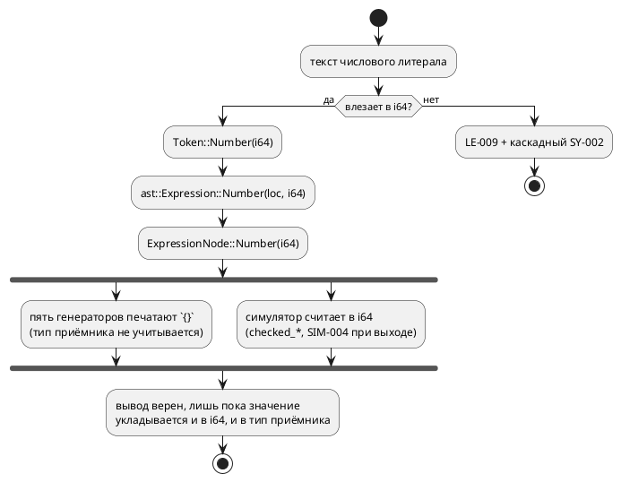

Источник: [docs/features/0157-literal-u64-representation.md](https://github.com/Pastor/Takt/blob/3c154a13d979b18312a1250ebfbe3db2fa5247d3/docs/features/0157-literal-u64-representation.md)

Полный текст по ссылке. Ниже начало карточки.

# Фича: Представление числового литерала: полная маска `[bit;64]`

- **Номер:** 0157
- **Статус:** ГОТОВО
- **Зависит от:** нет
- **Tier:** 2
- **Связанные issue (анализ):** кандидат блока 2 `FEATURES.md` (вынесено закрытием [диагностика вместо паники на числовом литерале больше `i64::MAX`](0128-lexer-literal-overflow.md), Option B/C ADR отвергнуты в объёме)

## Стадии жизненного цикла

Все стадии — **разделы этой карточки**: «Архитектура (ADR)»,
«Анализ», «Разработка», «Тест-план», «Отчёт о тестировании», «Итог».
Отдельным артефактом остаются только исправления —
[`docs/fixes/`](../fixes/README.md) (при необходимости `0157-YY-*`).

## Краткое описание

Значение литерала хранится как `i64`, поэтому «все единицы» для официально
поддержанного типа `[bit;64]` записать **нельзя**. После 0128 это честная ошибка
`LE-009` вместо паники — но записать значение по-прежнему не выходит.

> Фича зарегистрирована из бэклога кандидатов (отобрана заказчиком 2026-07-28); далее проходит жизненный цикл по своду.

## Что известно на входе

- `0xFFFFFFFFFFFFFFFF` → `LE-009` (было — паника, снята фичей).
- `[bit;64]` — официально поддержанный тип: фича
  [семантика `[bit;N]` расходится втрое](0078-bit-array-semantics.md) определила `[bit;N]` при `N ≤ 64` как
  упакованный вектор (скаляр).
- То есть язык обещает тип, значения которого невыразимы литералом.

## Направление решения (наметка, не решение)

- Решение о представлении числового литерала: расширить (`i128` либо
  беззнаковый вариант токена) **либо** ввести отдельную форму записи маски.
- Правка **сквозная**: токен → АСД → семантика → **пять генераторов**, у
  каждого своя печать чисел. В 0128 не бралась намеренно, чтобы не протаскивать
  её под видом исправления паники.
- Смежно с [экспонента целочисленного литерала: считать или отвергнуть, но не терять молча](0144-int-literal-exponent.md): экспонента у целого литерала
  упирается в тот же вопрос представления.

Окончательный выбор — за стадиями **архитектуры** (ADR) и **анализа**: раздел
выше фиксирует то, что уже проверено, а не предрешает реализацию.

## Решение архитектуры (стадия 2, 2026-07-30)

Принят **Option A** ADR — носитель `i128` на всём тракте. Объём утверждён
заказчиком **целиком** (пять пунктов): носитель, приём лексера
`[i64::MIN, u64::MAX]`, диагностика `SE-089` (литерал вне диапазона типа),
печать литерала **по типу приёмника** в целях `c`/`sv`, вычисление в `i128` у
симулятора. Номер версии языка при этом **не растёт**: `0.8.0` не выпущена, и
по своду изменения накапливаются в неё.

Пробы стадии (полностью — в ADR) показали, что дыра шире заголовка фичи:

- `u64` неполноценен и **без** литерала: `m: u64 := 9223372036854775807; m := m + 1;`
  даёт `SIM-004`, хотя ADR обещает обёртку `mod 2⁶⁴` (у `u8`/`u32` она есть).
- Диагностики диапазона по типу **нет вовсе**: `var a: u8 := 300;` — успех у
  `taktc` и отказ у `cc -Werror` (`-Wconstant-conversion`).
- Цель `sv` печатает голое десятичное и ломается на `verilator -Wall`
  **уже с 33 бит** (`WIDTHEXPAND`) — существующий дефект, которого корпус просто
  не содержит.

Вне объёма (записано кандидатами): константное выражение в инициализаторе
переменной симулятором **не вычисляется** (`var a: u8 := 1 + 2;` → симулятор `0`,
цель `c` `3` — молча, класс Tier 1), частный случай того же — `~0`.

## Документирование

**Требуется.** Меняется множество записуемых литералов — затронуты разделы
[`book/src/02-lexical/`](../../book/src/02-lexical/index.typ) (литералы) и
[`book/src/03-types/`](../../book/src/03-types/index.typ) (тип `[bit;N]`).

## Архитектура (ADR)

- **Status:** Accepted (вариант и объём утверждены заказчиком 2026-07-30)
- **Date:** 2026-07-30
- **Authors:** Архитектор
- **Related issues:** [Фича](0157-literal-u64-representation.md);
  предшественник — [ADR](0128-lexer-literal-overflow.md#архитектура-adr) (паника → `LE-009`),
  смежные — [ADR](0078-bit-array-semantics.md#архитектура-adr) (`[bit;N]`),
  [ADR](0127-int-overflow-semantics.md#архитектура-adr) (переполнение целых),
  [фича](0144-int-literal-exponent.md) (экспонента у целого),
  [ADR](0171-c-gate-werror.md#архитектура-adr) (проверка `c` под `-Werror`).

### Context

Язык объявляет типы `u64` и `[bit;64]` (при `N ≤ 64` — упакованный скаляр), но **носитель значения на всём тракте — `i64`**: `Token::Number(i64)`
→ `ast::Expression::Number(_, i64)` → `ExpressionNode::Number(i64)` →
`takt_sim::eval::Value::Number(i64)`. Верхняя половина диапазона `u64`
(и, в частности, маска «все единицы» у `[bit;64]`) **невыразима** — ни литералом,
ни вычислением.

#### Что показали пробы (2026-07-30, все команды воспроизводимы)

| № | Вход | Наблюдаемое | Вывод |
|---|---|---|---|
| П1 | `var m: [bit;64] := 0xFFFFFFFFFFFFFFFF;` | `LE-009` + каскадный `SY-002` на `;` | обещанный тип имеет невыразимые значения; вдобавок пользователь видит **две** ошибки на одну причину |
| П2 | `var m: u64 := 18446744073709551615;` | `LE-009` + `SY-002` | то же для `u64` |
| П3 | `var m: u64 := 0x7FFFFFFFFFFFFFFF;` → цели `c`/`rust`/`st`/`sv` | все печатают голое десятичное `9223372036854775807` | печать числа **не знает о типе приёмника** |
| П4 | `uint64_t a = 18446744073709551615;` под `cc -Wall -Werror` | `error: -Wimplicitly-unsigned-literal` | цель `c` **обязана** печатать суффикс (`ULL`/hex+`ULL`), иначе проверка отвергнет вывод |
| П5 | `a <= 9223372036854775807;` в `logic [63:0]` под `verilator --lint-only -Wall` | `%Warning-WIDTHEXPAND` → `%Error` | цель `sv` ломается **уже на 33 битах** (проверено также на `8589934592` и `4294967295`); дефект существует **сегодня**, корпус его просто не содержит |
| П6 | `ULINT := 18446744073709551615;` и `16#FFFFFFFFFFFFFFFF` через `iec2c` | принято, код 0 | цель `st` к расширению готова |
| П7 | `(18446744073709551615, 0xFFFFFFFFFFFFFFFF)` как `u64` под `rustc -D warnings` | принято | цель `rust` к расширению готова |
| П8 | `var m: u64 := 9223372036854775807;` + `m := m + 1;` в симуляторе | `SIM-004` «переполнение при вычислении '+'» | у **вычисления** тот же потолок: `u64` неполноценен и без литерала (при этом `u8`/`u32` оборачиваются верно — ADR соблюдён) |
| П9 | `var a: u8 := 300;` / `var b: i8 := -200;` | `taktc` рапортует успех; `cc -Werror` → `-Wconstant-conversion`, симулятор → `SIM-003` | **диагностики диапазона по типу нет вовсе**: расширить носитель, не заведя её, значит расширить и класс молча невалидного вывода |

#### Поток значения «как есть»

Существенно, что **три** независимых слоя упираются в одну границу: лексер
(приём), симулятор (вычисление), генераторы (печать). Расширение любого одного
слоя выразимости не даёт.

### Decision Drivers

1. **Язык не должен обещать типы с невыразимыми значениями.** `u64` и `[bit;64]`
   объявлены поддержанными; сегодня половина их диапазона недоступна.
2. **Один смысл литерала на все цели.** Шесть потребителей (симулятор + пять
   генераторов) не имеют права разойтись в значении одного текста — урок
   («арифметика в одном месте») и 0127 (нормированное переполнение).
3. **Расширение приёма без диагностики диапазона умножает молчаливый брак.**
   П9 доказывает: уже сегодня `u8 := 300` даёт невалидный C при рапорте об
   успехе; после расширения таких входов станет больше.
4. **Печать числа обязана знать тип приёмника.** П4 (C) и П5 (SV) показывают,
   что голое десятичное — не универсальная форма.
5. **Обратная совместимость.** Все ныне валидные программы обязаны
   давать **байт-в-байт** прежний вывод: `examples/generated/` — снапшот
   (детерминизм 0048), его дифф несёт смысл.

### Considered Options

#### Option A. Носитель `i128` на всём тракте + печать по типу приёмника

Токен, АСД, семантика и `eval::Value` несут `i128`; лексер принимает всё из
`[i64::MIN, u64::MAX]`, остальное — прежний `LE-009` с переписанным текстом
(диапазон становится свойством пары «литерал + тип»). Семантика получает
диагностику «литерал вне диапазона типа приёмника» (`SE-089`). Генераторы
печатают литерал **по целевому типу**: `c` — суффикс `ULL`, когда значение вне
`long long`; `sv` — размерная форма `64'd…`, когда естественная ширина ≠ 32 и не
равна ширине приёмника; `st`/`rust`/`plantuml` — как сейчас (П6, П7). Симулятор
считает в `i128`, а усечение и обёртку по типу делает существующий
`coerce_to_type`  — этим закрывается П8.

**Pros:**
- Закрывает все три слоя одной идеей; `u64` становится полноценным.
- `i128` шире любого выразимого типа, поэтому промежуточный результат не
  переполняется там, где итог по типу законен (П8).
- Запас на будущее (`u128`/`[bit;128]`, если появятся) без второй такой правки.

**Cons:**
- Правка сквозная: лексер, грамматика (типы действий LALRPOP), АСД, семантика,
  три константных вычислителя, симулятор (`eval`, `state_io`), пять генераторов,
  LSP, фикстуры и снапшоты.
- В АСД становятся представимы значения, не принимаемые **ни одним** типом
  (`> u64::MAX` из лексера не приходит, но конструируется в коде) — границу
  держит диагностика, а не тип Rust.

#### Option B. Носитель «модуль + знак» (`u64` + `bool`)

**Pros:**
- Точно покрывает потребность, не вводя непринимаемых значений.

**Cons:**
- Два поля в каждом узле и в каждом сравнении; `+0`/`−0` дают два представления
  одного числа — равенство узлов (у `Extend` оно уже с ручной семантикой, 0056)
  становится ещё тоньше.
- Любое вычисление всё равно уходит в более широкий тип — выигрыш мнимый.

#### Option C. Бит-каст: оставить `i64`, широкий литерал складывать битовым шаблоном

`0xFFFFFFFFFFFFFFFF` → `Number(-1)`; форму восстанавливает печать по типу
приёмника.

**Pros:**
- Минимальная правка носителя (лексер + печать).

**Cons:**
- Значение литерала перестаёт быть свойством текста и становится свойством
  контекста — прямо против драйвера 2; три константных вычислителя (0042, 0143,
  0185) обязаны договориться о бит-касте, а они и так расходятся.
- `18446744073709551615 > 9223372036854775807` в константном выражении даёт
  **ложь**: сравнение идёт над бит-шаблоном.
- П8 не закрывается вовсе: вычисление остаётся в `i64`.

#### Option D. Спецформа записи маски (`all`, `~0` как константа) вместо расширения

**Pros:**
- Дёшево; закрывает ровно заголовочный случай «все единицы».

**Cons:**
- `u64` в десятичной записи остаётся невыразим (П2), П8 не закрывается.
- Язык обрастает формой, существующей ради обхода внутреннего ограничения.
- Путь **уже сломан** независимо от 0157: `var u: u64 := ~0;` симулятор молча
  даёт `0` (константное выражение в инициализаторе им не вычисляется —
  `unit/initial.rs` отвечает «не константа»), а цель `c` печатает `~0` (все
  единицы). Опираться на эту форму нельзя, пока расхождение не устранено
  (вынесено в кандидаты, см. ниже).

### Decision

Принимается **Option A** (решение заказчика 2026-07-30). Объём подтверждён им
же **целиком**: диагностика диапазона, печать по типу приёмника в `c`/`sv` и
вычисление в `i128` у симулятора взяты в фичу, а не вынесены в преемники —
только этот состав делает `u64` полноценным разом по всем трём слоям (вычисление, печать). Итого **пять пунктов**:

1. **Носитель** `i128` в токене, АСД, семантике и `eval::Value::Number`.
2. **Лексер**: принимает `[i64::MIN, u64::MAX]`; вне — `LE-009` с переписанным
   текстом. Каскадный `SY-002` (П1) гасится: после лексической ошибки в этой
   позиции парсер не обязан вторично жаловаться на `;`.
3. **Семантика**: `SE-089` — литерал не помещается в тип приёмника (закрывает П9;
   без него расширение приёма увеличивает класс молча невалидного вывода).
4. **Цели**: печать литерала по типу приёмника — `c` (суффикс `ULL` при выходе за
   `long long`), `sv` (размерная форма при ширине ≠ 32; попутно закрывает П5).
   Условие печати — «когда иначе вывод невалиден», поэтому корпус
   `examples/generated/` обязан остаться **байт-в-байт прежним**.
5. **Симулятор**: вычисление в `i128`, усечение/обёртка — существующим
   `coerce_to_type` по типу (закрывает П8, соблюдая ADR).

**Вне объёма** (записать кандидатами, не втягивать):

- Константное выражение в инициализаторе переменной не вычисляется симулятором:
  `var a: u8 := 1 + 2;` → симулятор `0`, цель `c` `3`. **Молча**, класс Tier 1.
- `~0` в инициализаторе — частный случай того же (Option D выше).
- Экспонента у целого литерала ([экспонента целочисленного литерала: считать или отвергнуть, но не терять молча](0144-int-literal-exponent.md))
  — упирается в тот же носитель, но имеет свою карточку.

### Consequences

#### Положительные

- `u64` и `[bit;64]` становятся полноценными: значение выразимо литералом и
  достижимо вычислением.
- Цель `sv` перестаёт ломаться на литералах шире 32 бит (П5) — дефект, который
  сегодня ждёт первого же примера с такой константой.
- Диагностика диапазона (`SE-089`) переводит целый класс «валидный `.takt` →
  невалидный C» из молчания в отказ на этапе компиляции.

#### Отрицательные / Action items

- Правка задевает порядка десяти модулей и все фикстуры с `Number(...)`;
  декомпозиция на подзадачи обязательна.
- Печать по типу приёмника требует, чтобы генератор **знал** тип в точке печати
  литерала; там, где не знает (константа вне объявления), нужен либо проброс
  типа, либо консервативная форма. Это — вопрос стадии анализа.
- Документ `book/` (разделы `02-lexical`, `03-types`) и реестр диагностик
  обновляются в стадии документирования.
- Язык меняется: расширено множество допустимых литералов, добавлена
  диагностика диапазона. **Номер версии при этом не растёт**: свод —
  версия накапливается по циклам, а `0.8.0` (поднята фичей) ещё не
  выпущена, поэтому 0157 вносит изменения в неё. Первая редакция ADR писала
  `0.8.0 → 0.9.0` — ошибка, исправлена при документировании.

#### Acceptance criteria

1. `var m: [bit;64] := 0xFFFFFFFFFFFFFFFF;` и `var m: u64 := 18446744073709551615;`
   компилируются всеми пятью целями; вывод принимается проверками (`cc -Wall
   -Werror`, `rustc -D warnings`, `iec2c`, `verilator -Wall`, `yosys`).
2. Потактовая сверка симулятора и цели `c` на модели, где `u64` пересекает
   границу `i64::MAX` (обёртка по ADR, а не `SIM-004`).
3. `var a: u8 := 300;` даёт `SE-089` с позицией, а не успех (П9).
4. Цель `sv`: литерал шириной 33…64 бита проходит `verilator --lint-only -Wall`
   без `WIDTHEXPAND` (П5).
5. `examples/generated/` — **байт-в-байт** без изменений (свод + 0048).
6. `./scripts/precheck.sh` зелёный.

## Анализ

### Цель и контекст

ADR принял Option A: значение числа несёт `i128` на всём тракте, лексер
принимает `[i64::MIN, u64::MAX]`, добавляется диагностика диапазона по типу
(`SE-089`), печать литерала в целях `c`/`sv` учитывает приёмник, симулятор
считает в `i128`. Задача анализа — превратить это в **список точек правки с
проверяемыми условиями** и разложить на подзадачи разработки.

Ключевая мысль, добытая пробами ADR: **выразимость упирается в три независимых
слоя** — приём (лексер), вычисление (симулятор), печать (генераторы). Правка
одного слоя ничего не даёт: расширенный литерал упрётся в `SIM-004` при
вычислении и в `-Wimplicitly-unsigned-literal` при печати.

### Зависимости фичи

- **Зависит от:** `нет`. Проверено по контракту: носитель `i64` изолирован
  внутри проекта (внешних потребителей АСД нет), а все шесть потребителей
  значения (симулятор + пять генераторов) правятся в этой же фиче.
- **Влияние на порядок разработки:** ничего не блокирует и не разблокирует
  напрямую. Смежная [экспонента целочисленного литерала: считать или отвергнуть, но не терять молча](0144-int-literal-exponent.md) (экспонента
  у целого литерала) упирается в тот же носитель — после 0157 её объём
  сокращается, но зависимостью это не является (0144 может быть сделана и на
  `i64`). Фича меняет **язык**, но не номер версии: `0.8.0` ещё не выпущена
  (раздел `[Не выпущено]` в `CHANGES.md`), и по своду изменения
  накапливаются в неё.

### Карта точек правки (снята `rg` по дереву, 2026-07-30)

#### Слой 1 — приём (лексер, грамматика, АСД)

| Место | Сейчас | Целевое |
|---|---|---|
| `parser/lexer.rs` (hex-ветвь) | `i64::from_str_radix` → `LE-009` | приём в `i128`, отказ вне `[i64::MIN, u64::MAX]` |
| `parser/lexer.rs` (десятичная ветвь, экспонента) | `i64::from_str`, `checked_mul` | то же в `i128` |
| `parser/token.rs` | `Token::Number(i64)` | `Token::Number(i128)` |
| `grammar.lalrpop` | `number => Token::Number(<i64>)` + 6 мест конструирования узлов | тип действия `i128` |
| `parser/ast.rs` | `Expression::Number(Location, i64)`, `Condition::Number`, `Value::Number(i64)`, `FormulaExpression::Number(Location, i64, Option<Identifier>)`, `EnumVariant.value: Option<i64>` | `i128` |

`grammar.lalrpop` (1000 строк), `lexer.rs` (986), `ast.rs` (995) — **на
границе лимита размера модуля**; правка обязана быть заменой типа, а не
дописыванием (проверка `scripts/check-module-size.sh` отвергнет рост).

**`Token::Duration(i64, …)` и `Token::Ticks(i64, …)` не трогаем:** длительность
хранится в наносекундах и её диапазон — свойство времени (±292 года), а не
числа. Смешивать эти границы нельзя.

#### Слой 2 — семантика

| Место | Роль |
|---|---|
| `semantic/mod.rs` | `ExpressionNode::Number(i64)`, `ConditionNode::Number(i64)` — корень тракта |
| `semantic/const_eval/` | общий константный вычислитель (0185) |
| `address_map/eval.rs` | арифметика адреса (0042) — **свой** `apply_binary` |
| `semantic/condition/after_const.rs` | константная выдержка (0143) |
| `semantic/enum_node.rs` (`enum_facts`, варианты `(String, i64)`) | знак и ширина перечисления (0060) |
| `semantic/bit_vector.rs` | `[bit;N]` (0078) |
| `semantic/lower_float.rs` | понижение `float` в `Number(repr)` (0096) |
| `semantic/type_inference.rs` | вывод типа литерала |

**Решение аналитика: значение варианта перечисления переезжает в `i128` вместе с
литералом.** Пары `(String, i64)` живут в `enum_node.rs`, `sv_expr.rs::Scope`,
`st_expr.rs` и `rust`-печатнике; оставить их на `i64` значит завести **второй**
носитель числа и границу между ними — ровно то, от чего уходит ADR (драйвер 2).
Вариант перечисления задаётся тем же литералом (`enum E { A = 0xFF… }`), поэтому
и границу обязан иметь ту же.

#### Слой 3 — вычисление (симулятор)

| Место | Роль | Засада |
|---|---|---|
| `eval/value.rs` | `Value::Number(i64)` | — |
| `eval/ops.rs` | `Num::Int(i64)`, `as_ints`, `checked_add/sub/mul` | арифметика ведётся в носителе; после правки промежуточный результат живёт в `i128`, а усечение делает `coerce_to_type` |
| `eval/fixed.rs` | `(*i as i128) << n` | **уже** считает в `i128` — сузится приведение, не логика |
| `predicate.rs`, `expression.rs`, `unit/initial.rs` | адаптеры узлов | три места разбора узла  — правятся согласованно |
| `state_io.rs` | JSON-снимок состояния | `serde_json::Value::Number((*n).into())` для `i128` **не компилируется**; проба показала рабочий путь — `serde_json::Number::from_i128(n)` (принял `18446744073709551615`), чтение — симметрично `as_i128()` |

#### Слой 4 — печать (цели)

| Цель | Место | Что делать | Нужен ли тип приёмника |
|---|---|---|---|
| `c` | `c_expr/expr.rs`, `c_expr/condition.rs`, `c_decl.rs` | суффикс `ULL`, когда значение вне `long long` | **нет** — условие по самому значению (проба П4: `-Wimplicitly-unsigned-literal` возникает именно на `> i64::MAX`) |
| `sv` | `sv_expr.rs`, `sv_const.rs`, `sv_fsm.rs` | размерная форма `<W>'d<value>` | **да** — проба: `64'd18446744073709551615` и `64'd8589934592` verilator принимает, а безразмерная `'d8589934592` даёт `WIDTHEXPAND` |
| `st` | `st_expr.rs` | ничего (проба П6: `ULINT := 18446744073709551615` принят `iec2c`) | нет |
| `rust` | `rust_expr.rs`, `rust_cond.rs` | ничего (проба П7: принято `rustc -D warnings`) | нет |
| `plantuml` | печать числа | ничего | нет |

**У SV типа приёмника в точке печати сегодня нет.** `Scope` (`sv_expr.rs`)
несёт `registered`/`function`/`enums`/`warnings` — ширин переменных в нём нет; в
`sv_fsm.rs` (ветвь сброса) тип **есть** (`ty`), там же уже печатается
`enum_literal`. То есть работа делится надвое: инициализатор — правка на месте,
тела — расширение `Scope` картой «сигнал → ширина». Это самая дорогая позиция
фичи.

### Требования и проверяемые условия

- **R1. Выразимость.** `0xFFFFFFFFFFFFFFFF` и `18446744073709551615` — валидные
  литералы для `u64` и `[bit;64]`; вывод принимают все пять проверок целей.
- **R2. Один смысл на все цели.** Значение литерала не зависит от цели и от
  контекста: `18446744073709551615 > 9223372036854775807` истинно во всех
  константных вычислителях (это и отличает принятый Option A от Option C).
- **R3. Вычислимость.** `u64`-арифметика у границы `i64::MAX` даёт обёртку
  `mod 2⁶⁴`, а не `SIM-004`; для знаковых типов сохраняется прежняя
  ошибка программы.
- **R4. Диагностика диапазона.** Литерал, не помещающийся в тип приёмника, даёт
  `SE-089` **с позицией** (правило «в пачке сообщений координата 1:1
  бесполезна», 0130), а не молча невалидный вывод цели.
- **R5. Печать по потребности.** Суффикс `ULL` (цель `c`) и размерная форма
  (цель `sv`) появляются **только** там, где иначе вывод невалиден.
- **R6. Обратная совместимость.** `examples/generated/` — байт-в-байт
  без изменений; ни один существующий `.takt` не меняет поведения.
- **R7. Одна ошибка на одну причину.** Литерал вне `[i64::MIN, u64::MAX]` даёт
  `LE-009` без каскадного `SY-002` (проба П1 показывает две ошибки на одну
  причину).

### Критерии приёмки и способ проверки

| # | Критерий | Способ проверки |
|---|---|---|
| A1 | `var m: [bit;64] := 0xFFFFFFFFFFFFFFFF;` компилируется целями `c`/`rust`/`st`/`sv`/`plantuml` | новый тест-фикстура + проверки `precheck.sh` (`cc -Wall -Werror`, `rustc -D warnings`, `iec2c`, `verilator -Wall`, `yosys`) |
| A2 | `u64` пересекает `i64::MAX` с обёрткой | потактовая с
