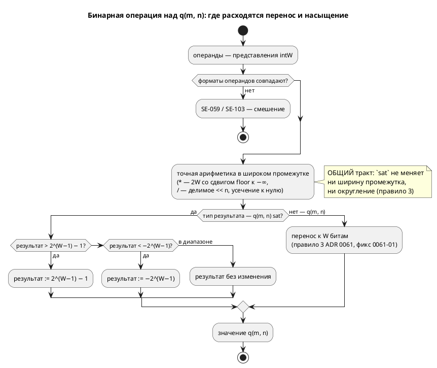

Источник: [docs/features/0170-fixed-point-saturation.md](https://github.com/Pastor/Takt/blob/3c154a13d979b18312a1250ebfbe3db2fa5247d3/docs/features/0170-fixed-point-saturation.md)

Полный текст по ссылке. Ниже начало карточки.

# Фича: Насыщение (saturation) для fixed-point `q(m, n)`

- **Номер:** 0170
- **Статус:** ГОТОВО
- **Зависит от:** нет
- **Tier:** 2
- **Связанные issue (анализ):** кандидат блока 2 `FEATURES.md` (вынесено проработкой [fixed-point Q(m.n) как тип языка](0061-fixed-point-type.md), свод ADR)

## Стадии жизненного цикла

Все стадии — **разделы этой карточки**: «Архитектура (ADR)»,
«Анализ», «Разработка», «Тест-план», «Отчёт о тестировании», «Итог».
Отдельным артефактом остаются только исправления —
[`docs/fixes/`](../fixes/README.md) (при необходимости `0170-YY-*`).

## Краткое описание

Ядро 0061 фиксирует **wraparound** при `+`/`−` — как у целых типов языка. Но для
регуляторов (типовой потребитель fixed-point) нужнее **насыщение**: перенос
превращает «чуть перелетели уставку» в «прыгнули на другой край диапазона».

> Фича зарегистрирована из бэклога кандидатов (отобрана заказчиком 2026-07-28); далее проходит жизненный цикл по своду.

## Что известно на входе

- свод ADR фиксирует wraparound **явно** — именно затем, чтобы автор
  не принял умолчание за обещание.
- Арифметика `q` побитово едина у симулятора и всех целей; эталон —
  `takt-sim/src/eval/fixed.rs`, Q-логика вынесена в `{c_expr,rust,st,sv}_fixed`.
- Потребитель в корпусе: `examples/regulator.takt`, `examples/pid_regulator.takt`
  (у последнего есть anti-windup — то есть насыщение уже пишется руками).

## Направление решения (наметка, не решение)

- Насыщение как **явная** возможность, не как смена умолчания: иначе молча
  поменяется поведение уже написанных программ.
- Правка сквозная по **пяти** реализациям (эталон + четыре цели), и она
  обязана быть побитово единой — иначе цели разойдутся молча (класс уроков).
- Смежно с [единая семантика переполнения целых во всех целях](0127-int-overflow-semantics.md): у целых семантика
  переполнения уже нормирована — насыщение должно встать рядом, а не вразрез.

Окончательный выбор — за стадиями **архитектуры** (ADR) и **анализа**: раздел
выше фиксирует то, что уже проверено, а не предрешает реализацию.

## Документирование

**Требуется.** Меняется семантика арифметики `q(m, n)` — затронут раздел
[`book/src/03-types/`](../../book/src/03-types/index.typ) (типы с фиксированной
точкой) и раздел о выражениях.

## Архитектура (ADR)

- **Status:** Accepted
- **Date:** 2026-08-14
- **Authors:** Архитектор + Заказчик (форма записи и порядок работ — решения-14)
- **Related issues:** [Фича](0170-fixed-point-saturation.md); смежные — [ADR](0061-fixed-point-type.md#архитектура-adr) (тип `q(m, n)`, свод: wraparound), исправление [перенос `q(m, n)` идёт к ширине хранения, а не к `W`](../fixes/0061-01-q-wrap-storage-width.md) (перенос к `W`), [ADR](0127-int-overflow-semantics.md#архитектура-adr) (семантика переполнения целых), [фича](0096-fixed-point-native-float.md) (прозрачный `float` через `--float-as-q`)

### Context

Ядро 0061 зафиксировало сводом: `+`/`−` над `q(m, n)` дают **перенос**
(wraparound), как у целых типов языка. Правило записано **явно**, чтобы автор не
принял умолчание за обещание, а насыщение оставлено кандидатом — с прямой
пометкой «для регуляторов оно обычно нужнее переноса» (A-5 ADR).

Регулятор — типовой потребитель fixed-point, и в корпусе он уже есть. Замер по
`examples/pid_regulator.takt`: anti-windup написан **вручную**, четырьмя строками
условий, а комментарий примера прямо фиксирует нехватку:

> «…в q(m, n)-представлении арифметика — перенос, не насыщение; без ограничения
> интеграл `i_acc` переполнил бы q и «перевернулся» (+127 → −128) — регулятор
> стал бы неустойчивым. Поэтому `i_acc` ограничен `[−Imax, Imax]` условиями
> (насыщающего оператора в языке нет — кандидат на будущее)».

**Ручное ограничение не эквивалентно насыщению операции.** Оно ограничивает
**результат уже вычисленного** выражения, а перенос случается **внутри**
операции: `i_acc + err` переполняется до того, как значение дойдёт до `if`.
На узких форматах (типичных для МК и FPGA) это наблюдаемо: `q(4, 4)` с
`i_acc = 7.9` и `err = 1.0` даёт не 7.9, а −7.1. Тот же довод закрывает и
встроенную `clamp(x, lo, hi)`, которая в языке уже есть: `clamp(acc + step, …)`
получает **обёрнутое** значение.

#### Что показала проба

Проба стадии архитектуры (обход всех потребителей `TypeNode::Fixed` и `Value::Fixed`).

| № | Что проверялось | Результат |
|---|---|---|
| P1 | Мест, знающих о `TypeNode::Fixed` | **57** в 20 файлах (5 реализаций арифметики + типы целей + семантика + симулятор) |
| P2 | Имя `sat` в корпусе, книге, фикстурах | **0 вхождений** — форма `q(m, n) sat` не отбирает занятого имени |
| P3 | Прецедент «слово-не-ключевое» | Есть: конструктор `q` — **обычный `identifier`**, имя проверяет семантика (`SE-057`), иначе `q` перестало бы годиться как имя переменной |
| P4 | Ручное насыщение в корпусе | `examples/pid_regulator.takt` (4 строки условий), `examples/pid_law.takt` (anti-windup в законе), `examples/comprehensive.takt` (`fn clamp_temp`) |
| P5 | Смежность с `--float-as-q` (0096) | Флаг понижает **все** `float` в один формат `q(m, n)`; признак насыщения у понижённых значений взять неоткуда |
| P6 | Смежность с 0127 | У целых нормировано: беззнаковое — обёртка, знаковое — **ошибка** (`SIM-003`). У `q` (знакового по построению) — обёртка. Расхождение осознанное: `q` есть представление дроби, а не целое |
| P7 | Постфиксный `identifier?` в правиле `Type` — даёт ли LR(1)-конфликт | **Не даёт.** Сборка с `")" <sat:identifier?>` прошла LALRPOP; единственная ошибка — арность варианта АСД (её сообщил `rustc`, а не генератор парсера). Причина: после типа в языке всегда стоит разделитель (`;`, `:=`, `,`, `)`, `]`), поэтому идентификатор за `)` однозначен |

**P1 — главный расход фичи.** Признак насыщения обязан быть виден **всем пяти**
реализациям арифметики, иначе они разойдутся молча — ровно тот класс, который
только что стоил исправления (там расхождение прожило от 0061 до 0170).

### Decision Drivers

1. **Явность вместо смены умолчания.** Изменить поведение существующего
   `q(m, n)` нельзя: программы, написанные под перенос (включая корпусный
   регулятор с ручным anti-windup), молча поменяли бы смысл.
2. **Единство пяти реализаций — обязательное, а не желаемое.** Урок:
   расхождение целей по переполнению не ловится ни одним проверкой языка, только
   сверкой значений.
3. **Ошибка компилятора вместо ревью.** Признак, который потребитель может
   «не заметить», обязан ломать сборку у того, кто его не разобрал.
4. **Стоимость записи для автора.** Регулятор пишут инженеры асу тп; форма
   должна читаться в объявлении, а не растворяться в каждом выражении.
5. **Совместимость с уже принятыми решениями:** неявное смешение форматов `q`
   запрещено (`SE-059`, свод ADR) — новый признак обязан встать в тот
   же ряд, а не завести второе правило смешения.

### Considered Options

Форму записи заказчик выбрал **до** ADR — **свойство типа `q(m, n) sat`**
(альтернативы: насыщающие операторы `+|`, встроенные `sat_add`). Здесь
рассматривается **носитель признака** внутри компилятора.

#### Option A. Поле в существующем варианте: `TypeNode::Fixed { m, n, sat }`

**Pros:**
- Компилятор **перечисляет** места, требующие решения: структурный паттерн
  `TypeNode::Fixed { m, n }` без `..` перестаёт собираться, и каждый из 57
  потребителей приходится осмотреть (драйвер 3).
- Формат и его семантика переполнения путешествуют **вместе** — как уже
  путешествуют `m`/`n`; невозможно передать формат, «забыв» признак.
- `Value::Fixed` симулятора правится тем же приёмом — эталон и типы остаются
  зеркальными.

**Cons:**
- Правка 57 мест, из них большинство — механические (`{ m, n, .. }`).
- Часть мест **обязана** остаться безразличной к признаку (печать типа хранения,
  ширина в `sv`) — и это придётся показать явно.

#### Option B. Отдельный вариант `TypeNode::FixedSat { m, n }`

**Pros:**
- Нулевая правка существующих веток `Fixed`.

**Cons:**
- Потребитель, не знающий нового варианта, **молча** перестаёт видеть тип:
  `match … { Fixed { .. } => …, _ => отказ }` даст «тип не выводится» вместо
  насыщения. Это ровно молчаливая потеря, которой проект избегает.
- Дублирует все правила формата (границы `m`/`n`, ширина хранения, смешение) на
  два варианта — источник расхождения внутри одного компилятора.

#### Option C. Признак вне типа (флаг переменной, таблица моделей)

**Pros:**
- Тип не меняется вовсе.

**Cons:**
- Арифметика получает операнды **выражениями**, а не переменными: у
  `(a + b) * c` промежуточный результат не привязан ни к какой переменной, и
  признак взять неоткуда. То есть вариант не выражает предмет фичи.

### Decision

Принимается **Option A**: признак — **поле `sat: bool`** в `TypeNode::Fixed`
(и симметрично в `Value::Fixed` симулятора).

Нормативные правила фичи (обязаны совпасть у симулятора и **всех** целей —
побитово, как правила ADR):

1. **Форма.** `q(m, n) sat` — тип с насыщением; `q(m, n)` — прежний, с переносом.
   Умолчание **не меняется**.
2. **Насыщение — свойство типа результата.** Всякая операция, дающая
   представление `q(m, n) sat` — `+`, `−`, `*`, `/`, унарный минус, приведения
   `int → q`, `float → q`, `q → q` — вместо переноса **прижимает** значение к
   границам представления: `[−2^(W−1), 2^(W−1) − 1]`, `W = m + n`.
3. **Промежуток вычисляется точно, насыщается только результат.** У `*` это
   по-прежнему произведение шириной `2W` со сдвигом `floor` к −∞ (свод ADR), и лишь итог прижимается к границам. Иначе `sat` менял бы ещё и
   округление.
4. **Смешение `sat` и не-`sat` — ошибка `SE-103`**, как и смешение разных
   `q(m, n)` (`SE-059`, свод ADR). Приведение между ними — **явное**:
   `x as q(8, 8) sat`.
5. **Деление на ноль остаётся ошибкой**, а не насыщением к границе: это не
   переполнение, а неопределённая операция (поведение 0061 сохраняется).
6. **Флаг `--float-as-q=m.n` (0096) даёт формат без насыщения.** Признак — часть
   типа, который автор пишет сам; CLI логику автомата не меняет (принцип 0042).
   Насыщающий регулятор пишется на явном `q(m, n) sat`.

**свод: диаграмма.** ADR меняет семантику языка, поэтому ниже —
диаграмма активности вычисления бинарной операции: она показывает **точку**, где
расходятся перенос и насыщение, и что до неё тракт общий.

**Обратная совместимость.** Полная: умолчание не меняется, новая
форма — надстройка. Программы корпуса, включая регулятор с ручным anti-windup,
дают побитово тот же вывод. Версия языка растёт (новая форма типа) — свод.

### Consequences

#### Положительные

- Регулятор перестаёт нуждаться в ручном anti-windup **на уровне арифметики**:
  перенос больше не может «перевернуть» интеграл внутри операции.
- Признак путешествует вместе с форматом, поэтому пять реализаций получают его
  из одного места; забыть его на границе нельзя.
- Кандидат блока 2 `FEATURES.md` о нехватке насыщения снимается.

#### Отрицательные / Action items

- **A1.** Правка 57 мест `TypeNode::Fixed` (большинство — механическое `..`), из
  них **пять** — содержательные: эталон `eval/fixed.rs` и четыре цели.
- **A2.** **Ручной anti-windup примера остаётся содержательным** и после
  фичи: насыщение защищает от переполнения представления, но не заменяет
  ограничение интеграла по **инженерному** пределу (`Imax` ≪ границы формата).
  Переписывать `pid_regulator.takt` на `sat` без сохранения смысла нельзя.
- **A3.** **`sat` — обычный идентификатор, не ключевое слово** (прецедент P3:
  так же живёт конструктор `q`). Проба P7 показала, что постфиксный
  `identifier?` в правиле `Type` конфликта LR(1) **не даёт**, а имя `sat` в
  корпусе свободно (P2). Слово, отличное от `sat`, отвергает **семантика**
  называющей диагностикой — как `SE-057` отвергает конструктор, отличный от `q`.
  Следствие: редакторский слой правится **минимально** — нового
  токена нет, но подсветка типа и автодополнение о форме знать должны.
- **A4.** **Цель `st`: насыщение к `W`, не к типу хранения.** Тот же капкан,
  что в 0061-01: `LINT_TO_INT` сузит к 16 битам раньше, чем сработает прижатие.
  Насыщение обязано считаться в `LINT` **до** сужения.
- **A5.** **Цель `sv`: насыщение стоит сумматора с проверкой переполнения.**
  Ширина `logic signed [W-1:0]` не даёт места промежутку — потребуется расширение
  на бит и сравнение; синтезируемость проверяется (verilator + yosys).
- **A6.** Документирование обязательно: раздел
  [`book/src/03-types/`](../../book/src/03-types/index.typ) и раздел о выражениях.

#### Acceptance criteria

1. **A1.** `var x: q(8, 8) sat := 1.5;` разбирается; `q(8, 8)` продолжает
   означать перенос.
2. **A2.** Смешение `q(8,8)` и `q(8,8) sat` в одной операции → **`SE-103`** с
   называющим текстом; явное `as q(8, 8) sat` законно.
3. **A3.** Насыщение на **верхней и нижней** границах: `+`, `−`, `*`, унарный
   минус, приведение `int → q`. Обязательно проверить **отрицательную**
   границу: на положительных прижатие и перенос дают разные значения, но
   ошибиться знаком легко.
4. **A4.** Побитовая потактовая сверка: симулятор = `c` = `rust` = `st` = `sv`
   на каждом такте, включая формат с `W ≠ ширины хранения` (наследие 0061-01).
5. **A5.** Вывод для программ **без** `sat` не меняется байт-в-байт (корпус,
   снапшоты `examples/generated`).
6. **A6.** Версия языка поднята; `./scripts/precheck.sh` зелёный; разделы книги
   описывают обе семантики и говорят, какая по умолчанию.

## Анализ

### Цель и контекст

ADR принял: насыщение — **свойство типа** (`q(m, n) sat`), носитель признака —
поле `sat` в `TypeNode::Fixed` и `Value::Fixed`; умолчание (перенос) не меняется.

Анализ разбирает, **где именно** правится каждая из пяти реализаций арифметики,
**как** признак доезжает от синтаксиса до цели и **чем** это проверяется.

### Зависимости фичи

- **Зависит от:** нет **незакрытых**. Проверено: ядро [fixed-point Q(m.n) как тип языка](0061-fixed-point-type.md)
  закрыто, его исправление [перенос `q(m, n)` идёт к ширине хранения, а не к `W`](../fixes/0061-01-q-wrap-storage-width.md) исправлен
  **до** начала этой фичи (решение заказчика 2026-08-14 — «сначала исправление, потом
  насыщение»). Это существенно: насыщение прижимает к границам **`W`**, и, строй
  мы его над целями, переносившими к ширине хранения, прижатие уехало бы вместе
  с ними.
- **Влияние на порядок разработки:** завершение не разблокирует других фич
  (зависимостей на 0170 нет). Смежные кандидаты (`SV-009` о делителе,
  структуры в `st`/`rust`) не задеваются.

### Требования и проверяемые условия

#### R1. Признак доезжает от текста до пяти реализаций

Тракт: `Type::Fixed` (АСД) → `construct_fixed` (семантика) → `TypeNode::Fixed`
→ пять потребителей. Замер по коду:

| Слой | Мест | Характер правки |
|---|---|---|
| `TypeNode::Fixed` — всего упоминаний | **57** в 20 файлах | 10 уже с `..` (правки не требуют), 20 — структурный паттерн `{ m, n }` (дописать `..` либо разобрать признак), прочее — конструирование |
| `Value::Fixed` (симулятор) | **35** | то же, зеркально |
| **Содержательные** реализации арифметики | **5** | `takt-sim/src/eval/fixed.rs` (эталон), `generator/c/c_expr/fixed.rs`, `generator/rust/rust_fixed.rs`, `generator/st/st_fixed.rs`, `generator/sv/sv_fixed.rs` |

**Проверка компилятором — часть замысла.** Структурный паттерн без `..`
перестаёт собираться, то есть каждое из 20 мест придётся осмотреть и решить
осознанно. Дописывать `..` «чтобы собралось» допустимо **только** там, где
поведение от признака не зависит (печать типа хранения, ширина `sv`), и это
фиксируется комментарием.

#### R2. Форма записи: `sat` — идентификатор, а не ключевое слово

Правило `Type` дополняется постфиксным `<sat:identifier?>`; проба P7 ADR
показала, что LR(1)-конфликта нет. Слово проверяет **семантика**
(`construct_fixed`), тем же приёмом, каким проверяется конструктор `q`:

- `q(8, 8) sat` → `TypeNode::Fixed { m: 8, n: 8, sat: true }`;
- `q(8, 8)` → `sat: false`;
- `q(8, 8) foo` → **`SE-104`**: «после формата допустимо только `sat`».

Отдельной диагностики для `foo` мало было бы: без неё опечатка (`q(8,8) sta`)
дала бы **молчаливый перенос** там, где автор просил насыщение, — то есть ровно
тот класс, который фича закрывает.

#### R3. Смешение `sat` и не-`sat` — ошибка `SE-103`

Существующий страж `validate/fixed.rs` требует **совпадения формата** операндов
(`SE-059`). Признак насыщения входит в формат, поэтому:

- `a: q(8,8)` + `b: q(8,8) sat` → **`SE-103`** (отдельный код: причина иная —
  не разрядность, а семантика переполнения, и текст обязан называть именно её);
- явное `a as q(8, 8) sat + b` — законно.

**Равенство `TypeNode` теперь учитывает `sat`** — это и даёт `SE-059`/`SE-103`
даром в местах, сравнивающих типы. Обратная сторона: места, где тип сравнивается
ради **ширины** (выбор `int{S}_t`), обязаны сравнивать `m`/`n`, а не тип целиком.

#### R4. Правило насыщения — одно, на границах представления

`sat_to(v, W) = min(max(v, −2^(W−1)), 2^(W−1) − 1)`, где `v` — точный
промежуточный результат (`i128` у эталона, широкий промежуток у целей).

| Операция | Что насыщается |
|---|---|
| `+`, `−` | сумма/разность представлений |
| `*` | итог `(a·b) >> n` (сдвиг **до** прижатия — свод ADR) |
| `/` | итог `(a << n) / b`; деление на ноль — по-прежнему **ошибка** |
| унарный `−` | `−repr` (важен край: `−(−2^(W−1))` = `2^(W−1) − 1`, а не переполнение) |
| `int → q`, `float → q`, `q → q` | результат масштабирования |

**`−(−2^(W−1))` — обязательная проверка.** У переноса этот случай даёт
исходное значение (самое отрицательное), у насыщения — максимум. Ошибка здесь
не видна ни на одном «обычном» значении.

#### R5. Реализации целей — по образцу исправления

Приём тот же: хелпер эмитится **только когда нужен** (тип `sat`), иначе вывод
для корпуса меняется.

| Цель | Как | Капкан |
|---|---|---|
| `c` | хелпер `lam_q_sat(v, w)` рядом с `lam_q_wrap` | считать в `int64_t` **до** сужения к типу хранения |
| `rust` | `.clamp(min, max)` по литеральным границам | границы печатать литералами, а не выражениями: `clippy` придирчив к `i64::MIN >> k` |
| `st` | `FUNCTION LAM_Q_SAT` на сравнениях | **A4 ADR:** прижимать в `LINT` **до** `LINT_TO_{S}`, иначе сужение сработает раньше |
| `sv` | сравнение с расширением на бит | **A5 ADR:** ширина `logic signed [W-1:0]` промежутка не даёт; синтезируемость доказывает проверка (verilator + yosys) |
| эталон | `sat_to` в `eval/fixed.rs` | `i128`-промежуток уже есть — правка минимальна |

#### R6. Вывод для программ без `sat` не меняется байт-в-байт

Корпус `sat` не содержит (P2 ADR), значит `examples/generated` обязан совпасть
пословно. Это проверяет предкоммит (детерминизм 0048 + снапшоты в git).

#### R7. Версия языка и документ

Форма типа — новая, значит версия языка растёт: `0.8.0 → 0.9.0`,
синхронно в трёх местах (`LANGUAGE_VERSION`, README, живой контекст — проверка
`check-language-version.sh`). Документирование обязательно: раздел
`book/src/03-types/` (обе семантики и какая по умолчанию) и раздел о выражениях.

### Критерии приёмки и способ проверки

| # | Критерий | Способ проверки |
|---|---|---|
| A1 | `q(8, 8) sat` разбирается; `q(8, 8)` — прежний | `takt-lang/tests/semantic/fixed_saturation_tests.rs` |
| A2 | `q(8, 8) foo` → `SE-104` | тот же файл |
| A3 | Смешение → `SE-103`; явное приведение законно | тот же файл |
| A4 | Насыщение на **обеих** границах для `+`, `−`, `*`, унарного минуса, `int → q` | значенческие тесты эталона (`eval::fixed`) |
| A5 | `−(−2^(W−1))` = `2^(W−1) − 1` | тот же |
| A6 | Побитовая сверка sim = `c` = `rust` = `st` = `sv`, включая `W ≠ S` | `takt-sim/tests/conformance_*` (новые фикстуры) |
| A7 | Вывод корпуса не изменился | предкоммит (снапшоты `examples/generated`) |
| A8 | Версия языка поднята синхронно | `scripts/check-language-version.sh` |
| A9 | Документ описывает обе семантики | ревью + проверка примеров книги (0133) |
| A10 | Предкоммит зелёный | `./scripts/precheck.sh` |

### Особенности по обратной совместимости

Полная: умолчание не меняется, новая форма — надстройка над
существующим типом. Ни одна программа корпуса не меняет поведения; вывод целей
для них байт-в-байт прежний (R6). Растёт только версия языка.

### Декомпозиция (стадия 4)

| Задача | Содержание |
|---|---|
| [насыщение (saturation) для fixed-point `q(m, n)`](0170-fixed-point-saturation.md#разработка) | Синтаксис и семантика: `Type::Fixed` + признак, `construct_fixed` (`SE-104`), `TypeNode::Fixed { sat }`, равенство типов, `SE-103` при смешении; форматтер и слой использований |
| [насыщение (saturation) для fixed-point `q(m, n)`](0170-fixed-point-saturation.md#разработка) | Эталон: `Value::Fixed { sat }`, `sat_to` в `eval/fixed.rs`, все операции R4 |
| [насыщение (saturation) для fixed-point `q(m, n)`](0170-fixed-point-saturation.md#разработка) | Цели `c` и `rust` |
| [насыщение (saturation) для fixed-point `q(m, n)`](0170-fixed-point-saturation.md#разработка) | Цели `st` и `sv` |
| [насыщение (saturation) для fixed-point `q(m, n)`](0170-fixed-point-saturation.md#разработка) | Сверки значений (четыре цели), версия языка, документ `book/` |

Порядок значим: 01 → 02 (эталон задаёт истину) → 03/04 (цели догоняют эталон) →
05 (сверка доказывает совпадение). Сверку заводить **вместе** с целями, а не
после: проверка целевого языка доказывает компилируемость, но не верность (подтверждённые исправлением).

### Риски и зависимости

- **Р1. Пять реализаций разойдутся молча.** Главный риск фичи и по
