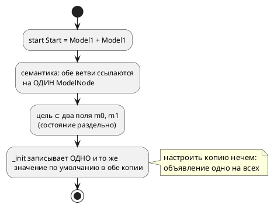
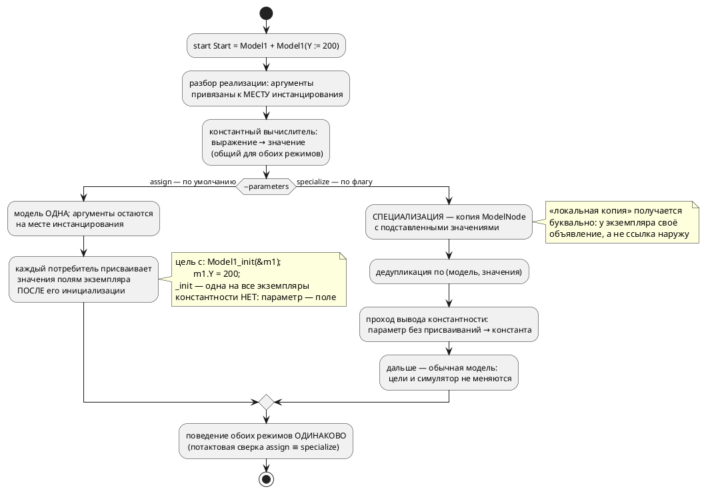

Источник: [docs/features/0185-model-parameters.md](https://github.com/Pastor/Takt/blob/3c154a13d979b18312a1250ebfbe3db2fa5247d3/docs/features/0185-model-parameters.md)

Полный текст по ссылке. Ниже начало карточки.

# Фича: Параметризация моделей (ключевое слово `parameter`)

- **Номер:** 0185
- **Статус:** ГОТОВО
- **Зависит от:** нет
- **Tier:** 1 (приоритет повышен решением заказчика 2026-07-29)
- **Связанные issue (анализ):** запрос заказчика 2026-07-29 (уточнён трижды: форма объявления и аргументы-выражения — 2026-07-29; два режима генерации — 2026-07-30); снимает ограничение О8 анализа [библиотечный ПИД-регулятор и пример его применения](0182-pid-library-and-application.md) («параметризации моделей нет»)

## Стадии жизненного цикла

Все стадии — **разделы этой карточки**: «Архитектура (ADR)»,
«Анализ», «Разработка», «Тест-план», «Отчёт о тестировании», «Итог».
Отдельным артефактом остаются только исправления —
[`docs/fixes/`](../fixes/README.md) (при необходимости `0185-YY-*`).

## Краткое описание

Ввести в язык **параметры модели** — третью форму объявления наряду с `var` и
`const`:

```takt
model Model1 {
    var X: u8 := 100;         // обычная переменная: задаётся только внутри
    parameter Y: u8 := 100;   // параметр: значение по умолчанию 100,
}                             // но его можно задать в месте инстанцирования

start Start = Model1 + Model1(Y := 200);
```

Первая копия работает со `100`, вторая — с `200`.

**Пять уточнений заказчика, определяющих форму** (2026-07-29 и 2026-07-30):

1. `parameter` — **самостоятельное ключевое слово**, а не спецификатор при `var`.
   Формы `var parameter` не существует.
2. **Отдельной константной формы нет.** Константность выводится **семантически**:
   параметр, который нигде в модели не изменяется, есть константа (и может
   эмитироваться как константа); параметр, которому присваивают, — переменная с
   заданным начальным значением.
3. `parameter` — **локальная копия**. Значение вычисляется в месте
   инстанцирования и копируется в экземпляр; связи с внешним объявлением у него
   нет, и изменение внутри модели наружу не видно.
4. **Аргумент инстанцирования — константное выражение, а не только число.**
   Допустимы арифметика над именами, литералы длительности и вызовы
   **константных функций** — функций, вычислимых на этапе компиляции
   (генерации):

   ```takt
   start Start = Model1(X := Y + 1, C := 5s, D := calculate_parameter(U + 67));
   ```

   Здесь `X`/`C`/`D` — параметры `Model1`, а `Y`/`U` — константные имена,
   видимые в месте инстанцирования; `calculate_parameter(U + 67)` вычисляется
   компилятором, и параметр `D` получает готовое значение. Ссылка на величину
   времени исполнения (переменную, порт) остаётся ошибкой.
5. **Два режима генерации, выбираемые флагом** (уточнение 2026-07-30):

   ```sh
   taktc compile --parameters=assign     …   # по умолчанию
   taktc compile --parameters=specialize …   # копия модели на каждую настройку
   ```

   - **`assign` — умолчание и основной способ.** Модель одна, значения
     присваиваются полям **конкретного экземпляра сразу после его
     инициализации**; в цели `c` функция `_init` — **одна на все экземпляры**.
     Это заметно проще. **Цена принята осознанно: константностью в этом режиме
     приходится пренебречь** — параметр всегда поле, и уточнение 2 в выводе
     эффекта не даёт. Как следствие, параметр нельзя употребить там, где нужна
     compile-time величина (`after PARAM`, размер массива, бит адреса): это
     диагностика, **называющая режим**, а не молчаливая деградация.
   - **`specialize` — по флагу.** Модель **копируется** на каждый различный
     набор значений: свои `_init` в цели `c`, свои `FUNCTION_BLOCK` в `st`,
     дедупликация одинаковых наборов — и тогда параметр без присваиваний
     эмитируется **константой**.

   Режим меняет **форму** вывода, но не поведение: одна программа под обоими
   режимами обязана давать одинаковую потактовую трассу. Это главный контроль
   решения.

> Фича зарегистрирована **по запросу заказчика 2026-07-29**; синтаксис и
> семантика заданы им же. Жизненный цикл по своду пройден полностью:
> заказчик просил проработку до стадии разработки, затем разработка была
> выполнена девятью задачами и фича закрыта.

## Что известно на входе (пробы 2026-07-29)

- **Синтаксис аргументов уже разбирается.** `Model1(Y := 200)` в выражении
  реализации грамматика принимает как `Function(M, [Assign(y, 200)])` — отвергает
  его **семантика** (`extend.rs`: «Выражение AST расширения не поддерживается»,
  причём диагностика **без кода**). То есть правки грамматики выражений, скорее
  всего, не требуется вовсе — работа в разборе реализации.
- **`parameter` — не ключевое слово:** объявление даёт `SY-002`. Новый токен
  обязывает пройти (LSP + плагины редакторов).
- **Раздельность экземпляров уже есть.** `M | M` даёт в цели `c` два поля
  (`TwiceM m0; TwiceM m1;`), в симуляторе — два узла в `--save-state`. Не хватает
  ровно одного: **разных начальных значений**.
- **Константа модели в цели `c` — макрос на модель**, а не поле экземпляра
  (`#define CONST_CST_M_K 7`), тогда как в цели `st` — поле FB
  (`K : USINT := 7`). Значит параметр, выведенный как константа, с разными
  значениями у двух копий требует **разных моделей** в кодогене.
- **Анализа изменяемости в семантике НЕТ.** `semantic::unused` считает только
  использования (`UsageSet`), «присваивают ли переменной» не отслеживает нигде.
  Вывод константности (уточнение 2) — **новый проход**, а не переиспользование.
- **Вычисления функций при компиляции НЕТ нигде.** В компиляторе есть два
  **узких** константных вычислителя: адресные выражения
  ([инъекция define'ов для адресов (--define)](0042-address-defines.md) — имена + целочисленная арифметика) и
  константные выдержки `after` ([`after` принимает константу типа `duration`, а не только литерал](0143-after-const-duration.md) —
  длительности, предел глубины 32, отказ `SE-072` с названной причиной). Вызов
  функции не вычисляет ни один. Уточнение 4 (константные функции) требует
  **третьего, более широкого вычислителя** — при том что семантика вычислений
  по инварианту живёт в `takt-sim/src/eval/`: вычислитель в компиляторе —
  второй интерпретатор, его расхождение с симулятором надо контролировать сверкой
  значений.
- **Версия языка 0.7.0 выпущена** (тег `v0.7.0`), поэтому фича поднимает её до
  **0.8.0**.

## Принятое решение

**Гибрид по флагу генерации** (Option E [ADR](0185-model-parameters.md#архитектура-adr),
редакция 2026-07-30): умолчание — присваивание полю экземпляра (`assign`),
специализация модели (`specialize`) — по флагу. Прежняя редакция ADR принимала
безусловную специализацию; заказчик заменил её гибридом ради простоты
умолчания, приняв отказ от константности в принятом по умолчанию режиме.

Порядок разработки следует из этого выбора: **сначала умолчание** (0185-04 —
флаг и потребление аргументов пятью потребителями), затем специализация
(0185-05) и вывод константности (0185-06), затем сверка режимов (0185-07).

## Документирование

**Требуется.** Фича меняет **лексику** (новое ключевое слово `parameter`),
**синтаксис** (аргументы при инстанцировании) и **семантику** (значение
объявления зависит от места использования; константность выводится).
Затрагиваются разделы:

- [`02-lexical`](../../book/src/02-lexical/index.typ) — новое ключевое слово;
- [`04-models-states`](../../book/src/04-models-states/index.typ) — **отдельная
  секция «Параметризация моделей»** (требование заказчика 2026-07-29):
  объявление, инстанцирование, **оба режима генерации и граница между ними**,
  вывод константности, «локальная копия» и граница «настройка сборки vs величина
  такта»;
- [`09-imports`](../../book/src/09-imports/index.typ) — параметры при композиции;
- [`19-library`](../../book/src/19-library/index.typ) — **снимается оговорка**
  «настройку нельзя задать снаружи»;
- приложения «Ошибки и предупреждения», «Грамматика» и перечень флагов CLI
  (`--parameters=`).

## Архитектура (ADR)

- **Status:** Accepted (решение пересмотрено 2026-07-30: вместо безусловной
  специализации принят гибрид по флагу генерации — см. Decision)
- **Date:** 2026-07-29, ред. 2026-07-30
- **Authors:** Архитектор + Аналитик
- **Related issues:** [Фича](0185-model-parameters.md); снимает ограничение О8 [анализа 0182](0182-pid-library-and-application.md#анализ); опирается на [ADR](0026-c-root-typedef.md#архитектура-adr) (структуры цели `c`), [ADR](0045-sv-backend.md#архитектура-adr) (уплощение композиции), [ADR](0184-imported-shared-variables.md#архитектура-adr) (усыновление импортированного поддерева)

### Context

Модель в Takt переиспользуема лишь наполовину: её можно подключить импортом и
поставить в композицию несколько раз, но **настроить каждую копию по-своему
нечем**. Всё, что объявлено внутри модели, одинаково у всех копий; всё, что
вынесено наружу, перестаёт быть её частью.

Цена видна на свежем примере. Библиотечный ПИД
([`examples/pid_law.takt`](../../examples/pid_law.takt)) держит
коэффициенты внутри модели — и раздел документа честно пишет, что другая
настройка означает **правку библиотеки либо её копию**. Два контура с разной
настройкой в одной системе сегодня требуют двух файлов с одинаковым текстом.

#### Форма, заданная заказчиком (2026-07-29, с уточнениями; последнее — 2026-07-30)

```takt
model Model1 {
    var X: u8 := 100;          // переменная: живёт только внутри
    parameter Y: u8 := 100;    // параметр: 100 по умолчанию, задаётся извне
}

start Start = Model1 + Model1(Y := 200);
```

Пять положений уточнений обязательны для решения:

1. **`parameter` — самостоятельное ключевое слово**, третья форма объявления
   наряду с `var` и `const`. Формы `var parameter` не существует.
2. **Константной формы нет.** Константность выводится семантически: параметр, не
   изменяемый в теле модели, есть константа; изменяемый — переменная с заданным
   начальным значением. Автор не обязан выбирать, компилятор видит это сам.
3. **`parameter` — локальная копия.** Значение вычисляется в месте
   инстанцирования и копируется в экземпляр; связи с внешним объявлением нет, и
   изменение внутри модели наружу не видно.
4. **Аргумент — константное выражение, а не только число** (уточнение
   2026-07-29, второе):

   ```takt
   start Start = Model1(X := Y + 1, C := 5s, D := calculate_parameter(U + 67));
   ```

   Допустимы арифметика над константными именами, литералы длительности и вызов
   **константной функции** — функции, вычислимой на этапе компиляции
   (генерации). Константность функции, как и константность параметра
   (положение 2), **выводится**, а не объявляется: функция константна, если её
   результат вычислим из одних аргументов и констант — она не читает переменные
   и порты и не зовёт `extern fn`. Невычислимый аргумент — диагностика с
   **названной** причиной (образец — `SE-072` фичи), не молчаливый ноль.
5. **Два режима генерации, выбираемые флагом** (уточнение 2026-07-30, третье):

   ```sh
   taktc compile --parameters=assign     …   # по умолчанию
   taktc compile --parameters=specialize …   # копия модели на каждую настройку
   ```

   **`assign` — режим по умолчанию.** Модель одна; аргументы вычисляются при
   компиляции и **присваиваются полям конкретного экземпляра сразу после его
   инициализации**. В цели `c` это буквально `Model1_init(&self->m1);
   self->m1.Y = 200;` — функция `_init` **одна на все экземпляры**. Это заметно
   проще, и заказчик выбрал простоту умолчанием. **Цена принята им осознанно:
   константность в этом режиме не выражается** — параметр всегда поле
   экземпляра, и положение 2 эффекта в выводе не даёт.

   **`specialize` — режим по флагу.** `M(Y := 200)` порождает **копию** модели с
   подставленными значениями: свои `_init` в цели `c`, свой `FUNCTION_BLOCK` в
   `st`, и параметр без присваиваний эмитируется **константой**.

   **Режим меняет форму вывода, но не поведение.** Одна и та же программа под
   обоими режимами обязана давать одинаковую потактовую трассу; это контроль
   решения, а не пожелание.

#### Что уже есть, а чего нет (пробы 2026-07-29)

| Факт | Проба | Следствие для решения |
|---|---|---|
| `Model1(Y := 200)` **разбирается** грамматикой как `Function(M, [Assign(y, 200)])` | компиляция входа из двух строк | правки грамматики выражений не нужны; работа — в `semantic/extend.rs` |
| объявление `parameter Y …` не разбирается (`SY-002`) | то же | новый токен → лексер, грамматика объявления, свод |
| `M \| M` уже даёт **раздельные** экземпляры: `TwiceM m0; TwiceM m1;`, два узла в `--save-state` | цель `c` + симулятор | инфраструктура копий есть; не хватает **разных начальных значений** |
| константа модели в цели `c` — `#define CONST_CST_M_K 7` (**на модель**), в цели `st` — поле FB | сравнение выводов | параметр, выведенный константой, с разными значениями требует **разных моделей** |
| анализа изменяемости в семантике **нет** (`UsageSet` считает только использования) | чтение `semantic/unused.rs` | вывод константности — **новый проход**, а не даровая проверка |
| вычисления **функций** при компиляции нет; есть два узких вычислителя — адреса (0042) и выдержки `after` (0143) | чтение `address_map/eval.rs`, `semantic/condition/after_const.rs` | аргумент-вызов функции → **третий вычислитель**, побитово согласный с `takt-sim/eval` |

#### Поток «как есть»



#### Целевой поток



### Decision Drivers

1. **Простота умолчания.** Обычному автору нужен настраиваемый **экземпляр**, а
   не размноженные модели. Умолчание обязано быть простым в реализации и
   предсказуемым в выводе; всё, что сложнее, включается явно.
2. **Пять потребителей дерева.** Симулятор и пять целей читают одно
   семантическое дерево. Урок: механизм, требующий правки в каждом из них,
   расходится молча. Механизм, который такой правки требует, обязан нести
   **сверку** — иначе он расходится молча и здесь.
3. **«Локальная копия» — требование заказчика,** а не деталь реализации.
   Изменение параметра в одном экземпляре не видно ни другому экземпляру, ни
   внешнему объявлению. Каким средством это достигнуто — копией объявления или
   полем экземпляра — заказчику безразлично; **свойство** обязательно.
4. **Выведенная константа требует копии модели.** В цели `c` константа
   печатается макросом **на модель**; значит две настройки константой выразимы
   только двумя моделями. Отсюда не следует «всегда копировать» — следует
   «константность доступна там, где копия есть».
5. **Детерминизм вывода** (0048). Имена специализаций зависят только от входа, а
   не от порядка обхода: иначе два прогона дадут разный код.
6. **Обратная совместимость.** Модели без параметров обязаны
   компилироваться байт-в-байт как раньше — **в обоих режимах**.
7. **Честная граница «настройка vs величина такта».** Параметр задаётся при
   сборке автомата; переменная меняется в такте. Язык обязан их различать, а не
   полагаться на дисциплину автора.
8. **Режим — свойство вывода, а не программы.** Флаг генерации вправе менять
   **форму** порождённого кода, но не его поведение (граница из 0042; прецедент
   осознанного исключения — `--float-as-q` фичи). Значит гибрид законен
   ровно до тех пор, пока режимы сверяются потактово.

### Considered Options

#### Option A. Специализация на месте инстанцирования (мономорфизация)

`M(Y := 200)` порождает **копию** `ModelNode` с подставленными значениями и
детерминированным именем; копии с одинаковым набором значений дедуплицируются.
Дальше в дереве стоит обычная модель, и ни цели, ни симулятор о параметрах не
знают.

**Pros:**
- «локальная копия» получается **буквально**: у экземпляра своё объявление
  (драйвер 3);
- выведенная константа остаётся compile-time — макрос печатается на
  специализацию (драйвер 4);
- цели и симулятор правок почти не требуют: задача решена в семантике, до них
  (драйвер 2);
- открывает дорогу к параметризации **размеров** (ширина вектора, длина
  массива) — не в этой фиче, но без потери такой возможности;
- потактовая сверка возможна сразу: специализация — обычная модель.

**Cons:**
- растёт число моделей в выводе: две настройки — две структуры в C;
- имена специализаций видны в порождённом коде — обязаны быть стабильными,
  читаемыми и детерминированными;
- дедупликация обязана быть по **значениям**, иначе `M(Y := 200)` в двух местах
  даст две одинаковые копии;
- **дороже в реализации**, чем присваивание полю: копирование дерева, схема
  имён, дедупликация — код, которого нет вовсе.

#### Option B. Аргументы экземпляра (значения инициализации без копии модели)

`Extend::Model` несёт список аргументов; модель одна, значения присваиваются
полям **конкретного экземпляра сразу после его инициализации** (в цели `c` —
`Model1_init(&self->m1); self->m1.Y = 200;` при **одной** `_init` на все копии,
в `st` — присваивание полям экземпляра FB, в симуляторе — при построении `Unit`).

**Pros:**
- **заметно проще**: ни копий дерева, ни схемы имён, ни дедупликации — значение
  ложится в уже существующее поле (драйвер 1);
- вывод компактнее: одна структура и одна `_init` на модель независимо от числа
  настроек;
- привычная «инстанциация с аргументами», предсказуемая по форме вывода;
- «локальная копия» (драйвер 3) выполняется **свойством поля**: поле принадлежит
  экземпляру, изменение другому экземпляру не видно.

**Cons:**
- параметр, выведенный **константой**, невыразим: в цели `c` константа — макрос
  на модель, а модель одна. Положение 2 уточнения в этом режиме **эффекта в
  выводе не даёт**;
- следствие того же: `parameter` **нельзя употребить там, где язык требует
  compile-time величины** — `after PARAM` (0143), размер массива, бит адреса
  порта;
- править нужно **все** пять потребителей — тот класс работы, где 0184 показал
  молчаливое расхождение (драйвер 2).

#### Option C. Гибрид по признаку изменяемости: изменяемые параметры — по B, выведенные константы — по A

**Pros:** компактный вывод там, где параметр всё равно поле.
**Cons:** форма порождённого кода начинает зависеть от того, присваивают ли
параметру **где-то в теле**, — то есть невинная правка тела меняет структуру
вывода. Для пользователя это непредсказуемо, для тест-плана — удвоение.
Отвергается. Не путать с Option E: там режим выбирает **человек флагом**, и
правка тела форму вывода не меняет.

#### Option D. Не вводить параметры; настройка — копией файла

**Pros:** нулевая стоимость.
**Cons:** оставляет в силе ограничение, ради снятия которого фича заведена;
копия библиотеки — известный источник расхождений.

#### Option E. Гибрид по флагу генерации: B по умолчанию, A по `--parameters=specialize`

Оба механизма реализуются; какой применить — решает **флаг генерации**, единый
на прогон. Умолчание — B (просто, компактно, без константности); A включается
явно там, где нужны compile-time значения.

**Pros:**
- умолчание простое (драйвер 1), а сложная машинерия не навязана тем, кому она
  не нужна;
- константность (драйвер 4) не отменена, а **отложена до флага** — уточнение 2
  остаётся в языке целиком;
- «локальная копия» (драйвер 3) обеспечивается в обоих режимах, разными
  средствами;
- флаг меняет форму, а не поведение (драйвер 8) — и это **проверяемо**.

**Cons:**
- **два пути кодогена вместо одного** — главная цена: они обязаны совпадать по
  поведению, а совпадение двух реализаций одного смысла в этом проекте уже
  расходилось молча (0042: «арифметика — в одном месте»; 0090: два источника
  истины у проверок);
- тест-план удваивается по всем критериям, где форма вывода различна;
- пользователь обязан **знать про флаг**: не включил — не получил константы;
  включил без нужды — распух вывод. Смягчается диагностикой (см. решение, п. 8).

### Decision

Принимается **Option E** — гибрид по флагу генерации: **`--parameters=assign` по
умолчанию, `--parameters=specialize` по требованию** (решение заказчика
2026-07-30). Прежняя редакция ADR принимала Option A безусловно; она заменена.

Механизм фиксируется так:

1. **Объявление.** `parameter ИМЯ: ТИП := ЗНАЧЕНИЕ;` — третья форма наряду с
   `var` и `const`. Инициализатор **обязателен**: это значение по умолчанию.
   (Обязательные параметры без умолчания — отдельная фича, если понадобятся.)
2. **Место объявления — только модель.** Параметр верхнего уровня файла
   инстанцировать нечем — явная диагностика.
3. **Инстанцирование.** `M(ИМЯ := ВЫРАЖЕНИЕ, …)` в выражении реализации: в
   композиции (`+`, `|`), в реализации состояния (`state S = M(…)`) и в корне
   (`start S = M(…)`). Значение — **константное выражение**, вычислимое при
   компиляции; ссылка на величину времени исполнения — ошибка. Константное
   выражение — это (положение 4 уточнения): литералы (число, бит, длительность —
   `5s` пересчитывается по правилам), имена констант, видимых в месте
   инстанцирования, арифметика над ними и вызовы **константных функций**
   (`D := calculate_parameter(U + 67)`), вычисляемые компилятором до значения.
   Константность функции выводится по её телу (
