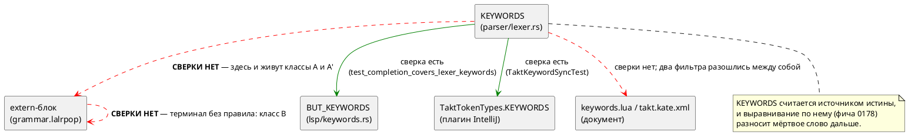

Источник: [docs/features/0201-dead-lexemes.md](https://github.com/Pastor/Takt/blob/3c154a13d979b18312a1250ebfbe3db2fa5247d3/docs/features/0201-dead-lexemes.md)

Полный текст по ссылке. Ниже начало карточки.

# Фича: Мёртвая лексика: слова и терминалы, которых грамматика не знает

- **Номер:** 0201
- **Статус:** ГОТОВО
- **Зависит от:** нет (проставлено аналитиком)
- **Связанные issue (анализ):** кандидат блока 2 `FEATURES.md`, переведён в фичу-03 (запрос заказчика)

## Стадии жизненного цикла

Все стадии — **разделы этой карточки**: «Архитектура (ADR)»,
«Анализ», «Разработка», «Тест-план», «Отчёт о тестировании», «Итог».
Отдельным артефактом остаются только исправления —
[`docs/fixes/`](../fixes/README.md) (при необходимости `0201-YY-*`).

## Краткое описание

Лексер знает лексемы, которых грамматика не использует. Кандидат называл одну —
`string`; проба стадии архитектуры нашла **пять** в трёх классах. Подробности
находки, замеры и оговорки — в разделах «Что известно на входе» и «Что показала
проба»; форма решения — в [ADR](0201-dead-lexemes.md#архитектура-adr).

> Фича зарегистрирована **из бэклога кандидатов** (запрос заказчика 2026-08-03:
> перевести кандидатов в фичи без проработки); далее проходит жизненный цикл по
> своду. Заголовок и объём расширены на стадии архитектуры по решению
> заказчика (2026-08-04): прежнее имя `dead-keyword-string` описывало частный
> случай.

## Что известно на входе

> Фича заведена **из кандидата** блока 2 `FEATURES.md` (запрос заказчика
> 2026-08-03: перевести кандидатов в фичи без проработки). Проработка —
> стадии 2–3 жизненного цикла; ниже — запись кандидата **как есть**, вместе с
> замерами и оговорками, сделанными при его заведении.
>
> Замеры кандидата **не перепроверялись** при переводе в фичу: их
> актуальность подтверждает пробой стадия архитектуры (урок — записи
> кандидатов устаревают, и две из них оказались неверны).

**Класс:** синтаксис языка (Tier 1 — приоритет по решению заказчика
2026-08-03: синтаксис → семантика → генерация → остальное).

**`string` — мёртвое ключевое слово: лексер знает, грамматика не использует.**
Проба стадии архитектуры [подсветка имён типов отдельным цветом в LSP и плагинах](0196-editor-type-highlighting.md)
(2026-08-02): `var s: string := "x";` даёт `SY-002` («нераспознанный токен
'string'»), а грепом по `grammar.lalrpop` `Token::String` не находится ни в
одном правиле. При этом слово занимает место в таблице `KEYWORDS` лексера, в
списке автодополнения LSP (`BUT_KEYWORDS`), в подсказках как «строковый тип»
и в `KEYWORDS` плагина IntelliJ — то есть четыре места обещают возможность,
которой в языке **нет**. Дефект **громкий** (отказ разбора), молчаливой
потери нет. Решение — за заказчиком: либо ввести строковый тип, либо изъять
слово из лексера и всех списков. В объём 0196 сознательно не взято:
подсветка — слой редактора, а это изменение **языка** (рост
версии).

## Что показала проба (стадия архитектуры, 2026-08-04)

Запись кандидата описывала **частный случай**. Сверка таблицы `KEYWORDS`
лексера с extern-блоком грамматики и обход всех 93 терминалов дали **пять**
мёртвых лексем трёх классов:

| Класс | Лексема | Состояние |
|---|---|---|
| A — слово в `KEYWORDS`, в extern-блоке грамматики **отсутствует** | `string` | `SY-002` при употреблении |
| A | **`template`** | `SY-002`; механизма шаблонов в языке нет вовсе |
| A′ — вариант `Token` есть, лексер его **никогда не производит** | **`pragma`** | недостижим вместе со всем механизмом: `pragma_value()`, поле `last_tokens`, обёртка `Iterator::next` |
| B — терминал объявлен в extern, но не используется ни одним правилом | `==` | изъят из языка фичей |
| B | `-->` (`Token::PeirceArrow`) | LTL-импликация пишется `->` |

Три поправки к записи кандидата:

1. **Мест, обещающих `string`, не четыре, а шесть**, и hover среди них **нет**:
   он работает по `BUT_BUILTIN_TYPES` и ключевые слова не обслуживает. Зато
   есть два фильтра подсветки документа, и они **расходятся** — `book/keywords.lua`
   считает `string` ключевым словом, `book/takt.kate.xml` — **типом**.
2. **`SY-002` несёт позицию** (`2:12`) — запись кандидата этого не отрицала, но
   выигрыш изъятия не в появлении позиции, а в существе сообщения: вместо
   «нераспознанный токен» со списком ожидаемых терминалов приходит `SE-034`
   «Локальный тип 'string' не найден».
3. **Дефект распространяется сам.** `CHANGES.md` фиксирует, что `template` и
   `string` попали в редакторские списки фичей — **автоматическим
   выравниванием по `KEYWORDS`**. Сверки `KEYWORDS` ↔ грамматика нет ни одной;
   обе существующие принимают `KEYWORDS` за истину.

## Документирование

Фича меняет **язык**: пять лексем перестают быть зарезервированными, имена
`string` и `template` освобождаются под идентификаторы, диагностика на них
меняется с `SY-002` на `SE-034`. Затронут раздел
[`book/src/02-lexical/`](../../book/src/02-lexical/index.typ) — таблица
зарезервированных слов: убрать `template` из строки «Объявления» и `string` из
строки «Прочие». Заодно приводятся в согласие фильтры подсветки документа
(`book/keywords.lua`, `book/takt.kate.xml`), сегодня расходящиеся между собой.

Новых конструкций язык не получает, поэтому новых примеров на Takt раздел не
требует. Эталон `Takt.ebnf` **в объём не входит**: его список ключевых слов
устарел широко и независимо — это фича
[синхронизация эталона `Takt.ebnf` с актуальным синтаксисом](0160-takt-ebnf-sync.md).

## Архитектура (ADR)

- **Status:** Accepted
- **Date:** 2026-08-04
- **Authors:** Архитектор + Заказчик (решения по объёму и направлению — 2026-08-04)
- **Related issues:** [Фича](0201-dead-lexemes.md); смежные — [ADR](0021-swap-assign-compare.md#архитектура-adr) (изъятие `==` из языка), [ADR](0178-editor-layer-language-sync.md#архитектура-adr) (согласование редакторского слоя с языком)

### Context

Лексер языка Takt держит таблицу `KEYWORDS` (48 записей) — она считается
источником истины о ключевых словах: по ней выравниваются список
автодополнения LSP, список плагина IntelliJ и фильтры подсветки документа.
Грамматика (`takt-lang/src/grammar.lalrpop`) объявляет свой набор терминалов в
extern-блоке (93 записи). **Сверки между этими двумя множествами нет ни
одной** — обе существующие сверки (`test_completion_covers_lexer_keywords`,
`TaktKeywordSyncTest`) идут от `KEYWORDS` наружу, к редакторскому слою.

Кандидат блока 2 `FEATURES.md` называл одно расхождение: `string`. Проба
стадии архитектуры (обход всех 48 слов и всех 93 терминалов) нашла **пять**
мёртвых лексем в трёх классах:

| Класс | Лексема | Чем мертва |
|---|---|---|
| **A** — слово в `KEYWORDS`, в extern-блоке грамматики отсутствует | `string` | употребление → `SY-002` |
| **A** | `template` | употребление → `SY-002`; механизма шаблонов в языке нет вовсе |
| **A′** — вариант `Token` есть, лексер его не производит **никогда** | `pragma` | слова нет в `KEYWORDS`, поэтому недостижим и он, и весь его механизм |
| **B** — терминал объявлен в extern, ни одним правилом не используется | `==` | изъят из языка фичей |
| **B** | `-->` (`Token::PeirceArrow`) | LTL-импликация пишется `->` |

#### Чем это плохо

Отказ разбора **громкий**, молчаливой потери нет — и этим дефект отличается от
большинства разбираемых проектом. Цена в другом.

**Лексема обещает возможность, которой в языке нет.** `string` занимает место в
шести местах, и в одном из них — с описанием «строковый тип» в автодополнении
LSP; `template` — с описанием «объявление шаблона». Автор видит слово в списке
дополнения, пишет его и получает отказ разбора.

**Обещание расходится само с собой.** Два фильтра подсветки документа
классифицируют `string` по-разному: `book/keywords.lua` — ключевое слово,
`book/takt.kate.xml` — **тип** (в одном списке с `q` и `rational`).

**Дефект размножается механически.** `CHANGES.md` фиксирует, что `template` и
`string` попали в редакторские списки фичей — **автоматическим
выравниванием по `KEYWORDS`**. Пока `KEYWORDS` считается истиной, а сверки с
грамматикой нет, каждая следующая правка редакторского слоя будет разносить
мёртвое слово дальше. Это и есть главный мотив фичи: удалить пять строк
дёшево, но без контроля шестая придёт тем же путём.

**Класс A′ вдобавок несёт цену на такте разбора.** Страж `Iterator::next`
проверяет `last_tokens` на **каждом** токене ради ветви, которая не может
сработать; поле обновляется тоже на каждом токене.

#### Что показала проба

Пробы прогонялись настоящим `taktc` на файлах-зондах; для класса B собраны
**две редакции грамматики** (с терминалом в extern и без).

| № | Вход | Результат |
|---|---|---|
| P1 | `var s: string := "x";` | `SY-002` в `2:12`: «нераспознанный токен 'string', ожидалось identifier, "[", "X", …» |
| P2 | `template T;` | `SY-002` в `2:5`, список ожидаемых — 31 терминал |
| P3 | `a == b`, **две редакции** | первая диагностика **байт-в-байт одинакова**; с терминалом в extern добавляется **вторая, каскадная** — `SY-002` на `}` |
| P4 | `a --> b`, **две редакции** | то же, что P3 |
| P5 | `var string: u8 := 1;` | `SY-002` — имя занято словом |
| P6 | `var bit: u8 := 1;` | **компилируется** — эталон: имя встроенного типа как идентификатор законно |
| P7 | `var pragma: u8 := 1;` | **компилируется** — `pragma` уже обычный идентификатор |
| P8 | `pragma solidity 0.8;` | `SY-002` — директива грамматикой не принимается |

**P3/P4 опровергли рабочую гипотезу.** Ожидалось, что объявление `==` в
extern-блоке — намеренное «надгробие» фичи: терминал объявлен, чтобы
отказ на изъятом операторе был внятным. Замер это не подтвердил: сообщение о
самой ошибке **не меняется**, а объявление добавляет **каскадную** вторую
диагностику — следствие первой, а не второй дефект. Фича накапливает
диагностики ради **разных** ошибок за прогон; каскад по одной причине — шум.

**P6/P7 задают эталон решения.** Имя встроенного типа (`bit`) и имя `pragma`
уже сегодня законны как идентификаторы, потому что ключевыми словами не
являются. Это ключ к дешевизне изъятия: типы в грамматике — **обычные
идентификаторы** (`Type: Alias(Identifier)`), а `bit`, `bool`, `u8`, `q`
намеренно не в `KEYWORDS`. Именно статус ключевого слова и блокирует `string`.

#### Где место проверке

Расхождение существует между **двумя таблицами внутри компилятора**, поэтому
проверке место там же, а не в редакторском слое и не в CI-скрипте: оба
удалены от источника и оба уже показали, что дефект переживают.

### Decision Drivers

1. **Обещание языка обязано быть исполнимым.** Слово в списке автодополнения —
   это обещание; отказ разбора на нём — дефект доверия к инструменту, даже
   когда он громкий.
2. **Один источник истины.** Проект последовательно сводит расходящиеся
   представления одного знания в одну точку (0084, 0143, 0187, 0192, 0193,
   0195). Здесь их два — `KEYWORDS` и extern-блок, — и они разошлись.
3. **Класс закрывается контролем, а не правкой.** Пять строк удаляются за
   минуту; без машинной сверки шестая придёт тем же автоматическим
   выравниванием, каким пришли эти.
4. **Решение не должно закрывать дорогу строковому типу.** Если язык однажды
   получит строки, изъятие слова не должно этому мешать.
5. **Замер вместо чтения.** Судьбу класса B решает проба на двух редакциях
   грамматики, а не рассуждение о намерениях фичи.

### Considered Options

#### Option A. Изъять мёртвые лексемы; завести сверку `KEYWORDS` ↔ грамматика

Удалить `string`, `template`, `pragma` из лексера **полностью** (вариант
`Token`, запись `KEYWORDS`, ветвь `Display`, ветвь `semantic_tokens`) и из всех
списков, обещающих их пользователю. Удалить недостижимый механизм `pragma`.
Удалить терминалы `==` и `-->` из extern-блока. Завести тест, сверяющий
`all_keywords()` с терминалами грамматики в обе стороны.

**Pros:**
- Обещание и возможность сходятся: ни одно слово списка не даёт отказа разбора.
- `var s: string;` начинает давать `SE-034` «Локальный тип 'string' не найден» —
  сообщение по существу вместо «нераспознанный токен» со списком из 8 терминалов.
- Имена `string` и `template` освобождаются под идентификаторы — как `bit`
  сегодня (P6).
- Каскадная вторая диагностика на `==`/`-->` исчезает (P3/P4).
- Уходит недостижимый код и проверка `last_tokens` на каждом токене.
- Строковый тип позже вводится **одной строкой** в `builtin_type_by_name` —
  ровно как `duration` в 0134.
- Контроль закрывает класс, а не случай.

**Cons:**
- Слома нет, но формально язык меняется — требуется запись в анализе
  и правка документа.
- Контроль читает грамматику текстом (`include_str!`) — привязка к форме файла,
  а не к разобранному дереву.
- Осознанные исключения придётся оформлять списком, а список — место, куда
  легко спрятать пропуск (та же оговорка, что у `COMPLETION_EXCLUDED`).

#### Option B. Ввести настоящий строковый тип

Сделать `string` рабочим типом языка: представление (длина, память без
аллокации для МК), отображение в шесть целей, исполнение в эталоне,
потактовые сверки.

**Pros:**
- Обещание исполняется буквально: слово начинает означать то, что написано в
  автодополнении.
- Внутренний `TypeNode::BuiltinString` уже существует (тип параметра `debug`),
  то есть точка входа есть.

**Cons:**
- Не решает задачу: `template`, `pragma`, `==`, `-->` остаются мёртвыми, а
  сверки как не было, так и нет.
- Цена несопоставима с находкой: в SystemVerilog строки не синтезируются, в
  `rust` под `no_std` и в ST это отдельные подсистемы.
- Для DSL конечных автоматов ценность сомнительна: сегодня строка нужна только
  `debug` и путям `import` — и там она уже работает **литералом**, без типа.

#### Option C. Статус-кво + запись в документ

Оставить лексемы, но описать в документе, что они зарезервированы «на будущее».

**Pros:**
- Нулевая цена правки; резерв имени под будущую конструкцию сохраняется.

**Cons:**
- Обещание остаётся неисполнимым, а расхождение фильтров подсветки — неснятым.
- Резерв ничего не резервирует: типы в языке — обычные идентификаторы, поэтому
  ввести `string` типом можно и **не** держа его ключевым словом (P6 — эталон
  `bit`).
- Сверки по-прежнему нет: следующее мёртвое слово придёт тем же путём.

### Decision

Принимается **Option A** — рекомендация архитектора и решение заказчика
(2026-08-04) совпали. Заказчиком отдельно решено: `template` берётся **в объём
0201**, терминалы `==`/`-->` **разбираются в 0201**.

Класс A′ (`pragma`) найден **после** этих решений и включается по тому же
основанию: это та же болезнь на уровень глубже — лексема, которой не знает уже
не грамматика, а сам лексер.

Судьба класса B решена **замером, а не намерением**: гипотеза «объявление
`==` — намеренное надгробие 0021» опровергнута пробами P3/P4. Сообщение об
ошибке от объявления не зависит, а сама ошибка получает лишнюю каскадную
спутницу. Оба терминала удаляются.

Специальной диагностики на изъятые лексемы **не заводится** — по прецеденту
[смена операторов — `<=` для присваивания, `=` для сравнения](0021-swap-assign-compare.md) отказ возникает естественно и проверяется контрпримером.

### Consequences

#### Положительные

- Ни одно слово из `KEYWORDS` не обещает несуществующей конструкции.
- `var s: string;` и `var t: template;` дают `SE-034` — диагностику по существу.
- `var string: u8;` и `var template: u8;` становятся законными; имена свободны.
- Каскадная вторая диагностика на `a == b` и `a --> b` исчезает.
- Из лексера уходит недостижимый механизм и проверка на каждом токене.
- Класс закрыт машиной: новая мёртвая лексема валит сборку.

#### Отрицательные / Action items

- **Язык меняется, но версия не поднимается.** Цикл `0.8.0` открыт и не
  выпущен, а по своду версия накапливается по циклам. На этих граблях
  проект наступал дважды (ADR и 0187 писали «`0.8.0 → 0.9.0`» ошибочно).
  Факт изменения языка обязан быть зафиксирован в анализе.
- **свод: редакторский слой.** Правки нужны в `lsp/keywords.rs`,
  `lsp/semantic_tokens.rs` и в плагине IntelliJ. `TaktKeywordSyncTest`
  сверяет на **равенство** и в `precheck.sh`/CI **не входит** — гонять вручную.
  Плагин Zed своих списков не ведёт; ответ «правок не требует» фиксируется.
- **свод: документ.** Таблица зарезервированных слов
  `book/src/02-lexical/`, плюс приведение в согласие `book/keywords.lua` и
  `book/takt.kate.xml`.
- **Тесты с жёсткими списками покраснеют** (`lexer_tests.rs`,
  `lexer_tests/part2.rs`) — их правка есть часть работы.
- **`Takt.ebnf` в объём не входит.** Его список ключевых слов устарел широко
  и независимо (нет `template`, `while`, `match`, `at`, `after`, `every`,
  `parameter`, `address`, …) — это объём фичи; находка передаётся туда.
- Контроль читает грамматику текстом, поэтому обязан вырезать комментарии перед
  счётом употреблений — иначе терминал, упомянутый только в комментарии,
  сойдёт за живой.

#### Acceptance criteria

1. `all_keywords()` не содержит `string` и `template`; вариантов
   `Token::{String, Template, Pragma}` в `parser/token.rs` нет.
2. Терминалов `"=="` и `"-->"` нет в extern-блоке грамматики; `a == b` даёт
   **одну** диагностику вместо двух.
3. `var string: u8 := 1;` и `var template: u8 := 1;` компилируются целью `c`.
4. `var s: string;` даёт `SE-034`, а не `SY-002`.
5. Контроль существует и **краснеет от восстановленного дефекта**: возврат
   `"string" => Token::String` в `KEYWORDS` валит тест (мутационная проверка).
6. Строковые литералы не задеты: `import "…"` и `debug("…")` работают,
   `semantic_tokens_string_literal` зелёный.
7. `./scripts/precheck.sh` — код возврата 0; `./gradlew --offline test` плагина
   IntelliJ зелёный.

## Анализ

### Цель и контекст

ADR принял **Option A**: изъять пять мёртвых лексем и завести машинную сверку
`KEYWORDS` ↔ грамматика. Анализ описывает места правки, границы объёма и
ответы по своду.

Существо решения — в наблюдении пробы P6: **типы в грамматике суть обычные
идентификаторы** (`Type: Alias(Identifier)`), и `bit`, `bool`, `u8`, `q`
ключевыми словами намеренно не являются. Поэтому изъятие не «убирает
возможность», а снимает искусственное препятствие: имя перестаёт быть
зарезервированным и начинает вести себя как всякое другое.

### Зависимости фичи

- **Зависит от:** `нет`. Правка локальна для лексера, грамматики,
  редакторского слоя и документа; ни одна незакрытая фича её не блокирует.
- **Влияние на порядок разработки:** ничего не разблокирует и не блокирует.
  Смежная фича [синхронизация эталона `Takt.ebnf` с актуальным синтаксисом](0160-takt-ebnf-sync.md) (синхронизация
  `Takt.ebnf`) получает **находку**, но не зависимость: её список ключевых слов
  устарел независимо и шире (нет `template`, `while`, `match`, `at`, `after`,
  `every`, `parameter`, `address`, `inout`, `invariant`, `from`, `_`).

### Места правки

**Лексер и токены.**

| Файл | Что |
|---|---|
| `takt-lang/src/parser/lexer.rs` | записи `KEYWORDS`: `"string"`, `"template"`; поле `last_tokens`, его инициализация; `pragma_value()`; обёртка `Iterator::next` |
| `takt-lang/src/parser/token.rs` | варианты `String`, `Template`, `Pragma` и их ветви `Display` |

**Грамматика.** `takt-lang/src/grammar.lalrpop`, extern-блок: терминалы `"=="`
и `"-->"`.

**Редакторский слой.**

| Файл | Что |
|---|---|
| `takt-lang/src/lsp/keywords.rs` | записи `BUT_KEYWORDS`: `("template", …)`, `("string", …)` |
| `takt-lang/src/lsp/semantic_tokens.rs` | ветви `Token::{Template, Pragma, String}` (`TT_KEYWORD`), `Token::{Equal, PeirceArrow}` (`TT_OPERATOR`) |
| `extensions/intellij-takt/.../psi/TaktTokenTypes.kt` | `"string"`, `"template"` в `KEYWORDS` |

**Тесты с жёсткими списками** (покраснеют — правка есть часть работы):
`takt-lang/tests/syntax/lexer_tests.rs` (`is_keyword_returns_true_for_keywords`
содержит `string`, `template`; `is_keyword_returns_false_for_identifiers`
содержит `pragma` — эта запись **теряет смысл**, потому что вариант токена
исчезает),
`takt-lang/tests/lexer_tests/part2.rs` (`token_display_keywords` — записи
`string`, `template`, `pragma`).

**Фикстура `takt-lang/tests/data/lexer/valid/pragmas.takt`.** Обход каталога
(`valid_files_lex_without_errors`) проверяет только **отсутствие лексических
ошибок**, поэтому изъятие слов из `KEYWORDS` фикстуры не ломает: слово просто
станет идентификатором. Но сама фикстура озаглавлена «Директивы pragma
(позитивный тест лексера)» и содержит `pragma version 1.0;` — форму, которую
**парсер не принимает** (проба P8). Она проходит лишь потому, что тест лексера
до разбора не доходит. После изъятия `Token::Pragma` файл перестаёт значить
хоть что-нибудь: он тестирует «идентификаторы и числа лексируются», что уже
покрыто `identifiers.takt` и `numbers.takt`, — и при этом продолжает
утверждать, что директивы существуют. **Удаляется** вместе с механизмом.

Фикстура `operators.takt` содержит `==` и **остаётся**: она про лексер, а
`==` из лексера не изымается (изымается только терминал грамматики). Лексема
`==` по-прежнему распознаётся — меняется лишь то, что грамматика её не
объявляет.

**Документ.** `book/src/02-lexical/index.typ` (таблица
зарезервированных слов), `book/keywords.lua`, `book/takt.kate.xml`.

### Ограничения, которые определяют форму решения

**О1. Удалять вариант `Token`, а не только запись `KEYWORDS`.** Осиротевший
вариант — тот же дефект классом ниже: ровно так живёт сегодня `pragma`, чьё
слово из `KEYWORDS` когда-то изъяли, а вариант и механизм оставили. Полумера
воспроизвела бы разбираемую болезнь.

**О2. `TypeNode::BuiltinString` не трогать.** Это узел **семантики** — тип
параметра встроенной `debug`; он не имя в тексте программы и в `KEYWORDS` не
значится. Его `Display` печатает `string`, и это остаётся верным.

**О3. Строковые литералы не задеты.** `T
