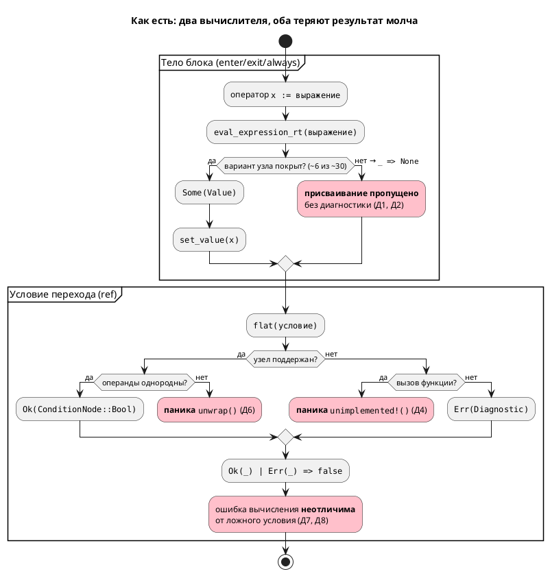

Источник: [docs/features/0025-simulator-expression-eval.md](https://github.com/Pastor/Takt/blob/3c154a13d979b18312a1250ebfbe3db2fa5247d3/docs/features/0025-simulator-expression-eval.md)

Полный текст по ссылке. Ниже начало карточки.

# Фича: Починка вычислителя выражений симулятора

- **Номер:** 0025
- **Статус:** **ГОТОВО** (закрыта 2026-07-14). Отчёт — вердикт **✅ ПРОЙДЕН**
  после доработки `0025-06`…`0025-08`. Итог — в разделе «Итог (что сделано)»
- **Зависит от:** **нет** — проставлено аналитиком на стадии 3.
  Проверены и пересечения по инфраструктуре; жёстких зависимостей
  нет, `ЗАБЛОКИРОВАНА` не ставится. Обоснование — в
  [анализе](0025-simulator-expression-eval.md#анализ), раздел «Зависимости фичи».
- **Связанные issue (анализ):** новая фича (дефект выявлен при обзоре проекта
  2026-07-14; в бэклоге кандидатов `FEATURES.md` отсутствовал)
- **Крейт:** `simulation` (затрагивает `unit/builder.rs`, `unit/mod.rs`, `predicate.rs`)
- **Приоритет:** высший — заявленная функциональность крейта `simulation`
  ([крейт simulation — симуляция моделей](0012-simulation-core.md)) в основном не работает и делает это
  **бесшумно**.

## Стадии жизненного цикла

Все стадии — **разделы этой карточки**: «Архитектура (ADR)»,
«Анализ», «Разработка», «Тест-план», «Отчёт о тестировании», «Итог».
Отдельным артефактом остаются только исправления —
[`docs/fixes/`](../fixes/README.md) (при необходимости `0025-YY-*`).

## Краткое описание

Крейт `simulation` вычисляет модели **неверно и молча**: runtime-вычислитель
выражений поддерживает лишь малую часть узлов `ExpressionNode`, а невычислимое
выражение приводит к **тихому пропуску присваивания** — без ошибки и
предупреждения. В результате любая арифметика и любой вызов функции в телах
`enter`/`exit`/`always` не исполняются, переменные остаются с начальными
значениями, а зависящие от них переходы не срабатывают никогда. Фича
восстанавливает корректность симуляции и — что не менее важно — заменяет тихое
игнорирование на диагностику.

## Мотивация / контекст

Дефект не виден по тестам: полный прогон **зелёный** (1484 passed, 6 ignored),
сборка чистая. Существующие тесты проверяют факт переходов, но **не сверяют
вычисленные значения переменных**, поэтому дыра в вычислителе не ловится.

Симуляция — не вспомогательный инструмент, а способ проверить автоматную модель
до синтеза в C (цель проекта — язык и тулы для промышленных систем
управления). Симулятор, который молча выдаёт неверную трассу, хуже отсутствующего:
он даёт ложную уверенность в модели.

## Состав дефектов (все воспроизведены, 2026-07-14)

> Д1–Д5 выявлены при обзоре (стадия 1); **Д6–Д8 добавлены на стадии 2 (ADR)** при
> разборе `predicate.rs`. Рост инвентаря на архитектурной стадии — сам по себе
> аргумент в пользу принятого решения: дефекты не независимы, у них общая причина
> (подстановочная ветка `_ =>`, `Option` вместо `Result`, AST в роли значения).

| № | Дефект | Место | Проявление |
|---|---|---|---|
| Д1 | `eval_expression_rt` покрывает ~6 из ~30 вариантов `ExpressionNode` (`Number`, `Bool`, `Rational`, `Variable`, `Negate`, `Parenthesis`); вся арифметика, сравнения, битовые операции и `Function` → `_ => None` | `simulation/src/unit/builder.rs:135` | `c := a + 1` не выполняется |
| Д2 | Невычислимое правое выражение → **тихий** пропуск присваивания (`if let Some(value) = … { set_value }`, ветки `else` нет) | `simulation/src/unit/builder.rs:220` | нет ни ошибки, ни предупреждения |
| Д3 | `compile_expression` обрабатывает только `Assign`, остальное → `vec![]` | `simulation/src/unit/builder.rs:218` | голый вызов `log_temp(temperature);` молча выпадает |
| Д4 | `ConditionNode::Function` в условии перехода → `unimplemented!()` | `simulation/src/predicate.rs:111` | **паника** симулятора |
| Д5 | `enter` **стартового** состояния не исполняется при инициализации: `enter` вызывается только внутри ветки перехода (шаг 5 `tick`) | `simulation/src/unit/mod.rs:185` | начальная инициализация модели теряется |
| Д6 | Смешанная арифметика `int`+`real` в условии → `unwrap()` на `None` (`extract_number` возвращает пару `(Option<i64>, Option<f64>)`, ветка «оба real» не покрывает смешанный случай) | `simulation/src/predicate.rs:130` | **паника** |
| Д7 | `Parenthesis` возвращает внутренний узел **невычисленным** (`Ok(*cond.clone())` вместо `flat(cond, context)`) | `simulation/src/predicate.rs:78` | `(t + 1) > 2` при `t=5` → условие **ложно** |
| Д8 | `EnumVariant`, `State`, `Model`, `ArraySubscript` → `Err` | `simulation/src/predicate.rs:~242` | `mode = Manual` при `mode=Manual` → **ложно**; `S(Ping) = End` в симуляторе не работает |

Д7 и Д8 молчаливы вдвойне: `create_predicate` (`predicate.rs:11`) сводит и `Err`, и
невычислимый результат к `false` (`Ok(_) | Err(_) => false`), поэтому **ошибка
вычисления неотличима от честно ложного условия**.

### Воспроизведение (пробы)

Минимальная проба Д1/Д2 — `a := 5` → `5`, `b := a` → `5`, но `c := a + 1` → **`0`**:

```lam
var a: u8 := 0;
var b: u8 := 0;
var c: u8 := 0;

start Idle {
    always {
        a := 5;
        b := a;
        c := a + 1;
    }
}
```

Проба Д5 — `enter { e := 7; }` в `start`-состоянии не срабатывает (`e=0`); тот же
`enter` при переходе в состояние работает (`e=9`).

Проба Д4 — `ref Hot: ready(t) > 0;` роняет симулятор с `not implemented`.

Проба Д6 — `ref Hot: t + 2.5 > 3;` роняет симулятор с
`called 'Option::unwrap()' on a 'None' value`.

Проба Д7 — при `var t: u8 := 5;` условие `ref Hot: (t + 1) > 2;` **ложно** (переход
не происходит), хотя `6 > 2`. Без скобок — работает.

Проба Д8 — при `enum Mode { Auto = 0, Manual = 1 }` и `var mode: Mode := Manual;`
условие `ref Hot: mode = Manual;` **ложно** (в трассе `mode=1`, переход не
происходит).

### Дефект виден в собственных примерах проекта

- **`examples/comprehensive.lam`** — `always { temperature := temperature + delta; }`
  не исполняется (Д1), поэтому `ref Heating: temperature > 10` не срабатывает
  **никогда**: модель висит в `Idle` и на 30-м шаге. Заявленный в примере сценарий
  `Idle → Heating → Cooling → Done` недостижим.
- **`examples/stacker.lam`** — `eta := travel_time(task_stack_no, task_row_no,
  task_section_no);` (строка 176) — вызов функции (Д1), значение молча
  отбрасывается: в выводе штатной симуляции (`examples/simulations/stacker_loading.json`)
  `eta=0` на **каждом** шаге.

Симулятор пригоден лишь для моделей на прямых присваиваниях (`x := y`, `x := 5`) —
именно поэтому демонстрационные сценарии `stacker_*.json` внешне «работают».

### Что дефектом **не** является (проверено)

Инвариант «условия рёбер `ref` не разрешаются» (`CLAUDE.md`) к дефекту отношения
**не имеет**: проба показала, что условия переходов разрешены корректно
(`Idle -> Heating : More(Variable(temperature), Number(10))`), и `flat` в
`predicate.rs` сравнения вычисляет. Сломан именно runtime-вычислитель выражений в
телах блоков. Инвариант при работе над фичей **не трогать**.

## Объём (предварительно, уточняет аналитик)

1. **Д1** — полное покрытие `ExpressionNode` в `eval_expression_rt`: арифметика
   (`Add`/`Subtract`/`Multiply`/`Divide`/`Modulo`/`Power`), сравнения, логические
   и битовые операции, `ArraySubscript`/`ArraySlice`/`BitAccess`, `Function`
   (вызов пользовательских `fn` с телом) и `extern fn` (семантика — за ADR).
2. **Д2/Д3** — вместо тихого пропуска: диагностика невычислимого выражения и
   неподдержанного оператора; исполнение выражений-операторов (вызовы функций).
3. **Д4** — устранить `unimplemented!()`; симулятор не должен паниковать ни на
   одной корректно скомпилированной модели.
4. **Д5** — исполнять `enter` стартового состояния при инициализации.
5. **Тесты** — сверять **вычисленные значения** переменных, а не только факт
   перехода (иначе класс дефекта воспроизведётся). Примеры/контрпримеры по
   своду; `comprehensive.lam` и `stacker.lam` (`eta`) — приёмочные сценарии.

## Архитектурное решение (стадия 2, ADR принят)

В крейте `simulation` **два независимых вычислителя**, и они разошлись:

| Вычислитель | Вход | Умеет |
|---|---|---|
| `predicate.rs::flat` | `ConditionNode` | арифметику и сравнения, но паникует (Д4, Д6) и молча врёт (Д7, Д8) |
| `unit/builder.rs::eval_expression_rt` | `ExpressionNode` | только литералы/переменную/`Negate`/скобки (Д1) |

Корневая причина — не «забыли варианты», а то, что архитектура **позволяет** забыть
и не сигнализирует: подстановочная ветка `_ => None`, `Option` вместо `Result`,
использование узлов AST в роли значений.

[ADR](0025-simulator-expression-eval.md#архитектура-adr) принял **Option B**: общее ядро
вычисления над `Value` (единственное место семантики) + два тонких адаптера с
**исчерпывающим `match` без `_`**, возвращающих `Result<Value, Diagnostic>`. Тогда
новый вариант `ExpressionNode`/`ConditionNode` ломает сборку вместо тихого `None` —
инвариант удерживает компилятор, а не дисциплина. Отвергнуты: точечная починка
(Option A — оставляет причину) и понижение `ConditionNode → ExpressionNode`
(Option C — лоссиво: `Model`/`State`/`EnumVariant` не имеют аналогов, и наступает на
решение, уже отвергнутое [ADR](0019-condition-expression-unification.md#архитектура-adr)).

**Связь с фичей [унификация грамматик Condition/Expression](0019-condition-expression-unification.md):** то же дублирование
`Condition`/`Expression`, но на уровне симулятора, а не грамматики. Жёсткой
зависимости нет — 0019 сужена до устранения `LoopCond` и грамматики не сливает.
Подтверждает аналитик на стадии 3.

### Уточнения анализа (стадия 3)

[Анализ](0025-simulator-expression-eval.md#анализ) решение ADR не
переоткрывает, но в двух местах уточняет — оба уточнения основаны на проверке кода:

1. **Критерий сверки с C сужен** до `Integer`/`Enum`/`Bool`. Проверка эталона
   показала, что генератор C **сам дефектен** на остальных типах: `Rational` →
   `float` (f32) против f64 в симуляторе; `Bit` → `int` (32-битный знаковый);
   `Array(size, elem)` → `uint{size}_t`, где `size` — **число элементов**, а не
   разрядность (`[u8; 4]` → `uint4_t`), причём массив **молча исчезает** из
   структуры (проба: `var data: [u8; 4];` не попал в `arr.h`). Сверять с таким
   эталоном — значит узаконить его дефекты. Дефекты генератора C вынесены в бэклог
   кандидатов (вне объёма 0025).
2. **Смена контракта `Context` не требуется.** ADR числил её в action items;
   проверка показала, что тип переменной достижим в точке записи
   (`ModelNode::variables: HashMap<String, VariableNode>` → `VariableNode::ty()`),
   поэтому усечение по типу делается внутри `ModelNodeContext::set_value` без
   смены сигнатур.

Кроме того, анализ **снял опасение ADR** о «подогнанных под дефект» эталонах:
guard-проверки в `examples/simulations/*.json` опираются на прямые присваивания и
`eta` не проверяют вовсе.

Декомпозиция задач разработки — `0025-01…05` (см. анализ, раздел «Декомпозиция»);
задача 05 переопределена с «сверочные тесты» на «канал диагностики» (тесты —
стадия 5).

### Находка тест-плана (стадия 5): почему 1484 зелёных теста ничего не поймали

[Тест-план](0025-simulator-expression-eval.md#тест-план) установил причину, и она
не «тесты плохо написаны»:

- в `unit/builder.rs` 22 теста, из них **4** покрывают `eval_expr` — **константный**
  вычислитель инициализаторов;
- тестов на `eval_expression_rt` — **дефектный runtime-вычислитель** — **ноль**;
- у крейта `simulation` **нет каталога интеграционных тестов** (`simulation/tests/`
  отсутствует): ни один тест не берёт `.lam`, не прогоняет его и не сверяет
  значения переменных.

Покрыт был **сосед** дефектного кода, а слоя, на котором дефект проявляется
(модель → трасса → значения), не существовало. Поэтому тест-план добавляет новый
слой — интеграционные тесты через публичный `runner::SimulationRunner` — и вводит
мета-требование: **T1–T8 обязаны быть красными на `HEAD`** до починки. Тест,
зелёный до починки, не проверяет то, что заявляет.

Тест-план также выявил **риск для [сохранение и загрузка состояния модели](0014-state-io.md)**: `state_io`
сериализует переменные из кэша `ModelNodeContext`, а кэш сегодня почти пуст —
присваивания пропускаются (проба: `--save-state` для `comprehensive.lam` даёт
`"variables": {}`). После починки вывод `--save-state` изменится → фикстуры
`state_io` подлежат сверке.

## Обратная совместимость

Синтаксис и семантика языка **не меняются** — чинится исполнение уже
специфицированного поведения, версия языка **не** повышается.
Оговорки для анализа:

- Меняются **результаты симуляции** существующих моделей — но в сторону
  соответствия спецификации языка; текущее поведение считается дефектным.
- Приёмочные сценарии `examples/simulations/*.json` могут содержать проверки,
  подогнанные под дефектное поведение (кандидат №1 — `eta=0`); их нужно
  пересмотреть, а не «сохранять совместимость» с ошибкой.
- Версия крейта `simulation` — бамп patch/minor по SemVer, решает аналитик.

## Риски

- **Скрытая ширина.** Полное покрытие `ExpressionNode` затрагивает типы, массивы
  и вызовы функций — объём может превысить одну задачу разработки (кандидат на
  декомпозицию `0025-YY-*`).
- **Семантика вычислений** (переполнение `u8`, деление на ноль, порядок побочных
  эффектов, рекурсия в `fn`) для симулятора не специфицирована — требует решений
  ADR и сверки с поведением генератора C, иначе симуляция и синтезированный C
  разойдутся.
- **`extern fn`** в симуляции не имеет реализации — нужна модель заглушек
  (значение по умолчанию / из `--sim-file` / диагностика).
- **Тестовый долг.** Зелёные тесты пропустили дефект; без тестов на значения
  переменных ремонт не проверяется.

> Фича зарегистрирована по запросу заказчика (обзор проекта 2026-07-14); далее
> проходит жизненный цикл по своду: архитектура (ADR) → анализ → разработка.

<!-- При закрытии фичи (стадия 8, статус ГОТОВО) сюда добавляется раздел
     «## Итог (что сделано)» —
     ссылки на отчёт/исправления. Незакрытые фичи «Итога» не имеют. -->

## Архитектура (ADR)

- **Status:** Accepted
- **Date:** 2026-07-14
- **Authors:** Архитектор + системный аналитик
- **Related issues:** [Фича](0025-simulator-expression-eval.md);
  связь с [ADR](0019-condition-expression-unification.md#архитектура-adr) (дублирование
  `Condition`/`Expression` — то же явление, но на уровне грамматики)

### Context

Крейт `simulation` вычисляет модели неверно и **бесшумно**. Обзор 2026-07-14
выявил восемь дефектов; все воспроизведены пробами. Существенно, что они **не
независимы** — это симптомы одной архитектурной причины.

В симуляторе **два вычислителя**, выросших порознь и разошедшихся:

| Вычислитель | Вход | Возвращает | Состояние |
|---|---|---|---|
| `unit/builder.rs::eval_expression_rt` | `ExpressionNode` (тела `enter`/`exit`/`always`) | `Option<Value>` | покрывает ~6 из ~30 вариантов; остальное → `_ => None` |
| `predicate.rs::flat` | `ConditionNode` (условия переходов) | `Result<ConditionNode, Diagnostic>` | арифметику умеет, но использует **узлы AST как значения** и делает `unwrap` |

Ни один не является подмножеством другого: `ConditionNode` содержит `Model`,
`State`, `EnumVariant`, которых нет в `ExpressionNode`; `ExpressionNode` содержит
`Assign`, `Multiply`/`Divide`/`Modulo`/`Power`, сдвиги, побитовые операции,
`CodeBlock`, которых нет в `ConditionNode`. Поэтому расхождение не заметил ни
компилятор, ни тесты.

#### Инвентарь дефектов

| № | Дефект | Место | Проявление |
|---|---|---|---|
| Д1 | `eval_expression_rt` покрывает ~6 из ~30 вариантов `ExpressionNode` | `unit/builder.rs:135` | `c := a + 1` → `c` не меняется |
| Д2 | Невычислимое выражение → **тихий** пропуск присваивания (нет ветки `else`) | `unit/builder.rs:220` | ни ошибки, ни предупреждения |
| Д3 | `compile_expression` обрабатывает только `Assign` | `unit/builder.rs:218` | голый вызов `log_temp(x);` выпадает |
| Д4 | `ConditionNode::Function` → `unimplemented!()` | `predicate.rs:111` | **паника** |
| Д5 | `enter` стартового состояния не исполняется | `unit/mod.rs:185` | начальная инициализация теряется |
| Д6 | Смешанная арифметика `int`+`real` → `unwrap()` на `None` | `predicate.rs:130` | **паника** |
| Д7 | `Parenthesis` возвращает внутренний узел **невычисленным** (`Ok(*cond.clone())` вместо `flat(cond)`) | `predicate.rs:78` | `(t + 1) > 2` при `t=5` → условие ложно |
| Д8 | `EnumVariant`, `State`, `Model`, `ArraySubscript` → `Err` | `predicate.rs:~242` | `mode = Manual` при `mode=Manual` → ложно; `S(Ping) = End` не работает |

Д7 и Д8 молчаливы вдвойне: `create_predicate` (`predicate.rs:11`) сводит и `Err`,
и невычислимый результат к `false` (`Ok(_) | Err(_) => false`), поэтому ошибка
вычисления неотличима от честно ложного условия.

#### Поток «как есть»



#### Корневая причина

Дефект — **не** «забыли дописать варианты». Забыть стало возможно, потому что
архитектура это позволяет и не сигнализирует:

1. **`_ => None`** — подстановочная ветка гасит любой невычисленный узел. Добавление
   варианта в `ExpressionNode` не ломает сборку `simulation` — новый узел молча
   становится «невычислимым».
2. **`Option` вместо `Result`** — «нет значения» не несёт причины, и вызывающий не
   обязан её обрабатывать; естественный код — `if let Some(v) = … {}` — и есть Д2.
3. **AST как значение** (`flat` возвращает `ConditionNode`) — смешивает частичную
   нормализацию с вычислением; отсюда `unwrap` (Д6) и невычисленные скобки (Д7).

Пока эти три свойства сохраняются, любая точечная починка восстановит паритет
сегодня и потеряет его на следующем добавленном узле.

#### Почему это важно

Симуляция — способ проверить автоматную модель **до** синтеза в C.
Симулятор, молча выдающий неверную трассу, хуже отсутствующего: он даёт ложную
уверенность. Дефекты видны в собственных примерах проекта: `comprehensive.lam`
навсегда висит в `Idle`, у `stacker.lam` `eta=0` на каждом шаге. Полный прогон
тестов при этом **зелёный** (1484 passed) — тесты проверяют факт переходов, но не
вычисленные значения.

### Decision Drivers

1. **Закрыть класс дефекта, а не восемь дефектов.** Главный критерий решения — чтобы
   девятый такой дефект не мог появиться молча. Всё остальное вторично.
2. **Достоверность симуляции.** Наблюдаемое поведение симулятора обязано совпадать с
   поведением синтезированного C — иначе проверка модели бессмысленна.
3. **Никаких паник.** Ни одна корректно скомпилированная модель не должна ронять
   симулятор: паника — это отказ инструмента проверки.
4. **Язык не меняется.** свод: чинится исполнение уже
   специфицированного поведения; версия языка не растёт. Инвариант «условия рёбер
   `ref` не разрешаются» (`CLAUDE.md`) — неприкосновенен.
5. **Соразмерность.** `simulation` — не горячий код; читаемость и проверяемость
   важнее микрооптимизации (`docs/CODE.md`).

### Considered Options

#### Option A. Точечная починка обоих вычислителей

Дописать недостающие варианты в `eval_expression_rt`, убрать `unimplemented!()` и
`unwrap` из `flat`, исправить `Parenthesis`, `EnumVariant`, `enter`.

**Pros:**
- Минимальный диф; все восемь дефектов закрываются быстро.
- Нулевой риск задеть смежные подсистемы.

**Cons:**
- **Не устраняет причину** (драйвер 1): `_ => None`, `Option` и AST-как-значение
  остаются. Расхождение вернётся на следующем варианте `ExpressionNode` — ровно
  так оно и возникло.
- Дублирование семантики сохраняется: правила переполнения, приведения `int`/`real`
  и деления на ноль придётся реализовать **дважды** и держать синхронными вручную.
  Д1 против Д6/Д7 — прямое доказательство, что вручную не удерживается.

#### Option B. Общее ядро вычисления над `Value` + два исчерпывающих адаптера

Семантика значений выносится в единый модуль (`simulation/src/eval/`): тип `Value`,
типизированные унарные/бинарные операции, правила приведения и усечения, приведение
к `bool`. Два тонких адаптера — `ConditionNode → Value` и `ExpressionNode → Value` —
не содержат семантики, только структурный разбор, и пишутся **исчерпывающим `match`
без `_`**, возвращая `Result<Value, Diagnostic>`.

**Pros:**
- Устраняет причину (драйвер 1): новый вариант `ExpressionNode`/`ConditionNode`
  **ломает сборку** `simulation`, а не тихо возвращает `None`. Компилятор берёт на
  себя то, что не удержали тесты и ревью.
- Семантика (переполнение, `int`/`real`, деление на ноль) существует в **одном**
  месте → расхождение вычислителей структурно невозможно (драйвер 2).
- `Result` вместо `Option` делает диагностику обязательной по типу, а не по
  дисциплине: Д2 не пишется случайно.
- `flat` перестаёт быть частичным нормализатором → `unwrap` (Д6) и невычисленные
  скобки (Д7) исчезают как класс.

**Cons:**
- Объём больше A: новый модуль + переписывание `flat`, а не правка веток.
- Асимметрия узлов остаётся: `Model`/`State` (только `Condition`) и
  `Assign`/`CodeBlock` (только `Expression`) обрабатываются в своих адаптерах.
- Требует доступа к типу переменной (`TypeNode`) при записи — `Value` ширины не несёт.

#### Option C. Понижение `ConditionNode` → `ExpressionNode`, один вычислитель

Привести условия к выражениям и оставить единственный `eval`.

**Pros:**
- Максимальное устранение дублирования: один тип, один вычислитель.
- Хорошо сочетается с идеей фичи.

**Cons:**
- **Понижение лоссивое:** `Model`, `State`, `EnumVariant` не имеют аналогов в
  `ExpressionNode`; для них пришлось бы расширять `ExpressionNode` — то есть менять
  семантические типы крейта `grammar` ради симулятора.
- `Condition::And`/`Or` документированы как **побитовые**, а `flat` вычисляет их
  логиче
