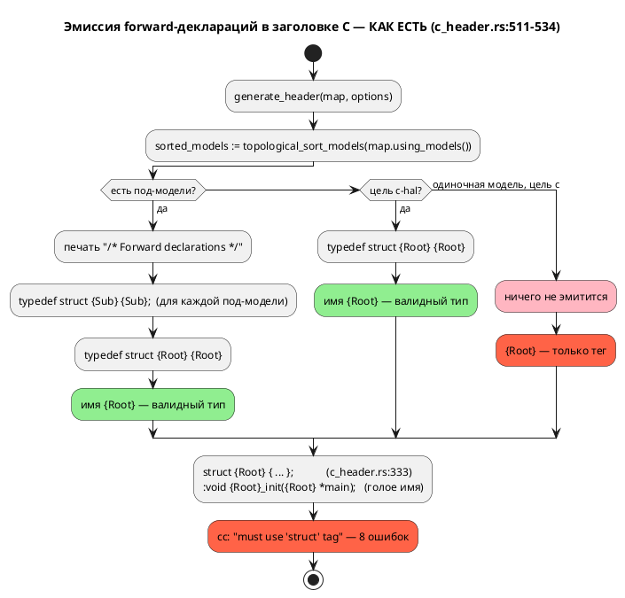
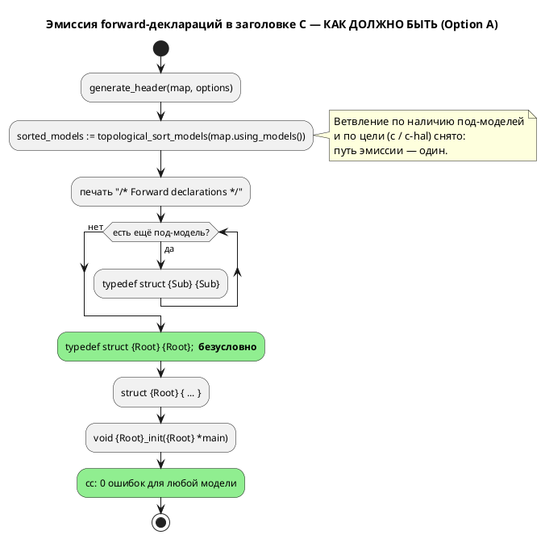

Источник: [docs/features/0026-c-root-typedef.md](https://github.com/Pastor/Takt/blob/3c154a13d979b18312a1250ebfbe3db2fa5247d3/docs/features/0026-c-root-typedef.md)

Полный текст по ссылке. Ниже начало карточки.

# Фича: Генератор C: typedef корневой структуры для одиночной модели

- **Номер:** 0026
- **Статус:** **ГОТОВО**
- **Зависит от:** **нет.** Фича автономна: правка локализована в одной ветке
  `grammar/src/generator/c/c_header.rs:511–534` и не требует ни изменений языка,
  ни готовности других фич. [адрес порта — размещение и потребление (карта адресов)](0020-port-address-decl.md) (цель `c-hal`),
  при работе над которой дефект был выявлен, **закрыта**, и её код — уже
  работающий образец решения. Обоснование и разбор смежных кандидатов по
  генератору C — в [анализе](0026-c-root-typedef.md#анализ), раздел
  «Зависимости фичи».
- **Приоритет:** **Tier 1 (высокий)** — см. раздел «Приоритет» ниже.
- **Связанные issue (анализ):** новая фича (из блока «Кандидаты в фичи»
  `FEATURES.md`; дефект найден попутно задачей
  [адрес порта — размещение и потребление (карта адресов)](0020-port-address-decl.md#разработка), раздел «Найденное попутно»).

## Стадии жизненного цикла

Все стадии — **разделы этой карточки**: «Архитектура (ADR)»,
«Анализ», «Разработка», «Тест-план», «Отчёт о тестировании», «Итог».
Отдельным артефактом остаются только исправления —
[`docs/fixes/`](../fixes/README.md) (при необходимости `0026-YY-*`).

## Краткое описание

Генератор C не эмитит `typedef struct {Root} {Root};` для модели **без
под-моделей**, из-за чего порождённый код **не компилируется**: определение
структуры печатается тегом без typedef (`struct {Root} { … };`), а прототипы
объявлены через голое имя (`void {Root}_init({Root} *main);`). Фича делает
эмиссию typedef корня **безусловной** и сливает расходящиеся ветки целей `c` и
`c-hal` в один путь (в `c-hal` то же место уже исправлено локально задачей). Язык не меняется — правка целиком внутри генератора.

## Мотивация / контекст

Дефект делает цель `c` неработоспособной для **простейшего** класса моделей —
одиночной модели без под-моделей (именно так выглядит большинство фикстур
`grammar/tests/data/semantic/valid/`). Это прямо бьёт по основной цели проекта: синтез C из автоматной модели.

Дефект **предсуществующий**, и до сих пор его не поймали потому, что все пять
примеров `examples/*.lam`, на которых `precheck.sh` собирает порождённый C через
cmake/ninja, содержат под-модели — то есть попадают в **рабочую** ветку эмиссии.
[починка вычислителя выражений симулятора](0025-simulator-expression-eval.md) столкнулась с дефектом вплотную и
была вынуждена его **обойти**: фикстура сверки
`simulation/tests/data/eval/conformance_u8.lam` намеренно обёрнута в
`model Conf { … }` + `start Entry = Conf;`, и в самой фикстуре стоит комментарий,
что иначе порождённый C не компилируется.

## Объём

- Безусловная эмиссия `typedef struct {Root} {Root};` в
  `grammar/src/generator/c/c_header.rs` (одна ветка, ~10 строк).
- Слияние ветки цели `c` и локальной правки `c-hal` в **один** путь эмиссии —
  чтобы расхождение целей не воспроизвелось.
- Тесты: наличие typedef для одиночной модели; **фактическая компиляция**
  порождённого C компилятором `cc` (страховка от повторения класса дефекта);
  регресс multi-model и `c-hal`.

## Приоритет (свод п.3)

**Tier 1 (высокий).** Аргументы:

1. **Класс дефекта — неработоспособность, а не неудобство.** Порождённый C для
   одиночной модели не компилируется вовсе (проба: **8 ошибок** `cc`), т.е. цель
   `c` не выполняет свою единственную задачу на целом классе входов.
2. **Цена исправления минимальна** — одна ветка условия, работающий образец уже
   есть в `c-hal`. Отношение «польза/затраты» — лучшее среди кандидатов по
   генератору C.
3. **Восстанавливает проверяемость.** Пока дефект жив, фикстуры сверки
   «симулятор ↔ C» обязаны нести обёртку-обход (как в 0025); после исправления они
   пишутся естественно.
4. **по своду п.4** аналитик ставит фичу выше прочих кандидатов по
   генератору C ([заглушки генератора C: диагностика вместо тихого пропуска](0028-c-generator-stubs.md) — заглушки,
   [генератор C: отображение типов Array/Bit/Rational](0029-c-type-mapping.md) — отображение типов): те расширяют
   корректность, эта — восстанавливает базовую работоспособность. Жёсткой
   зависимости между ними нет (разные функции и файлы).

## Риски / открытые вопросы

- **Изменение вывода `c` (предупреждение кандидата).** Подтверждено, но **строго
  ограничено**: меняется вывод **только** для файлов без под-моделей (+2 строки);
  вывод для моделей с под-моделями не затрагивается.
- **Находка: генерация C недетерминирована.** Порядок вариантов `enum` состояний
  и веток `switch` меняется **от запуска к запуску** на одном и том же входе
  (причина — `states: HashMap<String, StateNode>`, `semantic/mod.rs:101`).
  Побайтовые codegen-снапшоты, которые предлагал сверить кандидат, поэтому
  невозможны в принципе — проверки только структурные. Оформляется отдельным
  кандидатом (за границами 0026).
- **Обратная совместимость:** правка **аддитивна** — добавление
  `typedef struct X X;` не ломает потребителей, пишущих `struct X`. Язык не
  меняется → версия языка остаётся **0.2.0**.

> Фича зарегистрирована из блока «Кандидаты в фичи» `FEATURES.md`; далее проходит
> жизненный цикл по своду.

<!-- При закрытии фичи (стадия 8, статус ГОТОВО) сюда добавляется раздел
     «## Итог (что сделано)» —
     ссылки на отчёт/исправления. Незакрытые фичи «Итога» не имеют. -->

## Архитектура (ADR)

- **Status:** Accepted
- **Date:** 2026-07-15
- **Authors:** Архитектор + Аналитик
- **Related issues:** [Фича](0026-c-root-typedef.md); наследует
  локальную правку [адрес порта — размещение и потребление (карта адресов)](0020-port-address-decl.md#разработка)
  (цель `c-hal`, [ADR](0020-port-address-decl.md#архитектура-adr))

### Context

Цель `c` порождает **некомпилируемый** код для модели **без под-моделей**. Факты
собраны чтением кода и пробами на текущей ветке `v2`.

**Как устроена эмиссия сейчас** (`grammar/src/generator/c/c_header.rs:511–534`):

```rust
if !sorted_models.is_empty() {          // есть под-модели
    printer.print("/* Forward declarations */").nl();
    for element in &sorted_models { … typedef struct {Sub} {Sub}; … }
    typedef struct {Root} {Root};
} else if options.hal {                  // под-моделей нет, но цель c-hal
    typedef struct {Root} {Root};
}                                        // под-моделей нет, цель c → НИЧЕГО
```

Третья ветка (одиночная модель, цель `c`) не эмитит ничего. При этом:

- Определение структуры печатается **тегом без typedef**:
  `struct {Root} {` (`c_header.rs:333`), закрывается `};` (`c_header.rs:483`) —
  то есть имя `{Root}` само по себе типом **не становится**.
- Прототипы объявлены через **голое** имя: `void {Root}_init({Root} *main);`.

В C это противоречие: `{Root}` — тег структуры, а не имя типа, и обращаться к
нему без `struct` нельзя. Единственное, что делало голое имя типом в остальных
ветках, — как раз forward-`typedef`.

**Проба** (цель `c`, файл без под-моделей
`grammar/tests/data/semantic/valid/deterministic_transitions.lam`):

```c
struct DeterministicTransitions { … };                              /* тег, без typedef */
void DeterministicTransitions_init(DeterministicTransitions *main); /* ← ошибка */
```

```
$ cc -fsyntax-only deterministic_transitions.c
error: must use 'struct' tag to refer to type 'DeterministicTransitions'
… всего 8 ошибок (4 в .h + 4 в .c)
```

**Существенное уточнение к формулировке кандидата.** Кандидат в `FEATURES.md`
описывает симптом как «прототипы невалидны **как отдельный C**», что читается как
дефект оформления заголовка. На деле не компилируется **вся единица трансляции**:
`.c` включает свой `.h` и падает на тех же прототипах — цель `c` для одиночной
модели не даёт рабочего результата вообще.

**Почему дефект дожил до сих пор.** `precheck.sh` собирает порождённый C через
cmake/ninja, но **все пять** `examples/*.lam` содержат под-модели и попадают в
первую (рабочую) ветку. Фича упёрлась в дефект и **обошла** его: фикстура
`simulation/tests/data/eval/conformance_u8.lam` обёрнута в `model Conf { … }` +
`start Entry = Conf;` с комментарием в самой фикстуре — «для одиночной корневой
модели генератор не эмитит `typedef`, и порождённый C не компилируется (дефект
генератора, бэклог)».

Поток «как есть» — с ветвлением, породившим дефект:



### Decision Drivers

1. **Порождённый C обязан компилироваться.** Профиль проекта —
   синтез C из автоматной модели; некомпилируемый выход обесценивает цель `c`
   на целом классе входов.
2. **Устранить причину, а не симптом.** Дефект родился из того, что исправление
   применили к **одной** цели (`c-hal`), оставив вторую ветку. Пока путей два,
   расхождение воспроизведётся при следующей правке.
3. **Обратная совместимость.** Работающий сегодня вывод (модели с
   под-моделями) меняться не должен; правка для одиночных моделей — аддитивная.
4. **Язык не затрагивается.** Правка внутри генератора; синтаксис и
   семантика неизменны → версия языка **не растёт**.
5. **Пропорциональность.** Дефект стоит одной ветки условия; решение не должно
   переписывать генератор.

### Considered Options

#### Option A. Эмитировать typedef корня безусловно (слить ветки `c` и `c-hal`)

Ветвление убирается: секция forward-деклараций печатается **всегда**, под-модели
добавляются в неё, если есть; typedef корня эмитится в любом случае.

**Pros:**
- Устраняет дефект в его причине: путь эмиссии остаётся **один**, расхождение
  целей `c`/`c-hal` исчезает как класс (драйвер 2).
- Решение уже **проверено в бою**: та же строка работает в `c-hal` (проба —
  `cc -fsyntax-only` даёт **0 ошибок** на том же файле, что в `c` даёт 8).
- Минимальный диф (~10 строк), нулевой риск для multi-model: та ветка уже
  печатала typedef корня — её поведение сохраняется.
- Аддитивно для потребителей: `typedef struct X X;` не конфликтует с кодом,
  пишущим `struct X`.

**Cons:**
- Вывод `c` для одиночных моделей меняется (+2 строки) — требует пересмотра
  ожиданий в тестах (проверено: сегодня таких ожиданий нет).
- Вывод `c-hal` для одиночной модели получит строку `/* Forward declarations */`
  (косметика; существующие проверки `contains` не ломаются).

#### Option B. Печатать самотипизированные определения `typedef struct X { … } X;`

Отказаться от forward-деклараций, печатая определение сразу с typedef — как уже
делается для пользовательских структур (`c_header.rs:544`).

**Pros:**
- Одна конструкция вместо двух; для пользовательских структур форма уже принята.

**Cons:**
- **Ломает взаимные ссылки** — ровно то, ради чего forward-декларации введены
  (`c_header.rs:509–511`: «важно при взаимных ссылках»). Под-модель, ссылающаяся
  на тип, объявленный ниже, перестанет компилироваться.
- Меняет **работающий** вывод multi-model — против драйвера 3, риск несоразмерен
  масштабу дефекта.

#### Option C. Объявлять прототипы через тег: `void {Root}_init(struct {Root} *)`

Оставить отсутствие typedef, но всюду в прототипах и определениях писать `struct`.

**Pros:**
- Формально корректный C без единого typedef.

**Cons:**
- Меняет **публичный API** порождённого C для **всех** моделей, включая
  работающие сегодня: код потребителя `Root m; Root_init(&m);` перестаёт
  собираться. Это слом обратной совместимости ради дефекта, который
  чинится аддитивно.
- Противоречит уже закреплённой в `c-hal` конвенции (typedef + голое имя) —
  расхождение целей не исчезнет, а закрепится.
- Диф — по всему генератору (прототипы, определения, HAL), а не в одной ветке.

#### Option D. Ничего не менять, задокументировать ограничение

Признать одиночную модель неподдерживаемой для цели `c`, требуя обёртки в
`model` (как это сделала 0025).

**Pros:**
- Нулевой диф.

**Cons:**
- Оставляет цель `c` неработоспособной на простейшем классе входов и вынуждает
  каждого пользователя писать обёртку-ритуал без всякой семантической причины.
- Обход уже пришлось встроить в фикстуру 0025 — цена ограничения растёт с каждым
  новым потребителем.

### Decision

Принимается **Option A** — эмитировать `typedef struct {Root} {Root};`
**безусловно**, слив ветку цели `c` и локальную правку `c-hal` в один путь.

Обоснование: это единственный вариант, который чинит дефект **в его причине**
(два пути эмиссии вместо одного), не трогает работающий вывод multi-model
(драйвер 3), аддитивен для потребителей и уже подтверждён работой `c-hal`
(драйвер 1). Option B и C переписывают работающий вывод ради узкого дефекта
(против драйверов 3 и 5), Option D оставляет цель `c` сломанной.

Целевая структура ветки (`c_header.rs:511–534`): условие снимается, секция
печатается всегда, цикл по под-моделям исполняется столько раз, сколько их есть
(в том числе ноль), typedef корня печатается следом.

Поток «как должно быть»:



### Consequences

#### Положительные

- Цель `c` даёт компилируемый код для **любой** модели, включая одиночную.
- Расхождение целей `c`/`c-hal` устранено: один путь эмиссии, исправление невозможно
  применить «к половине».
- Фикстуры сверки «симулятор ↔ C» перестают нуждаться в обёртке-обходе (0025).
- Совместимость сохранена: multi-model вывод неизменен, правка аддитивна, версия
  языка остаётся **0.2.0**.

#### Отрицательные / Action items

- Вывод `c` для одиночных моделей меняется (+2 строки) — ожидаемо и желаемо;
  проверить, что ни один существующий тест не завязан на отсутствие typedef
  (проверено на стадии анализа: не завязан).
- Вывод `c-hal` для одиночной модели получит строку `/* Forward declarations */`
  — косметика, проверки `contains` не ломаются.
- **Закрыть класс дефекта тестом, а не глазами:** добавить проверку, которая
  **компилирует** порождённый C настоящим `cc` (по образцу
  `simulation/tests/conformance_c_tests.rs:141`, с проверкой на доступность `cc` —
  `cc_available()`, там же строка 65). Именно отсутствие такой проверки для
  одиночных моделей дало дефекту дожить.
- **Вне области ADR (передано в бэклог):** генерация C **недетерминирована** —
  порядок вариантов `enum` состояний и веток `switch` меняется от запуска к
  запуску (`states: HashMap<String, StateNode>`, `semantic/mod.rs:101`). Поэтому
  побайтовая сверка codegen-снапшотов, предложенная кандидатом, невозможна;
  проверки этого ADR — структурные.

#### Acceptance criteria

1. Для модели **без под-моделей** цель `c` эмитит `typedef struct {Root} {Root};`
   ровно **один** раз.
2. Порождённый целью `c` код для одиночной модели **компилируется**:
   `cc -std=c11 -fsyntax-only {root}.c` → 0 ошибок (сегодня — 8).
3. Вывод цели `c` для модели **с** под-моделями не изменился (структурный
   регресс: секция forward-деклараций и оба typedef на месте).
4. Цель `c-hal` не регрессирует: typedef корня по-прежнему ровно один, таблица
   адресов и принятый по умолчанию HAL на месте.
5. Путь эмиссии typedef корня в коде **один** (нет ветки, зависящей от
   `options.hal` или от наличия под-моделей).
6. Версия языка не изменилась (**0.2.0**): правка не затрагивает синтаксис и
   семантику.

## Анализ

### Цель и контекст

Сделать эмиссию `typedef struct {Root} {Root};` в генераторе C **безусловной**,
чтобы порождённый код компилировался и для модели **без под-моделей**.
Архитектурное решение — [ADR](0026-c-root-typedef.md#архитектура-adr), Option A
(слить пути эмиссии целей `c` и `c-hal` в один).

Все утверждения ниже проверены на ветке `v2` чтением кода и пробами; ссылки на
строки актуальны на 2026-07-15.

#### Проверка исходного текста кандидата

Кандидат в `FEATURES.md` подтвердился **в главном** и разошёлся с фактами **в
двух местах** — обе расхождения ценны и учтены в требованиях.

| Утверждение кандидата | Статус | Факт |
|---|---|---|
| Для модели без под-моделей цель `c` не эмитит typedef корня | ✅ подтверждено | `c_header.rs:511–534`: ветка `else if options.hal` покрывает только `c-hal`; для цели `c` не эмитится ничего |
| В `c-hal` исправлено локально | ✅ подтверждено | `c_header.rs:525–534` с комментарием «Обычный режим `c` не трогаем (вывод байт-в-байт)» |
| Прототипы `{Root}_init({Root} *)` невалидны **как отдельный C** | **занижено** | Не компилируется **вся единица трансляции**, а не только заголовок: `cc -fsyntax-only {root}.c` → **8 ошибок** (4 в `.h` + 4 в `.c`, т.к. `.c` включает свой `.h`). Цель `c` для одиночной модели не даёт рабочего результата вообще |
| «Правка меняет вывод `c` → **сверить codegen-снапшоты**» | ❌ **неисполнимо и не нужно** | Codegen-снапшотов в проекте **нет** (`grep` по `insta`/`snapshot`/`assert_eq!(header` в `grammar/tests/codegen_tests.rs` — пусто; все 35 тестов структурные, через `contains`). И завести их **нельзя**: генерация **недетерминирована** — см. находку ниже. Область изменения вывода при этом узкая и точно очерчена: **только** файлы без под-моделей (+2 строки) |

#### Находка вне области фичи: генерация C недетерминирована

Пять запусков `lamc compile -t c` на **одном и том же** входе
(`grammar/tests/data/semantic/valid/deterministic_transitions.lam`) дали **разный**
порядок вариантов `enum` состояний в `.h` и веток `switch` в `.c`:

```
run 1: INIT, A, B, S, END
run 2: INIT, B, S, A, END
run 5: INIT, S, B, A, END
```

Причина — итерация по `states: HashMap<String, StateNode>`
(`grammar/src/semantic/mod.rs:101`): `std::collections::HashMap` рандомизирует
порядок обхода на каждый процесс. Семантически выводы эквивалентны (значения
`enum` согласованы внутри одной генерации), но **побайтово** воспроизводимость
отсутствует: сборки не воспроизводимы, а числовые значения состояний в ABI
«плавают» между сборками. `structs` рядом сортируются явно (`c_header.rs:540`) —
то есть проблема осознавалась точечно, но не системно.

**За границами 0026** (иначе фича из исправления одной ветки превращается в ревизию
генератора). Передаётся координатору как **отдельный кандидат** в `FEATURES.md`.
Для 0026 находка имеет одно прямое следствие: проверки — **только структурные**,
побайтовое сравнение запрещено как метод.

### Зависимости фичи

- **Зависит от:** **нет.**

  Проверено по контракту, коду и инфраструктуре:

  - **По коду.** Правка целиком внутри `generate_header`
    (`grammar/src/generator/c/c_header.rs:511–534`). Ни одна незакрытая фича этой
    ветки не касается.
  - **[адрес порта — размещение и потребление (карта адресов)](0020-port-address-decl.md) (`c-hal`) — закрыта.**
    Дефект найден попутно её задачей [адрес порта — размещение и потребление (карта адресов)](0020-port-address-decl.md#разработка),
    но зависимости не создаёт: её код (`c_header.rs:525–534`) — **готовый
    образец** решения, а не предпосылка. Скорее наоборот: 0026 доводит до конца
    правку, которую 0020-05 сознательно ограничила одной целью.
  - **[починка вычислителя выражений симулятора](0025-simulator-expression-eval.md) — закрыта.**
    Потребитель дефекта (обёртка в фикстуре сверки), не блокер.
  - **Смежные кандидаты по генератору C — пересечения нет:**
    [заглушки генератора C: диагностика вместо тихого пропуска](0028-c-generator-stubs.md) (заглушки) правит
    `generator/c/c_model.rs:316,769`; [генератор C: отображение типов Array/Bit/Rational](0029-c-type-mapping.md)
    (типы `Array`/`Bit`/`Rational`) правит `get_c_type`
    (`generator/c/mod.rs:150`). Разные файлы и функции; конфликта правок нет,
    порядок между ними свободен.
  - **Инфраструктура готова:** приём «скомпилировать порождённый C настоящим
    `cc`» уже реализован в `simulation/tests/conformance_c_tests.rs:141` с проверкой
    `cc_available()` (строка 65) — переиспользуется, новых зависимостей не
    добавляет.

- **Влияние на порядок разработки:** фича **никого не блокирует формально**, но
  по своду п.4 аналитик ставит её **первой среди кандидатов по генератору
  C** (0028, 0029): она восстанавливает базовую работоспособность цели `c`, тогда
  как те расширяют корректность; цена — одна ветка условия. Завершение 0026
  снимает необходимость обёртки-обхода в фикстурах сверки «симулятор ↔ C»
  (см. 0025) и делает доступным весь корпус одиночных моделей
  `grammar/tests/data/semantic/valid/` как материал для будущих C-проверок — что
  прямо повышает проверяемость. Статус `ЗАБЛОКИРОВАНА` **не** ставится:
  зависимостей нет.

### Требования и проверяемые условия

- **R1. Typedef корня эмитится безусловно.** Для модели **без под-моделей** цель
  `c` эмитит `typedef struct {Root} {Root};`. Сегодня не эмитит
  (`c_header.rs:511–534`).
- **R2. Порождённый C компилируется.** Для одиночной модели вывод цели `c`
  собирается компилятором C11 без ошибок. Сегодня — 8 ошибок
  `must use 'struct' tag to refer to type`.
- **R3. Ровно один typedef корня.** Ни в одной цели (`c`, `c-hal`) и ни при какой
  конфигурации (с под-моделями и без) `typedef struct {Root} {Root};` не
  дублируется.
- **R4. Регресс multi-model = 0.** Для модели **с** под-моделями структура вывода
  цели `c` не меняется: секция `/* Forward declarations */`, typedef
