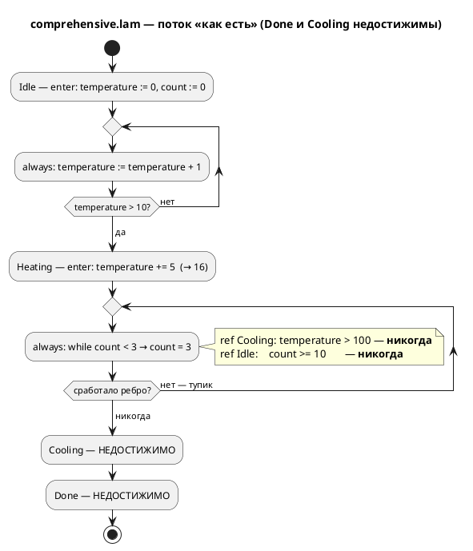
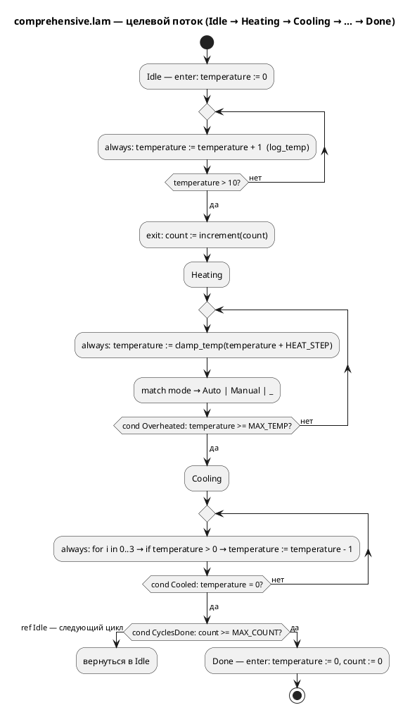

Источник: [docs/features/0030-comprehensive-example-fix.md](https://github.com/Pastor/Takt/blob/3c154a13d979b18312a1250ebfbe3db2fa5247d3/docs/features/0030-comprehensive-example-fix.md)

Полный текст по ссылке. Ниже начало карточки.

# Фича: Исправление примера comprehensive.lam (недостижимый сценарий)

- **Номер:** 0030
- **Статус:** **ГОТОВО** (2026-07-17; подзадачи
  [исправление примера comprehensive.lam (недостижимый сценарий)](0030-comprehensive-example-fix.md#разработка) и
  [исправление примера comprehensive.lam (недостижимый сценарий)](0030-comprehensive-example-fix.md#разработка) выполнены,
  [отчёт](0030-comprehensive-example-fix.md#отчёт-о-тестировании) — вердикт «пройдено»)
- **Зависит от:** **нет.** Фича автономна: правка — в одном файле
  `examples/comprehensive.lam` плюс новый тест в крейте `simulation`; язык,
  компилятор и симулятор **не меняются**. [починка вычислителя выражений симулятора](0025-simulator-expression-eval.md) (вычислитель симулятора), при
  реализации которой дефект был выявлен, **закрыта** — именно её результат и
  делает проверку сценария прогоном возможной; блокировки нет. Смежные
  кандидаты по симулятору ([вызов функции из тела функции](0031-fn-calls-fn.md) — вызов функции из
  функции, [согласование тактов симулятора и порождённого C (INIT-такты)](0033-init-tick-alignment.md) — сдвиг `INIT`-тактов) —
  **ограничения**, а не зависимости: целевая модель их не задействует.
  Обоснование и разбор — в [анализе](0030-comprehensive-example-fix.md#анализ),
  раздел «Зависимости фичи».
- **Приоритет:** **Tier 2 (средний)** — см. раздел «Приоритет» ниже.
- **Связанные issue (анализ):** новая фича (из блока «Кандидаты в фичи»
  `FEATURES.md`; дефект найден попутно задачей
  [0025-02b-1](0025-simulator-expression-eval.md#разработка), подтверждён
  отчётом [починка вычислителя выражений симулятора](0025-simulator-expression-eval.md#отчёт-о-тестировании), находка Н1).

## Стадии жизненного цикла

Все стадии — **разделы этой карточки**: «Архитектура (ADR)»,
«Анализ», «Разработка», «Тест-план», «Отчёт о тестировании», «Итог».
Отдельным артефактом остаются только исправления —
[`docs/fixes/`](../fixes/README.md) (при необходимости `0030-YY-*`).

## Краткое описание

`examples/comprehensive.lam` объявляет автомат `Idle → Heating → Cooling → Done`,
в котором **половина состояний недостижима, а 4 из 6 переходов мертвы по логике
самой модели**: `Heating` — тупик (ни `ref Cooling`, ни `ref Idle` не могут
сработать никогда), поэтому `Cooling` и `Done` не достигаются ни при каких
входах. Фича приводит пример в состояние, где заявленный сценарий **действительно
проходит**, и закрепляет это **прогоном симулятора** в тесте — чтобы дефект не
вернулся. Язык, компилятор и симулятор не меняются: правится модель-пример и
добавляется тест.

## Мотивация / контекст

Примеры `examples/*.lam` — **часть документации по языку**:
`precheck.sh` генерирует из них C и собирает его, форматтер обязан держать их в
каноне, а свод прямо требует, чтобы проверенные примеры попадали в
документацию по языку. Пример с недостижимыми состояниями учит читателя неверному:
он демонстрирует не «состояние охлаждения», а **мёртвый код**, поданный как
образцовая модель.

Дефект уже причинил измеримый вред: критерий приёмки **A6** [починка вычислителя выражений симулятора](0025-simulator-expression-eval.md) был сформулирован как «`comprehensive.lam`
проходит `Idle → Heating → Cooling → Done`» — то есть от **симулятора** потребовали
поведения, невозможного по модели. Критерий пришлось исправлять по ходу
реализации ([0025-02b-1](0025-simulator-expression-eval.md#разработка)),
а сам дефект зафиксирован контрпримером T19a
[тест-плана 0025](0025-simulator-expression-eval.md#тест-план) и находкой Н1
[отчёта 0025](0025-simulator-expression-eval.md#отчёт-о-тестировании). Пока пример не
починен, он остаётся ловушкой для каждой следующей фичи, которая возьмёт его как
эталон.

Профиль проекта — промышленные системы управления. Контроллер
нагрева, который по своей же спецификации никогда не выходит из нагрева, —
ровно тот класс ошибки проектирования, который язык Lam призван **отлавливать**,
а не демонстрировать.

## Объём

- Починка `examples/comprehensive.lam`: модель должна проходить заявленный
  сценарий и не содержать мёртвых переходов, оставаясь правдоподобной моделью
  управления и сохраняя покрытие конструкций языка, заявленное в
  её шапке.
- Приведение шапочного комментария в соответствие с фактом (сегодня он обещает
  `loop`, `cond` и `else`, которых в примере **нет** — проверено).
- **Приёмочный тест прогоном симулятора**: сценарий проверяется
  автоматически, а не глазами.
- **Корпусной проверка** (`0030-02`): достижимость заявленных сценариев проверяется
  для всего каталога `examples/`, с явным списком исключений и причин — по
  образцу проверки непокрытых узлов из [канонический форматтер.lam (lamc fmt)](0024-lam-formatter.md).

## Приоритет (свод п.3)

**Tier 2 (средний).** Аргументы:

1. **Дефект — в документации, а не в продукте.** Компилятор, генератор C и
   симулятор работают правильно: они честно исполняют то, что написано в
   примере. Неработоспособности инструмента нет — поэтому не Tier 1.
2. **Но вред уже нанесён и повторяем.** Пример однажды заставил ошибиться
   **аналитика** (критерий A6 фичи). Ошибка такого рода дороже опечатки:
   она попадает в критерии приёмки и оттуда — в требования к коду.
3. **Цена минимальна, риск близок к нулю.** Правка — один файл примера плюс
   тест; исходный код не затрагивается, обратная совместимость не при чём.
4. **по своду п.4** аналитик ставит фичу **выше** прочих кандидатов по
   симулятору ([вызов функции из тела функции](0031-fn-calls-fn.md), [сохранение переменных модели в --save-state/--load-state](0032-state-io-variables.md),
   [согласование тактов симулятора и порождённого C (INIT-такты)](0033-init-tick-alignment.md)): те расширяют возможности, эта —
   восстанавливает **доверие к эталону**, на который опираются остальные. Проверка
   `0030-02` вдобавок страхует все будущие примеры. Жёстких зависимостей между
   ними нет.

## Риски / открытые вопросы

- **Соблазн «минимальной правки» обманчив.** Предложение кандидата — «нагрев в
  `always` состояния `Heating`» — **проверено пробой и недостаточно**: даже с
  нагревом модель идёт `Idle → Heating → Cooling → Idle → …`, а `Done` остаётся
  недостижимым (второй, независимый дефект — в `Cooling`). Разбор — в
  [ADR](0030-comprehensive-example-fix.md#архитектура-adr), раздел «Context».
- **Пример — вход `precheck.sh`**: из него генерируется C и собирается
  cmake/ninja, а `lamc fmt --check examples/` требует канона. Правка обязана
  пройти оба проверки (на эскизе проверено: C генерируется; `lamc fmt` прогнать
  обязательно — эскиз канону не соответствовал).
- **Границы проверки `0030-02`.** Не всякий пример исполним симулятором:
  `elevator_mini.lam` падает с `SIM-009` (найдено при анализе — **дефект
  симулятора**, не примера, см. анализ). Проверка обязан иметь явный список
  исключений с причинами, иначе он либо не включится, либо будет отключён
  первым же красным прогоном.
- **Обратная совместимость:** язык **не** меняется — версия языка не
  растёт. На публичный API, грамматику и семантику влияния нет.
  **Уточнено при реализации (решение заказчика 2026-07-17):** утверждение
  «на генераторы влияния нет» **не выдержало проверки** — в объём введена починка
  генератора `st` (порядок секций `VAR`/`VAR CONSTANT` в `FUNCTION`). Вывод цели
  `st` меняется для **любой** модели, чьи функции имеют локальные переменные; в
  корпусе такая одна — `comprehensive`. Разбор — в
  [анализе](0030-comprehensive-example-fix.md#анализ), врезка «Пересмотр A9».

> Фича зарегистрирована из блока «Кандидаты в фичи» `FEATURES.md`; далее проходит
> жизненный цикл по своду.

## Архитектура (ADR)

- **Status:** Accepted
- **Date:** 2026-07-15
- **Authors:** Архитектор + Аналитик
- **Related issues:** [Фича](0030-comprehensive-example-fix.md);
  вытекает из [ADR](0025-simulator-expression-eval.md#архитектура-adr) (вычислитель
  симулятора — именно он сделал дефект видимым)

### Context

`examples/comprehensive.lam` — «витринный» пример языка: единственный файл в
`examples/`, чья задача — показать **все** конструкции Lam разом. Примеры входят
в документацию по языку, собираются в C через `precheck.sh` и
обязаны быть в каноне форматтера. Значит, пример — не иллюстрация, а
**спецификация в исполняемом виде**.

#### Что заявлено

Модель `Controller` объявляет четыре состояния с говорящими комментариями:
`Idle` («начальное»), `Heating` («состояние нагрева»), `Cooling` («состояние
охлаждения») и `Done` («конечное состояние — работа завершена»). Между ними
объявлено шесть переходов `ref`. Читатель — и, как показала практика, аналитик —
достраивает из этого сценарий `Idle → Heating → Cooling → Done`.

**Уточнение факта (важно для формулировок).** Шапка примера этот сценарий
**дословно не обещает** — в ней нет строки `Idle → Heating → Cooling → Done`.
Обещание сделано **структурой**: именами состояний, их комментариями и
объявленными рёбрами `ref`. Поэтому дефект нельзя свести к «неточному
комментарию»: **мертвы сами рёбра**, а не текст рядом с ними. Именно из этой
структуры был выведен (и оказался неверным) критерий A6 фичи.

#### Что есть на самом деле (проверено прогоном)

```sh
cargo build --bin simulation
./target/debug/simulation examples/comprehensive.lam -n 30
```

```
Шаг   1..10:  [Idle]
Шаг  11..30:  [Heating]
Выполнено 30 шагов (лимит достигнут).
```

`Heating` — **тупик**. Разбор по логике самой модели:

| Ребро | Условие | Почему мертво |
|---|---|---|
| `Heating → Cooling` | `temperature > MAX_TEMP` (100) | в `Heating` температура **не меняется**: `enter` даёт +5 (11 → **16**), `always` её не трогает |
| `Heating → Idle` | `count >= MAX_COUNT` (10) | `while count < 3` упирает счётчик в **3**; `Idle.enter` его к тому же обнуляет |
| `Cooling → Done` | `temperature <= 0` | `Cooling` недостижим (следствие тупика) |
| `Cooling → Idle` | `temperature > 0` | то же |

Итог: **достижимы 2 состояния из 4** (`Idle`, `Heating`), **мертвы 4 ребра из
6**. Значение `temperature = 16` подтверждено пробой (во временную копию
добавлено `ref Done: temperature = 16;` — переход срабатывает на шаге 12).

#### Ключевая находка: «минимальная правка» из бэклога недостаточна

Кандидат в `FEATURES.md` предлагал починить логику, «например, нагрев в `always`
состояния `Heating`». **Проверено пробой — этого мало.** С добавленным
`temperature := temperature + 10;` в `always` состояния `Heating`:

```
Шаг  11..19:  [Heating]
Шаг  20:      [Cooling]
Шаг  21..30:  [Idle]
```

`Done` по-прежнему **недостижим** — из-за **второго, независимого дефекта**: в
`Cooling` объявлены `ref Done: temperature <= 0;` и `ref Idle: temperature > 0;`,
а тело охлаждения снимает лишь 3 градуса за такт. Войдя в `Cooling` со 101,
модель на первом же такте имеет `temperature = 98 > 0` → уходит в `Idle`, где
`enter` обнуляет температуру. Ребро `Cooling → Done` мертво **при любом
нагреве**: чтобы оно сработало, вход в `Cooling` должен происходить при
`temperature <= 3`, а вход требует `temperature > 100`.

Вывод для решения: дефект **не один и не локальный**. Это ошибка проектирования
автомата в целом — `Cooling` спроектирован как «шаг охлаждения», а не как
«состояние охлаждения», и потому не удерживает управление до охлаждения.

#### Третье расхождение: шапка обещает конструкции, которых нет

Шапка заявляет «условные операторы (**if/else**), циклы (**loop**, for, while),
… именованные условия (**cond**)». Подсчёт по телу примера (без шапки):

| Заявлено | Фактически в теле |
|---|---|
| `else` | **0** |
| `loop` | **0** |
| `cond` | **0** |
| `while` / `for` / `match` / `if` | 2 / 1 / 2 / 3 |

То есть «всесторонний» пример не покрывает три из заявленных им же конструкций.
Это тот же класс дефекта (документ обещает то, чего нет) и правится тем же
действием.

#### Поток «как есть»



### Decision Drivers

1. **Пример — документация по языку.** Он обязан быть
   корректным: то, что он объявляет, должно исполняться. Мёртвое ребро в витрине
   языка — антипример.
2. **Правдоподобие модели управления.** Профиль проекта —
   промышленные системы управления. Контроллер нагрева обязан читаться как
   контроллер нагрева: греет в `Heating`, охлаждает в `Cooling`, завершает в
   `Done`.
3. **Доказуемость, а не убеждение.** Заявленный сценарий обязан проверяться
   **прогоном симулятора** в тесте. Именно отсутствие такой проверки позволило
   дефекту дожить до критерия приёмки чужой фичи.
4. **Язык не меняется.** Правка — в модели-примере. Ни
   грамматика, ни семантика, ни генераторы не затрагиваются; версия языка не
   растёт. Поэтому диаграмма здесь — **не** EBNF, а **активности целевого
   сценария**: она нужна, чтобы зафиксировать предмет договорённости (какой
   именно автомат считается починенным).
5. **Соразмерность.** Пример — 105 строк. Решение не должно превращаться в
   переписывание документации или в статический анализатор достижимости.

### Considered Options

#### Option A. Починить логику модели

Изменить тела состояний и условия рёбер так, чтобы заявленный автомат
действительно проходился: нагрев — в `always` состояния `Heating`, охлаждение —
удерживающее управление в `Cooling`, `Done` — достижимое завершение. Шапка
приводится в соответствие; заявленные `else`/`loop`/`cond` **добавляются** в
модель (а не вычёркиваются из шапки).

**Pros:**
- Устраняет **причину**, а не её описание: мёртвых рёбер не остаётся.
- Единственный вариант, совместимый с драйвером 2: модель начинает быть
  правдоподобным контроллером нагрева, а не автоматом, застревающим в нагреве.
- Сохраняет ценность примера как «всестороннего»: покрытие конструкций не
  сокращается, а дорастает до заявленного.
- Делает возможным приёмочный тест на **достижение `Done`** — самый сильный из
  доступных (терминальное состояние, симуляция завершается сама).
- **Проверено на эскизе**: целевая модель существует и работает (см. Decision).

**Cons:**
- Диффа больше, чем в B: правятся тела `Heating`/`Cooling`, условия рёбер и
  константы.
- Требует прогнать `lamc fmt examples/` и пересобрать порождённый C
  (`precheck.sh`) — впрочем, это обязательная гигиена для любой правки примера.
- «Минимальной» правки не выйдет: как показано в Context, дефектов **два**.

#### Option B. Привести комментарий в соответствие с фактическим поведением

Оставить модель как есть, переписав комментарии: `Heating` описать как тупик,
`Cooling`/`Done` — как недостижимые.

**Pros:**
- Минимальный дифф; нулевой риск для `precheck.sh` и генерации C.
- Формально устраняет расхождение «сказано ↔ сделано».

**Cons:**
- **Не устраняет дефект, а узаконивает его.** Мёртвые рёбра остаются в коде
  примера; витрина языка начинает демонстрировать мёртвый код как норму.
- **Противоречит драйверу 2.** Получается «контроллер нагрева, который никогда
  не прекращает нагрев» — модель, которую промышленный инженер обязан
  забраковать. Пример учил бы ровно тому классу ошибок, который Lam призван
  ловить.
- **Противоречит драйверу 3**: проверять прогоном будет **нечего** — тест
  зафиксирует «модель навсегда висит в `Heating`», то есть закрепит дефект
  тестом. Это ровно то, что уже сделано контрпримером T19a в тест-плане 0025 —
  как **констатация**, а не как цель.
- Состояния `Cooling`/`Done` и константа `MAX_COUNT` остаются недостижимым
  балластом: читатель не поймёт, зачем они написаны.
- Не решает третье расхождение (`else`/`loop`/`cond`) иначе как **сокращением**
  заявленного покрытия — «всесторонний» пример становится менее всесторонним.

#### Option C. Переписать пример целиком

Спроектировать новую витринную модель с нуля (новый домен, новая структура),
попутно покрыв все конструкции языка.

**Pros:**
- Позволяет заодно выправить структуру примера и покрыть конструкции с запасом.
- Свобода выбрать более выразительный домен управления.

**Cons:**
- **Несоразмерно** (драйвер 5): дефекты локализованы в двух состояниях —
  переписывать 105 строк ради этого нет причин.
- Теряется история файла и узнаваемость примера; ссылки на него из `CHANGES.md`,
  тест-плана и отчёта 0025 перестают соотноситься с содержимым.
- Максимальный риск задеть смежные проверки (формат, генерация C, cmake/ninja) —
  при том, что задача фичи узкая.
- Скрывает урок: ценность в том, чтобы **починить именно этот** автомат, а не
  заменить его другим.

### Decision

Принимается **Option A — починить логику модели**.

Основание: только A удовлетворяет драйверам 1–3 одновременно. B и C отпадают по
разным причинам, но обе — принципиальные: **B закрепляет дефект** (мёртвые рёбра
остаются, а тест сможет проверять лишь факт тупика — то есть узаконит его), **C
несоразмерен** объёму дефекта и рвёт связь с историей файла.

Дополнительно постановляется: **правка не «минимальная», а полная**.
Предложенная бэклогом правка «нагрев в `always` состояния `Heating`» отвергнута
как **проверенно недостаточная** (Context): она чинит первый дефект и оставляет
второй, после чего `Done` остаётся недостижимым — то есть даёт **иллюзию**
починки, которую поймал бы только тест на достижение `Done`.

#### Целевой автомат (термоциклирование)

Модель переосмысливается как **контроллер термоциклирования** — правдоподобный
промышленный сценарий (испытательная камера): прогреть объект до `MAX_TEMP`,
охладить до нуля, повторить `MAX_COUNT` раз, завершить работу. Такое прочтение
**даёт смысл всем** элементам, которые сегодня мертвы: `Cooling` удерживает
управление до конца охлаждения, `count`/`MAX_COUNT` считают выполненные циклы (а
не такты `while`), `Done` — завершение программы испытаний.



Ключевые отличия от нынешней модели — каждое закрывает конкретное мёртвое ребро:

| Что | Было | Стало | Какой дефект чинит |
|---|---|---|---|
| Нагрев | только `enter` (+5 → 16) | `always`: `temperature := clamp_temp(temperature + HEAT_STEP)` | `Heating → Cooling` |
| Порог выхода из нагрева | `temperature > MAX_TEMP` (недостижим) | `cond Overheated = temperature >= MAX_TEMP` (достижим) | `Heating → Cooling` |
| Счётчик циклов | `count` обнулялся в `Idle.enter`, упирался в 3 | считает **завершённые циклы** (`Idle.exit`), не обнуляется | `Heating → Idle` (ребро убрано как бессмысленное) |
| Выход из охлаждения | `ref Idle: temperature > 0` срывал охлаждение на первом такте | `ref Idle: Cooled & !CyclesDone` — только по завершении охлаждения | `Cooling → Done` |
| Завершение | `ref Done: temperature <= 0` (недостижим) | `ref Done: Cooled & CyclesDone` | `Cooling → Done` |
| `else`/`loop`/`cond` | заявлены в шапке, отсутствуют | присутствуют (`cond` — три штуки; `else` — в `clamp_temp`) | расхождение шапки |

**Эскиз проверен прогоном** (см. анализ, раздел «Проверка целевого эскиза»):
`Idle(10) → Heating(12) → Cooling(34) → Idle → … ×3 → Done`, завершение за
**172 шага**; `lamc compile -t c` — успешно. Эскиз — доказательство
осуществимости, а не финальный текст: окончательная модель формируется задачей
[исправление примера comprehensive.lam (недостижимый сценарий)](0030-comprehensive-example-fix.md#разработка).

#### Границы решения

> **Граница пересмотрена при реализации (решение заказчика, 2026-07-17).**
> Пункт «генераторы не правятся» **снят в части цели `st`**. Причина: целевой
> автомат — первый в корпусе, чьи функции имеют **локальные переменные**, и это
> обнажило **латентный дефект генератора ST**: секция `VAR CONSTANT` печаталась
> **перед** `VAR`, а MatIEC протаскивает квалификатор `CONSTANT` на следующую
> секцию → «Assignment to CONSTANT variables is not allowed». Обойти его в
> примере было можно (передать пороги параметрами), но заказчик выбрал **чинить
> причину**: дефект бьёт по любой будущей модели с функциями, а не только по
> витрине. Правка — перестановка секций в `generator/st/st_func.rs` + тест-контроль.
> Критерий **A9** изменён соответственно (см. ниже). Осуществимость эскиза,
> которую доказывал анализ, была проверена лишь симулятором и целью `c` — проверки
> `iec2c` и `clippy` на эскизе не гонялись, поэтому оба дефекта проработка не
> увидела.

- **Язык не меняется**: версия языка не растёт. Правится
  `.lam`-файл примера; грамматика, семантика и симулятор — нет. Генератор `st` —
  **правится** (см. врезку выше).
- **Симулятор не чинится этой фичей.** Найденный при анализе отказ
  `elevator_mini.lam` (`SIM-009`) — **дефект симулятора**, не примера, и лежит
  за границами 0030 (см. анализ, «Находки по остальным примерам»).
- **Статический анализ достижимости не вводится.** Соблазн «пусть компилятор
  сам ловит мёртвые рёбра» отклонён как отдельная крупная фича (и в общем виде
  неразрешимый при свободных входных портах). Здесь достижимость проверяется
  **прогоном** — эмпирически, но честно и дёшево.

### Consequences

#### Положительные

- Витринный пример языка начинает демонстрировать **работающий** автомат:
  достижимы все 4 состояния, мёртвых р
