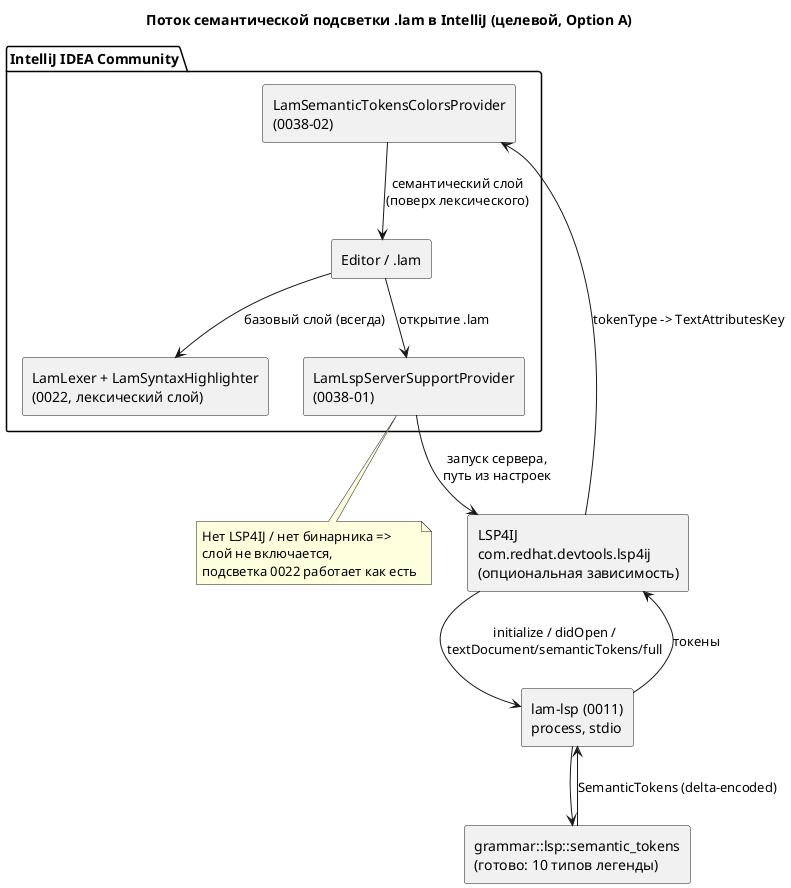

Источник: [docs/features/0038-intellij-semantic-tokens.md](https://github.com/Pastor/Takt/blob/3c154a13d979b18312a1250ebfbe3db2fa5247d3/docs/features/0038-intellij-semantic-tokens.md)

Полный текст по ссылке. Ниже начало карточки.

# Фича: Семантическая подсветка Lam в IntelliJ через lam-lsp

- **Номер:** 0038
- **Статус:** **ГОТОВО** (2026-07-19; функционально закрыта, A11 — визуальный остаток GUI)
- **Зависит от:** нет. Обе предпосылки уже закрыты (`ГОТОВО`):
  [lSP-сервер lam-lsp](0011-lsp-server.md) (`lam-lsp`, **включая готовый**
  `textDocument/semanticTokens/full`) и [плагин IntelliJ IDEA — подсветка синтаксиса Lam](0022-intellij-syntax-highlight.md)
  (плагин `extensions/intellij-lam` с лексической подсветкой). Незакрытых
  зависимостей нет ⇒ состояние `ЗАБЛОКИРОВАНА` **не ставится**.
  Обратная связь: [действие Reformat Code в плагине IntelliJ](0039-intellij-reformat.md) (Reformat Code) при
  выборе LSP4IJ-пути будет зависеть **от 0038**, а не наоборот — обоснование в
  [анализе](0038-intellij-semantic-tokens.md#анализ).
- **Приоритет / Tier:** **Tier 2** (оснастка языка, не ядро — свод),
  приоритет **средний**. В последовательности разработки ставится
  **перед 0039**: закрывает общую для обеих фич инфраструктуру LSP4IJ
  (критерий 4 — «раньше берётся фича, разблокирующая другие»).
- **Связанные issue (анализ):** новая фича (из блока «Кандидаты» `FEATURES.md`:
  «Семантическая подсветка Lam в IntelliJ через `lam-lsp`»; задел
  [ADR](0022-intellij-syntax-highlight.md#архитектура-adr), Option C)
- **Крейт/подпроект:** существующий подпроект `extensions/intellij-lam/`
  (Kotlin + Gradle IntelliJ Platform Plugin). Крейт `grammar` затрагивается
  **только тестами** (серверная реализация уже есть).

## Стадии жизненного цикла

Все стадии — **разделы этой карточки**: «Архитектура (ADR)»,
«Анализ», «Разработка», «Тест-план», «Отчёт о тестировании», «Итог».
Отдельным артефактом остаются только исправления —
[`docs/fixes/`](../fixes/README.md) (при необходимости `0038-YY-*`).

## Краткое описание

**Семантическая** надстройка над лексической подсветкой плагина
`extensions/intellij-lam`: плагин через **LSP4IJ** запускает `lam-lsp`, получает
`textDocument/semanticTokens/full` и перекрашивает идентификаторы по их
**смыслу**, а не по внешнему виду. Сегодня `LamLexer` видит любое имя как
`IDENTIFIER` и красит одинаково; сервер же различает функции, типы, варианты
`enum`, состояния/модели и обычные переменные — это ровно то, чего лексическому
плагину не хватает и чего он в принципе не может дать без семантической модели.

**Ключевой факт, изменивший объём фичи** (перепроверен при анализе): серверная
часть **уже готова**. `grammar/src/lsp.rs::semantic_tokens` реализован (легенда
`SEMANTIC_TOKEN_TYPES` из 10 типов, дельта-кодирование, корректная длина в
UTF-16), а `grammar/src/bin/lam_lsp.rs` объявляет `semantic_tokens_provider` в
capabilities и обрабатывает запрос `textDocument/semanticTokens/full`. Поэтому
фича — **почти целиком клиентская**: писать сервер не нужно, нужен потребитель.
Со стороны `grammar` остаются только **тесты** классификации (существующие
юнит-тесты покрывают лишь «не паникует» и длину UTF-16, но не то, что имя `fn`
приходит как `FUNCTION`).

Подсветка остаётся **деградируемой**: без установленного LSP4IJ или без бинарника
`lam-lsp` плагин работает ровно как сегодня (лексическая подсветка 0022) — без
ошибок и навязчивых уведомлений. Фича аддитивна: синтаксис/семантика языка и
версия языка не меняются (свод неприменим).

> Фича зарегистрирована из блока «Кандидаты» `FEATURES.md` (задел Option C
> [ADR](0022-intellij-syntax-highlight.md#архитектура-adr)); далее проходит жизненный
> цикл по своду.

## Архитектура (ADR)

> ## Пересмотр (2026-07-19): драйвер 1 (платформа) изменён
>
> **Факт, вскрытый при реализации:** современный **LSP4IJ несовместим с build
> 241** (IntelliJ 2024.1). Все актуальные версии (0.19+, включая 0.20.1) требуют
> `sinceBuild = 242` (IntelliJ 2024.2), а 2024.2 требует **JDK 21**. Плагин был
> закреплён на `platformVersion = 2024.1.7` / JDK 17 (драйвер 1, «Community/JDK17»).
> Пиннинг старой версии LSP4IJ (последняя с поддержкой 241 — ~год давности)
> отвергнут заказчиком в пользу **современного** клиента.
>
> **Решение заказчика (2026-07-19):** поднять платформу до **2024.2.5** (`sinceBuild
> = 242`), toolchain — **JDK 21** (авто-провижининг через foojay-резолвер в
> `settings.gradle.kts`; проверено — JDK 21 скачивается и компилирует). **Community
> сохранён** (`platformType = IC`) — суть драйвера 1 (не Ultimate) цела; менялась
> лишь минимальная линейка/JDK. Открытый `until-build`  сохранён.
>
> Прочие решения ADR (Option A, LSP4IJ, единый источник семантики, неломающая
> надстройка, перенос проверок на сервер) — **без изменений**. Драйвер 1
> переформулирован: «Community (не Ultimate), минимум 2024.2/JDK 21» вместо
> «Community 2024.1/JDK 17».

- **Status:** Accepted (драйвер 1 пересмотрен 2026-07-19 — см. врезку выше)
- **Date:** 2026-07-15
- **Authors:** Архитектор + дизайнер инструментов разработки + лид разработки
- **Related issues:** [Фича](0038-intellij-semantic-tokens.md);
  реализует **отложенный Option C** из [ADR](0022-intellij-syntax-highlight.md#архитектура-adr);
  наследует ограничения плагина из [ADR](0023-intellij-navigation-include.md#архитектура-adr);
  потребляет `lam-lsp` из [lSP-сервер lam-lsp](0011-lsp-server.md)

### Context

Плагин `extensions/intellij-lam` ([плагин IntelliJ IDEA — подсветка синтаксиса Lam](0022-intellij-syntax-highlight.md),
[плагин IntelliJ IDEA — навигация к декларации и include](0023-intellij-navigation-include.md), обе `ГОТОВО`, версия
плагина `0.4.0`) даёт **лексическую** подсветку: рукописный `LexerBase`
(`LamLexer`), `LamSyntaxHighlighter`, `LamColorSettingsPage`, эргономику
редактора, плоский PSI и навигацию. Его потолок структурен: лексер видит
**только форму токена**. Любое имя — `IDENTIFIER`, и `process` (функция),
`Celsius` (тип), `RED` (вариант `enum`), `Idle` (состояние) и `counter`
(переменная) окрашены **одинаково**. Различить их можно лишь имея семантическую
модель, которой у плагина нет и не будет без второго парсера языка.

**Ключевой факт (перепроверен при заведении фичи).** Серверная часть
**существует и работает** — это меняет объём решения радикально:

- `grammar/src/lsp.rs:17` — легенда `SEMANTIC_TOKEN_TYPES`: 10 типов
  (`KEYWORD`, `VARIABLE`, `FUNCTION`, `TYPE`, `ENUM_MEMBER`, `STRING`, `NUMBER`,
  `COMMENT`, `OPERATOR`, `CLASS` — последний для состояний и моделей);
- `grammar/src/lsp.rs:1412` — `pub fn semantic_tokens(source: &str) -> SemanticTokens`:
  токенизирует лексером, **обогащает идентификаторы семантической моделью**
  (`search_func` → `FUNCTION`, `types`/`enums` → `TYPE`, `search_enum_variant` →
  `ENUM_MEMBER`, `search_state`/`models` → `CLASS`, иначе `VARIABLE`), добавляет
  комментарии, сортирует и кодирует в дельта-формат LSP; длина считается в
  **кодовых единицах UTF-16** (кириллица учтена);
- `grammar/src/bin/lam_lsp.rs:51` — `semantic_tokens_provider` в
  `ServerCapabilities` (`full: true`, без `range`, без модификаторов);
  `lam_lsp.rs:200` — обработчик `textDocument/semanticTokens/full`.

Сервер деградирует мягко: если файл не парсится, `semantic_tokens` строит модель
через `.ok()` и при неудаче красит идентификаторы как `VARIABLE` — токены есть
всегда, подсветка «худеет», но не исчезает.

Итого решаемая задача — **не «сделать семантическую подсветку»**, а **«подключить
готовый источник токенов к IntelliJ»**. Вопрос ADR: каким транспортом.

**Силы, действующие на решение.**

1. **Редакция IDE.** Плагин собирается под `platformType = IC`
   (`gradle.properties`) — IntelliJ IDEA **Community**. Платформенный LSP API
   (`com.intellij.platform.lsp`) — **Ultimate-only** (требует
   `com.intellij.modules.ultimate`); в Community он недоступен. Это зафиксировано
   ещё в [ADR](0022-intellij-syntax-highlight.md#архитектура-adr) (Option C, Cons) и
   [ADR](0023-intellij-navigation-include.md#архитектура-adr) (Option C, Cons).
2. **Автономность 0022 — инвариант, а не пожелание.** Базовая подсветка обязана
   работать офлайн, в Community, без `lam-lsp`. Семантика может быть только
   **надстройкой**, включающейся при наличии сервера, и не вправе ломать
   лексический слой при его отсутствии.
3. **Никакого дублирования семантики.** Второе (Kotlin-) зеркало семантической
   модели немыслимо: ADR отвергли даже дублирование **грамматики**.
   Единственный законный источник классификации имён — крейт `grammar`.
4. **Общая инфраструктура с 0039.** [действие Reformat Code в плагине IntelliJ](0039-intellij-reformat.md)
   (Reformat Code) рассматривает тот же LSP4IJ-путь: `textDocument/formatting`
   пришёл бы «бесплатно» поверх той же интеграции. Решение предопределяет
   объём 0039 — это учитывается в Decision, но не делает 0038 зависимой.
5. **Проверяемость.** `runIde` требует GUI, собрать/прогнать плагин в CI-среде
   нельзя (остаточные пункты 0022/0023). Решение обязано максимизировать долю
   автоматически проверяемого — то есть по возможности переносить проверяемую
   логику на **сторону сервера** (Rust-тесты в CI).

### Decision Drivers

1. **Работа в Community** — плагин собран под IC; решение, требующее Ultimate,
   не решает задачу для целевой аудитории.
2. **Единый источник семантики** — классификация имён только из `grammar`,
   никаких вторых реализаций.
3. **Неломающая надстройка** — при отсутствии сервера поведение плагина
   **байт-в-байт** прежнее.
4. **Максимум автопроверок** — проверяемая логика по возможности на стороне
   Rust (CI), а не за GUI.
5. **Учёт 0039** — не закрывать, а по возможности удешевить путь к
   `textDocument/formatting`.

### Considered Options

#### Option A. LSP4IJ + `textDocument/semanticTokens` из `lam-lsp`

Опциональная зависимость плагина на LSP4IJ (`com.redhat.devtools.lsp4ij`),
`LamLspServerSupportProvider` (дескриптор сервера: команда запуска `lam-lsp`,
маппинг языка Lam), `SemanticTokensColorsProvider` — маппинг 10 типов легенды в
`TextAttributesKey` (переиспользуя ключи `LamHighlighterColors` из 0022).
Путь к бинарнику — настройка плагина + автопоиск в `PATH`.

**Pros:**
- **Работает в Community** — LSP4IJ ставится из Marketplace в IC (в этом весь
  смысл проекта LSP4IJ от Red Hat).
- Переиспользует **готовую** серверную реализацию (0011) целиком — объём фичи
  сводится к клиентскому связыванию; дублирования семантики нет.
- Надстройка: при отсутствии LSP4IJ/бинарника лексический слой 0022 не тронут
  (`<depends optional="true">` не срывает загрузку плагина).
- Открывает 0039 (`textDocument/formatting` — та же интеграция, ~одна точка
  расширения) и будущую LSP-навигацию/hover/completion — сервер уже всё это умеет.
- Заметная часть проверок уходит в Rust-тесты `semantic_tokens` (CI), где нет
  проблемы GUI.

**Cons:**
- **Внешняя зависимость плагина** от стороннего LSP4IJ: пользователь ставит два
  плагина; API LSP4IJ моложе платформенных и может меняться между версиями.
- Требует собранный `lam-lsp` (`cargo build --features lsp --bin lam-lsp`) —
  нужны UI настройки пути, диагностика отсутствия бинарника, документация.
- LSP4IJ тянет собственный `sinceBuild`; **открытый `until-build`** плагина
  ([проверка совместимости с новыми IDE (verifyPlugin) + валидность дескриптора](../fixes/0023-01-verifyplugin-descriptor.md)) придётся
  сверить с диапазоном LSP4IJ через `verifyPlugin`.
- Оптиональная зависимость усложняет тесты: часть путей исполняется только при
  наличии LSP4IJ в тестовом classpath.

#### Option B. Нативный LSP API платформы IntelliJ (`com.intellij.platform.lsp`)

`LspServerSupportProvider` из платформы + `LspSemanticTokensSupport`.

**Pros:**
- API «от первоисточника», без сторонних плагинов; лучше интегрирован в
  платформу и стабильнее по контракту.
- Нет второго плагина в установке пользователя.

**Cons:**
- **Ultimate-only — дисквалифицирующий минус.** `com.intellij.platform.lsp`
  требует `com.intellij.modules.ultimate`; плагин собирается под
  `platformType = IC` (`gradle.properties`) и заявляет
  `<depends>com.intellij.modules.platform</depends>`. Переход означал бы либо
  отказ от Community-аудитории, либо раздвоение плагина на IC/IU-редакции.
- Ломает драйвер 1 (инженеры асу тп, массово — Community/RustRover).
- Сборочная платформа (IC 2024.1.7, JDK 17) сменилась бы на IU — новый
  toolchain, новый диапазон, перепроверка всего `verifyPlugin`.

#### Option C. Семантическая подсветка через собственный PSI/аннотатор без LSP

`Annotator`/`HighlightVisitor` поверх полноценного PSI-парсера ([полноценный PSI-парсер плагина IntelliJ](0040-intellij-psi-parser.md)), классифицирующий имена
собственными средствами плагина.

**Pros:**
- Полная автономность: ни LSP4IJ, ни бинарника `lam-lsp`, ни внешних процессов.
- Мгновенный отклик (без IPC), нативная интеграция с инспекциями/подсказками.
- Тестируется штатным `BasePlatformTestCase` (в пределах ограничения GUI).

**Cons:**
- **Требует третьей реализации семантики языка на Kotlin** — разрешение имён,
  области видимости, импорты, псевдонимы типов, варианты `enum`. Это ровно то
  дублирование, которое ADR и 0023 отвергли **дважды** (там речь шла лишь о
  грамматике; здесь — о семантической модели, которая много сложнее).
- Гарантированный дрейф от `grammar`: подсветка начнёт врать при эволюции языка,
  причём **молча** (тот же класс «тихого расхождения», что дал восемь дефектов в
  фиче).
- Блокируется фичей (полный PSI) — сама по себе крупная многозадачная фича;
  объём несоразмерен задаче раскраски.
- Не переиспользует ничего из готовых 0011/`semantic_tokens`.

### Decision

Принимается **Option A** — LSP4IJ + `textDocument/semanticTokens` из `lam-lsp`.

**Обоснование.**

1. **Option B отпадает по факту, а не по вкусу:** платформенный LSP API —
   Ultimate-only, плагин собран и заявлен под Community (`platformType = IC`).
   Выбрать B — значит либо потерять целевую аудиторию, либо
   раздвоить плагин; цена несоразмерна выигрышу «нет второго плагина».
2. **Option C отпадает по стоимости и по риску:** он требует третьего зеркала
   семантики языка на Kotlin — то самое дублирование, которое проект отвергал
   дважды, причём здесь дублируется не грамматика, а
   семантическая модель. Расхождение с `grammar` было бы **тихим**, а подсветка,
   которая врёт, хуже подсветки, которой нет.
3. **Option A почти ничего не строит заново.** Сервер готов: легенда, обогащение
   идентификаторов моделью, дельта-кодирование, UTF-16 — всё в
   `grammar/src/lsp.rs`. Остаётся клиентское связывание. Это единственный
   вариант, где семантика имеет **ровно один** источник — крейт `grammar`.
4. **Драйвер 3 соблюдён:** зависимость от LSP4IJ — `optional="true"`, слой
   включается при наличии сервера; иначе плагин ведёт себя как сегодня.
5. **Драйвер 5 соблюдён:** ограничение GUI не обойти, но его удаётся **обойти по
   касательной** — классификация токенов (то, что фича реально утверждает)
   проверяется Rust-тестами в CI; за GUI остаётся только «цвета доехали».

**Про 0039.** Решение делает LSP4IJ-путь для 0039 практически бесплатным
(`textDocument/formatting` сервер уже реализует — `lam_lsp.rs:50`,
`document_formatting_provider`). Но 0038 **не зависит** от 0039: инфраструктура
LSP4IJ входит в объём 0038 целиком  и строится независимо от
того, какой путь выберет ADR. Направление зависимости — обратное
(0039 → 0038), и только если ADR выберет LSP4IJ; подробности — в
[анализе](0038-intellij-semantic-tokens.md#анализ).

### Consequences

#### Положительные

- Идентификаторы `.lam` в IntelliJ различаются **по смыслу**: функции, типы,
  варианты `enum`, состояния/модели, переменные — каждый своим цветом.
- Семантика имеет один источник (`grammar`); дрейфа между IDE и компилятором
  нет по построению.
- Готовая интеграция LSP4IJ открывает 0039 (formatting) и будущие
  hover/completion/definition от `lam-lsp` — сервер их уже отдаёт.
- Плагин остаётся автономным в базовом режиме: 0022/0023 работают без сервера.
- Rust-тесты `semantic_tokens` усиливаются и закрывают реальную дыру: сейчас
  проверяется только «не паникует», а не корректность классификации.

#### Отрицательные / Action items

- **Внешняя зависимость LSP4IJ** — документировать установку (README плагина); `<depends optional="true" config-file="lam-lsp4ij.xml">`, чтобы
  отсутствие LSP4IJ не срывало загрузку плагина.
- **Требуется бинарник `lam-lsp`** (`cargo build --features lsp --bin lam-lsp`) —
  нужны настройка пути, автопоиск в `PATH`, тихая деградация при отсутствии
  (без модальных ошибок при каждом открытии файла).
- **Диапазон совместимости** — сверить открытый `until-build` плагина с
  `sinceBuild` LSP4IJ через `verifyPlugin`; при конфликте зафиксировать нижнюю
  границу в `gradle.properties` и отразить в README.
- **Ограничение проверяемости сохраняется** (остаточные пункты 0022/0023):
  фактическая раскраска в редакторе проверяется только визуально в среде с GUI
  (`runIde`); в CI — Rust-тесты токенов + Gradle-тесты чистой логики.
- **Сервер не отдаёт `range`-токены и модификаторы** (`full: true`, `range: None`,
  `token_modifiers: vec![]`) — для больших файлов возможна перерисовка целиком;
  если проявится, вынести `semanticTokens/range` и модификаторы
  (`declaration`/`readonly` для `const`) в бэклог отдельной фичей.
- **Версия плагина** `0.4.0 → 0.5.0` (аддитивная функциональность, SemVer,
  свод к **языку** неприменим — язык не меняется).

#### Acceptance criteria

1. При установленном LSP4IJ и доступном `lam-lsp` открытие `.lam` в IntelliJ IDEA
   **Community** поднимает сервер, а идентификаторы окрашиваются по семантике:
   имя `fn` — как функция, имя `type`/`enum` — как тип, вариант `enum` — как
   константа перечисления, `state`/`model` — как класс, прочие — как переменная.
2. Без LSP4IJ **или** без бинарника `lam-lsp` плагин загружается и работает ровно
   как версия `0.4.0` (лексическая подсветка, навигация, эргономика), без
   исключений и модальных ошибок; регресс-тесты зелёные.
3. Все 10 типов легенды `grammar::lsp::SEMANTIC_TOKEN_TYPES` имеют маппинг в
   `TextAttributesKey`; несопоставленных типов нет (проверяется тестом).
4. Rust-тесты подтверждают **классификацию** (не только отсутствие паники):
   для эталонного `.lam` имя функции приходит с типом `FUNCTION`, тип — `TYPE`,
   вариант `enum` — `ENUM_MEMBER`, состояние/модель — `CLASS`, переменная —
   `VARIABLE`; на непарсящемся исходнике токены отдаются (деградация без паники).
5. `./gradlew buildPlugin test` — BUILD SUCCESSFUL, все тесты зелёные;
   `verifyPlugin` — Compatible для заявленного диапазона IDE.
6. Язык, его синтаксис/семантика и версия языка не изменены; изменения в
   `grammar` ограничены тестами (аддитивность).

## Анализ

### Цель и контекст

Дать плагину `extensions/intellij-lam` **семантический** слой подсветки поверх
лексического (0022): различать имена по смыслу (функция / тип / вариант `enum` /
состояние-модель / переменная), а не по форме токена. Реализация — **Option A**
[ADR](0038-intellij-semantic-tokens.md#архитектура-adr): LSP4IJ + готовый
`textDocument/semanticTokens/full` из `lam-lsp`.

**Проверка ключевого факта (выполнена при анализе, а не принята на веру).**
Кандидат в `FEATURES.md` описывал фичу как задел Option C из ADR, оставляя
открытым вопрос, есть ли серверная часть. Ответ: **есть, полностью**.

| Что | Где | Состояние |
|---|---|---|
| Легенда из 10 типов токенов | `grammar/src/lsp.rs:17` (`SEMANTIC_TOKEN_TYPES`) | готово |
| Генерация токенов + обогащение семантической моделью | `grammar/src/lsp.rs:1412` (`pub fn semantic_tokens`) | готово |
| Дельта-кодирование LSP | `grammar/src/lsp.rs:1535–1575` | готово |
| Длина токена в UTF-16 (кириллица) | `grammar/src/lsp.rs:1544–1555` | готово |
| Объявление `semantic_tokens_provider` | `grammar/src/bin/lam_lsp.rs:51` (`full: true`, `range: None`, без модификаторов) | готово |
| Обработчик `textDocument/semanticTokens/full` | `grammar/src/bin/lam_lsp.rs:200` | готово |
| **Тесты классификации токенов** | `grammar/src/lsp.rs:2117–2150` | **дыра**: только «не паникует» (валидный/пустой ввод) и длина UTF-16; **корректность классификации не проверяется ничем** |
| Потребитель в IntelliJ | — | **отсутствует** (предмет фичи) |

Следствие для объёма: фича **клиентская**. Писать сервер не нужно — нужен
потребитель. Со стороны `grammar` — только тесты, закрывающие
выявленную дыру: сегодня можно сломать классификацию (например, порядок ветвей в
`match` по `Token::Identifier`) и **не уронить ни одного теста**.

Классификация идентификатора сервером (`lsp.rs:1432–1451`), в порядке
приоритета: встроенный тип (`BUT_BUILTIN_TYPES`) → `TYPE`; `search_func` →
`FUNCTION`; `types`/`enums` → `TYPE`; `search_enum_variant` → `ENUM_MEMBER`;
`search_state`/`models` → `CLASS`; иначе → `VARIABLE`. При непарсящемся исходнике
модель не строится (`.ok()`), и все идентификаторы деградируют в `VARIABLE` —
токены отдаются всегда.

### Зависимости фичи

- **Зависит от:** **нет**. Обе предпосылки закрыты (`ГОТОВО`):
  - [lSP-сервер lam-lsp](0011-lsp-server.md) — `lam-lsp` с реализованными semantic
    tokens (см. таблицу выше). Не «в планах», а рабочий код.
  - [плагин IntelliJ IDEA — подсветка синтаксиса Lam](0022-intellij-syntax-highlight.md) — плагин, поверх
    которого строится надстройка (`LamHighli
