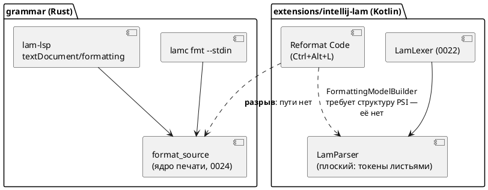
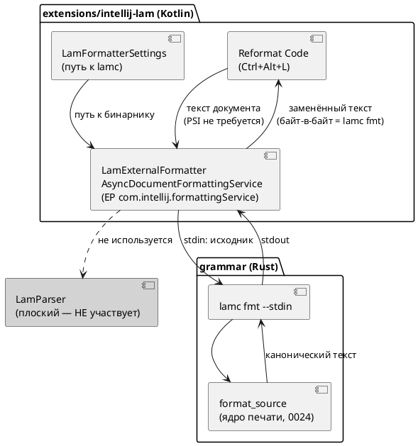

Источник: [docs/features/0039-intellij-reformat.md](https://github.com/Pastor/Takt/blob/3c154a13d979b18312a1250ebfbe3db2fa5247d3/docs/features/0039-intellij-reformat.md)

Полный текст по ссылке. Ниже начало карточки.

# Фича: Действие Reformat Code в плагине IntelliJ

- **Номер:** 0039
- **Статус:** **ГОТОВО** (2026-07-19). Развилка разрешена заказчиком в пользу
  **LSP4IJ-варианта (Option B)** после принятия LSP4IJ в фиче
  [семантическая подсветка Lam в IntelliJ через lam-lsp](0038-intellij-semantic-tokens.md) — форматирование пришло бесплатно от
  уже работающего `lam-lsp`, фича схлопнулась до приёмки. Итог — в разделе
  [«Итог (что сделано)»](#итог-что-сделано) ниже; обновление решения — в
  [ADR](0039-intellij-reformat.md#архитектура-adr), раздел «Обновление решения (2026-07-19)».
  Подзадачи Option C [действие Reformat Code в плагине IntelliJ](0039-intellij-reformat.md#разработка),
  [действие Reformat Code в плагине IntelliJ](0039-intellij-reformat.md#разработка),
  [действие Reformat Code в плагине IntelliJ](0039-intellij-reformat.md#разработка) **сняты как неактуальные**.
- **Зависит от:** **нет.** Фича автономна и **не** переводится в `ЗАБЛОКИРОВАНА`.
  Разбор смежных фич: [полноценный PSI-парсер плагина IntelliJ](0040-intellij-psi-parser.md) (PSI-парсер) — **не
  блокер**, т.к. принятый путь **не использует PSI** (посылка витрины «реформат
  требует структуры PSI» опровергнута: платформа имеет точку расширения
  `com.intellij.formattingService` для внешних форматтеров, и она **присутствует
  на платформе сборки** `ideaIC-2024.1.7`); [семантическая подсветка Lam в IntelliJ через lam-lsp](0038-intellij-semantic-tokens.md)
  (LSP4IJ) — **не блокер** технически, но **связана по решению** (см. статус
  выше и раздел «Развилка» ниже). [плагин IntelliJ IDEA — подсветка синтаксиса Lam](0022-intellij-syntax-highlight.md),
  [плагин IntelliJ IDEA — навигация к декларации и include](0023-intellij-navigation-include.md), [канонический форматтер.lam (lamc fmt)](0024-lam-formatter.md) —
  **закрыты** (`ГОТОВО`), блокировать нечему
- **Приоритет:** **Tier 3 (низкий)** — см. раздел «Приоритет» ниже
- **Связанные issue (анализ):** новая фича (из блока «Кандидаты в фичи»
  `FEATURES.md`; вынесена из [канонический форматтер.lam (lamc fmt)](0024-lam-formatter.md), [канонический форматтер.lam (lamc fmt)](0024-lam-formatter.md#разработка), раздел «Находка»)

## Стадии жизненного цикла

Все стадии — **разделы этой карточки**: «Архитектура (ADR)»,
«Анализ», «Разработка», «Тест-план», «Отчёт о тестировании», «Итог».
Отдельным артефактом остаются только исправления —
[`docs/fixes/`](../fixes/README.md) (при необходимости `0039-YY-*`).

## Краткое описание

Плагин `extensions/intellij-lam` получает штатное действие **«Reformat Code»**
(`Ctrl+Alt+L`) для файлов `.lam`: текст документа отдаётся процессу
`lamc fmt --stdin`, результат применяется к документу. Реализация — точка
расширения платформы `com.intellij.formattingService`
(`AsyncDocumentFormattingService`), предназначенная ровно для **внешних**
форматтеров (по ней в IDE работают Prettier и rustfmt) и **не требующая**
PSI-структуры — поэтому плоский `LamParser` (решение [ADR](0023-intellij-navigation-include.md#архитектура-adr))
менять не нужно. Стиль остаётся описан **один раз** — в ядре `grammar/src/format/`
([канонический форматтер.lam (lamc fmt)](0024-lam-formatter.md)): реформат в IDE **является** вызовом
`lamc fmt`, поэтому совпадает с ним байт-в-байт по построению, а не по
договорённости. Язык не меняется.

> Фича зарегистрирована из бэклога кандидатов `FEATURES.md` (вынесена из фичи
> 0024); далее проходит жизненный цикл по своду.

## Мотивация / контекст

Фича объявила **трёх** потребителей канонического ядра печати: `lamc fmt`,
LSP `textDocument/formatting` и «Reformat Code» в IntelliJ. Первые два сделаны и
проверены; третий остался несделанным — и это **последний незакрытый пункт**
фичи.

Практическая цена пропуска: пользователь IntelliJ форматирует `.lam` только из
терминала. При этом `lamc fmt --check` уже стоит в `precheck.sh` и стережёт канон
`examples/` — то есть разработчик узнаёт о неканоничном форматировании **от CI**,
хотя IDE могла бы исправить это по `Ctrl+Alt+L`.

## Развилка (решение заказчика)

Витрина `FEATURES.md` прямо вынесла выбор пути на заказчика. ADR разобрал все
три и **рекомендует путь 3**:

| Путь | Суть | Вердикт ADR |
|---|---|---|
| 1 | Полноценный PSI-парсер ([полноценный PSI-парсер плагина IntelliJ](0040-intellij-psi-parser.md)) + `FormattingModelBuilder` | **отвергнут**: стиль пришлось бы описать **вторым** кодом на Kotlin → «байт-в-байт» недостижимо по построению; плюс дорого и блокируется 0040 |
| 2 | Интеграция LSP4IJ ([семантическая подсветка Lam в IntelliJ через lam-lsp](0038-intellij-semantic-tokens.md)) — форматирование «бесплатно» | **не рекомендован здесь**, но остаётся правом заказчика: `<depends>com.redhat.devtools.lsp4ij</depends>` — **жёсткая** зависимость (без стороннего плагина из Marketplace наш **не загрузится вовсе**), и это разворот принципа самодостаточности, принятого **дважды** (ADR Option C, ADR Option C) |
| **3** | **`lamc fmt --stdin` внешним процессом** | **Принят** (Option C ADR) |

**Почему путь 3, а не «самый выгодный» путь 2, как предполагала витрина.**
Витрина оценивала путь 3 как обременённый («нужны UI настроек, обработка
отсутствия бинарника») и исходила из того, что реформат требует PSI. Проверка
показала: **посылка неверна** — EP для внешних форматтеров существует и есть на
платформе сборки. После снятия посылки путь 3 — не обходной манёвр, а штатный
механизм платформы, который вдобавок:

- даёт «байт-в-байт» **тавтологически** (реформат *есть* `lamc fmt`);
- не разворачивает два принятых ADR и не ломает загрузку плагина без внешних
  компонентов;
- требует от пользователя **один** бинарник `lamc` (который у пользователя Lam и
  так есть) вместо «сторонний плагин + LSP-сервер»;
- **проверяем автотестом** здесь и сейчас.

**Оговорка (честно).** Путь 2 остаётся объективно выгоднее **в одном случае** —
если заказчик независимо принимает LSP4IJ ради фичи (её серверная часть в
`lam-lsp` **уже написана**: `semantic_tokens_provider` объявлен и обрабатывается;
не хватает только клиента в IDE). Тогда форматирование приходит бесплатно, а
[действие Reformat Code в плагине IntelliJ](0039-intellij-reformat.md) схлопывается до приёмочных тестов. Поэтому решение по LSP4IJ принимается
**в 0038**, а 0039 — его следствие. Отсюда оговорка в статусе: проработку
завершить, разработку начинать после развилки.

## Объём

- `LamExternalFormatter` — `AsyncDocumentFormattingService` на EP
  `com.intellij.formattingService`; вызов `lamc fmt --stdin` (UTF-8, таймаут),
  отказ вместо порчи при ненулевом коде возврата.
- `LamFormatterSettings` (`PersistentStateComponent`) + страница настроек +
  резолвер пути (настройка → `PATH`) + диагностика отсутствия бинарника.
- Тесты: головная сверка «байт-в-байт» с эталоном, вычисляемым прогоном
  настоящего `lamc`; корпус `examples/`; контрпримеры; регресс 0022/0023.
- Версия плагина `0.4.0 → 0.5.0`.

**Вне объёма:** PSI-парсер, LSP-клиент/LSP4IJ,
format-on-save (включается средствами платформы), правки крейтов
`grammar`/`simulation` (контракт `lamc fmt` уже достаточен — проверено пробой).

## Приоритет (свод п.3)

**Tier 3 (низкий).** Аргументы:

1. **Это эргономика, а не работоспособность.** Форматирование в проекте **уже
   есть** и доступно двумя путями (`lamc fmt`, LSP). Фича не чинит сломанное, а
   избавляет пользователя IntelliJ от переключения в терминал. Сравнить с
   Tier 1-фичами вроде [генератор C: typedef корневой структуры для одиночной модели](0026-c-root-typedef.md), где порождённый C **не
   компилируется вовсе**: там страдает основная цель проекта, здесь
   — удобство.
2. **Аудитория узкая:** только пользователи IntelliJ, и только те, кто не
   пользуется `lamc fmt`/LSP-редактором.
3. **Главный риск — не технический, а решенческий** (см. «Развилка»): пока не
   принято решение по LSP4IJ, работа может оказаться выброшенной. Низкий
   приоритет здесь — не оценка качества проработки, а способ не тратить усилия
   до развилки.
4. **Но цена мала** (один класс + настройки + тесты, крейты Rust не трогаются
   вовсе), поэтому по своду п.4 фичу **допустимо поднять** сразу после
   решения по 0038, если оно окажется «LSP4IJ не берём»: тогда она за один заход
   закрывает последний остаточный пункт фичи.

## Архитектура (ADR)

- **Status:** Accepted — с **обновлением решения от 2026-07-19**: развилка
  разрешена в пользу **Option B (LSP4IJ)**, не Option C. Причина —
  принятие LSP4IJ в фиче [семантическая подсветка Lam в IntelliJ через lam-lsp](0038-intellij-semantic-tokens.md).
  См. раздел «## Обновление решения (2026-07-19)» в конце. Разбор опций,
  драйверы и посылка о PSI ниже сохранены как история — они остаются в силе.
- **Date:** 2026-07-15 (обновление решения — 2026-07-19)
- **Authors:** Архитектор + Системный аналитик
- **Related issues:** [Фича](0039-intellij-reformat.md); развивает
  [ADR](0024-lam-formatter.md#архитектура-adr) (ядро форматтера) и наследует принципы
  [ADR](0022-intellij-syntax-highlight.md#архитектура-adr) / [ADR](0023-intellij-navigation-include.md#архитектура-adr)
  (самодостаточность плагина); смежные фичи — [семантическая подсветка Lam в IntelliJ через lam-lsp](0038-intellij-semantic-tokens.md),
  [полноценный PSI-парсер плагина IntelliJ](0040-intellij-psi-parser.md)

### Context

[канонический форматтер.lam (lamc fmt)](0024-lam-formatter.md) дала **каноническое ядро печати**
`grammar/src/format/` (`format_source`) и двух потребителей:

- `lamc fmt` (`--check` / `--stdin`) — CLI;
- `lam-lsp` `textDocument/formatting` — редакторы по LSP.

Третий заявленный потребитель — действие **«Reformat Code»** плагина
`extensions/intellij-lam` — в 0024 **не был сделан**. [канонический форматтер.lam (lamc fmt)](0024-lam-formatter.md#разработка) зафиксировала находку:
плагину «нечем дотянуться до ядра», потому что `LamParser` — **плоский**
разборщик (`LamParser.kt:15–24`: все токены листьями под корень; осознанное
решение ADR, Option A), а `FormattingModelBuilder` форматирует **по
структуре PSI**. Вопрос был вынесен в `FEATURES.md` как **решение заказчика**
между тремя путями.

#### Проверка посылки: «нужен PSI» — неверно

Настоящий ADR **опровергает** посылку, на которой держалась постановка вопроса.
`FormattingModelBuilder` — не единственный способ форматирования в платформе.
Существует точка расширения **`com.intellij.formattingService`**, предназначенная
ровно для **внешних** форматтеров (по ней работают Prettier, rustfmt, shfmt) и
**не требующая ни PSI-структуры, ни `FormattingModelBuilder`**.

Проверено **на той самой платформе, против которой собирается плагин**
(`ideaIC-2024.1.7`, `gradle.properties: platformVersion`):

```
lib/app-client.jar :: META-INF/CodeStyle.xml
  <extensionPoint name="formattingService"
                  interface="com.intellij.formatting.service.FormattingService"
                  dynamic="true"/>
lib/app-client.jar :: com/intellij/formatting/service/AsyncDocumentFormattingService.class
```

Тот же класс присутствует и в `ideaIC-2025.1` — то есть открытый `until-build`
плагина не ставится под угрозу. `AsyncDocumentFormattingService` получает **текст
документа**, отдаёт его внешнему процессу и возвращает результат; штатное
`Reformat Code` (`Ctrl+Alt+L`) маршрутизируется через него.

**Следствие:** путь «внешний процесс» не блокируется ни фичей (PSI-парсер),
ни фичей (LSP4IJ). Он реализуем **сегодня**, на текущей платформе.

#### Что уже готово в ядре (проверено)

| Факт | Где | Статус |
|---|---|---|
| `format_source` — каноническая печать | `grammar/src/format/` | готово (0024) |
| `lamc fmt --stdin` — stdin → stdout | `grammar/src/bin/lamc.rs:322–345` | **готово, проверено пробой** |
| `lamc fmt --check` — код 0/≠0 | `grammar/src/bin/lamc.rs` | **готово, проверено пробой** |
| LSP `textDocument/formatting` | `lam_lsp.rs:50, 144–162`; `lsp.rs:146` | готово (0024-04) |
| LSP `textDocument/semanticTokens` (full) | `lam_lsp.rs:51–61, 201–204` | **готово** (серверная часть 0038) |
| `LamParser` — плоский, структуры нет | `LamParser.kt:15–24` | подтверждено |

Проба `lamc fmt --stdin` (реальный прогон, `examples/extend_complex.lam`):
вывод из stdin **байт-в-байт** совпал и с файловым режимом, и с каноническим
оригиналом; `--check --stdin` дал код `0` на каноничном и `1` на изменённом
входе.



### Decision Drivers

1. **Единое ядро — фактом, а не договорённостью.** Критерий A6 фичи:
   расхождение стиля между CLI и редактором должно быть невозможно **по
   построению**. Любой путь, где стиль печатается вторым кодом, — отвергается.
2. **Самодостаточность плагина.** ADR и ADR **дважды** отвергли
   LSP-путь именно потому, что он ломает автономность (платформенный LSP API —
   Ultimate-only; в Community нужен сторонний LSP4IJ). Разворот этого принципа —
   отдельное решение заказчика, а не деталь реализации 0039.
3. **Минимум дублирования грамматики.** Второй парсер/принтер языка на Kotlin —
   источник рассинхронизации с `grammar.lalrpop` (тот же довод, что в ADR).
4. **Проверяемость.** Решение должно оставлять как можно больше **автоматически**
   проверяемого: `runIde` требует GUI, и всё, что проверяется только глазами,
   рискует остаться непроверенным.
5. **Деградация без внешнего компонента.** Отсутствие внешнего бинарника/плагина
   не должно ломать уже работающие подсветку и навигацию (0022/0023).

### Considered Options

Три опции ниже — ровно те, что витрина `FEATURES.md` вынесла на решение
заказчика; четвёртая добавлена как честная «нулевая» альтернатива.

#### Option A. Полноценный PSI-парсер плагина + `FormattingModelBuilder` (путь 1 витрины)

[полноценный PSI-парсер плагина IntelliJ](0040-intellij-psi-parser.md) строит настоящее PSI-дерево;
форматирование описывается штатной моделью блоков/отступов/интервалов.

**Pros:**
- Нативное для платформы форматирование; заодно приходят find usages, rename,
  структура файла, инспекции.
- Не нужен внешний бинарник: всё внутри плагина, офлайн.

**Cons:**
- **Нарушает драйвер 1.** Стиль пришлось бы описать **второй раз** — правилами
  `Block`/`Indent`/`Spacing` на Kotlin. Это не «то же ядро», а его ручное
  зеркало: расхождение с `lamc fmt` становится вопросом времени, а критерий
  «байт-в-байт» — недостижимым по построению.
- Самая крупная трудоёмкость из всех опций; блокируется фичей.
- Второй парсер языка — рассинхронизация с `grammar.lalrpop` (довод ADR).

#### Option B. Интеграция LSP4IJ: `textDocument/formatting` от `lam-lsp` (путь 2 витрины)

Плагин объявляет зависимость от стороннего LSP4IJ (Red Hat) и регистрирует
`lam-lsp` как сервер; форматирование приходит от уже готового
`textDocument/formatting`.

Проверено по документации LSP4IJ (в этой среде плагин **не установлен**, поэтому
проверка — документарная, не исполняемая):

- id для `<depends>` — `com.redhat.devtools.lsp4ij`; вендор — Red Hat;
- `textDocument/formatting` — **поддержан полностью** (через тот же EP
  `formattingService`);
- `textDocument/semanticTokens` — **экспериментальный**, только
  `semanticTokens/full` (что совпадает с тем, как объявляет себя `lam-lsp`:
  `full: Some(Bool(true))`);
- совместим со всеми редакциями IntelliJ, включая Community.

**Pros:**
- Форматирование — **бесплатно**: ядро уже отдаёт правки по LSP (0024-04),
  писать код форматирования не нужно вовсе.
- Драйвер 1 соблюдён: то же `format_source`.
- Одной инфраструктурой закрывается и [семантическая подсветка Lam в IntelliJ через lam-lsp](0038-intellij-semantic-tokens.md):
  серверная часть semantic tokens в `lam-lsp` **уже написана** — не хватает
  только клиента.

**Cons:**
- **Нарушает драйвер 2 сильнее всех.** `<depends>com.redhat.devtools.lsp4ij</depends>` —
  **жёсткая** зависимость: без установленного из Marketplace стороннего плагина
  наш плагин **не загрузится вообще**, вместе с уже работающими подсветкой и
  навигацией. Драйвер 5 нарушен.
- Разворачивает решения **двух** принятых ADR (0022 Option C, 0023 Option C),
  отвергших LSP ровно по этой причине. Такой разворот — предмет отдельного
  решения, а не побочный эффект фичи про реформат.
- Требует установленного и настроенного `lam-lsp` + управление процессом сервера
  — нагрузка на пользователя **не меньше**, чем у Option C (там нужен один
  `lamc`, здесь — сторонний плагин **и** сервер).
- Проверяемость (драйвер 4): в этой среде не проверить ничего — ни LSP4IJ, ни
  связку. Непроверяемо и в CI.

#### Option C. Внешний форматтер: `AsyncDocumentFormattingService` + `lamc fmt --stdin` (путь 3 витрины)

Плагин реализует `com.intellij.formattingService` через
`AsyncDocumentFormattingService`: отдаёт текст документа процессу
`lamc fmt --stdin`, применяет полученный текст. PSI не нужен (см. Context).

**Pros:**
- **Драйвер 1 выполнен предельно:** это не «то же ядро», это **буквально
  `lamc fmt`**. Критерий «байт-в-байт равно выводу `lamc fmt`» выполняется
  тавтологически, а не проверкой.
- **Драйвер 2 сохранён:** ни новых плагинов-зависимостей, ни разворота ADR. Плагин остаётся самодостаточным.
- **Драйвер 5 выполнен:** нет `lamc` → деградирует **только** реформат
  (сообщение об ошибке), подсветка и навигация работают.
- **Драйвер 4 — лучший из опций:** EP присутствует на платформе сборки
  (проверено локально), а `lamc` собирается тем же `cargo` в этом же
  репозитории — значит связку можно прогнать **headless-тестом**, а не глазами.
- Не блокируется ничем: ни 0038, ни 0040. Реализуема немедленно.
- Малый объём: один класс формата + настройка пути + тесты.

**Cons:**
- Требует установленного `lamc` и UI настройки пути; нужна внятная диагностика
  отсутствия бинарника (это и есть основной объём фичи).
- Запуск процесса на каждое форматирование — накладные расходы (для файла
  масштаба `stacker.lam`, 16.9K, несущественно; EP асинхронный by design).
- Если заказчик впоследствии примет LSP4IJ, два механизма
  **столкнутся на одном и том же EP** `formattingService` — потребуется снять
  один. См. Consequences.

#### Option D. Ничего не делать: пользоваться `lamc fmt` / LSP

Форматирование уже доступно из CLI и из любого LSP-редактора.

**Pros:**
- Ноль затрат и рисков; функциональность в проекте уже есть.

**Cons:**
- Пользователь IntelliJ не получает штатного `Ctrl+Alt+L` — ради этого фича и
  заведена; заказчик спрашивает не «есть ли форматтер», а «работает ли реформат
  в IDE».

### Decision

Принимается **Option C** — внешний форматтер через
`com.intellij.formattingService` / `AsyncDocumentFormattingService`, вызывающий
`lamc fmt --stdin`.

Обоснование:

1. **Посылка, из-за которой опция считалась слабой, оказалась ложной.** Витрина
   предлагала выбирать между «PSI» и «LSP» потому, что реформат якобы требует
   структуры PSI. Это неверно: платформа имеет EP ровно для внешних форматтеров,
   и он **есть на платформе сборки плагина** (проверено в
   `ideaIC-2024.1.7/lib/app-client.jar`). Как только посылка снята, Option C
   перестаёт быть «костылём» и становится штатным механизмом платформы — тем
   самым, которым в IDE работают Prettier и rustfmt.
2. **Только Option C даёт «байт-в-байт» по построению.** Option A печатает стиль
   вторым кодом (расхождение неизбежно). Option B даёт то же ядро, но через две
   внешние сущности. Option C **является** `lamc fmt` — сверять нечего.
3. **Не разворачивает принятые ADR.** Отказ от LSP ради самодостаточности принят
   дважды (0022, 0023). Фича «про реформат» — неподходящее место, чтобы отменить
   это решение мимоходом: цена (плагин не грузится без стороннего LSP4IJ) платится
   всеми пользователями, включая тех, кому реформат не нужен.
4. **Максимум автоматической проверки** в среде, где `runIde` недоступен.

**Явная развилка для заказчика.** Рекомендация не отменяет права выбрать Option B:
он выгоднее, **если** заказчик независимо решает принять LSP4IJ ради фичи
(серверная часть semantic tokens уже готова, не хватает только клиента). Тогда
форматирование приходит бесплатно, и фичу следует **пересобрать в
приёмочные тесты** поверх 0038, а не реализовывать Option C. Это решение
принимается **в фиче**; 0039 — его следствие, а не причина. Порядок,
рекомендуемый аналитиком: сначала решение по 0038, затем 0039 (см.
[анализ](0039-intellij-reformat.md#анализ), «Зависимости фичи»).



### Consequences

#### Положительные

- `Ctrl+Alt+L` форматирует `.lam` тем же ядром, что и CI (`lamc fmt --check`):
  локальный реформат не может «разойтись» с проверкой в CI.
- Плагин остаётся самодостаточным: без `lamc` теряется только реформат.
- Ни PSI-парсер (0040), ни LSP4IJ (0038) не становятся блокерами — фича
  автономна и берётся в работу немедленно.
- Появляется механика вызова `lamc` из плагина — переиспользуемый строительный
  блок для будущих действий (например, `lamc compile` из IDE).
- **Проверяемость улучшена против ожиданий витрин
