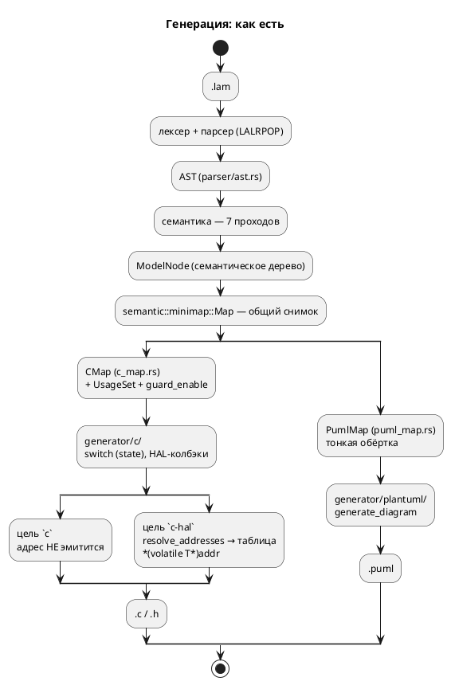
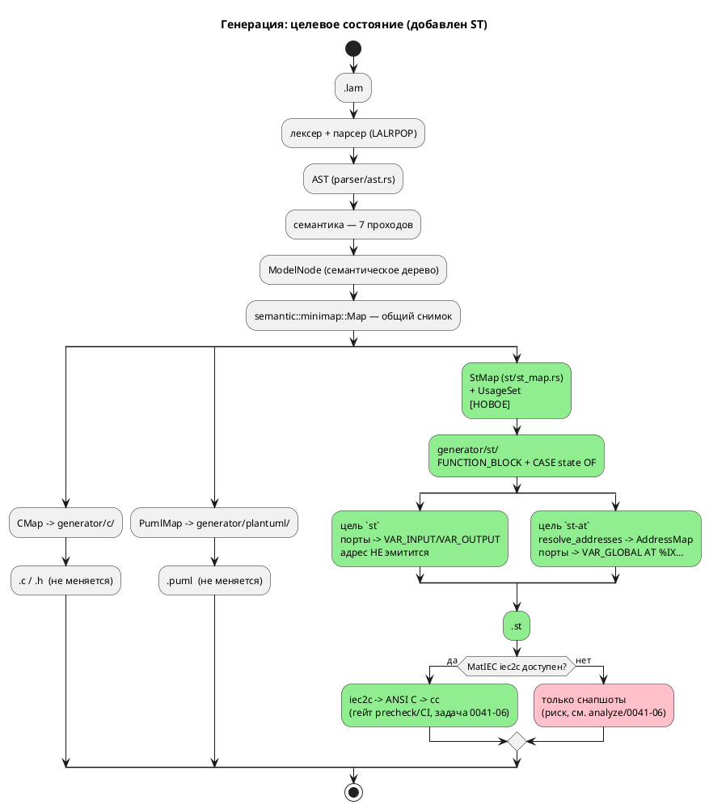

Источник: [docs/features/0041-st-backend.md](https://github.com/Pastor/Takt/blob/3c154a13d979b18312a1250ebfbe3db2fa5247d3/docs/features/0041-st-backend.md)

Полный текст по ссылке. Ниже начало карточки.

# Фича: Генератор генерации в Structured Text (IEC 61131-3)

- **Номер:** 0041
- **Статус:** ГОТОВО
- **Зависит от:** `0020` (ГОТОВО — потребляется `AddressMap`/`resolve_addresses`
  для формы `AT %…`; зависимость **закрыта**, фича **не** блокируется)
- **Приоритет / Tier:** **Tier 1 (высокий)** — профильная фича проекта («язык задания и синтеза автоматных моделей **промышленных систем управления**»).
  ST — стандартный язык ПЛК; это единственная фича пула, которая выводит `lamc` на
  реальную целевую платформу отрасли. Самая крупная в пуле: 7 подзадач.
- **Крейт:** `grammar` (крейт `0.2.0` → `0.3.0` по SemVer; **версия языка не
  меняется** — синтаксис и семантика `.lam` не тронуты)
- **Связанные issue (анализ):** новая фича (из блока «Кандидаты в фичи»
  `FEATURES.md`; кандидат вынесен из [адрес порта — размещение и потребление (карта адресов)](0020-port-address-decl.md) —
  «ST `AT %` — в рамках фичи ST-генератор»)

## Стадии жизненного цикла

Все стадии — **разделы этой карточки**: «Архитектура (ADR)»,
«Анализ», «Разработка», «Тест-план», «Отчёт о тестировании», «Итог».
Отдельным артефактом остаются только исправления —
[`docs/fixes/`](../fixes/README.md) (при необходимости `0041-YY-*`).

## Краткое описание

Третий целевой язык генерации наряду с C и PlantUML: `generator::Language` сейчас
имеет ровно два варианта — `C` и `PlantUML`
([`generator/mod.rs:14`](../../takt-lang/src/generator/mod.rs)). Фича добавляет
вариант `ST` и модуль `grammar/src/generator/st/`, транслирующий семантическое
дерево модели в **Structured Text (IEC 61131-3)** — стандартный язык ПЛК, куда FSM
ложится естественно: модель → `FUNCTION_BLOCK`, состояния → `CASE state OF` (прямой
аналог `switch (model->state)`, который уже эмитит C-генератор,
[`c_model.rs:554`](../../takt-lang/src/generator/c/c_model.rs)).

Фича **включает потребителя карты адресов** из [адрес порта — размещение и потребление (карта адресов)](0020-port-address-decl.md): `AddressMap` → размещённые переменные
`AT %IX…/%QX…/%MW…`. По образцу уже существующей пары целей `c` / `c-hal` вводятся
две цели: `-t st` (порты как `VAR_INPUT`/`VAR_OUTPUT` блока, адрес не эмитится) и
`-t st-at` (порты как `VAR_GLOBAL … AT %…`).

Изменение **аддитивно**: `Language` помечен `#[non_exhaustive]`
([`generator/mod.rs:13`](../../takt-lang/src/generator/mod.rs)), существующие цели
`c`/`c-hal`/`plantuml` байт-в-байт не меняются, `.lam` не тронут.

> Фича зарегистрирована из бэклога кандидатов (`FEATURES.md`, блок 2); далее
> проходит жизненный цикл по своду.

## Декомпозиция (см. [анализ](0041-st-backend.md#анализ))

| Задача | Содержание |
|---|---|
| **0041-01** | Каркас генератора: `Language::ST`, `generator/st/`, `StMap`, цель `-t st`, `compile_to_st` |
| **0041-02** | Отображение типов Lam → IEC + диагностики (**никакого тихого пропуска**) |
| **0041-03** | Состояния и переходы: `CASE OF`, `INIT`, `enter`/`always`/`exit`, композиция `\|` / `+` |
| **0041-04** | Выражения, условия, функции (`fn` → `FUNCTION`, `extern fn` → внешняя) |
| **0041-05** | Карта адресов: цель `-t st-at`, `AT %IX…`, `VAR_GLOBAL` |
| **0041-06** | **Проба-проверка:** валидация порождённого ST через MatIEC `iec2c` в `precheck.sh`/CI |
| **0041-07** | Примеры (`elevator.lam`, `stacker.lam`), контрпримеры, документация |

## Ключевой риск

**Проверяемость порождённого ST.** У проекта нет ПЛК в CI. Единственный
автоматизируемый проверка — открытый транспилятор **MatIEC `iec2c`** (ST → ANSI C,
далее `cc`), что повторяет форму существующего C-проверки в `scripts/precheck.sh`
(cmake/ninja над `examples/generated/c`). Но MatIEC **не пакет Debian** (сборка из
исходников: `autoreconf -i && ./configure && make`, зависимости bison/flex/gcc) и
требует полной `CONFIGURATION`/`RESOURCE`/`PROGRAM`, а не голого `FUNCTION_BLOCK`.
Обе предпосылки в репозитории **не проверены** → подзадача **0041-06 вынесена
вперёд как проба-проверка**: пока она не пройдена, корректность порождённого ST
держится только на снапшотах. Подробно —
[`analyze/0041-06`](0041-st-backend.md#анализ).

## Архитектура (ADR)

- **Status:** Accepted
- **Date:** 2026-07-15
- **Authors:** Архитектор + системный аналитик + дизайнер языков программирования
- **Related issues:** [Фича](0041-st-backend.md); потребляет
  `AddressMap` из [ADR](0020-port-address-decl.md#архитектура-adr); образец «второго
  генератора» — [фича](0009-plantuml-generator.md); ядро генерации —
  [фича](0001-core-language-c.md); урок отображения типов —
  [фича](0029-c-type-mapping.md).

### Context

#### Что есть сейчас

Слой генерации Lam устроен так (проверено по коду 2026-07-15):

- **`generator/mod.rs:14`** — перечисление `Language` ровно с двумя вариантами:
  `C` и `PlantUML`. Помечено **`#[non_exhaustive]`** (строка 13) с прямым
  комментарием: «список целевых языков будет расширяться, и добавление вариантов
  не должно ломать обратную совместимость». Точка расширения
  спроектирована заранее — эта фича ею и пользуется.
- **`generator/mod.rs:67`** — трейт `Generator` с единственным методом
  `generate(&self, model: &ModelNode, output_path: &str, options: &GenerateOptions)
  -> Result<(), Diagnostic>`. Свободная функция `generate(l, model, path, options)`
  (строка 80) диспетчеризует по `Language` через `match`.
- **`generator/mod.rs:30`** — `GenerateOptions` (тоже `#[non_exhaustive]`):
  `guard_enable`, `hal: bool`, `address_map: HashMap<String, ResolvedAddress>`.
  Поля `hal`/`address_map` заведены фичей ровно для «адрес-потребляющего»
  режима — ST-генератор переиспользует их, а не заводит третий канал.
- **Цели CLI** (`bin/lamc.rs:551`, `match options.target.as_str()`): фактически
  **три** — `c-hal`, `c`, `plantuml`. Замечание: сообщение об ошибке (строка ~646)
  говорит «Поддерживается: c, plantuml» — про `c-hal` умалчивает (мелкий дефект,
  правится попутно задачей: строка всё равно меняется).
- **Образец второго генератора — PlantUML** (`generator/plantuml/mod.rs`, 258 строк):
  структура ровно та, что нужно повторить — `struct Generator {}` + `impl
  AsGenerator`, тонкая обёртка-снимок `PumlMap` над общей `semantic::minimap::Map`
  (`puml_map.rs`, 66 строк), чистая функция `generate_diagram(&map) ->
  Result<String, Diagnostic>` и запись в файл. Юнит-тесты живут прямо в модуле и
  проверяют **подстроки** результата.
- **C-генератор** (`generator/c/`, 6248 строк) — тяжёлый образец: `CMap` (`c_map.rs`)
  добавляет к снимку `usage: UsageSet` (фильтрация неиспользуемых элементов) и
  `guard_enable`.

#### Как C-генератор укладывает FSM (ключ к решению)

Зонд: `lamc compile -t c examples/stacker.lam`. Порождённый C имеет ровно ту
форму, которую естественно повторить в ST:

- **Модель → структура + функции.** `struct StackerLiftController { enum {…} state; }`
  плюс `StackerLiftController_init/_tick/_reset/_is_done(model, main)`.
- **Состояния → `switch (model->state)`** (`c_model.rs:554`) с `case` на состояние.
- **Синтетическое состояние `INIT`** на каждый уровень вложенности — первый такт
  исполняет `enter` стартового состояния и переводит в него.
- **`enter` целевого состояния инлайнится в переход** (проверено:
  `case …LIFT_IDLE: if (main->lift_request) { write_bit(CMD_FORK, 1); state = …LIFT_OPERATING; break; }`
  — тело `enter` состояния `LiftOperating` исполнено **в переходе**).
- **Параллельная композиция `A | B | C`** (`start Stacker = CommandReceiver |
  MovementController | LiftController;`) → под-структуры полями родителя и
  **последовательный вызов их `_tick` в одном такте родителя**, с завершением по
  конъюнкции `_is_done` (проверено, `stacker.c:425-433`).
- **Порты → enum + колбэки HAL** (`read_bit`/`write_bit`/`read_numeric`/
  `write_numeric` в структуре); адрес в цели `c` **не эмитится** — находка 0020.

Поток «как есть» — два потребителя одного семантического дерева:



#### Какую проблему решаем

свод объявляет целью проекта «язык задания и синтеза автоматных моделей
**промышленных систем управления**». При этом ни одна из двух целей генерации не
попадает на реальную платформу отрасли: `c` — прошивка МК (нужен свой HAL,
тулчейн, сборка), `plantuml` — картинка. **Стандартный язык программирования ПЛК
— это IEC 61131-3**, и ST в нём — текстовый язык, в который FSM ложится буквально
один-в-один: `CASE state OF` ≡ уже эмитируемый `switch`. Отсутствие ST-генератора —
самый крупный разрыв между заявленной целью проекта и его выходом.

Фича — задел, оставленный фичей: её карточка прямо фиксирует «ST `AT %` — в
рамках фичи ST-генератор», а анализ 0020 — «Разблокирует: задел под кандидат
“ST-генератор” (`AT %`)».

### Decision Drivers

1. **Профиль проекта.** ST — целевой язык ПЛК. Без него `lamc`
   синтезирует «во что угодно, кроме промышленного контроллера».
2. **Аддитивность.** `Language` уже `#[non_exhaustive]`; добавление
   варианта не должно менять ни байта вывода целей `c`/`c-hal`/`plantuml` и не
   должно трогать `.lam`. Версия языка не растёт.
3. **Не повторить дефекты отображения типов C**. `get_c_type`
   (`generator/c/mod.rs:150`) отображает `Array(size, elem)` → `uint{size}_t`
   (размер путается с разрядностью), `Bit` → `int`, `Rational` → `float` (f32
   против f64 симулятора), а переменная-массив **молча исчезает** из структуры
   **без диагностики**. ST-генератор пишется с нуля — обязан сделать это правильно и
   **никогда не терять узел молча** (класс дефектов «тихий пропуск»: фичи).
4. **Потребляемость адреса.** Адрес порта не должен снова стать мёртвыми
   метаданными (находка 0020). `AddressMap` уже есть и разрешён —
   `resolve_addresses` (`address_map.rs:409`).
5. **Проверяемость.** Проверка «сгенерировали и скомпилировали» для C уже работает
   (`precheck.sh` → cmake/ninja). Для ST нужен аналог, иначе фича закрывается
   снапшотами «текст равен тексту», что не доказывает ничего о валидности ST.
6. **Переиспользование, а не копирование.** Снимок `minimap::Map`, `UsageSet`,
   `resolve_addresses`, `Printer` (`generator/indent.rs`) — общие; ST-генератор не
   должен форкать обход дерева.

### Вопрос 1. Как FSM ложится на ST

#### Option A. `FUNCTION_BLOCK` на модель + `CASE state OF`

Модель → `FUNCTION_BLOCK`; состояния → `CASE` по переменной состояния; композиция
→ экземпляры вложенных FB в `VAR` родителя, вызываемые в его теле. Изоморфно
тому, что уже делает C-генератор.

**Pros:**
- **1:1 с существующим C-генератором** — тот же обход `minimap::Map`, та же
  синтетическая `INIT`, тот же инлайн `enter` в переход, та же композиция
  «вызвать под-модели последовательно за один такт». Семантика уже отлажена и
  сверена с симулятором (0025-07): ST наследует её, а не изобретает.
- **Такт ПЛК ≡ такт модели.** Модель Lam уже тактовая (`tick`); скан-цикл ПЛК —
  ровно это. `FUNCTION_BLOCK` — единственная конструкция IEC с **сохраняемым
  состоянием между вызовами**, что и требуется для переменной состояния FSM.
- Экземплярность: одна модель — много экземпляров (естественно для `M1 | M2`).
- Читается инженером-наладчиком: `CASE` по состояниям — канонический способ
  писать FSM на ST вручную; вывод не будет «чужим» в проекте ПЛК.
- Поддерживается **всеми** средами (CODESYS/TwinCAT/Beremiz/MatIEC) — это ядро
  языка, а не расширение.

**Cons:**
- Ручное управление переменной состояния (как в C) — нет «встроенной» семантики
  шагов, которую даёт SFC.
- Вложенность FB даёт длинные цепочки квалифицированных имён.

#### Option B. SFC (Sequential Function Chart)

Состояния → `STEP`/`TRANSITION` текстового SFC; композиция `|` → расходящиеся
параллельные ветви SFC.

**Pros:**
- Семантически «родная» для FSM конструкция стандарта: шаги, переходы,
  параллельные ветви — прямо то, что моделирует Lam. `M1 | M2` идейно точно
  ложится на simultaneous divergence.
- Графическое представление в среде ПЛК — «бесплатно», перекликается с
  PlantUML-генератором.

**Cons:**
- **Семантика не совпадает.** SFC-шаг имеет действия с квалификаторами
  (`N`/`S`/`R`/`P`/`D`…) и активность шага, а Lam оперирует `enter`/`always`/`exit`
  и мгновенным переходом с инлайном `enter` цели. Отображение не тождественно —
  пришлось бы либо менять семантику языка (свод → версия языка растёт;
  фича заявлена аддитивной), либо строить нетривиальную эмуляцию, которую нечем
  проверить.
- **Текстовый SFC поддерживается плохо и по-разному.** Стандарт задаёт текстовую
  форму, но вендоры (CODESYS/TwinCAT) работают с SFC графически и хранят его в
  своих проектных форматах — генерировать переносимый *текст* SFC малополезно.
- Нет изоморфизма с C-генератором → второй, независимо отлаживаемый обход дерева и
  второй набор дефектов; сверка ST ↔ C ↔ симулятор становится невозможной.
- Вложенные модели Lam — не то же, что вложенные SFC.

#### Option C. Одна `PROGRAM` с плоским `CASE`

Всё дерево моделей уплощается в одну `PROGRAM` с единым `CASE` по композитному
состоянию (декартово произведение либо перенумерация).

**Pros:**
- Простейший вывод: один файл, одна сущность, никакой вложенности имён.
- Нет экземпляров FB → минимум памяти на ПЛК.

**Cons:**
- **Взрыв состояний** на `M1 | M2`: `stacker.lam` — три параллельные модели с
  13 × 4 × 4 состояниями; декартово произведение ≈ 208 `case` вместо 21 в трёх
  блоках.
- Теряется структура модели: имена под-моделей исчезают, отладка на ПЛК
  (наблюдение переменной состояния конкретной под-модели) невозможна.
- `PROGRAM` — единичная сущность; повторное использование модели как компонента в
  чужом проекте ПЛК исключено.
- Расходится с C-генератором → см. Cons Option B.

#### Decision (вопрос 1)

Принимается **Option A** — `FUNCTION_BLOCK` на модель + `CASE state OF`.

Решающий довод — **изоморфизм с уже работающим C-генератором**. Семантика тактов,
`INIT`, инлайна `enter` в переход и параллельной композиции уже реализована,
отлажена и сверена с симулятором (0025-07). Option A переиспользует её обход и
делает возможной **тройную сверку** (симулятор ↔ C ↔ ST) — сильнейший из
доступных способов проверки. Option B требует другой семантики (ломает
аддитивность) и не проверяем; Option C не масштабируется на `stacker.lam` —
основной пример профиля.

**Отображение композиции.**

| Конструкция Lam | C (как есть) | ST (решение) |
|---|---|---|
| `model M { … }` | `struct M { enum state; }` + `M_tick()` | `FUNCTION_BLOCK M` … `END_FUNCTION_BLOCK`, тело = один скан |
| `state S { … }` | `case …_S:` | `<n>: (* S *)` внутри `CASE state OF` |
| стартовое состояние | синтетический `case …_INIT` | синтетический `INIT` (значение 0 — по умолчанию при холодном старте ПЛК) |
| `M1 \| M2` (параллельно) | под-структуры + последовательные `_tick` в одном такте | экземпляры под-FB в `VAR`; последовательные вызовы в одном скане; завершение — конъюнкция `is_done` |
| `M1 + M2` (конкатенация) | последовательные шаги по `state` родителя | шаги `CASE` родителя: пока `NOT M1.is_done` — вызывать `M1`, затем `M2` |
| терминальность | `_is_done()` → `state == …_END` | выход `is_done : BOOL` блока |

Целевой поток:



**EBNF порождаемого подмножества ST** (генерируется код на другом
языке; фиксируем ровно то подмножество IEC 61131-3, которое эмитит генератор: всё,
что вне этой грамматики, генератор порождать не вправе):

```plantuml
@startuml
' EBNF: подмножество IEC 61131-3 ST, порождаемое бэкендом 0041
title EBNF порождаемого ST (подмножество IEC 61131-3)

file        = { type_decl } , { global_vars } , { function } ,
              { function_block } , [ configuration ] ;

type_decl   = "TYPE" , type_name , ":" , ( enum_spec | struct_spec ) ,
              ";" , "END_TYPE" ;
enum_spec   = "(" , enum_item , { "," , enum_item } , ")" ;
enum_item   = identifier , [ ":=" , integer ] ;
struct_spec = "STRUCT" , { identifier , ":" , iec_type , ";" } , "END_STRUCT" ;

global_vars = "VAR_GLOBAL" , { located_var } , "END_VAR" ;
located_var = identifier , [ "AT" , direct_addr ] , ":" , iec_type ,
              [ ":=" , literal ] , ";" ;
direct_addr = "%" , ( "I" | "Q" | "M" ) ,
              ( "X" | "B" | "W" | "D" | "L" ) ,
              integer , { "." , integer } ;

function       = "FUNCTION" , identifier , ":" , iec_type ,
                 var_input , { var_block } , stmt_list , "END_FUNCTION" ;

function_block = "FUNCTION_BLOCK" , identifier ,
                 [ var_input ] , [ var_output ] , var_block ,
                 stmt_list , "END_FUNCTION_BLOCK" ;
var_input   = "VAR_INPUT"  , { var_decl } , "END_VAR" ;
var_output  = "VAR_OUTPUT" , { var_decl } , "END_VAR" ;
var_block   = "VAR"        , { var_decl } , "END_VAR" ;
var_decl    = identifier , ":" , iec_type , [ ":=" , literal ] , ";" ;

iec_type    = "BOOL" | "SINT" | "INT" | "DINT" | "LINT"
            | "USINT" | "UINT" | "UDINT" | "ULINT" | "LREAL"
            | array_type | type_name ;
array_type  = "ARRAY" , "[" , integer , ".." , integer , "]" , "OF" , iec_type ;

stmt_list   = { statement } ;
statement   = assign_stmt | if_stmt | case_stmt | while_stmt
            | call_stmt | "RETURN" , ";" | ";" ;
assign_stmt = variable , ":=" , expression , ";" ;
if_stmt     = "IF" , expression , "THEN" , stmt_list ,
              { "ELSIF" , expression , "THEN" , stmt_list } ,
              [ "ELSE" , stmt_list ] , "END_IF" , ";" ;
case_stmt   = "CASE" , expression , "OF" ,
              { case_element } , [ "ELSE" , stmt_list ] , "END_CASE" , ";" ;
case_element= integer , ":" , stmt_list ;
while_stmt  = "WHILE" , expression , "DO" , stmt_list , "END_WHILE" , ";" ;
call_stmt   = identifier , "(" , [ arg_list ] , ")" , ";" ;

expression  = xor_expr , { "OR" , xor_expr } ;
xor_expr    = and_expr , { "XOR" , and_expr } ;
and_expr    = cmp_expr , { "AND" , cmp_expr } ;
cmp_expr    = add_expr , { ( "=" | "<>" | "<" | ">" | "<=" | ">=" ) , add_expr } ;
add_expr    = mul_expr , { ( "+" | "-" ) , mul_expr } ;
mul_expr    = unary_expr , { ( "*" | "/" | "MOD" ) , unary_expr } ;
unary_expr  = [ "NOT" | "-" ] , primary ;
primary     = literal | variable | call_expr | "(" , expression , ")" ;
variable    = identifier , { "." , identifier | "[" , expression , "]" } ;

configuration = "CONFIGURATION" , identifier ,
                "RESOURCE" , identifier , "ON" , identifier ,
                "TASK" , identifier , "(" , task_params , ")" , ";" ,
                "PROGRAM" , identifier , "WITH" , identifier , ":" ,
                identifier , ";" ,
                "END_RESOURCE" , "END_CONFIGURATION" ;
@enduml
```

### Вопрос 2. Отображение типов Lam → типы IEC

Исходные данные: `TypeNode` (`semantic/type_node.rs:496`) — `Bit`, `Bool`,
`Rational`, `Array(u16, Box<TypeNode>)`, `Enum(String)`, `Struct(String)`,
`Integer { bits: u8, signed: bool }`, плюс служебные (`Inference`, `Address`,
`Unsupported`, `Unit`, `Builtin*`).

#### Option A. «Как в C» — переиспользовать логику `get_c_type`

**Pros:** нулевая работа; вывод ST согласован с выводом C.

**Cons:** **воспроизводит все три дефекта фичи** — `Array(size, elem)` →
`uint{size}_t` (число элементов вместо разрядности; `[u8; 4]` → `uint4_t`), а сама
переменная-массив **молча исчезает из структуры без диагностики**; `Bit` → `int`;
`Rational` → `float` (f32) против f64 симулятора. Тиражировать известный дефект в
новый генератор — прямое нарушение драйвера 3. **Отвергается без дальнейшего
обсуждения.**

#### Option B. Прямое отображение на типы IEC + диагностика на непокрытое

`Bit`/`Bool` → `BOOL`; `Integer{bits,signed}` → `USINT/UINT/UDINT/ULINT` и
`SINT/INT/DINT/LINT`; `Rational` → `LREAL`; `Array(N, T)` → `ARRAY [0..N-1] OF T`;
`Enum` → `TYPE … : (…); END_TYPE`; `Struct` → `TYPE … : STRUCT … END_STRUCT;
END_TYPE`. Любой неотображаемый узел → **ошибка** `ST-0xx`, генерация не
продолжается.

**Pros:**
- Каждый тип Lam получает **семантически точный** аналог IEC, а не ближайший
  подходящий: `bit` → `BOOL` (1 бит по смыслу, а не 32-битный знаковый `int`),
  `float` → `LREAL` (f64 — совпадает с симулятором, а не f32).
- `ARRAY [0..N-1] OF T` — **настоящий массив**: размер не путается с разрядностью,
  переменная не исчезает.
- Отказ вместо тихой потери — прямое следствие уроков фич.
- Разбор `TypeNode` без ветки `_`: единственная вынужденная ветка
  (`TypeNode` помечен `#[non_exhaustive]`, `type_node.rs:495`) возвращает
  **ошибку**, а не `None`, — ровно как `eval::coerce_to_type`.

**Cons:**
- Требует эмиссии `TYPE … END_TYPE` для `enum`/`struct` — новый пласт вывода,
  которого нет ни в одном существующем генераторе.
- Перечислимые типы (`TYPE … : (A := 0);`) — конструкция 3-й редакции; поддержка
  в MatIEC требует пробы.

#### Option C. Гибрид: перечисления как `USINT` + константы

`Enum` → `T
