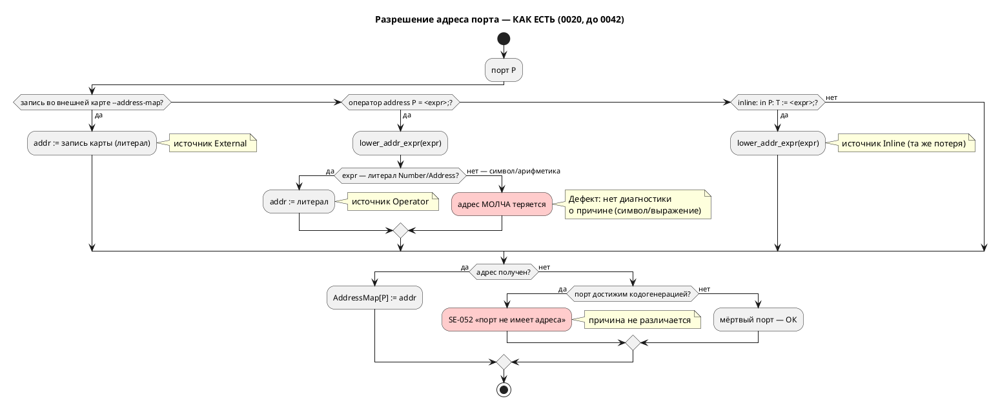
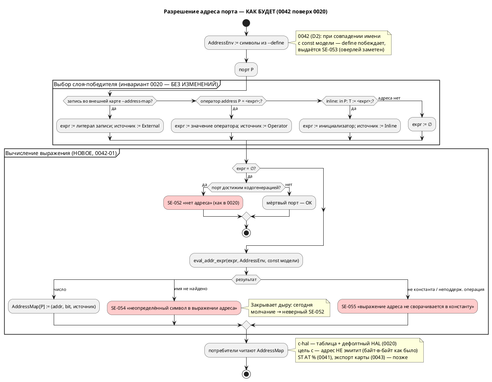

Источник: [docs/features/0042-address-defines.md](https://github.com/Pastor/Takt/blob/3c154a13d979b18312a1250ebfbe3db2fa5247d3/docs/features/0042-address-defines.md)

Полный текст по ссылке. Ниже начало карточки.

# Фича: Инъекция define'ов для адресов (--define)

- **Номер:** 0042
- **Статус:** **ГОТОВО** (2026-07-17; [отчёт](0042-address-defines.md#отчёт-о-тестировании) — вердикт «пройдено»)
- **Зависит от:** нет
- **Приоритет:** Tier 2 (ядро 0042-01 — Tier 1, см. ниже)
- **Крейт:** `grammar`. Версия языка **не поднималась**: к моменту реализации 0.3.0 уже поднята закрытой 0029 (тег `v0.3.0`), и по своду (накопление) 0042 вносит изменения в **уже поднятую** версию. Расширение аддитивно.
- **Связанные issue (анализ):** новая фича (вынесена из [адрес порта — размещение и потребление (карта адресов)](0020-port-address-decl.md))

> **Обоснование «Зависит от: нет».** Фича вынесена из [адрес порта — размещение и потребление (карта адресов)](0020-port-address-decl.md)
> («`-D`/инъекция define’ов … — выносятся в **отдельные фичи**»,
> раздел Action items). Ядро 0020 — слой `AddressMap`, `resolve_addresses`,
> оператор `address`, внешняя карта — **закрыто** (статус `ГОТОВО`, 2026-07-14,
> см. [реестр](README.md)). Единственная зависимость по контракту
> удовлетворена, блокировки нет: фича может быть взята в разработку
> немедленно.

## Стадии жизненного цикла

Все стадии — **разделы этой карточки**: «Архитектура (ADR)»,
«Анализ», «Разработка», «Тест-план», «Отчёт о тестировании», «Итог».
Отдельным артефактом остаются только исправления —
[`docs/fixes/`](../fixes/README.md) (при необходимости `0042-YY-*`).

## Краткое описание

Платформенные символы `--define NAME=VALUE` (кратко `-D`) вводятся в **среду
символов адреса** и потребляются выражениями адреса — как оператором
`address BTN = BTN_ADDR;`, так и inline-инициализатором порта. Это позволяет
держать один `.lam` и переключать адреса под платформу/ревизию флагами сборки, не
правя модель и не заводя файл карты. Слой — надстройка над `AddressMap`: define **не является четвёртым источником адреса** и не меняет
принятый приоритет `inline := < address < внешняя карта`, а лишь снабжает
значениями выражения того слоя, где они записаны.

> **Находка пробы (2026-07-15, проверено на коде — см. анализ).** Кандидат был
> описан как «тонкий слой поверх `AddressMap`». Это **не подтвердилось**:
> выражения адреса сегодня **не умеют** ссылаться на символы вообще.
> `lower_addr_expr` (`grammar/src/address_map.rs:384`) принимает только литералы
> `Number`/`Address`; `address BTN = BTN_ADDR;` и `address BTN = 0x100000 + 4;`
> **молча теряют адрес** → `SE-052` в цели `c-hal` (с неверной причиной), а
> ссылка на несуществующий символ вне `c-hal` не диагностируется вовсе.
> Поэтому ядро фичи — **вычисление выражений адреса** (свёртка констант +
> разрешение символов), а `--define` (0042-02) — надстройка над
> ним. Ядро 0042-01 самоценно и относится к классу «тихого пропуска» (как
> фича), поэтому имеет приоритет **Tier 1** внутри фичи.

> Фича зарегистрирована **из бэклога кандидатов** `FEATURES.md` (пункт
> «`-D`/инъекция define’ов для адресов», вынесенный из фичи); далее проходит
> жизненный цикл по своду.

## Декомпозиция (см. анализ)

- **0042-01** — вычисление выражений адреса: свёртка констант и разрешение
  символов; диагностики `SE-054` (неопределённый символ), `SE-055`
  (неконстантное выражение). *Ядро; закрывает найденный дефект тихого пропуска.*
- **0042-02** — среда define'ов `AddressEnv`: разбор `--define NAME=VALUE`,
  подстановка в разрешение символов, диагностики `DF-001…DF-004`, `SE-053`
  (define перекрывает одноимённую `const` модели).
- **0042-03** — проводка в CLI `lamc` (`--define`/`-D`, слитная форма
  `-DNAME=VAL`), справка, документация языка и примеры.

## Риски

- **Область видимости define'ов.** Расширение видимости за пределы выражений
  адреса сделало бы CLI способным молча менять логику автомата → в ADR принята
  изолированная среда (`AddressEnv`), видимая только выражениям адреса.
- **Ползучая семантика свёртки.** Вычислитель адреса не должен превратиться во
  второй интерпретатор выражений (ср. урок фичи) → строго ограниченное
  целочисленное подмножество, всё вне него → `SE-055`.
- **Регресс цели `c`.** Цель `c` адрес не эмитит и обязана остаться
  байт-в-байт неизменной — проверяемое условие тест-плана.
- **Конкуренция за `address_map.rs`** с фичами и 0043 (оба — потребители
  `AddressMap`) → рекомендованный порядок: 0042 → 0043 → 0041 (см. анализ).

## Архитектура (ADR)

- **Status:** Accepted
- **Date:** 2026-07-15
- **Authors:** Архитектор + дизайнер языков
- **Related issues:** [Фича](0042-address-defines.md); развивает
  [ADR](0020-port-address-decl.md#архитектура-adr) (слой `AddressMap`, приоритет источников);
  пересекается с [ADR](0041-st-backend.md#архитектура-adr) и [ADR](0043-address-map-export.md#архитектура-adr)
  (оба — потребители `AddressMap`)

### Context

ADR закрепил подсистему привязки портов к адресам: источники наполняют
единый слой **`AddressMap: PortId → Address`**, из которого потребители (сегодня —
цель `c-hal`) эмитят таблицу адресов и принятый по умолчанию HAL. Приоритет источников
(**инвариант**, `CLAUDE.md`):

> **inline `:=` < оператор `address Имя = <адрес>;` < внешняя карта `--address-map`**

В Action items ADR значилось: «**`-D`/инъекция define’ов** … выносятся в
**отдельные фичи**» — с формулировкой «символы `--define BTN_ADDR=0x200000` в
среде констант, потребляемые выражениями адреса (`address BTN = BTN_ADDR;`).
Это не отдельный парсер, а подстановка в окружение констант».

#### Находка: «тонкий слой» не подтвердился (проба на коде, 2026-07-15)

Кандидат предполагал, что выражения адреса уже умеют ссылаться на имена, и
`--define` останется тонкой надстройкой. **Проба это опровергла.**

Разрешение адреса выполняет `resolve_addresses`
(`grammar/src/address_map.rs:409`), а понижение выражения в число —
`lower_addr_expr` (`grammar/src/address_map.rs:384`). Последняя принимает
**только литералы**:

```rust
// grammar/src/address_map.rs:384 — фактический код
match expr {
    ExpressionNode::Address(a, b) => Some((*a, Some(*b))),
    ExpressionNode::Number(n) => Some((*n, None)),
    ExpressionNode::Unresolved(ast::Expression::Address(_, a, b)) => Some((*a, Some(*b))),
    ExpressionNode::Unresolved(ast::Expression::Number(_, n)) => Some((*n, None)),
    _ => None,   // ← символ, арифметика, всё остальное — молча «адреса нет»
}
```

Значение оператора `address` хранится как `ExpressionNode::Unresolved(…)`
(`grammar/src/semantic/tree.rs:551‑563`) и **никогда не понижается**
семантикой — вывод типов его не трогает. Результаты проб
(`cargo run --bin lamc -- compile -t c-hal`):

| Проба | Вход | Факт сегодня |
|---|---|---|
| A (эталон) | `address BTN = 0x00100000;` | ✅ адрес попадает в таблицу `*__ADDR` и принятый по умолчанию HAL |
| B | `const BTN_ADDR: u32 := 0x00100000; address BTN = BTN_ADDR;` | ❌ **ошибка `SE-052`** «порт не имеет адреса» — символ молча потерян |
| C | `address BTN = NOWHERE_DEFINED;` (цель `c-hal`) | ❌ `SE-052` — **причина в диагностике неверная** (символа не существует, но об этом не сказано) |
| C2 | то же, цель `c` | **компилируется успешно, rc=0** — висячая ссылка не диагностируется вовсе |
| D | `address BTN = 0x00100000 + 4;` | ❌ `SE-052` — свёртки констант нет |

**Вывод.** Выражения адреса **не умеют ссылаться на символы**, а любая
неатомарная форма **молча теряет адрес** — тот же класс дефекта «тихого
пропуска», что дал восемь ошибок в фиче. Поэтому 0042 состоит из **двух**
решений, а не из одного:

1. **Вычисление выражения адреса** — свёртка констант и разрешение символов
   (ядро; отсутствует сегодня).
2. **Источник символов** — откуда берутся имена, в частности из `--define`.

#### Поток «как есть»



### Decision Drivers

1. **Не нарушить инвариант приоритета 0020.** `inline < address < внешняя карта`
   зафиксирован в `CLAUDE.md` и охраняется тестами; define не должен стать
   скрытым четвёртым слоем.
2. **CLI не должен менять логику автомата.** Флаг сборки, способный молча
   переопределить `const`, участвующую в переходах, — это дыра в верифицируемости (язык для промышленных систем управления).
3. **Закрыть тихий пропуск.** Молчаливая потеря адреса недопустима: диагностика
   обязана называть причину (ср. замысел форматтера 0024 и урок).
4. **Обратная совместимость.** CLI `lamc` расширяется аддитивно;
   существующие `.lam` и вывод цели `c` — без изменений.
5. **Не плодить второй интерпретатор.** Вычислитель адреса — минимальное
   целочисленное подмножество, а не копия `simulation/src/eval/`.
6. **Симметрия с уже принятыми решениями.** Наложение платформы главнее
   модели, но **заметен** (предупреждение `SE-050`) — то же поведение ожидается и
   от define'ов.

### Вопрос 1. Место define'ов в приоритете источников адреса

#### Option A1. Define — четвёртый источник адреса (выше внешней карты)

`--define BTN=0x200000` напрямую задаёт адрес порта `BTN`, минуя выражения.

**Pros:**
- Прямолинейно: «переопредели адрес одним флагом».

**Cons:**
- **Ломает инвариант** (`CLAUDE.md`): цепочка становится
  `inline < address < карта < define`, все тексты/тесты приоритета — переписывать.
- Дублирует `--address-map`, у которого ровно эта роль (наложение платформы).
- Порождает неоднозначность: `-D BTN=…` — это адрес порта `BTN` или значение
  символа `BTN`? Имена портов и символов сливаются в одно пространство.

#### Option A2. Define — среда символов, ортогональная приоритету (**принято**)

Define не привязывается к порту вообще. Он даёт **значение имени**, которое
может встретиться в выражении адреса — на любом слое. Слой-победитель по-прежнему
выбирается правилом, и лишь **затем** его выражение вычисляется.

**Pros:**
- **Инвариант сохранён дословно** — define'ы лежат на другой оси
  («чем вычисляется выражение»), а не в цепочке источников.
- Композиция: `-D BASE=0x200000` + `address BTN = BASE + 4;` — модель описывает
  раскладку, платформа даёт базу.
- Имена портов и символов остаются разными пространствами.

**Cons:**
- Бесполезен без вычислителя выражений адреса (которого нет) → объём фичи растёт
  на задачу.
- Требует явного ответа: побеждает ли define одноимённую `const` (вопрос 4).

#### Option A3. Текстовый препроцессор (подстановка до лексера)

`-D NAME=VALUE` подставляется в текст `.lam` перед разбором, как в C.

**Pros:**
- Знакомая модель; тривиальная реализация.

**Cons:**
- Подстановка бьёт **по всему файлу**, а не только по адресам → драйвер 2 нарушен
  напрямую.
- Ломает позиции (`Location`) → диагностики, LSP и форматтер (0024) поедут.
- Проект сознательно не имеет препроцессора; вводить его ради адресов — тяжело.

### Вопрос 2. Область видимости define'а

#### Option B1. Define — константа в общей среде констант языка

Видна любому выражению: условиям переходов, телам блоков, инициализаторам `var`.

**Pros:**
- Максимально гибко; одна среда имён.

**Cons:**
- **CLI получает право молча менять поведение автомата** — `-D LIMIT=5` изменит
  `ref Stop: cnt = LIMIT;`. Для промышленных систем управления это
  недопустимо: верифицированная модель перестаёт быть самодостаточной.
- Меняет семантику разрешения имён языка → серьёзный рост версии языка и объёма
  тестов (все проходы семантики).
- Противоречит названию и мотиву фичи («define'ы **для адресов**»).

#### Option B2. Define виден только выражениям адреса (**принято**)

Символы живут в отдельной среде **`AddressEnv`**, к которой обращается только
вычислитель адреса — в двух позициях: значение оператора `address` и
inline-инициализатор порта (напомним находку 0020: инициализатор порта **и есть**
адрес, в C он иначе не используется).

**Pros:**
- Логика автомата **не зависит** от флагов сборки — модель остаётся
  верифицируемой (драйвер 2).
- Минимальная поверхность: не трогает 7 семантических проходов.
- Точная диагностика: имя в выражении адреса ищется в понятном, узком множестве.

**Cons:**
- Один и тот же идентификатор в выражении адреса и в логике может означать
  разное → снимается вопросом 4 (define перекрывает `const` **только** в
  выражениях адреса и **с предупреждением**).
- Не покрывает будущие «платформенные параметры» вне адресов — при появлении
  запроса заводится отдельная фича.

#### Option B3. Define виден только явно объявленным `extern const`

Модель декларирует `extern const BTN_ADDR: u32;`, define обязан его заполнить.

**Pros:**
- Максимальная явность: контракт платформы записан в модели.
- Опечатка в `-D` ловится как незаполненный `extern`.

**Cons:**
- **Расширяет грамматику** (`extern const`) → рост версии языка и объёма 0042.
- Требует объявлять каждый символ дважды (в модели и в сборке) — трение против
  мотива «не править модель под платформу».
- Хороший кандидат в **последующую** фичу поверх B2, если явность потребуется.

### Вопрос 3. Типизация значения define

#### Option C1. Только целочисленный литерал адреса (**принято**)

Значение — литерал в **той же грамматике, что и запись внешней карты**
(`Address` из `address_map.rs`): `0x…`, десятичное, необязательный `:bit`.
Переиспользуется существующая `parse_address_token`
(`grammar/src/address_map.rs:273`).

**Pros:**
- Ноль нового кода разбора значений; одинаковые правила у `--define` и
  `--address-map` → одна ментальная модель.
- Арифметика остаётся **в модели** (`address BTN = BASE + 4;`), где она видна
  ревьюеру и форматтеру, а не в командной строке.
- Значение всегда вычислено на момент разрешения — нет порядка/циклов между
  define'ами.

**Cons:**
- Нельзя `-D BTN_ADDR="BASE+4"` — вычисляемые наборы придётся раскрывать
  снаружи (shell/CMake).

#### Option C2. Значение — произвольное выражение Lam

`-D BTN_ADDR="BASE + 4"` разбирается парсером выражений и вычисляется.

**Pros:**
- Выразительно; наборы define'ов могут ссылаться друг на друга.

**Cons:**
- Требует разрешения **порядка и циклов** между define'ами (`-D A=B`, `-D B=A`)
  → полноценный граф зависимостей ради краевого случая.
- Диагностика с позициями внутри аргумента командной строки — отдельная возня с
  `Location` (у аргумента нет файла).
- Кавычки/экранирование в shell — источник ошибок сборки.

#### Option C3. Значение — нетипизированная строка

Хранится как текст, интерпретируется потребителем.

**Pros:**
- Универсально, задел под нечисловые параметры платформы.

**Cons:**
- Адрес обязан быть числом — проверка всё равно нужна, но уезжает вглубь, к
  потребителю → диагностика хуже.
- `AddressMap` типизирован `i64` — строка потребует приведения на каждом стыке.

### Вопрос 4. Конфликт define с одноимённой `const` в исходнике

#### Option D1. Ошибка

Любое совпадение имени define и `const` модели → отказ компиляции.

**Pros:**
- Однозначно; невозможен сюрприз.

**Cons:**
- Убивает главный сценарий: `const BTN_ADDR := 0x200000;` как **значение по
  умолчанию**, переопределяемое `-D BTN_ADDR=0x300000` под платформу.
- Асимметрия: у внешней карты (`--address-map`) ровно такое перекрытие —
  **предупреждение `SE-050`**, а не ошибка.

#### Option D2. Define побеждает, с предупреждением `SE-053` (**принято**)

В выражениях адреса имя ищется **сначала в `AddressEnv`, затем среди `const`
модели**. Если имя есть в обоих — берётся define, выдаётся предупреждение
`SE-053` с позицией объявления `const`.

**Pros:**
- **Прямая симметрия с `SE-050`** (0020): платформенный слой главнее модели, но
  перекрытие **заметно**. Одно правило на всю подсистему — легко объяснить.
- Работает сценарий «`const` = умолчание, `-D` = наложение под платформу».
- Перекрытие ограничено выражениями адреса (решение B2) → логика автомата
  по-прежнему неприкосновенна.

**Cons:**
- Предупреждение в штатном сценарии наложения будет частым → глушится `--quiet`
  (механизм уже есть в `lamc`), как и `SE-050`.

#### Option D3. `const` побеждает

Модель главнее командной строки.

**Pros:**
- Модель самодостаточна и неперекрываема.

**Cons:**
- `-D` становится бесполезен ровно там, где нужен (перекрыть умолчание), — остаётся
  лишь для имён, которых в модели нет. Мотив фичи не достигается.
- Противоречит направлению приоритета 0020 (внешнее главнее внутреннего).

### Вопрос 5. Наборы define'ов под платформы

#### Option E1. Только флаги командной строки (**принято для ядра 0042**)

`--define NAME=VALUE` (повторяемый), краткая форма `-D NAME=VALUE` и слитная
`-DNAME=VALUE` — по образцу уже существующего `-I` / `-I<путь>`
(`grammar/src/bin/lamc.rs:190‑199`). Роль «файла набора под платформу» уже
закрыта флагом **`--address-map`**, который читает `.ld`-подобный файл.

**Pros:**
- Ноль новых форматов: третий мини-язык (после `.lam` и `.ld`-карты) не заводится.
- Симметрия с `-I` — единый стиль CLI `lamc`.
- Набор под платформу выражается либо `--address-map stm32.map` (готово), либо
  обвязкой сборки (CMake/shell/`make`), где такие наборы и живут.

**Cons:**
- Длинные списки `-D` в командной строке при большом числе символов → лечится
  обвязкой сборки; при реальном запросе заводится фича файла-набора.

#### Option E2. Файл-набор нового формата (`--defines platform.def`)

**Pros:**
- Наборы версионируются вместе с проектом; командная строка коротка.

**Cons:**
- **Третий мини-формат** со своим лексером, диагностиками и тестами — ровно то,
  за что ADR уже платил на `.ld`-карте.
- Пересекается с `--address-map` по назначению → пользователю неочевидно, что
  когда применять.

#### Option E3. Переиспользовать формат `.ld`-карты для файла define'ов

`--defines platform.def` читается тем же `parse_address_map`, но записи
кладутся в `AddressEnv`, а не в карту адресов.

**Pros:**
- Парсер и коды `AM-001…006` переиспользуются целиком.

**Cons:**
- Два флага с **одинаковым** синтаксисом и **разной** семантикой (`NAME` — порт
  против `NAME` — символ) — ловушка для пользователя.
- Ценность мала, пока не доказан спрос на файл-наборы.

### Decision

Принимается связка **A2 + B2 + C1 + D2 + E1**:

1. **A2** — define'ы **ортогональны** приоритету источников. Инвариант
   (`inline < address < внешняя карта`) сохраняется **дословно**: сначала правило выбирает слой-победитель, и только затем выражение этого слоя
   вычисляется в среде `AddressEnv`.
2. **B2** — define виден **только выражениям адреса** (значение оператора
   `address` и inline-инициализатор порта). Логика автомата от флагов сборки не
   зависит.
3. **C1** — значение define — литерал адреса в грамматике внешней карты
   (`0x…` / десятичное / `:bit`); переиспользуется `parse_address_token`.
4. **D2** — define перекрывает одноимённую `const` **в выражениях адреса**, с
   предупреждением `SE-053` (симметрия с наложением карты `SE-050`).
5. **E1** — только флаги CLI; роль файла-набора уже играет `--address-map`.

Плюс — **обязательное ядро (0042-01)**, без которого `--define` нереализуем:
**вычислитель выражений адреса** `eval_addr_expr`. Он заменяет
`lower_addr_expr` и поддерживает строго ограниченное подмножество:

- литералы `Number`, `Address` (`0xADDR:bit`);
- имена → `AddressEnv` → `const` модели (рекурсивно, с защитой от циклов);
- целочисленные операции `+ - * / % << >> & | ^ ~`, унарный `+`/`-`, скобки;
- **всё остальное** (переменные, порты, вызовы функций, вещественные операции,
  блоки) → ошибка **`SE-055`**, а не молчание.

#### Целевой поток



#### Грамматика аргумента `--define` и разрешения имён

```plantuml
@startebnf
(* аргумент CLI: --define NAME=VALUE | -D NAME=VALUE | -DNAME=VALUE *)
DefineArg   = Name, "=", Address;
Name        = ( letter | "_" ), { letter | digit | "_" };
Address     = ( HexLiteral | DecLiteral ), [ ":", digit, { digit } ];
(* та же продукция Address, что и в записи внешней карты .ld (address_map.rs) *)

(* вычисляемое подмножество выражения адреса — 0042-01 *)
AddrExpr    = AddrTerm, { ( "+" | "-" | "|" | "^" | "<<" | ">>" ), AddrTe
