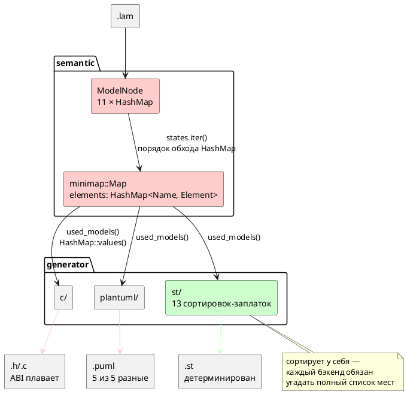

Источник: [docs/features/0048-deterministic-codegen.md](https://github.com/Pastor/Takt/blob/3c154a13d979b18312a1250ebfbe3db2fa5247d3/docs/features/0048-deterministic-codegen.md)

Полный текст по ссылке. Ниже начало карточки.

# Фича: Детерминированная генерация кода (единый порядок эмиссии)

- **Номер:** 0048
- **Статус:** ГОТОВО
- **Зависит от:** `нет` (проставлено аналитиком, стадия 3, 2026-07-16).
  Пересечения по файлам — не зависимости: [разделение переросших модулей (validate.rs, lsp.rs, c_expr.rs)](0027-module-size-split.md)
  трогает `c_expr.rs` (0048 его не касается) и `validate.rs`/`lsp.rs` (только в
  опциональном объёме «гигиена»), [генератор C: typedef корневой структуры для одиночной модели](0026-c-root-typedef.md) закрыта.
  Обоснование — в [анализе](0048-deterministic-codegen.md#анализ), раздел
  «Зависимости фичи».
- **Связанные issue (анализ):** новая фича (из бэклога кандидатов `FEATURES.md`,
  пункт «Генерация недетерминирована — C *и* PlantUML»; выявлено при
  [генератор C: typedef корневой структуры для одиночной модели](0026-c-root-typedef.md), уточнено при 0041-01, подтверждено пробами
  2026-07-16)
- **Крейт:** `grammar` (`semantic/minimap.rs`, `semantic/mod.rs`,
  `generator/{c,plantuml}/`)

## Стадии жизненного цикла

Все стадии — **разделы этой карточки**: «Архитектура (ADR)»,
«Анализ», «Разработка», «Тест-план», «Отчёт о тестировании», «Итог».
Отдельным артефактом остаются только исправления —
[`docs/fixes/`](../fixes/README.md) (при необходимости `0048-YY-*`).

## Краткое описание

Один и тот же `.lam` компилируется в **разный** код от запуска к запуску: плавают
порядок под-моделей, порядок вариантов `enum` состояний, порядок полей структуры
и — что хуже всего — **числовые значения портов**, то есть ABI прошивки. Причина
одна: словари семантического дерева (`ModelNode`) и снимок для генераторов
(`minimap::Map`) — `HashMap`, чей порядок обхода рандомизирован. Цель фичи —
сделать порядок эмиссии **свойством общего слоя**, а не привычкой каждого
генератора: один упорядоченный обход, от которого детерминизм получают `c`,
`plantuml` и любая будущая цель.

> Фича зарегистрирована из бэклога кандидатов `FEATURES.md` (решение заказчика
> 2026-07-16: «нужен детерминизм генерации»); далее проходит жизненный цикл по
> своду: архитектура (ADR) → анализ → разработка.

## Мотивация / контекст

Недетерминизм осознавался **точечно, но не системно**: для `structs` сортировка
уже сделана (`c_header.rs:546`), генератор `st` (закрытая
[генератор генерации в Structured Text (IEC 61131-3)](0041-st-backend.md)) сортирует у себя в **двенадцати** местах и потому
детерминирован. Но это лечение следствия: каждый новый генератор обязан заново
угадать полный список мест, где утекает порядок, а забытая сортировка не ломает
сборку и не ловится тестом — она проявляется случайно, раз в несколько прогонов.

Три следствия, ради которых фича заводится:

1. **«Плавающий» ABI.** Прошивка, собранная дважды из одного исходника, получает
   **разные идентификаторы портов**.
2. **Невоспроизводимые сборки.** Порождённый код нельзя сверить побайтно ни с
   эталоном, ни с самим собой.
3. **Принципиальная невозможность codegen-снапшотов.** Требование «сверить
   снапшоты» оказалось неисполнимым уже **дважды** — в 0026 и в тест-плане 0041
   (проверки T1–T4). Пока фича не закрыта, оно будет неисполнимо и впредь.

## Факты (пробы 2026-07-16, ветка v2)

Все цифры получены прогоном **одного и того же бинарника** на **одном и том же**
входе — не рассуждением.

### Масштаб: недетерминированы все примеры корпуса

`lamc compile -t c`, 5 прогонов каждый, сравнение `.h` по md5:

| Пример | Уникальных вариантов из 5 |
|---|---|
| `comprehensive.lam` | **5** |
| `elevator.lam` | **5** |
| `elevator_mini.lam` | **5** |
| `extend_complex.lam` | **5** |
| `stacker.lam` | **5** |

То есть **ни один** прогон не совпал с другим. Для `elevator_mini` то же верно
для `-t c` (`.c`), `-t plantuml` (`.puml`) и `-t c-hal` — 5 из 5, 5 из 5, 3 из 3.
Цель **`st` — 1 из 5**, то есть детерминирована (подтверждает заявку 0041).

### ABI: значение порта меняется между сборками

`elevator_mini`, порт `CABIN_BUTTON_DC`, **15 прогонов** цели `c`:

| Значение в `enum` | Прогонов |
|---|---|
| `= 0` | 8 |
| `= 2` | 7 |

Заявка кандидата (`CABIN_BUTTON_DC = 2` против `= 0`) **воспроизведена точно**.
Это не косметика: два бинарника, собранные из одного исходника, расходятся в
нумерации портов.

### Рабочее дерево прямо сейчас загрязнено этим дефектом

`git status` на ветке v2 показывает 7 изменённых порождённых файлов
(`examples/generated/`, 178 вставок / 178 удалений). Проверено `git diff`: это
**чистая перестановка** (`typedef struct StackerCommandReceiver` переехал на три
строки, блоки моделей поменялись местами) — содержательных изменений нет.
Симметрия 178/178 — подпись перестановки, а не правки.

### Механизм: две строки в общем слое

Отчёт по коду (проверено чтением, не догадкой) сузил причину сильнее, чем
предполагал кандидат: **почти всё** течёт через один общий слой
`semantic/minimap.rs`, а не через генераторы по отдельности.

| Место | Что происходит |
|---|---|
| `semantic/minimap.rs:196` | `states.iter().for_each(…)` строит `Element::Model.states: Vec<Name>` **прямо из порядка обхода `HashMap`**. Этот вектор потребляют **все** генераторы через `map.states()` — корень плавающего порядка состояний. |
| `semantic/minimap.rs:247-253` | `used_models()` возвращает `self.elements.values().filter(…)` — **порядок `HashMap::values()`**. Корень плавающего порядка под-моделей. Потребляют `c_map.rs:102`, `puml_map.rs:63`, `st_map.rs:106`. |
| `semantic/minimap.rs:170` | `elements: HashMap<Name, Element>` — сам контейнер снимка. |
| `semantic/mod.rs:73-115` | 11 полей `ModelNode` — `HashMap`: `models`, `functions`, `variables`, `types`, `conditions`, `enums`, `structs`, `states`, `docs`, `type_locs`, `raw_type_defs`. Отдельного поля `ports` **нет** — порты живут внутри `variables` как вариант `VariableNode::Port` и наследуют его недетерминизм. |
| `generator/c/mod.rs:825-858` | `topological_sort_models` недетерминирована **по построению**: `by_name: HashMap` (`:826`), `keys` собираются `.keys().cloned().collect()` **без сортировки** (`:836`), затем DFS `for key in &keys` (`:855`). |

**Третья причина — неверное допущение в докстринге.** `c/mod.rs:824` прямо
заявляет: «Нет гарантий порядка одноуровневых вершин — нужен только частичный
порядок». Для C это **неверно**: частичного порядка достаточно для
*корректности*, но не для *воспроизводимости* — топологическая сортировка со
случайным входом даёт случайный (хотя и всякий раз корректный) выход. Именно так
дефект и уцелел: допущение выглядит безобидным и сборку не ломает. Сравните с
`st/mod.rs:153`, где вход **сортируется перед** `topological_order` (`:154`) —
**это и есть недостающая строка в C**.

**Ловушка ABI — не там, где кажется** (`c_header.rs:261` + `:301-309`). Порты
**уже сортируются** — но **внутри одной модели** и по одному лишь имени порта;
номер же (`idx`) выдаётся сквозным `enumerate()` по циклу
`for element in &all_models`, где `all_models` = `map.using_models()`, то есть
порядок `HashMap::values()`. **Межмодельный порядок остаётся случайным** →
номера портов сдвигаются целыми блоками. Отсюда вывод, который должен попасть в
ADR: **локальная сортировка не спасает, если внешний цикл недетерминирован**, а
сортировка по неуникальному ключу лишь маскирует проблему (стабильная
`sort_by` сохраняет исходный, то есть случайный, порядок для равных ключей).

### Что кандидат утверждал неточно

- **Порядок полей структуры и вариантов пользовательского `enum` — стабилен.**
  `StructDefinitionNode.fields` — `Vec` (`struct_node.rs:27`),
  `EnumDefinitionNode.variants` — `Vec` (`enum_node.rs:35`), а `c_decl.rs:94`
  печатает явные значения из исходника. Наблюдаемое «поле уехало» — это порядок
  **`variables`** (`c_header.rs:339`) и порядок **самих структур**, а не полей
  внутри них. Пользовательские `enum` ABI не ломают — ломают `enum` **портов и
  состояний**, которые нумерует генератор.
- **Сортировка строк вывода** (`c_decl.rs:86, 107, 230, 237`) — существующий
  приём, но работает лишь там, где вывод плоский. Замечание кандидата про
  запятую у последнего варианта `enum` этим и объясняется: сортировать **текст**
  после эмиссии поздно, порядок надо задать **до** неё.

## Объём (предварительно, уточняет аналитик)

1. **Упорядочить общий слой** — `minimap::Map` (`elements`, `states`,
   `used_models`). Это чинит `c`, `plantuml` **и любую будущую цель разом**.
2. **Упорядочить `ModelNode`** — 11 полей-`HashMap`, либо точечно те, чей обход
   достигает вывода (`variables`, `models`, `states`, `functions`, `enums`).
3. **Снять теперь избыточные сортировки** в `st` (12 мест) — после п. 1 они
   перестают быть несущими. Решает аналитик: снимать или оставить как страховку.
4. **Закрепить тестом** — проверка «два прогона байт-в-байт совпадают» по всему
   корпусу `examples/`. Именно этой проверки не хватало: дефект дожил до 0048
   потому, что **не ломал сборку**.
5. **Codegen-снапшоты** — после п. 1–4 они впервые становятся возможны; разблокируют
   требования 0026 и T1–T4 тест-плана 0041. Заводить ли их в этой фиче — решает
   аналитик.
6. **Перегенерировать `examples/generated/`** и закоммитить стабильный вывод.

## Развилка для ADR (стадия 2)

Решение **не техническое, а вкусовое**, и аналитик его принимать не вправе —
нужен выбор заказчика:

| Вариант | Порядок вывода | Цена |
|---|---|---|
| **`BTreeMap`** | Алфавитный | Дёшево, `std`, но вывод **перестаёт соответствовать порядку объявлений** в `.lam` |
| **`IndexMap`** | **Порядок исходника** | Заголовок читается и диффится против `.lam`; **новая зависимость** (`indexmap` в проект **не подключён**) |
| **`Vec` + сортировка на эмиссии** | Алфавитный | Без новых типов, но каждый генератор снова обязан помнить о сортировке — то есть **лечит следствие**, что и привело к 0048 |

Замечание для ADR: `itertools 0.14` **уже** в зависимостях (используется в
`c/mod.rs:225`), `BTreeMap`/`BTreeSet`/`IndexMap` в проекте **не используются
нигде** — прецедента нет.

## Осторожно (не сломать)

- **Значения `enum` состояний и портов изменятся** — это и есть цель, но для
  любого уже прошитого устройства это **смена ABI**. Оценить в анализе.
- **Сборка `examples/generated/`** — вывод изменится **во всех** файлах; отличить
  «стало детерминированно» от «сломалось» можно только живой проверкой
  (`precheck.sh`, проверки `cc` и `iec2c`), а **не** глазами по диффу.
- **Цель `st` детерминирована уже сегодня** — её вывод после п. 1 не должен
  измениться **вовсе**; если изменился — регресс. Это бесплатный контрольный тест
  для п. 1.
- **`minimap.rs:188` / `mod.rs:188-195`** — `get_start_state()` берёт `.first()`
  из отфильтрованных `into_values()`. Если у модели окажется **два** `start`, кто
  победит — **случайность**. Проверить, закрыто ли это валидацией; если нет — это
  дефект строже косметики.
- **Пересечение по файлам:** [генератор C: typedef корневой структуры для одиночной модели](0026-c-root-typedef.md) правит
  `generator/c/mod.rs`, [разделение переросших модулей (validate.rs, lsp.rs, c_expr.rs)](0027-module-size-split.md) перекладывает
  `c_expr.rs` целиком. Конфликты слияния вероятны — порядок определяет аналитик.

## Обратная совместимость

**Синтаксис и семантика языка не меняются** — правится только порядок эмиссии,
поэтому версия языка **не растёт**. Однако **порождённый C
меняется** для всех входов, а числовые значения `enum` портов/состояний — это
ABI: код, слинкованный со старым заголовком, разойдётся с новым. Обосновать в
анализе; смягчающее обстоятельство — сегодня этот ABI **и так** не
воспроизводится между двумя сборками, то есть фича не ломает стабильность, а
**впервые её вводит**.

## Архитектура (ADR)

- **Status:** Accepted
- **Date:** 2026-07-16
- **Authors:** Архитектор + Лид разработки (решение развилки — заказчик, 2026-07-16)
- **Related issues:** [Фича](0048-deterministic-codegen.md)

### Context

Один и тот же `.lam` компилируется в **разный** код от запуска к запуску. Пробы
2026-07-16 (пять примеров корпуса, по 5 прогонов одного бинарника, сравнение
`.h` по md5) дали **5 уникальных вариантов из 5** для каждого примера — ни один
прогон не совпал с другим. Хуже косметики: 15 прогонов `elevator_mini` дали порту
`CABIN_BUTTON_DC` значение `= 0` в 8 случаях и `= 2` в 7, то есть **плавает ABI**
прошивки.

Причина одна и лежит **не в генераторах**, а в общем слое: словари
семантического дерева (`ModelNode`) и снимка для генераторов (`minimap::Map`) —
`HashMap`, порядок обхода которого рандомизирован (`RandomState`). Генераторы
лишь печатают то, что им выдал обход.

| Место | Что течёт |
|---|---|
| `semantic/minimap.rs:170` | `elements: HashMap<Name, Element>` — контейнер снимка |
| `semantic/minimap.rs:195` | `states.iter()` → `Element::Model.states: Vec<Name>` строится **из порядка обхода `HashMap`**; потребляют все генераторы |
| `semantic/minimap.rs:247-253` | `used_models()` = `elements.values()` — порядок под-моделей; потребляют `c_map.rs:102`, `puml_map.rs:63`, `st_map.rs:106` |
| `semantic/mod.rs:73-115` | 11 полей `ModelNode` — `HashMap`. Порты живут внутри `variables` (`VariableNode::Port`) и наследуют его недетерминизм |
| `generator/c/mod.rs:836` | `topological_sort_models`: `keys` собираются `.keys().cloned()` **без сортировки**, затем DFS `for key in &keys` |

**Почему дефект дожил до 0048.** Недетерминизм осознавался точечно, но не
системно: `c_header.rs:546` сортирует структуры, генератор `st` (закрытая
[генератор генерации в Structured Text (IEC 61131-3)](0041-st-backend.md#архитектура-adr)) сортирует у себя в **13** местах и потому
детерминирован (проба: 1 уникальный вариант из 5). Но это лечение следствия —
забытая сортировка **не ломает сборку** и не ловится тестом: она проявляется
случайно, раз в несколько прогонов. Докстринг `c/mod.rs:824` прямо закрепил
неверное допущение: «Нет гарантий порядка одноуровневых вершин — нужен только
частичный порядок». Для *корректности* частичного порядка довольно, для
*воспроизводимости* — нет: топологическая сортировка со случайным входом даёт
случайный (хотя и всякий раз корректный) выход.

**Ловушка ABI — не там, где кажется.** Порты **уже** сортируются
(`c_header.rs:261`, `:301-309`) — но **внутри одной модели** и по одному лишь
имени, тогда как номер (`idx`) выдаётся сквозным `enumerate()` по внешнему циклу
`for element in &all_models`, где `all_models = map.using_models()`, то есть
порядок `HashMap::values()`. Межмодельный порядок остаётся случайным → номера
портов сдвигаются целыми блоками. Отсюда правило, которое эта ADR закрепляет:
**локальная сортировка не спасает, если внешний цикл недетерминирован**, а
сортировка по неуникальному ключу лишь маскирует проблему (стабильная `sort_by`
сохраняет для равных ключей исходный — то есть случайный — порядок).

#### Поток «как есть»

### Decision Drivers

1. **ABI прошивки обязан быть воспроизводим.** Два бинарника из одного
   исходника должны совпадать побайтно. Сегодня это не так.
2. **Порядок — свойство общего слоя, а не привычка генератора.** Каждый новый
   генератор (0045 — SystemVerilog, и далее) не должен заново угадывать места
   утечки порядка. Цена бездействия растёт линейно по числу целей.
3. **Дефект обязан ломать сборку.** Забытая сортировка сегодня не ловится ничем;
   нужен проверка, а не дисциплина.
4. **Не плодить зависимости без нужды.** `IndexMap`/`BTreeMap`/`BTreeSet` в
   проекте не используются нигде — прецедента нет.

### Considered Options

#### Option A. `BTreeMap` — алфавитный порядок

Заменить `HashMap` на `BTreeMap` в `minimap::Map.elements` и в полях `ModelNode`,
чей обход достигает вывода.

**Pros:**
- `std`, новых зависимостей нет.
- Порядок — **свойство типа контейнера**: обход упорядочен всегда, забыть
  сортировку негде. Лечит причину, а не следствие.
- Ключи (`String`, `Name`) уже уникальны → тотальный порядок без tie-break.
- API `BTreeMap` совместим с `HashMap` по используемым методам
  (`get`/`insert`/`iter`/`values`/`keys`/`entry`/`retain`) → правка механическая,
  а несовместимости ловит компилятор.

**Cons:**
- Вывод **перестаёт соответствовать порядку объявлений** в `.lam`: заголовок
  читается по алфавиту, а не по исходнику.
- `BTreeMap` требует `Ord` на ключе — у `Name` его нет, придётся добавить.
- Вставка/поиск `O(log n)` против `O(1)` — на масштабах модели (десятки-сотни
  элементов) неизмеримо.

#### Option B. `IndexMap` — порядок исходника

**Pros:**
- Порядок эмиссии = порядок объявлений в `.lam`; заголовок диффится против
  исходника, номера портов идут «как написано».
- `O(1)` доступ сохраняется.

**Cons:**
- **Новая зависимость** (`indexmap` в проект не подключён).
- Порядок становится свойством **истории вставок**, а не данных: перестановка
  двух проходов семантики молча меняет ABI. Детерминизм есть, но он хрупок и
  никак не выражен в типе.

#### Option C. `Vec` + сортировка на эмиссии

**Pros:**
- Без новых типов и зависимостей.
- Точечно, минимальный диф.

**Cons:**
- **Лечит следствие** — ровно тот механизм, что и привёл к 0048: каждый генератор
  снова обязан помнить о сортировке, а забытая строка не ломает сборку. `st`
  уже несёт 13 таких заплаток, `c` — 5 частичных, `plantuml` — ноль.
- Потеря `O(1)`-поиска по имени либо дублирование контейнеров.

### Decision

Принимается **Option A (`BTreeMap`)** — решение заказчика от 2026-07-16.

Обоснование выбора: развилка вкусовая (драйвер 2 удовлетворяют и A, и B), и
заказчик предпочёл алфавитный порядок ценой соответствия исходнику. Довод в
пользу A сверх вкуса: `BTreeMap` выражает инвариант **в типе** — упорядоченность
нельзя забыть, тогда как у `IndexMap` она держится на порядке вставок, то есть на
той же дисциплине, ради отказа от которой заводится фича.

Три следствия решения, обязательные к исполнению:

1. **`Name` получает `Ord`/`PartialOrd` по паре `(unique, local)`** — сравниваются
   **оба** поля, поэтому порядок согласован с существующим `Eq` (требование
   `BTreeMap`). Первичный ключ — `unique` (полный путь `Root:Child:State`):
   сортировка по нему группирует элементы по родителям, что читается лучше
   алфавита по локальным именам.
2. **`topological_sort_models` (`c/mod.rs:825`) сортирует вход** — по образцу
   `st/mod.rs:153`, где вход сортируется **перед** `topological_order`.
   Смены типа `by_name` мало: DFS идёт по `keys`, и сортировать надо именно их.
   Докстринг `:824` («нужен только частичный порядок») исправляется — он и есть
   зафиксированное заблуждение.
3. **13 сортировок цели `st` остаются** (решение заказчика). После правки общего
   слоя они избыточны, но безвредны, а неизменность вывода `st` — **бесплатный
   контрольный тест** правки: если `.st` изменился, значит общий слой упорядочен
   не так, как предполагалось.

### Consequences

#### Положительные

- Порождённый код воспроизводим побайтно для всех целей, включая будущие
  (0045 и далее) — они получают детерминизм даром, ничего не зная про порядок.
- **Codegen-снапшоты впервые становятся возможны** — разблокируется требование,
  дважды оказавшееся неисполнимым (0026 и T1–T4 тест-плана 0041).
- Дифф `examples/generated/` снова несёт смысл: сегодня он «чистый шум
  перестановки» (рабочее дерево прямо сейчас загрязнено 7 файлами, 178/178 —
  симметрия, характерная для перестановки), и его нельзя читать как регресс.
- Снимается предупреждение из `CLAUDE.md` про недоверие к диффу порождённых файлов.

#### Отрицательные / Action items

- **ABI меняется однократно** — номера портов и состояний станут другими для
  всех входов. Это смена ABI, но смягчающее обстоятельство решающее:
  сегодня этот ABI **и так** не воспроизводится между двумя сборками — фича не
  ломает стабильность, а **впервые её вводит**. Обосновать в анализе.
- **Порядок вывода перестаёт соответствовать `.lam`** — принятая цена Option A.
- `Name` требует `Ord` — правка `minimap.rs`.
- **Отличить «стало детерминированно» от «сломалось» глазами по диффу нельзя** —
  только живой проверкой (`precheck.sh`, проверки `cc` и `iec2c`).
- **Версия языка не растёт**: синтаксис и семантика не меняются,
  правится лишь порядок эмиссии.
- Пересечение по файлам с [генератор C: typedef корневой структуры для одиночной модели](0026-c-root-typedef.md#архитектура-adr) (закрыта) и
  [разделение переросших модулей (validate.rs, lsp.rs, c_expr.rs)](0027-module-size-split.md#архитектура-adr) (`c_expr.rs`) — конфликты слияния вероятны.

#### Acceptance criteria

1. **Побайтная воспроизводимость.** Для каждого примера `examples/*.lam` и каждой
   цели (`c`, `c-hal`, `plantuml`, `st`) два прогона `lamc compile` дают
   идентичные файлы. Проверяется проверкой, а не глазами (объём 4 карточки).
2. **Проверка в `precheck.sh`** — «два прогона байт-в-байт совпадают» по всему
   корпусу; падает при появлении нового недетерминизма. Именно этой проверки не
   хватало: дефект дожил до 0048, потому что не ломал сборку.
3. **Вывод цели `st` не изменился вовсе** — контрольный тест правки общего слоя
   (сортировки `st` остаются на месте).
4. **Живая проверка зелена** — `precheck.sh` целиком: `cc` собирает порождённый
   C, `iec2c` принимает порождённый ST.
5. **`examples/generated/` перегенерирован** и закоммичен стабильным выводом.
6. **`topological_sort_models` детерминирована**, докстринг `c/mod.rs:824`
   исправлен.

## Анализ

### Цель и контекст

Сделать порядок эмиссии **свойством общего слоя**, а не привычкой каждого
генератора: `HashMap` → `BTreeMap` в `ModelNode` и `minimap::Map`
([ADR](0048-deterministic-codegen.md#архитектура-adr), Option A — решение зак
