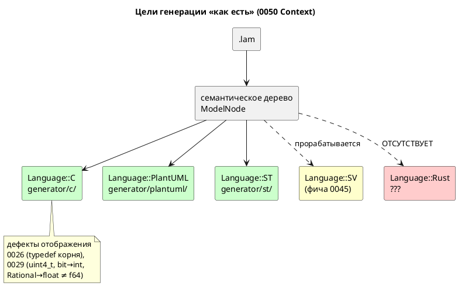

Источник: [docs/features/0050-rust-backend.md](https://github.com/Pastor/Takt/blob/3c154a13d979b18312a1250ebfbe3db2fa5247d3/docs/features/0050-rust-backend.md)

Полный текст по ссылке. Ниже начало карточки.

# Фича: Генератор генерации в Rust

- **Номер:** 0050
- **Статус:** ГОТОВО
- **Зависит от:** `нет`;
  содержательных зависимостей не найдено (разбор — [анализ](0050-rust-backend.md#анализ),
  раздел «Зависимости фичи»). Статус **`ЗАБЛОКИРОВАНА` не ставится**, фичу можно
  брать в работу сразу.
- **Приоритет / Tier:** **Tier 2 (высокий)** — профильная фича,
  заведена **по прямому запросу заказчика**. Пятый целевой язык; закрывает контур
  **безопасных прошивок**: та же ниша, что у цели `c` (микроконтроллер, HAL,
  жёсткое реальное время), но без класса дефектов памяти. Сопоставима по объёму с
  0041/0045 (8 подзадач) и **ниже обеих по риску**: проверка не требует установки
  инструментов (см. «Проверяемость»).
- **Крейт:** `grammar` (минорный рост версии крейта; **версия языка не меняется**
  — синтаксис и семантика `.lam` не тронуты)
- **Связанные issue (анализ):** **новая фича по прямому запросу заказчика**
  (2026-07-16); в блоке «Кандидаты в фичи» `FEATURES.md` отсутствовала.

## Стадии жизненного цикла

Все стадии — **разделы этой карточки**: «Архитектура (ADR)»,
«Анализ», «Разработка», «Тест-план», «Отчёт о тестировании», «Итог».
Отдельным артефактом остаются только исправления —
[`docs/fixes/`](../fixes/README.md) (при необходимости `0050-YY-*`).

## Краткое описание

Пятый целевой язык генерации наряду с C, PlantUML, ST и (прорабатываемым
параллельно) SystemVerilog. `generator::Language` получает вариант `Rust`, а
`grammar/src/generator/rust/` транслирует семантическое дерево в **`no_std`
Rust** — прошивку для микроконтроллера.

Ключевые решения ([ADR](0050-rust-backend.md#архитектура-adr)); **профиль и форма вывода —
решение заказчика 2026-07-16**:

- **Профиль: `no_std`-прошивка** — прямой аналог цели `c`, а не хостовая
  библиотека. `#![no_std]`, без `alloc`.
- **Форма вывода: один `.rs`-файл** (как `.h`/`.c` у цели `c`), подключается
  пользователем через `mod`. `Cargo.toml` генератор **не** порождает и им не
  владеет.
- **Порты: HAL-трейт** вместо пары указателей на функции и `void *userdata` цели
  `c`. Параметр типа `H: Hal` несёт состояние HAL — `userdata` исчезает как
  понятие вместе со своей небезопасностью.
- **Типы: нативное соответствие.** `bit` → `bool`, `[u8; 4]` → `[u8; 4]`,
  `enum` → `enum`, `u8` → `u8`, `Rational` → `f64` (**как в симуляторе**).
- **Автомат:** состояния → `enum` + `match` (не целочисленные константы);
  контракт [ADR](0033-init-tick-alignment.md#архитектура-adr) (вход в стартовое
  состояние не расходует такт) воспроизводится диспетчеризацией `Init` **до**
  `match`.

Изменение **аддитивно**: `Language` помечен `#[non_exhaustive]`, существующие
цели байт-в-байт не меняются, `.lam` не тронут.

> Фича зарегистрирована **по прямому запросу заказчика**; далее проходит
> жизненный цикл по своду. Проработана до стадии **РАЗРАБОТКА** (ADR принят,
> анализ и декомпозиция готовы).

## Зачем: цель `c` уже занимает эту нишу

Ниша та же — прошивка МК, — поэтому фича обязана отвечать, что даёт Rust сверх C.
Ответ **не** «Rust лучше», а конкретные, зафиксированные в репозитории дефекты
цели `c`, которые в Rust **не воспроизводятся by construction**:

| Дефект цели `c` | В Rust |
|---|---|
| [генератор C: typedef корневой структуры для одиночной модели](0026-c-root-typedef.md): нет typedef корня → порождённый C **не компилируется** для модели без под-моделей | тип корня — обычная `struct`, отдельного объявления не требует |
| [генератор C: отображение типов Array/Bit/Rational](0029-c-type-mapping.md): `[u8; 4]` → `uint4_t` (несуществующий тип), `bit` → `int`, `Rational` → `float` ≠ f64 симулятора | `[u8; 4]` → `[u8; 4]`, `bit` → `bool`, `Rational` → `f64` — **точное** соответствие |
| `void *userdata` + указатели на функции: типобезопасности нет | `H: Hal` — параметр типа, проверяется компилятором |
| Класс дефектов памяти (UB, выход за границы массива) | безопасное подмножество: `unsafe` в порождаемом коде **отсутствует** |

Цель `rust` — не дубликат `c`, а тот же контур **без** известных дефектов
отображения и без класса ошибок памяти. Цель `c` при этом не трогается.

## Проверяемость: доказана до начала разработки

Планка задана фичей (проверяемость доказывается **пробой**, а не
рассуждением). Здесь она **выше**: проверка — `rustc` и `clippy`, которые **уже
являются зависимостями проекта**. Ставить нечего (ср. 0041: MatIEC `iec2c` —
главный риск фичи, собирается из исходников; 0045: `brew install verilator
yosys`).

Пробы проведены при проработке (2026-07-16): целевой модуль по решению ADR
написан **руками** по образцу `examples/elevator_mini.lam` и прогнан.

| Проба | Результат |
|---|---|
| Целевой модуль (`no_std`, HAL-трейт, `Cabin \| Motor`, enum-состояния) | `rustc --crate-type=lib` — **код 0** (4 предупреждения) |
| Он же под `-D warnings` (задуманный проверка) | **код 1**: `dead_code` на вариантах `End`/`Tick` |
| `clippy -D warnings` | **код 1**, те же замечания |
| Имя `Self`/`self` у состояния или модели | **отвергнуто**; `r#Self` запрещён отдельно («`Self` cannot be a raw identifier») |
| Имя `Box`/`Option` (тень прелюдии) | **принято** — ловушки стандартной библиотеки, как у 0041 (`Concat`), **нет** |
| `#[repr(u8)] enum { Idle = 670 }` (`elevator.lam:121`) | **отвергнуто** («literal out of range»); `repr(u16)` — принято |
| `no_std` + `f64` (`+ - * /`, сравнение) | принято |
| `no_std` + `abs`/`min`/`max`/`clamp` (все встроенные функции Lam на `f64` и `u8`) | принято — **`libm` не нужен** |
| `no_std` + `assert!` (guard-формулы 0044) | принято — `assert!` живёт в `core` |
| `no_std` + `f64::sqrt` | метода нет (нужен `libm`) — **в Lam `sqrt` отсутствует**, цена нулевая |

**Главные находки** (обе меняют план разработки):

1. **Зеркальная калька с C проверка не проходит.** C-генератор эмитит состояния `_END`
   и `_TICK`, которые для конкретной модели никогда не конструируются; в C это
   молча, в Rust `dead_code` валит `-D warnings`. Решение — в
   [ADR](0050-rust-backend.md#архитектура-adr).
2. **Ловушка имён ровно одна и узкая:** `Self`/`self`. Всё прочее спасается
   CamelCase (`type` → `Type`) или raw-идентификатором; `Self` не спасается
   **ничем** и требует диагностики.

## Декомпозиция (см. [анализ](0050-rust-backend.md#анализ))

| Задача | Содержание |
|---|---|
| **0050-01** | Каркас: `Language::Rust`, `generator/rust/`, `RustMap`, цель `-t rust`, `compile_to_rust` |
| **0050-02** | **Проверка проверяемости:** `rustc` + `clippy` по порождённым `.rs` в `precheck.sh`/CI; решение по `-D warnings` |
| **0050-03** | Отображение типов Lam → Rust + диагностики (`repr` enum по диапазону, массивы, `bit`, `Rational`) |
| **0050-04** | Имена: `CamelCase`/`snake_case`, raw-идентификаторы, коллизия `Self` → `RS-004` |
| **0050-05** | Модель и порты: `struct` модели, HAL-трейт, `in`/`out`, `inout` |
| **0050-06** | Автомат: состояния (`enum` + `match`), переходы, контракт 0033, композиция `+` / `\|` |
| **0050-07** | Выражения, условия, функции (`fn`, `extern fn`, встроенные, `debug` в `no_std`) |
| **0050-08** | Примеры, контрпримеры, документация |

## Состояние реализации (2026-07-16)

Все восемь задач выполнены. **Весь корпус `examples/` порождает `.rs`**, и
**четыре примера из пяти проходят проверка `rustc` + `clippy` под `-D warnings`**;
пятый (`comprehensive.lam`) отвергается по дефекту **самого примера** —
см. ниже.

| Задача | Состояние |
|---|---|
| 0050-01 каркас | **готово** |
| 0050-02 проверка + политика линтов | **готово** — решение R9: вариант (а), `-D warnings`; контроль проверки проверен |
| 0050-03 типы + `repr` по диапазону | **готово** |
| 0050-04 имена, `RS-004`/`RS-005` | **готово** |
| 0050-05 модель, HAL-трейт, `inout` | **готово** (`inout` поддержан) |
| 0050-06 автомат | **готово**, включая композицию `+` (`rust_model::concat_steps`) |
| 0050-07 выражения, `fn`, `debug`, `extern fn` | **готово**, включая `fn` с доступом к состоянию модели (`rust_needs`) |
| 0050-08 документация | **готово** (README, CHANGES, CLAUDE.md) |

**Сверх задач: проверка исполнения** (`examples/generated/rust/`, `precheck.sh`).
Cargo-пакет над порождёнными примерами и по `main`-у на модель: автомат
прогоняется на подставном железе, наблюдаемое поведение проверяется `assert!`.
Мотив — граница проверки: `rustc` + `clippy` доказывают, что вывод
**компилируется**, а молча неверная трансляция (перепутанный приоритет,
потерянный переход, не тот операнд) компилируется тоже; ловит её только прогон.
Пакет **вне workspace** (порождаемое содержимое не должно попадать под `cargo
check`/`clippy` корня), рукописный каркас — в `src/`, иначе гейт `no_std` из
[генератор генерации в Rust](0050-rust-backend.md)-02 завернул бы в `#![no_std]`-крейт и `main`-ы, которые печатают.
Проверка `comprehensive` закрепляет **реальное** поведение дефектного примера
(`Heating` не выпускает), а не заявленное: на верной трансляции
дефектного примера она обязана проходить. Исправление её уронит — намеренно.

**`RS-021` и `RS-017` сняты.** Как именно:

- **Последовательная композиция `+`** — счётчик шага отдельным приватным `enum`
  на состояние (`ElevatorMiddleSeq`) плюс поле `{state}_seq`; передача хода
  стоит такта, как в C. Вложенная параллельная группа — шаг наравне с моделью
  (`Engine + (Engine | Engine) + Engine + …`, `elevator.lam`). Вложенная `+`
  внутри шага **отвергается** `RS-021` — цель `c` такой случай молча пропускает,
  оставляя автомат стоять.
- **`fn`, читающая состояние модели** — нужда раскладывается на две
  составляющие и передаётся **параметрами** (`rust_needs::FnNeeds`): порт /
  `extern fn` / `debug` → `hal: &mut H`; переменная модели → параметр по
  значению. Транзитивно по графу вызовов (рекурсия запрещена `SE-053`, значит
  граф — даг). Тот же приём, что `shared_variables` у `tick`, и та же развилка,
  которую `st` решает через `VAR_IN_OUT`.

**Находки, уточняющие ADR (R2):** `#![no_std]` в порождённом файле **не
эмитится** — атрибут допустим только в корне крейта, и в модуле под `mod` даёт
предупреждение, то есть ломал бы сборку пользователя под `-D warnings`. `no_std`
доказывает проверка, оборачивая вывод в корень с `#![no_std]`. Подробности — в
[генератор генерации в Rust](0050-rust-backend.md#разработка).

**Находка о корпусе:** `comprehensive.lam` содержит `temperature <= 0` при
`temperature : u8` — clippy прав (`absurd_extreme_comparisons`: на беззнаковом
это может значить только `== 0`). Дефект **примера**, а не трансляции; C
проглатывает его молча. Принадлежит фиче
[исправление примера comprehensive.lam (недостижимый сценарий)](0030-comprehensive-example-fix.md); проверка пропускает файл **громко**.

**Кандидат, вскрытый реализацией:** общие переменные корня передаются
под-модели по одной, и у `MovementController` (`stacker.lam`) их девять — такт
получает 10 параметров, что упирается в порог `clippy::too_many_arguments` (7).
Арность диктует модель, а не стиль, поэтому линт глушится точечно на самом
методе; системное лечение — свернуть общие переменные в структуру `Shared` и
передавать `&mut Shared`.

**Находка, уточняющая ADR (R2):** `#![no_std]` в порождённом файле **не
эмитится** — атрибут допустим только в корне крейта, и в модуле под `mod` даёт
предупреждение, то есть ломал бы сборку пользователя под `-D warnings`. `no_std`
доказывает проверка, оборачивая вывод в корень с `#![no_std]`. Подробности — в
[генератор генерации в Rust](0050-rust-backend.md#разработка).

**Находка о корпусе:** `comprehensive.lam` содержит `temperature <= 0` при
`temperature : u8` — clippy прав (`absurd_extreme_comparisons`: на беззнаковом
это может значить только `== 0`). Дефект **примера**, а не трансляции; C
проглатывает его молча. Принадлежит фиче
[исправление примера comprehensive.lam (недостижимый сценарий)](0030-comprehensive-example-fix.md); проверка пропускает файл **громко**.

## Ключевые ограничения (документируются)

- **`debug` в `no_std` напрямую не транслируется** — printf нет. Решение (метод
  HAL / отбрасывание / диагностика).
- **`extern fn`** требует решения о форме (метод HAL против `extern "C"`). Затрагивает `elevator.lam` (8 шт.), `comprehensive.lam` (2),
  `extend_complex.lam` (1).
- **Флагманский пример цели — `elevator_mini.lam`**: 0 `extern fn`, 0 `float`,
  0 `inout`, параллельная композиция `Cabin | Motor`, enum, порты (проверено
  `grep` по корпусу).
- **Карта адресов [адрес порта — размещение и потребление (карта адресов)](0020-port-address-decl.md) не потребляется**: порты
  идут через HAL-трейт, как в режиме `c` (не `c-hal`). MMIO-режим — кандидат.
- **`alloc` не используется**: динамических структур в Lam нет.

## Архитектура (ADR)

- **Status:** Accepted
- **Date:** 2026-07-16
- **Authors:** Архитектор + системный аналитик (ключевые развилки «профиль цели»
  и «форма вывода» — решение заказчика 2026-07-16)
- **Related issues:** [Фича](0050-rust-backend.md); наследует
  контракт такта из [ADR](0033-init-tick-alignment.md#архитектура-adr) (вход в стартовое
  состояние не расходует такт) и принцип «громкий отказ вместо тихого пропуска»
  из [ADR](0025-simulator-expression-eval.md#архитектура-adr)/[ADR](0028-c-generator-stubs.md#архитектура-adr);
  повторяет структуру решения соседних генераторов [генератор генерации в Structured Text (IEC 61131-3)](0041-st-backend.md#архитектура-adr) (ST) и
  [генератор генерации в SystemVerilog](0045-sv-backend.md#архитектура-adr) (SV).

### Context

`generator::Language` (`generator/mod.rs:13`, помечен `#[non_exhaustive]`) имеет
три варианта — `C`, `PlantUML`, `ST`; диспетчер `generate()` выбирает генератор
по варианту, каждый реализует трейт `Generator`. Добавление цели — **аддитивная**
операция: новый вариант + модуль `generator/<lang>/`.

Заказчик запросил (2026-07-16) пятый целевой язык — **Rust**.

**Ниша занята.** Rust на микроконтроллере попадает ровно в контур цели `c`:
прошивка, HAL, жёсткое реальное время. Поэтому первый вопрос ADR — не «как», а
«зачем»: чем цель `rust` отличается от `c`, кроме синтаксиса. Ответ обязан быть
предметным, иначе фича — дубликат.

Предметный ответ есть, и он записан в самом репозитории: у цели `c` **открытые
дефекты отображения**, которые в Rust не воспроизводятся by construction:

| Факт (проверен чтением кода) | Место |
|---|---|
| Для модели без под-моделей typedef корня не эмитится → порождённый C **не компилируется** (8 ошибок `cc`) | [генератор C: typedef корневой структуры для одиночной модели](0026-c-root-typedef.md) |
| `Array(size, elem)` → `uint{size}_t`, где `size` — **число элементов**: `[u8; 4]` → `uint4_t` (типа не существует) | `generator/c/mod.rs:150`, [генератор C: отображение типов Array/Bit/Rational](0029-c-type-mapping.md) |
| `Bit` → `int`; `Rational` → `float` (f32), тогда как симулятор считает в **f64** | там же |
| Порты — `void (*write_bit)(port, bool, void *userdata)` + `void *userdata`: типобезопасности нет | `examples/generated/c/elevator_mini.h` |

В Rust каждый из четырёх пунктов исчезает не «благодаря аккуратности», а
конструктивно: `[u8; 4]` — нативный тип, `bit` — `bool`, `Rational` — `f64`
(совпадает с симулятором → сверка потактовых трасс достижима, чего для `float`
цель `c` не даёт), `userdata` заменяется параметром типа `H: Hal`.

**Что уже готово и переиспользуется** (проверено чтением кода):

| Готово | Место |
|---|---|
| Диспетчер целей + трейт `Generator` + `GenerateOptions` | `generator/mod.rs:95` |
| Печать с отступами (общий слой) | `generator/indent.rs` |
| Снимок достижимых состояний/моделей (`minimap::Map`, `BTreeMap` → детерминизм) | `semantic/minimap.rs`, [детерминированная генерация кода (единый порядок эмиссии)](0048-deterministic-codegen.md) |
| Образец обхода переходов | `generator/c/c_model.rs:430` |
| Контракт такта (INIT не расходует такт) | [ADR](0033-init-tick-alignment.md#архитектура-adr) |

**Общий слой генераторов не заводится** — по тому же решению, что и для 0045
(`FEATURES.md`: «0045 каркаса не ждёт»): `Language` уже расширяем, а вычленять
общий каркас на третьем-пятом генераторе — преждевременное обобщение.

#### Ключевые развилки (вынесены заказчику)

Технически Rust допускает несколько несовместимых прочтений цели; выбор —
продуктовое решение, а не техническое:

1. **Профиль:** `no_std`-прошивка (аналог `c`) против хостовой `std`-библиотеки
   против «ядро + `std` по feature».
2. **Форма вывода:** один `.rs` против готового крейта (`Cargo.toml` +
   `src/lib.rs`).

#### Поток «как есть»



### Decision Drivers

1. **Профильная цель.** Прошивки промышленных систем управления —
   прямое назначение DSL; Rust даёт тот же контур без класса ошибок памяти.
2. **Не дубликат.** Фича обязана давать то, чего цель `c` не даёт; иначе она —
   вторая реализация того же с теми же дефектами.
3. **Проверяемость до разработки** (планка 0045). Порождённый код обязан
   проверяться автоматически, проверкой, а не глазами.
4. **Аддитивность.** Существующие цели и `.lam` не трогаются; версия языка не
   растёт.
5. **Соразмерность.** Первый срез обязан быть цельным и завершаемым; расширения
   (MMIO, `std`-слой) строятся поверх.
6. **Честная граница** (наследие 0025/0028): что не транслируется — диагностика,
   а не тихий пропуск.

### Considered Options

#### Развилка 1: профиль цели

##### Option A (принимается). `no_std`-прошивка — аналог цели `c`

`#![no_std]`, без `alloc`; порты через HAL-трейт; вывод — библиотечный модуль,
который пользователь подключает в свою прошивку.

**Pros:**
- Прямое попадание в профиль DSL — тот же контур, что у `c`.
- Даёт содержательную дельту к `c` (драйвер 2): нативные типы + отсутствие
  `unsafe` в порождаемом коде.
- Проверено пробой: `no_std` + `f64`-арифметика + все встроенные функции Lam
  (`abs`/`min`/`max`/`clamp`) + `assert!` компилируются **без `libm`**.
- Работает и на хосте: `no_std`-библиотека подключается из `std`-крейта без
  оговорок (обратное неверно).

**Cons:**
- `debug` (встроенная функция Lam) в `no_std` не имеет printf — требуется решение
  (0050-07).
- HAL-трейт нужно спроектировать (в хостовом варианте порты были бы просто
  полями).

##### Option B. Хостовая `std`-библиотека

**Pros:**
- Проще: ни HAL, ни ограничений `no_std`; `debug` → `println!`.

**Cons:**
- **Мимо профиля** (драйвер 1): на МК не поставить, то есть нишу цели `c` не
  закрывает — получается оснастка для тестов, а её роль уже играет крейт
  `simulation`.
- Дельта к `c` теряется: сравнивать не с чем.

##### Option C. Ядро `no_std` + `std`-слой по cargo feature

**Pros:**
- Покрывает оба сценария одним генератором.

**Cons:**
- Требует решить состав feature-флагов **и** владеть `Cargo.toml` (иначе
  feature негде объявить) — тянет за собой развилку 2 в сторону крейта.
- Проверка удваивается: обязаны проверяться обе сборки (`--no-default-features` и
  `--features std`).
- Несоразмерно первому срезу (драйвер 5); `no_std`-ядро (Option A) и так
  подключается из `std`-крейта, то есть выгода мнимая.

#### Развилка 2: форма вывода

##### Option A (принимается). Один `.rs`-файл

**Pros:**
- Симметрия с прочими целями (`.h`/`.c`, `.st`, `.puml`) — `examples/generated/`
  и проверка детерминизма 0048 работают без исключений.
- Генератор **не владеет** метаданными пакета (имя, версия, edition,
  зависимости) — их владелец пользователь.
- Проверка прост и быстр: `rustc --crate-type=lib` без сети и без `cargo`.

**Cons:**
- Не собирается «из коробки» — нужен `mod` в крейте пользователя.

##### Option B. Готовый крейт (`Cargo.toml` + `src/lib.rs`)

**Pros:**
- Собирается сразу.

**Cons:**
- Генератор начинает владеть `Cargo.toml`: имя пакета, версия, edition,
  зависимости — вопросы без хорошего умолчания, и каждый становится развилкой.
- Проверка тяжелее (`cargo build`, сеть при зависимостях), ломает симметрию
  `examples/generated/`.

### Decision

Принимаются **Option A по обеим развилкам** — решение заказчика 2026-07-16:
**`no_std`-прошивка**, вывод — **один `.rs`-файл**.

Отсюда вытекает целевая форма (написана руками и **проверена компиляцией** при
проработке — см. «Проверяемость» в карточке фичи):

```rust
#![no_std]

pub enum InBitPort { MotorSensorU, /* … */ }
pub enum OutBitPort { MotorUp, /* … */ }

pub trait Hal {
    fn read_bit(&mut self, port: InBitPort) -> bool;
    fn write_bit(&mut self, port: OutBitPort, value: bool);
}

pub struct ElevatorMini<H: Hal> {
    command: Command,          // enum Lam → enum Rust
    current_floor: u8,         // u8 → u8
    state: RootState,          // состояние → enum, не целое
    motor: MotorState,         // под-модели — поля
    cabin: CabinState,
    hal: H,                    // вместо void *userdata
}

impl<H: Hal> ElevatorMini<H> {
    pub fn tick(&mut self) {
        if self.state == RootState::Init {   // контракт 0033: вход не стоит такта
            self.state = RootState::Main;
        }
        match self.state { /* … */ }
    }
}
```

#### Частные решения (следствия принятых опций)

| Вопрос | Решение | Основание |
|---|---|---|
| Состояния | `enum` + `match` | тип, а не «целое с константами»; исчерпывающий `match` проверяется компилятором |
| Такт | `Init` диспетчеризуется **до** `match` | контракт [ADR](0033-init-tick-alignment.md#архитектура-adr) — сдвиг тактов 0 |
| `bit` | `bool` | точное соответствие (в `c` — `int`) |
| `Rational` | `f64` | совпадает с симулятором → сверка трасс достижима (в `c` — `float`) |
| `[T; N]` | `[T; N]` | нативно (в `c` — `uint4_t`) |
| `enum` Lam | `enum` + `#[repr(uN)]`, **разрядность по диапазону вариантов** | проба: `#[repr(u8)] Idle = 670` отвергается; тот же урок, что у ST |
| Порты | HAL-трейт, `H: Hal`
