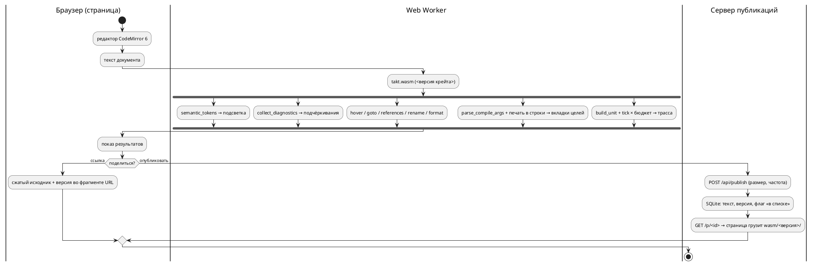

Источник: [docs/features/0531-web-playground.md](https://github.com/Pastor/Takt/blob/3c154a13d979b18312a1250ebfbe3db2fa5247d3/docs/features/0531-web-playground.md)

Полный текст по ссылке. Ниже начало карточки.

# Фича: Онлайн-редактор Takt: подсветка, LSP, генерация, симуляция, обмен ссылками

- **Номер:** 0531
- **Статус:** ГОТОВО
- **Зависит от:** нет (проверено на стадии анализа 2026-09-04: ни одна незакрытая
  фича не даёт контракта, схемы или инфраструктуры, которых ждёт эта)
- **Tier:** — (шкала «признак вреда» к новой возможности не применяется;
  предложено оставить прочерк — решение заказчика, см. ADR)
- **Класс:** прочее (инструменты)
- **Связанные issue (анализ):** запрос заказчика 2026-09-04

## Стадии жизненного цикла

Все стадии — **разделы этой карточки**. Пройдены регистрация,
архитектура (ADR, 2026-09-04) и анализ (2026-09-04, задачи `0531-01`…`0531-05`
и порядок их выполнения — в разделе «Анализ»); идёт разработка — выполнены
задачи `0531-01`, `0531-02` (раздел «Разработка»), `0531-03`, `0531-08`,
`0531-06`, `0531-07a`, `0531-07b`, `0531-09a`, `0531-09b`, `0531-09c`,
`0531-05`, `0531-07c`, `0531-07d`, `0531-09d`, `0531-09e`, `0531-09f-1`,
`0531-09f-2`, `0531-09f-3`, `0531-09g`, `0531-09h`, `0531-09i`, `0531-09j`,
`0531-09k`, `0531-09l`, `0531-09m`, `0531-09n`, `0531-09p`, `0531-09q`,
`0531-09r` и
`0531-10a` (разделы
«Часть 03», «Часть 08», «Часть 06», «Часть 07», «Часть 09» и «Часть 10»
анализа). Задача `0531-09f` (вход через OAuth площадок) — в проработке у
модели Fable по поручению заказчика 2026-09-04. Ниже — то, что
сказал заказчик, и вопросы, на которые отвечает ADR.

## Краткое описание

Веб-сервис, в котором модель на Takt пишут, проверяют и запускают прямо в
браузере, а результатом делятся по ссылке — как на pastebin.

Состав, названный заказчиком:

- **редактор** с подсветкой синтаксиса Takt;
- **семантический анализ** — «всё, что может обеспечить LSP»: диагностики по
  мере набора, переход к объявлению, поиск использований, переименование,
  наведение, форматирование;
- **генерация кода** — вывод целей рядом с исходником (предпросмотр);
- **симуляция** — отдельной вкладкой;
- **обмен**: код выкладывается на всеобщее обозрение, у каждой публикации своя
  ссылка.

Задача **большая** и по своду подлежит декомпозиции: на стадии анализа
она разбивается на задачи `0531-YY`, а часть, возможно, выделяется в отдельные
фичи со своими номерами.

## Документирование

Предварительно: **язык не меняется** — сервис показывает то, что уже умеют
`taktc`, `takt-lsp` и `takt-sim`. Раздел документа при этом, вероятно, нужен:
«Инструментарий» описывает работу с инструментами, и веб-редактор — такое же
применение (свод допускает прикладные разделы). Решение принимается на
стадии архитектуры; если сервис потребует ограничить конструкции языка (например
запретить долгие прогоны), это уже **изменение языка** и отдельный разговор.

## Вопросы к архитектуре (стадия 2)

Список открытых решений, а не предложений — их предстоит принять заказчику.

1. **Где исполняется компилятор.** Сборка `takt-lang` в WebAssembly и работа
   целиком в браузере — или серверный прогон с API? Первое снимает вопросы
   изоляции и нагрузки, второе не требует портирования и даёт доступ к
   инструментам целей (`cc`, `iec2c`, `verilator`), которых в браузере нет.
2. **Симуляция.** Прогон в браузере против прогона на сервере; лимиты шагов и
   времени; что делать с моделями, которые не завершаются (у эталона есть предел
   итераций, но не предел прогона).
3. **Хранение публикаций.** Что именно сохраняется (исходник, сценарий,
   выбранная цель, версия языка), сколько живёт, можно ли править и удалять;
   нужен ли приватный режим «по ссылке, но не в списке».
4. **Версия языка у публикации.** Ссылка должна открываться так же и через год:
   значит публикация хранит версию, а сервис — несколько версий компилятора.
   Иначе старые ссылки будут молча меняться в поведении.
5. **LSP в браузере.** `takt-lsp` — процесс, говорящий по LSP; в вебе нужен
   мост (WebSocket или WASM-сборка). Пути поиска импортов в вебе отсутствуют —
   решить, поддерживаются ли многофайловые публикации.
6. **Цели генерации в предпросмотре.** Показывать все восемь или выбранную;
   что делать с целями, отказывающими на входе (это нормальный ответ, а не
   ошибка сервиса).
7. **Злоупотребления.** Публичная площадка с исполнением кода: лимиты на размер,
   частоту, длительность; модерация; хранение адресов.
8. **Куда кладётся сервис.** Отдельный крейт в этом репозитории или отдельный
   репозиторий; как он собирается и чем проверяется (у изменения
   обязана быть сборка и тесты).

## Что уже есть в проекте (опора для анализа)

- `takt-lang` — компилятор с восемью целями и библиотечным API (`parse`,
  `compile_to_c`, …);
- `takt-lsp` — сервер LSP: диагностики, переход к объявлению, использования,
  переименование, форматирование, символы документа;
- `takt-sim` — эталонный симулятор: прогон по тактам, сценарии, GIF/SVG;
- `book/takt.sublime-syntax` и списки ключевых слов — готовое описание лексики
  для подсветки, сверяемое с лексером проверкой `check-book-keywords.py`;
- плагины редакторов (`extensions/`) — образец того, какие возможности
  редакторского слоя уже описаны.

## Архитектура (ADR)

- **Status:** Proposed — решения, названные в «Decision» как **решения заказчика**,
  ждут его слова; остальное предложено к принятию.
- **Date:** 2026-09-04
- **Authors:** архитектор, системный аналитик

### Context

Сервис обязан показывать **то же**, что `taktc`, `takt-lsp` и `takt-sim`:
документ уже обещает, что «диагностика в редакторе совпадает с диагностикой
компилятора» (раздел «Инструментарий»), и второй компилятор для веба проект
позволить себе не может. Значит, вопрос архитектуры — **где исполняется тот же
самый код** и **через какую границу** он говорит с браузером.

**Что уже есть (снято чтением дерева 2026-09-04):**

| Слой | Что есть | Что мешает браузеру |
|---|---|---|
| компилятор | `takt-lang`: `parse`, `compile_to_*` (8 целей), `compile_cli::parse_compile_args` (разбор ключей — одна таблица `target_flags`, 0466), `verify_all` | `compile_to_*` и `generator::generate` принимают **путь вывода** и пишут файлы сами; `std::fs` встречается в 17 файлах — генераторы, импорт, карта адресов, рабочая область LSP |
| LSP | библиотечный слой — **чистые функции над текстом**: `collect_diagnostics(src)`, `hover_info(src, pos)`, `goto_declaration`, `references_at`, `rename_at`, `formatting_edits`, `document_symbols`, `completion_items`, `semantic_tokens`; позиции — UTF-16 (`lsp/position.rs`) | транспорт (`Connection::stdio`, диспетчер) живёт в бинарнике `takt_lsp.rs` (529 строк); варианты `*_in_workspace` читают диск |
| эталон | `takt_sim::build_unit` + `Unit::tick`, `active_states`, `variable`, `set_port`, `is_terminal`; сценарий — `json_input::SimStep`; предел итераций цикла `MAX_ITERATIONS = 100_000` **на такт** | `SimulationRunner` печатает в stdout (11 мест) и пишет GIF/SVG на диск; раскладка графа берёт `rand::rng()` (`unit/viewport/graph.rs`) — на `wasm32-unknown-unknown` `getrandom 0.4` требует явного генератора; предела **прогона** нет — только `-n` |
| подсветка | `lsp::semantic_tokens` (лексер + имена из дерева), `book/takt.sublime-syntax` (для PDF, сверяется с лексером проверкой) | третий список ключевых слов для веба — класс |
| процесс | проверки внешних инструментов — мягкий пропуск, под `PRECHECK_STRICT=1` ошибка; CI Actions **не исполняется** (биллинг, 0175) — развёртывание только руками; расширение Zed собирается под WASM вне предкоммита (0414) | предкоммит 233 с — новый крейт в корневом workspace платит на каждом прогоне |

**Замер-04 (проба): крейты собираются под WebAssembly без
единой правки.** `cargo check --target wasm32-wasip1` (таргет уже стоит в пине
[расширение Zed не собирается: пин толчейна и каталог сборки](0414-zed-extension-build.md)):

| Крейт | Набор фич | Результат | Время |
|---|---|---|---|
| `takt-lang` | умолчание | `Finished` | 14.6 с |
| `takt-lang` | `lsp` (`lsp-types`, `lsp-server`, `serde_json`) | `Finished` | 10.1 с |
| `takt-sim` (`--lib`, вместе с `resvg`, `gif`, `clap`) | умолчание | `Finished` | 5.8 с |

Пробный `cdylib` с одним экспортом, удерживающим компилятор с восемью целями,
слой LSP и эталон (релиз, `opt-level = "s"`, `lto`, `panic = "abort"`, без
`wasm-opt`): **3.3 МБ** (`takt_wasm_probe.wasm`), **937 КБ** в gzip; сборка модуля при
готовых зависимостях — 10.9 с. В пробу вошли `resvg`, `fontdb`, `rustybuzz`
(графика эталона) — рабочий модуль без них будет меньше (A2).

Что проба **не** доказывает: таргет браузера `wasm32-unknown-unknown` в пине
отсутствует и не проверялся; известное по документации препятствие на нём —
`getrandom` (см. таблицу), а операции `std::fs` там **компилируются**, но
отвечают ошибкой при вызове. Инструменты целей (`cc`, `iec2c`, `verilator`,
`yosys`) в браузере недоступны при любом варианте.

### Decision Drivers

1. **Исполнение чужого кода.** На сервере это изоляция, лимиты, дежурство и
   площадка для злоупотреблений; в браузере — песочница, за которую платит
   браузер, и нагрузка, за которую платит автор модели.
2. **Один носитель.** Тот же код, что у `taktc`; подсветка — из того же лексера;
   ключи сборки — из той же таблицы. Второй список — молчаливое расхождение.
3. **Ссылка через год.** Поведение задаёт **версия крейта** `takt-lang`
   (0.55.0), а не только версия языка (0.17.0): исправления меняют вывод без подъёма
   языка. Публикация обязана хранить то, что задаёт поведение.
4. **Стоимость владения.** CI не исполняется, дежурного нет, разработчик один.
   Каждая движущаяся часть на сервере — обязательство навсегда.
5. **свод и цена предкоммита.** У каждой части — сборка и тесты; при этом
   233 с предкоммита не должны вырасти вдвое ради веба.
6. **свод.** Части обязаны быть самостоятельно полезны: редактор без
   сервера публикаций — уже инструмент.

### Considered Options

#### Option A. Всё в браузере (WebAssembly); сервер — только хранилище публикаций

Компилятор, слой LSP и эталон собираются в **один модуль WASM**, исполняются в
Web Worker; сервер (если он есть) хранит тексты и раздаёт статику.

**Pros:** песочница браузера снимает вопросы 1, 2 и 7 карточки (изоляция,
лимиты прогона, злоупотребления исполнением); версии — это **файлы**
`wasm/<версия>/takt.wasm`, старые лежат рядом с новыми и не стоят ничего;
ноль процессов на сервере ради компиляции; проба показала, что портировать
нечего — только развязать вывод от файловой системы.

**Cons:** нет инструментов целей — показывается вывод компилятора, а не вердикт
`cc`/`iec2c`/`verilator` (граница названная: тот же класс «валидный вывод при
нулевом коде», который у проекта контролируют проверки, в браузере не виден); модуль
весит мегабайты (замер выше); в проект входит JS-инструментарий (см. A3).

#### Option B. Всё на сервере: API над `taktc`/`takt-sim`, `takt-lsp` через WebSocket-мост

**Pros:** ничего не портируется; доступны инструменты целей; LSP говорит своим
протоколом.

**Cons:** исполнение чужого кода на сервере — контейнер/seccomp, лимиты CPU и
памяти, очередь; **процесс `takt-lsp` на сессию** (сервер не многодокументный);
несколько версий — несколько установленных бинарников и их маршрутизация;
`takt-sim` без предела прогона надо убивать по таймеру; при заблокированном CI
всё это разворачивается и чинится руками. Драйверы 1 и 4 против.

#### Option C. Гибрид: LSP и генерация в браузере, симуляция на сервере

**Cons:** худшее обеих — сервер всё равно исполняет чужой код, а код живёт на
двух путях; единственный аргумент (длинные прогоны) закрывается бюджетом
тактов в Worker с `terminate()`. Отвергнут.

#### Option D. Чужая площадка (Compiler Explorer)

Language добавляется PR с бинарником компилятора; ссылки короткие — их
инфраструктура. **Cons:** нет ни LSP, ни симуляции, ни своих публикаций;
исполнение — на их машинах со своей политикой. Отвергнут: закрывает одну
позицию из пяти.

**Выбор — Option A.** Ниже — решения внутри него; каждое с отвергнутой
альтернативой.

#### A1. Мост браузер ↔ WASM: C-ABI + JSON, без `wasm-bindgen`

Экспорты вида `fn(ptr, len) -> ptr` с строками UTF-8; аргументы и ответы —
JSON. Ответы слоя LSP сериализуются **типами `lsp-types`** (они уже `serde`):
форма ответа в вебе тождественна форме ответа `takt-lsp` редактору, и второго
описания API нет. Ключи сборки принимаются **строкой аргументов CLI** и
разбираются `parse_compile_args` — таблица применимости ключей 0466 остаётся
единственной.

Отвергнуто: `wasm-bindgen`/`wasm-pack` — ещё один внешний инструмент, чья
версия обязана совпадать с версией крейта; связка склеивающего JS занимает
≈60 строк, и писать их дешевле, чем контролировать инструмент. Отвергнуто: LSP
JSON-RPC через `lsp_server::Connection::memory()` — переносит в веб
**транспорт** (529 строк диспетчера), тогда как содержание — функции над
текстом; редактору в вебе клиент протокола не нужен.

#### A2. Таргет `wasm32-unknown-unknown`; вывод генераторов развязывается от файлов

Таргет браузера без WASI: прослойка WASI в браузере — ещё одна JS-зависимость
ради `std::fs`, которого в вебе быть не должно. Следствие — правка **в
библиотеке**: у генераторов появляется носитель «напечатать в строки»
(`Vec<(имя_файла, текст)>`), а нынешний `generate(…, output_path, …)` становится
«напечатать и записать». Бинарник и веб зовут один печатник; снимки
`examples/generated/` (0048, 0274) контролируют тождественность байт в байт.
Раскладка графа получает **детерминированный** генератор (трасса проекта
воспроизводима по замыслу 0134, случайность в кадре — то же нарушение), а
`resvg`/`gif` уходят под фичу `graphics` крейта `takt-sim` (умолчание — вкл.,
в WASM — выкл.).

#### A3. Редактор — CodeMirror 6; подсветка — `semantic_tokens` из модуля

Токены приходят от того же лексера, что у `takt-lsp` (на неразбираемом файле —
лексерные, имена появляются после разбора), диагностики — декорациями; своей
грамматики подсветки у веба **нет**. Отвергнуто: Monaco + `monaco-languageclient`
(мегабайты и клиент протокола ради того, что уже есть функциями); отвергнута
грамматика Monarch/Lezer (третий список слов).

Цена: в проект входит `node` с `package-lock.json` и сборщиком (`esbuild`);
политика та же, что у `iec2c`/`verilator` — нет `node` → мягкий пропуск,
`PRECHECK_STRICT=1` → ошибка. Отвергнуто: CDN во время исполнения (сервис
зависит от чужого хоста) и коммит собранного бандла (собранный артефакт в
дереве — то, чего проект избегает: 0274 сверяет снимки, а не хранит).

#### A4. Симуляция — в Worker, потактово через `Unit::tick`, с бюджетом

Сценарий — тот же JSON, что у `-s` (`json_input`); за такт — состояния и
значения в трассу (таблица, как у `takt-sim`); бюджет — число тактов (умолчание
как у `-n`) **и** время стены; превышение — `Worker.terminate()` и сообщение с
названной причиной. Бюджет — **свойство прогона**, как `-n`, а не языка:
конструкции не ограничиваются, язык не меняется (раздел «Документирование»
карточки). Кадры SVG — позже, после A2.

#### A5. Версия публикации — версия крейта `takt-lang`; модули лежат по версиям

Публикация хранит `takt_lang` (крейт) и `LANGUAGE_VERSION` (для показа);
страница грузит `wasm/<версия крейта>/takt.wasm`; новый документ берёт
последнюю. Старые модули **не удаляются** — это и есть ответ на вопрос 4
карточки. Отвергнуто: хранить только версию языка — исправления меняют поведение
между подъёмами языка (0507…0512 вышли без подъёма).

#### A6. Обмен — двумя ступенями

1. **Ссылка без сервера:** сжатый исходник + сценарий + цель + версия — во
   фрагменте URL (приём Compiler Explorer / TypeScript Playground). Вечная,
   самодостаточная, площадки для злоупотреблений нет. Достаточна для «поделиться».
2. **Сервер публикаций** (вопросы 3 и 7 карточки): `POST` → короткий
   идентификатор; список публичных; флаг «по ссылке, но не в списке»
   (умолчание — **не в списке**); удаление по токену владельца; предел размера
   (64 КиБ); ограничение частоты по адресу с окном в минуты — **адрес с
   публикацией не хранится**; модерация — удаление администратором. Сервер
   ничего не исполняет. Реализация — Rust (`axum` + SQLite) в **своём**
   workspace `web/server` (драйвер 5: корневой `cargo test` его не собирает),
   со своим шагом предкоммита.

Срок жизни публикаций и наличие ступени 2 в первом выпуске — **решение
заказчика**.

#### A7. Один файл; импорт — названная граница

Публикация — один файл. `import` даёт штатный `SE-001` с подсказкой (0279) —
это честный ответ, не отказ сервиса. Многофайловые публикации требуют
поставщика файлов в `semantic::import` (сейчас читает диск напрямую) — кандидат
в фичи после закрытия этой.

#### A8. Размещение в дереве и проверки

| Часть | Где | Сборка и проверка |
|---|---|---|
| привязки | `takt-wasm/` — **член корневого workspace** (тонкий: JSON ↔ вызовы библиотек) | нативно — обычный `cargo test`; под WASM — шаг предкоммита `cargo build --release --target wasm32-unknown-unknown -p takt-wasm` (таргет — в пин `rust-toolchain.toml`) |
| фронтенд | `web/` (`package.json`, lockfile, `esbuild`) | шаг предкоммита: сборка + **сверка в `node`**: корпус `examples/*.takt` через модуль против вывода `taktc` **байт в байт** по всем целям и трассы `examples/simulations/` против `takt-sim` — основание 0048 (генерация детерминирована) |
| сервер | `web/server/` — свой workspace (как `extensions/zed-takt`) | свой шаг: `cargo test` в его каталоге |

Проверки, перечисляющие крейты списком (`check-test-targets.py: CRATES`,
`check-module-size.sh`), получают третий крейт — иначе он невидим им молча.
Хостинг статики и домен — **решение заказчика**; развёртывание — скриптом
`scripts/`, поскольку CI не исполняется.

### Decision

Принять **Option A** с решениями A1–A8. Целевой поток:

**Декомпозиция для стадии анализа** (свод; порядок — по самостоятельной
пользе):

| Часть | Содержание | Что даёт сама по себе |
|---|---|---|
| 0531-01 | печать генераторов в строки; фича `graphics` и детерминированная раскладка у `takt-sim`; крейт `takt-wasm` (компиляция всех целей, диагностики, функции LSP, форматирование, потактовая симуляция); таргет в пине; шаг сборки WASM | модуль, который можно позвать из `node` |
| 0531-02 | фронтенд: редактор, токены, диагностики, наведение/переход/использования/переименование/форматирование, вкладки целей, вкладка симуляции с бюджетом; ссылка во фрагменте URL; проверка сверки с `taktc`/`takt-sim` | рабочий редактор без сервера |
| 0531-03 | сервер публикаций: API, хранение, список, приватность, лимиты, удаление, раздача модулей по версиям | «как pastebin» |
| 0531-04 | документ: подраздел «Онлайн-редактор» в разделе «Инструментарий» (свод допускает; новый **раздел** не заводится); README; скрипт развёртывания | описание применения |

Нумерация задач уточняется анализом; выделение 0531-03 в отдельную фичу —
по решению заказчика о ступени 2.

**Решения, ожидающие заказчика:** (1) `Tier` — шкала признака вреда к новой
возможности не применяется, предложено оставить `—`; (2) нужна ли ступень 2
обмена в первом выпуске и срок жизни публикаций; (3) хостинг статики и домен;
(4) согласие на вход `node` в предкоммит на условиях мягкого пропуска.

### Consequences

- **Язык не меняется**; бюджет прогона — свойство прогона. Раздел
  «Документирование» карточки подтверждается.
- Библиотека `takt-lang` получает печать генераторов **в строки** — правка
  касается всех восьми целей и контролируется снимками 0274 и проверкой; это
  улучшение и для тестов (сегодня они читают файлы).
- `takt-sim` теряет случайность в раскладке — кадр становится воспроизводимым,
  что согласно 0134 и так ожидалось от эталона.
- В предкоммит входят три шага (WASM-сборка, сверка в `node`, тесты сервера);
  цена измеряется на стадии анализа (`scripts/measure-precheck.sh`)
  и обязана уложиться в бюджет, названный там.
- Граница «инструменты целей в браузере недоступны» показывается пользователю
  словами на вкладке цели, а не молчанием.
- Первый JS-код в проекте: правила `docs/CODE.md` его не покрывают — анализ
  называет минимум (lockfile, версия `node`, без транспиляции сверх `esbuild`).

#### Acceptance criteria

1. Вывод каждой из восьми целей в браузере **байт в байт** совпадает с
   `taktc` на корпусе `examples/*.takt`; трасса симуляции совпадает с
   `takt-sim` на `examples/simulations/` — проверяет проверка, а не глаз.
2. Подсветка, диагностики, наведение, переход, использования, переименование
   и форматирование в браузере идут через функции `takt_lang::lsp`; в `web/`
   нет списка ключевых слов Takt (контроль — греп по каталогу).
3. Публикация, открытая по ссылке, грузит модуль **своей** версии; при двух
   выложенных версиях старая продолжает открываться (тест на двух модулях).
4. Прогон, превышающий бюджет, останавливается с названной причиной; страница
   остаётся отзывчивой (Worker).
5. Ключи сборки в вебе — те же строки, что у `taktc compile`; отказ цели
   показывается как её диагностика.
6. `./scripts/precheck.sh` зелёный; без `node` шаги веба пропускаются словом
   «пропуск», под `PRECHECK_STRICT=1` — ошибка.

## Анализ

### Цель и контекст

ADR принял **Option A**: компилятор, слой LSP и эталон исполняются в браузере
одним модулем WebAssembly, сервер (ступень 2 обмена) только хранит публикации.
Анализ переводит решение в задачи: что именно меняется в библиотеках, что
заводится заново, чем каждая часть проверяется и в каком порядке они идут.
Нумерация частей совпадает с нумерацией задач разработки.

### Замер (дата 2026-09-04)

Сверх замеров ADR (сборка под WASM без правок; модуль 3.3 МБ / 937 КБ gzip):

| Предмет |
