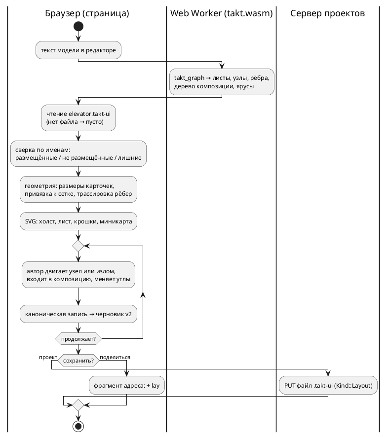

Источник: [docs/features/0539-model-layout-ui.md](https://github.com/Pastor/Takt/blob/3c154a13d979b18312a1250ebfbe3db2fa5247d3/docs/features/0539-model-layout-ui.md)

Полный текст по ссылке. Ниже начало карточки.

# Фича: графическое представление модели — раскладка состояний и рёбер в отдельном файле

- **Номер:** 0539
- **Статус:** ГОТОВО (закрыта 2026-09-08; вердикт тестирования — готово)
- **Зависит от:** нет (связь с [онлайн-редактор Takt: подсветка, LSP, генерация, симуляция, обмен ссылками](0531-web-playground.md) — по
  контракту оболочки, нужные части в дереве; обоснование в разделе «Анализ»)
- **Tier:** — (новая функциональность, а не дефект: шкала признака вреда к ней
  неприменима)
- **Класс:** прочее
- **Связанные issue (анализ):** запрос заказчика 2026-09-07

## Стадии жизненного цикла

Все стадии — **разделы этой карточки**: «Архитектура (ADR)»,
«Анализ», «Разработка», «Тест-план», «Отчёт о тестировании», «Итог». Раздел
заводится в момент прохождения стадии, а не заранее. Отдельным артефактом
остаются только исправления — [`docs/fixes/`](../fixes/README.md) (при
необходимости `0539-YY-*`).

## Краткое описание

Модель Takt получает **графическое представление**: схему состояний и переходов,
которую автор двигает руками, а не получает заново при каждом открытии. Раскладка
хранится отдельным файлом рядом с моделью (`elevator.takt` → `elevator.takt-ui`) и
несёт координаты: центры состояний и точки рёбер. Составное состояние показывается
одним квадратом с укрупнённой моделью внутри, а вход в него открывает вложенную
модель отдельной схемой.

> Фича зарегистрирована по запросу заказчика 2026-09-07; далее проходит жизненный
> цикл по своду. **Проработка (архитектура и анализ) поручена отдельно** — здесь
> только регистрация требования.

## Требование заказчика (дословно по смыслу)

Записано без домысливания решений; всё, чего заказчик не сказал, вынесено ниже в
открытые вопросы.

- **Графическое представление модели** для интерфейса пользователя.
- Оно **хранит 2D-координаты рёбер** — форма рёбер **прямоугольная либо
  скруглённая** — и **координаты центров состояний**.
- **Скомпонованные модели** показываются **квадратом**, внутри которого видна
  укрупнённая модель.
- **Переход внутрь скомпонованной модели** открывает каждую модель.
- Раскладка живёт **отдельным файлом**, например `elevator.takt-ui`.
- Отображаемая часть должна быть **похожа на графический редактор схем**
  `archlang.dev`.

## Чем это не является

Отделено от соседних работ намеренно, чтобы проработка не начала с их переиспользования:

- **Это не кадры прогона.** У эталона уже есть графика (`gif`, `svg`,
  `unit::viewport` под фичей `graphics`): она рисует **состояние прогона по
  тактам** и раскладку вычисляет сама, детерминированно. Здесь предмет другой —
  **авторская** раскладка модели, которая переживает закрытие редактора.
- **Это не диаграмма цели `plantuml`.** Та порождается из модели целиком и
  координат не хранит: расположение выбирает чужой инструмент.

## Открытые вопросы для стадии архитектуры

Перечислены как вопросы, а не как варианты решения:

1. **Где живёт интерфейс** — внутри онлайн-редактора
   ([онлайн-редактор Takt: подсветка, LSP, генерация, симуляция, обмен ссылками](0531-web-playground.md)) или отдельным инструментом.
2. **Кто пишет файл раскладки** — только редактор, или компилятор умеет положить
   начальную раскладку для модели, у которой файла ещё нет.
3. **Что происходит при расхождении** файла и модели: состояние переименовано,
   удалено, добавлено. Раскладка описывает то, чего в модели уже нет, — это отказ,
   предупреждение или молчаливое приведение.
4. **Формат файла** и его отношение к правилам проекта: читается ли он
   компилятором, попадает ли под проверки предкоммита, детерминирован ли вывод.
5. **Единицы и система координат**, а также что означает «прямоугольное либо
   скруглённое» ребро — форму отрисовки или форму хранения (точки излома).
6. **Отношение к вложенности**: одна схема на модель или одна на файл; как
   адресуется вложенная модель при переходе внутрь.
7. **Референс `archlang.dev`** — что именно из него берётся образцом:
   взаимодействие, вид схемы или и то и другое.

## Документирование

Язык не меняется: синтаксис, семантика и поведение целей прежние, версия
языка остаётся `0.18.0`. Меняется **инструментарий**, и его документ
описывает в прикладном разделе «Инструментарий», подраздел «Онлайн-редактор»
(свод допускает описание применения инструментов): добавляется описание
вкладки «Схема» и файла раскладки рядом с моделью — что он хранит, что
компилятор его не читает, и что расхождение с моделью показывается, а не
ломает сборку. Языковые разделы правки не требуют. Ответ дан на стадии
архитектуры; работа — задача 08 плана разработки.

## Архитектура (ADR)

- **Status:** Proposed — решения, названные в «Decision» как **решения заказчика**,
  ждут его слова; остальное предложено к принятию.
- **Date:** 2026-09-08
- **Authors:** архитектор, системный аналитик, дизайнер интерфейса

### Context

Текст модели — единственное описание автомата, и проект держит это правило
жёстко: у веб-части нет своего знания о языке (подсветку красят токены модуля,
ключи сборки приходят от разбора аргументов компилятора). Схема состояний
обязана встать в тот же ряд: **что** рисовать, говорит компилятор, а **где** —
файл раскладки, который принадлежит автору. Иначе схема станет второй записью
модели, и две записи разойдутся молча.

**Что уже есть (снято чтением дерева 2026-09-08):**

| Слой | Что есть | Чего схеме не хватает |
|---|---|---|
| оболочка ([онлайн-редактор Takt: подсветка, LSP, генерация, симуляция, обмен ссылками](0531-web-playground.md)) | две области с разделителями, вкладки области вывода (`output`, `flags`, `trace`, `doc`), полка режимов для узкого экрана, проекты с файлами трёх родов (`.takt`, `.json`, `.md`), черновик `v2` с ревизией, ссылка-снимок во фрагменте адреса (`v`, `src`, `scn`, `t`, `args`), архив проекта круговым рейсом, словарь `i18n/` | вкладки «Схема» нет; рода файла для раскладки нет ни у страницы (`project.js`), ни у сервера (`limits.rs::check_file_name` знает три расширения); ссылка-снимок раскладку не несёт |
| модуль `takt-wasm` | `takt_symbols` — структура документа (модели, состояния, блоки, функции) с позициями; `takt_sim_tick` — строки трассы; `takt_goto`, `takt_rename` | графа переходов модуль не отдаёт: символы знают состояния, но не рёбра и не форму реализации; шаг прогона отдаёт **строку**, а не список активных состояний |
| эталон | раскладка графа отжигом (`unit/viewport/graph.rs`, `petgraph` + `rand` с постоянным зерном) и растеризатор — под фичей `graphics`, в модуле выключены | раскладка эталона рисует **прогон**, узлы — состояния всех уровней одним графом; авторских координат не принимает |
| дизайн-система | книга [`web/design/BOOK.md`](../../web/design/BOOK.md), витрина `controls.html`, проверка `check-design.py` (`D1`…`D8`): палитра сырья и реестр пар, пять ступеней кегля, три высоты, два скругления, пять состояний контрола, две темы | контролов холста нет: узел, ребро, сетка, миникарта, хлебные крошки, панель инструментов схемы |
| компилятор | семантическое дерево знает состояния, рёбра (`ref` с условием, `next`), реализацию состояния (`Extend::Concatenation` / `Parallel`, `implementation_children`), импорт | публичной функции «граф модели» нет; цель `plantuml` печатает текст диаграммы без координат (и предложена к изъятию — [изъятие цели диаграмм и очистка упоминаний](0540-remove-plantuml-target.md)) |

**Референс `archlang.dev` (замер 2026-09-08 прогоном страницы `/viewer` в
браузере).** Это просмотрщик архитектурных схем: бесконечный холст с точечной
сеткой, панорамирование и масштаб колесом, показатель масштаба (`1.00×`) и
миникарта в углу, слева — дерево файлов и узлов с поиском, сверху — хлебная
крошка «Корень» и кнопка «Отцентрировать на этом уровне», переключатель
«просмотр / правка». Узел — скруглённая карточка: значок вида, имя, вид мелким
кеглем, строка описания; выбранный узел получает кольцо акцента. **Контейнер —
та же карточка крупнее, а в её теле уменьшенное изображение вложенных узлов.**
Рёбра — плавные линии со стрелкой между карточками. Тема одна, тёмная.

Что из референса **применимо**: механика холста (панорамирование, масштаб,
сетка, миникарта, «отцентрировать», крошки уровня), форма карточки и
контейнер с миниатюрой, навигатор слева (у нас его даёт `takt_symbols`).
Что **не применимо**: временная шкала и сравнение версий, «аспекты», набор
значков по видам узлов (у нас видов четыре: стартовое, обычное, конечное,
композиция), одна тёмная тема (у нас две, и светлая — основная).

### Decision Drivers

1. **Одна правда о модели.** Состояния, рёбра, форма композиции приходят от
   компилятора; страница не разбирает текст модели и не хранит списка
   ключевых слов (контроль — `check-web.sh`).
2. **Раскладка — работа автора, и она переживает всё.** Файл рядом с моделью,
   в проекте, в архиве, в черновике, в ссылке-снимке; дифф файла в git несёт
   смысл — значит, запись канонична и детерминирована.
3. **Расхождение файла с моделью — не отказ.** Компилятор файла не читает;
   переименованное, удалённое и добавленное состояние обязаны показываться, а
   не ломать сборку или редактор.
4. **Без новых зависимостей.** Фронтенд без `npm` и сборщика (решение
   заказчика по [онлайн-редактор Takt: подсветка, LSP, генерация, симуляция, обмен ссылками](0531-web-playground.md)); библиотек холста в проект не
   входит. Разработчик один, CI не исполняется.
5. **Дизайн-система одна.** Новые контролы живут в книге, витрине и под
   проверкой `check-design.py`, а не рядом с ними.
6. **Детерминизм.** Начальная раскладка и запись файла воспроизводимы:
   тот же текст модели даёт тот же файл байт в байт.

### Considered Options

Варианты приведены по семи вопросам карточки; у каждого — принятое и
отвергнутое.

#### Вопрос 1 — где живёт интерфейс

- **A (принято): вкладка «Схема» в области вывода онлайн-редактора.** Там уже
  есть проект с файлами, сохранение, обмен, черновик, две темы и словарь;
  схема рядом с текстом — единственное место, где выбор состояния на схеме
  может подвинуть курсор в тексте и наоборот.
- B: отдельный настольный инструмент — отвергнут: в проекте нет
  графического стека, хранилища и обмена, а один разработчик их не потянет.
- C: панель в редакторе через LSP и `webview` плагина — отложен кандидатом:
  плагины собираются вне предкоммита, и класс «расхождение молча» там
  дороже; после первой редакции ту же страницу можно показать в `webview`.

#### Вопрос 2 — кто пишет файл раскладки

- **A (принято): пишет страница; граф и начальную раскладку считает
  библиотека.** `takt-lang` получает модуль `layout`: из семантического
  дерева строится **граф модели** (листы по моделям, узлы-состояния с видом и
  позицией в тексте, рёбра с текстом условия, дерево композиции) и
  **ярусная раскладка** (ярус и порядок узла; без случайности). Модуль
  экспортирует `takt_graph`. Геометрию — размеры карточек, шаг сетки,
  трассировку рёбер без сохранённых точек — считает страница: размеры
  принадлежат оформлению и известны только ей.
- B: подкоманда `taktc layout`, кладущая начальный файл, — отложена
  кандидатом: файл без автора, который его двигал, — шум в проекте;
  библиотечная функция та же, подкоманда добавляется по нужде.
- C: раскладка целиком в JS — отвергнута: страница узнала бы о моделях,
  состояниях и композиции, то есть о языке.
- D: раскладка отжигом эталона (`viewport/graph.rs`) — отвергнута: она
  тянет `petgraph` и `rand` в модуль, рисует все уровни одним графом и не
  предназначена для листов по моделям.

#### Вопрос 3 — расхождение файла и модели

- **A (принято): файл — подсказка, ключ — имя.** Узел ищется по пути листа и
  имени состояния, ребро — по паре имён и порядковому номеру среди рёбер той
  же пары. Состояние без записи ставится автоматически и помечается как
  «не размещено» до первого перемещения. Запись без состояния читается,
  не рисуется и **снимается при следующей записи**, о чём страница говорит
  строкой-уведомлением с именами. Отказа нет ни в каком случае; компилятор
  файла не читает, сборка от него не зависит.
- B: отказ на расхождении — отвергнут: переименование состояния в тексте
  давало бы неоткрываемую схему.
- C: молчаливое приведение — отвергнуто: автор терял бы раскладку, не узнав.
- Дополнение (редакторский слой): `rename` из редактора переименовывает и
  ключи раскладки — иначе каждое переименование ронялo бы позицию.

#### Вопрос 4 — формат файла

- **A (принято): JSON с полем версии формата, каноническая запись.** Ключи
  отсортированы, отступ два пробела, координаты целые, перевод строки в
  конце. Родов файла проекта становится четыре: `Kind::Layout` по расширению
  `.takt-ui`; файл входит в архив и в предел размера. Компилятор и
  форматтер его не знают; проверки предкоммита — тесты в `node` на канон,
  сверку с графом и круговой рейс.
- B: текстовая запись в духе Takt — отвергнута: вторая грамматика в проекте.
- C: YAML или TOML — отвергнуты: разборщика в дереве нет, а JSON уже разбирают
  сценарии и архив.

#### Вопрос 5 — единицы, координаты, форма ребра

- **A (принято).** Единица — логический пиксель при масштабе `1.0`, начало —
  левый верхний угол листа, ось `y` вниз, значения целые, привязка к сетке
  шага `--gap`. У узла хранится **центр**; размер не хранится — его задаёт
  оформление (карточка по тексту имени, композиция — квадрат постоянной
  стороны). У ребра хранятся **точки излома** ортогональной ломаной;
  сторона присоединения к карточке считается по первой и последней точке.
  «Прямоугольная либо скруглённая» — **форма отрисовки углов** (`square`
  либо `round`), одна на файл; хранятся те же точки.
- B: хранить размеры узлов — отвергнуто: размер принадлежит оформлению и
  кеглю читателя; хранить его значит зафиксировать вид.
- C: хранить точки присоединения — отвергнуто: при смене кегля карточка
  растёт, и точка уезжала бы с грани.

#### Вопрос 6 — вложенность

- **A (принято): один файл раскладки на файл модели, внутри — листы по
  моделям.** Ключ листа — путь модели (`/` у корня, `Engine`, `C/C1`).
  Состояние с реализацией показывается **квадратом с миниатюрой**: для
  одной модели — уменьшенный лист этой модели, для композиции — уменьшенная
  схема выражения. Вход в квадрат: у одной модели — сразу её лист; у
  композиции — **лист композиции** (цепочка `+` слева направо, ветви `|`
  друг под другом, скобки — вложенными рамками), где каждая модель —
  карточка, а вход в неё открывает лист модели. Лист композиции строится
  из выражения и **не хранится**. Крошки уровня — путь входа. Лист
  импортированной модели живёт в раскладке **её** файла; нет файла —
  автоматическая раскладка.
- B: одна схема на файл со всеми уровнями — отвергнута: лифт даёт шесть
  экземпляров `Engine` на одном листе, и авторская раскладка теряет смысл.
- C: хранить раскладку листа композиции — отложено кандидатом: форма
  выражения диктует порядок, двигать там нечего.

#### Вопрос 7 — что берётся из референса

Ответ дан в «Context»: механика холста, карточка, контейнер с миниатюрой,
навигатор и крошки — берутся; тёмная тема как единственная, временная
шкала, «аспекты» и значки по видам — нет. Разделение записано в брифе
дизайнеру (раздел «Анализ»).

#### Решения сверх вопросов карточки

- **A8. Отрисовка — SVG в дереве документа**, без библиотек. Узел — элемент
  с фокусом и именем для диктора, цвета — токены `app.css`, шрифт — тот же
  Fira Code, масштаб — `viewBox`. Отвергнут `canvas`: узлы без фокуса, своё
  попадание курсора, текст мимо каскада стилей; у модели десятки состояний,
  и производительности `canvas` не требуется.
- **A9. Схема не редактирует модель.** В первой редакции она — вид модели
  плюс редактор раскладки: двигать узлы и изломы, менять форму углов,
  возвращать автоматическую раскладку. Добавление состояний и рёбер со
  схемы — кандидат: текст остаётся единственным носителем модели.
- **A10. Выбор синхронен с текстом в обе стороны.** Щелчок по узлу ставит
  курсор на объявление (как переход по символу); курсор в объявлении
  состояния подсвечивает узел.
- **A11. Подсветка прогона — по решению заказчика.** Активные состояния
  шага уже известны эталону (`active_states`), но `takt_sim_tick` отдаёт
  строку; чтобы схема их показала, ответ шага получает список имён. Работа
  небольшая, но требованием заказчика не названа: заведена отдельной
  последней задачей, дизайнер рисует состояние узла «в прогоне» заранее.

### Decision

Принять вариант A по каждому вопросу и решения A8–A11. Целевой поток:

**Декомпозиция для стадии анализа** (порядок — по самостоятельной пользе;
нумерация уточняется анализом):

| Часть | Содержание | Что даёт сама по себе |
|---|---|---|
| 01 | `takt_lang::layout`: граф модели и ярусная раскладка; экспорт `takt_graph` | граф, проверяемый тестами и годный любому потребителю |
| 02 | формат `.takt-ui`: чтение, канон, сверка, запись; род файла у страницы и сервера; архив | файл, который можно править руками и хранить в git |
| 03 | дизайн холста: бриф, техническое задание, выходные требования (внешний дизайнер, параллельно 01–02) | книга, витрина и токены схемы |
| 04 | холст: вкладка «Схема», лист, навигатор, крошки, миникарта, масштаб, выбор, синхронизация с текстом | просмотр модели |
| 05 | правка раскладки: перенос узлов и изломов, форма углов, автораскладка, отмена | авторская раскладка |
| 06 | композиция: квадрат с миниатюрой, вход и выход, лист композиции | вложенность |
| 07 | сохранение: черновик, проект, ссылка-снимок, архив, уведомление о расхождении | раскладка переживает закрытие |
| 08 | документ и README: подраздел «Онлайн-редактор» | описание применения |
| 09 | подсветка активных состояний прогона (по решению заказчика) | связь схемы с симуляцией |

**Решения, ожидающие заказчика:** (1) схема не редактирует модель в первой
редакции (A9); (2) лист композиции строится из выражения и не хранится
(вопрос 6); (3) расширение `.takt-ui` и JSON внутри (вопрос 4); (4) входит ли
подсветка прогона в объём (A11); (5) привлечение внешнего дизайнера по брифу
из раздела «Анализ» — либо оформление делает разработчик по тому же
техническому заданию.

### Consequences

- **Язык не меняется**; версия языка остаётся `0.18.0`. Раздел
  «Документирование» карточки уточнён: описывается инструмент.
- `takt-lang` получает модуль `layout` — граф модели становится публичным
  API библиотеки, и цель `plantuml` при изъятии (0540) ничего не теряет:
  граф живёт отдельно от печати диаграммы.
- Модуль `takt-wasm` растёт на один экспорт; ответ `takt_sim_tick` получает
  поле со списком активных состояний (при принятии A11).
- Сервер проектов учится четвёртому роду файла; старые проекты без
  раскладки открываются как прежде — файл необязателен.
- Ссылка-снимок получает поле `lay`; ссылки без него читаются по-старому.
- В книгу оформления входит раздел о холсте, в витрину — образцы, в
  `app.css` — токены схемы; проверка `check-design.py` судит их наравне с
  прочими.
- Предкоммит получает тесты в `node` (канон файла, сверка, круговой рейс
  ссылки и архива) и тесты `cargo` для модуля `layout`; цена измеряется на
  стадии анализа.

#### Acceptance criteria

1. Для каждого `examples/*.takt` вызов `takt_graph` отвечает без отказа;
   число узлов листа равно числу состояний модели, число рёбер — числу
   `ref` и `next`; повторный вызов даёт тот же ответ байт в байт.
2. Запись файла раскладки канонична: чтение и запись без правок дают тот же
   файл байт в байт; две записи одной раскладки совпадают.
3. Переименование, удаление и добавление состояния в тексте не ломают
   схему: узел без записи размещается автоматически и помечен, лишняя
   запись названа в уведомлении и снята при записи; отказов нет.
4. Раскладка переживает закрытие страницы (черновик), сохранение проекта,
   архив круговым рейсом и ссылку-снимок.
5. Композиция показана квадратом с миниатюрой; вход открывает лист
   композиции либо модели; крошки ведут обратно.
6. Схема проходит проверку `check-design.py`, читается в обеих темах,
   контраст пар не ниже 4,5:1, узлы доступны с клавиатуры.
7. В `web/` нет списка ключевых слов Takt и разбора текста модели
   (контроль — `check-web.sh`).
8. `./scripts/precheck.sh` зелёный.

## Анализ

### Цель и контекст

ADR принял вкладку «Схема» в онлайн-редакторе, граф от компилятора,
раскладку в файле `.takt-ui` рядом с моделью и вложенность листами по
моделям. Анализ переводит решения в проверяемые требования и задачи, а
для стадии оформления даёт **бриф, техническое задание и выходные
требования** внешнему дизайнеру — так, чтобы результат оформления
передавался в разработку без устных договорённостей.

### Замер (дата 2026-09-08)

| Предмет | Факт | Следствие для задач |
|---|---|---|
| структура документа | `takt_symbols` отдаёт модели и состояния с диапазонами имени и объявления, вложенные модели — детьми | навигатор схемы строится по символам; граф добавляет рёбра и реализацию (01) |
| рёбра в дереве | `StateElement::Reference(loc, имя, условие)` и `StateElement::Next(имя)`; условие — узел, цитату даёт исходник по позиции | текст условия на ребре берётся из исходника по `loc`, а не печатается заново (01) |
| реализация состояния | `StateDefine::implements` — выражение; семантика даёт `Extend::Concatenation` / `Parallel` / ссылку на модель; список детей по вызову — `implementation_children` | лист композиции строится из `Extend`; одна модель — прямой вход (01, 06) |
| пример заказчика | `examples/elevator.takt`: модель `Engine` (пять состояний
