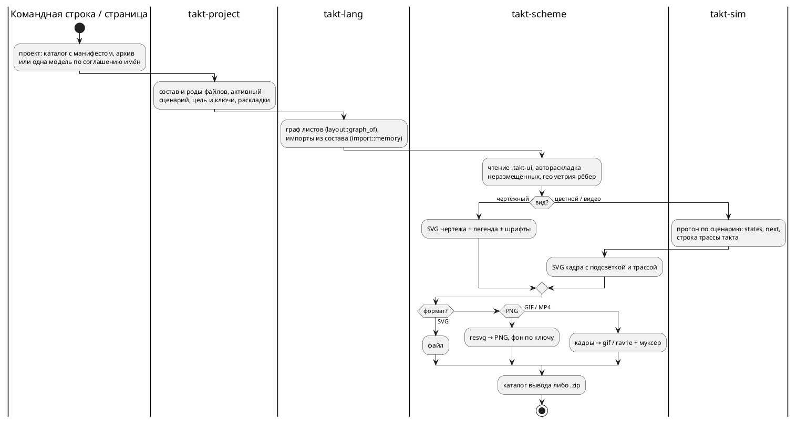

Источник: [docs/features/0590-project-export.md](https://github.com/Pastor/Takt/blob/3c154a13d979b18312a1250ebfbe3db2fa5247d3/docs/features/0590-project-export.md)

Полный текст по ссылке. Ниже начало карточки.

# Фича: экспорт проекта: изображения схемы и видео прогона

- **Номер:** 0590
- **Статус:** ГОТОВО
- **Зависит от:** [раскладка листа композиции хранится в файле раскладки](0542-scheme-composition-layout.md) — закрыта 2026-09-11 (решение заказчика 2026-09-11: экспорт идёт только по файлу раскладки, а лист композиции в файле пока не хранится). Связи, не зависимости: [панель схемы в webview](0543-scheme-in-editor-webview.md) — кнопка панели ставится после её закрытия; [подсветка прогона у нескольких экземпляров](0541-scheme-run-instances.md) улучшит цветной вид композиции
- **Tier:** — (новая возможность, не дефект)
- **Класс:** прочее
- **Связанные issue (анализ):** по запросу заказчика, 2026-09-11

## Стадии жизненного цикла

Все стадии — **разделы этой карточки**: «Архитектура (ADR)»,
«Анализ», «Разработка», «Тест-план», «Отчёт о тестировании», «Итог». Раздел
заводится в момент прохождения стадии, а не заранее. Отдельным артефактом
остаются только исправления — [`docs/fixes/`](../fixes/README.md) (при
необходимости `0590-YY-*`).

## Краткое описание

Схему модели можно выгрузить файлом: картинкой (SVG, PNG) в **чертёжном**
виде — для документа и отчёта — или в **цветном** виде прогона, а сам прогон —
видео (GIF, MP4). Сегодня схема живёт только на холсте страницы, и показать её
вне редактора можно лишь снимком экрана. Выгружается одна модель либо весь
проект: по картинке на модель.

> Фича зарегистрирована по запросу заказчика 2026-09-11; прорабатывать будет
> другой исполнитель. Далее проходит жизненный цикл по своду.

### Требования заказчика (2026-09-11)

1. **Форматы изображения:** SVG и PNG. У PNG два варианта фона — с заливкой
   либо прозрачный.
2. **Два вида изображения:**
   - **чертёжный** — без цветов прогона;
   - **цветной** — с подсветкой прогона (при симуляции).
3. **Легенда чертёжного вида** — по выбору: с легендой или без. Легенда несёт
   значок и пользовательское наименование — у состояний и у условий.
4. **Видео прогона:** GIF либо MP4; пауза между шагами задаётся при экспорте.
5. **Объём:** весь проект — несколько картинок, по одной на модель — либо
   только одна модель.
6. **Два пути экспорта — через интерфейс и без него** (уточнение заказчика
   того же дня): страница (и панель плагина) и командная строка дают один и
   тот же результат.
7. **Разбор и восприятие проекта без интерфейса.** Инструмент командной строки
   сам понимает проект: состав файлов и их роды (модели, сценарии, раскладки
   `.takt-ui`, карты адресов, пояснения), активный сценарий, цель и ключи
   сборки — всё то, что сегодня знает только страница и сервер проектов.
   Без этого экспорт «всего проекта» из командной строки невыразим.

### Что уже есть (для проработки; замер не снимался)

- Холст страницы — SVG (`web/static/scheme.js`), легенда — `web/static/legend.js`
  (значок и подпись автора из файла раскладки `.takt-ui`), подсветка прогона —
  классы узлов и рёбер на том же холсте.
- Эталон `takt-sim` пишет кадры прогона в GIF (`takt-sim/src/gif.rs`, растеризация
  через `resvg`) и в отдельные SVG (`takt-sim/src/svg.rs`) — под фичей
  `graphics`; раскладка там своя, не из `.takt-ui`.
- Фронтенд без зависимостей (решение заказчика, 0531): ни npm, ни бандлера.
  Скачивание файла страницей — обычная ссылка `download`.

### Вопросы к проработке (ADR и анализ)

- **Где рисуется картинка.** Раз экспорт обязан работать и без интерфейса,
  рисунок схемы нужен вне браузера. Кандидаты: общий носитель на Rust (его
  зовут CLI и модуль WebAssembly, `resvg` уже есть у эталона) либо JS-холст,
  исполняемый вне браузера. Два рисовальщика — холст страницы и отдельный
  рисунок CLI — разошлись бы молча: носитель рисунка должен остаться один, а
  если их всё же два, нужна сверка «страница = CLI». Вид холста (масштаб,
  выделение, ореолы, сетка) в чертёж попадать не должен.
- **Проект без интерфейса.** Что считается проектом на диске: каталог, архив
  проекта (круговой рейс 0531, задача 09g) или файл-манифест; где лежат
  активный сценарий, цель и ключи сборки (сегодня — метаданные сервера и
  архива); как CLI находит раскладку модели. Правило рода файла по расширению
  и правило поиска импортов обязаны остаться по одному носителю
  (`compile::project_search_paths`, 0575) — своя копия в CLI разошлась бы с
  редактором молча.
- **Команда.** Подкоманда `taktc` или `takt-sim` (прогон нужен для цветного
  вида и видео — это эталон), разбор проекта — общий для обеих.
- **MP4.** Кодировщика в браузере без зависимостей нет (`MediaRecorder` даёт
  WebM, и не везде); варианты — кодировщик в модуле, выгрузка на сервер,
  отказ от MP4 в браузере. Решение заказчика, если выбор меняет обещание.
- **Кадр видео** — такт, шаг с паузой или то и другое; что показывает кадр
  (номер такта, значения портов, легенда).
- **«Модель» в объёме проекта:** листы моделей, листы композиций (0542),
  вложенные модели и модели подключаемых файлов; модель без раскладки —
  автораскладка или отказ.
- **Легенда в картинке:** где стоит (снизу, справа — как `placeLegend`),
  что делать с моделью без условий и с длинными подписями.
- **Шрифт:** чертёж обязан выглядеть одинаково без шрифтов у читателя —
  встраивание (как делает `svg.rs`) или перевод текста в контуры.
- **Упаковка многокартинного экспорта:** архив или серия загрузок; имена
  файлов (модель, вид, формат), кириллица в именах.
- **Где кнопка:** панель схемы, меню проекта, плагин IntelliJ (панель
  [0543](0543-scheme-in-editor-webview.md)), CLI `takt-sim`/`taktc`.
- **Контроль:** что сверяется машиной (детерминированность SVG, размер PNG,
  число кадров), а что видит только человек.

## Документирование

Язык не меняется, но у фичи появляется командная строка экспорта и понятие
проекта вне страницы — это описание инструментов в [`book/`](../../book/):
глава «Инструментарий», подразделы «Экспорт — `export`» и «Проект на диске —
`project`» раздела о симуляторе и «Экспорт схемы» раздела об онлайн-редакторе
(сделано задачей о документе).

## Архитектура (ADR)

- **Status:** Accepted — решения заказчика получены 2026-09-11 (вопросы и
  ответы — в «Considered Options»); остальное принято архитектором.
- **Date:** 2026-09-11
- **Authors:** архитектор, системный аналитик

### Context

Схема модели живёт на холсте страницы, и вынести её за пределы редактора
можно лишь снимком экрана. Заказчик просит выгрузку: картинку схемы в
чертёжном либо цветном виде, видео прогона, одну модель либо весь проект, и
всё это двумя путями — со страницы и из командной строки, с одинаковым
результатом. Командная строка при этом обязана понимать проект сама: состав
файлов, их роды, активный сценарий, цель и ключи сборки, раскладки.

**Что уже есть (снято чтением дерева 2026-09-11):**

| Слой | Что есть | Чего экспорту не хватает |
|---|---|---|
| холст страницы | `scheme.js` (1766 строк) строит SVG через DOM; геометрия — `scheme-geometry.js` (820 строк, без DOM); файл раскладки — `layout.js` (без DOM); ступени вида (`edgeWidth`, `gamma` = `color`/`draft`/`contrast`, шрифты, кегли, сетка) едут на холст признаками `data-*`, а числа за ними живут в `app.css` | рисунка вне браузера нет; чертёжная гамма `draft` уже существует; вид холста (масштаб, выделение, ореолы, сетка, миникарта, крошки) вплетён в тот же SVG; `XMLSerializer` и скачивание картинки не используются |
| легенда | `legend.js` — HTML-таблицы «знак → имя из модели → подпись автора», образцы обозначений — свои маленькие SVG | легенда не часть SVG, в картинку её надо рисовать заново |
| граф | `takt_lang::layout` — листы по моделям, узлы, рёбра с цитатой условия, ярусы; форма JSON — общий носитель (0543), её отдаёт и `takt_graph`, и `takt-lsp --graph` | геометрии в Rust нет намеренно: координаты, трассировку рёбер и размеры считает страница |
| раскладка | `.takt-ui` формата 1: центры узлов, изломы, подписи автора, место легенды, ступени вида; читает только JS (страница, панель IntelliJ, скрипт примеров) | Rust файла не знает |
| эталон | `takt-sim` пишет GIF и серию SVG своей раскладкой (отжиг с постоянным зерном), кадр — псевдонимы состояний и легенда значений портов; под фичей `graphics` подключены `resvg`, `svg`, `gif`; растеризатор — `gif.rs::render_tree`; `Step` несёт `states` и `next` | вторая раскладка прогона, чужая файлу автора; номера такта в кадре нет; кодировщиков видео и `ffmpeg` в дереве нет; ширина GIF (990) расходится с `viewBox` (1180) — кадр сжат по горизонтали |
| модуль под браузер | `takt-wasm` собирает `takt-sim` без графики (модуль 3347 КиБ); плоский C-ABI, 20 функций | ни растеризатора, ни кодировщика, ни рисунка |
| проект | знает только сервер: род файла по расширению (`limits::check_file_name`: `.takt`, `.json`, `.md`, `.takt-ui`, `.takt-map`), активный сценарий, цель и ключи — колонки базы; манифест `takt-project.json` формата 5 — только внутри архива; компилятор читает состав из памяти (`semantic::import::memory`, `project_search_paths` в `takt-wasm`) | на диске манифеста нет; правило «сценарий принадлежит модели» реализовано трижды (`run_simulations.sh`, `build-example-projects.mjs`, `project.js`); сервер с `takt-lang` не линкуется намеренно (архив гоняет модуль через `wasmtime`) |
| шрифты | `web/static/font/` — Fira Code и ГОСТ 2.304-81 тип А как `woff2`; `svg.rs` встраивает шрифт в SVG через `@font-face` и base64, но ищет его в системе | `resvg` формата `woff2` не читает; TTF в дереве нет (`book/Makefile` качает ГОСТ в системный каталог) |
| панель IntelliJ | холст в режиме «данные снаружи» (`scheme-host.js`), ресурсы собираются из `web/` | самой панели ещё нет (0543 в разработке) |

### Decision Drivers

1. **Один рисовальщик на оба пути.** Страница и командная строка обязаны дать
   один результат; два независимых рисунка разошлись бы молча.
2. **Одна раскладка, и она — файл автора.** Интерфейс правит `.takt-ui`,
   экспорт читает его; картинка равна файлу. Без файла экспорта нет, вторая
   раскладка прогона (отжиг эталона) противоречит этому (корректировка
   заказчика 2026-09-11: «сперва правка `.takt-ui`, потом по нему экспорт»).
3. **Знание о проекте — один носитель.** Род файла, манифест, правило
   принадлежности сценария модели сегодня живут в трёх-четырёх копиях; экспорт
   из командной строки заводить пятую не вправе.
4. **Без внешних инструментов у экспорта.** Фронтенд без зависимостей (решение
   заказчика по [онлайн-редактору](0531-web-playground.md)); командная строка
   не требует `node` и `ffmpeg`.
5. **Детерминизм.** Тот же проект даёт тот же SVG байт в байт — иначе сверка
   «страница = командная строка» невозможна, а дифф картинок в git бессмыслен.
6. **Чертёж читаем без шрифтов читателя.** Картинка несёт шрифт с собой.

### Considered Options

Восемь вопросов; у каждого — принятое и отвергнутое. Первые четыре и вопросы
пять–восемь заданы заказчику 2026-09-11, его выбор помечен.

#### Вопрос 1 — где живёт рисовальщик чертежа (решение заказчика)

- **A (принято): чертёж считает компилятор.** Новый носитель на Rust строит
  SVG чертежа из графа, файла раскладки и ступеней вида; его зовут командная
  строка и модуль под браузер, поэтому экспорт со страницы и из командной
  строки тождествен по построению. Холст остаётся на JS — он интерактивен, а
  чертёж нет. Цена: геометрия существует в двух языках, и её тождественность
  держит сверка на корпусе (тест в `node` сравнивает координаты узлов и точки
  рёбер JS и Rust).
- **B (отвергнуто): JS вне браузера.** Модули холста исполняются в `node` с
  подменой DOM, командная строка зовёт `node`. Один рисовальщик, но экспорт без
  интерфейса требует `node` на машине, а вид холста пришлось бы вычищать из
  `draw()`.
- **C (отвергнуто): Rust рисует и холст.** Переделка холста и панели — самый
  дорогой путь при том же результате для экспорта.

#### Вопрос 2 — что такое проект на диске (решение заказчика)

- **A (принято): каталог с манифестом либо архив.** Проект — каталог, где
  рядом с файлами лежит `takt-project.json` того же формата, что в архиве, либо
  сам `.zip` архива. Формат манифеста, роды файлов и правило принадлежности
  получают один носитель на Rust, и сервер переходит на него. Каталог без
  манифеста — «проект из одной модели» по соглашению имён (модель,
  `<модель>*.json`, `<модель>.takt-ui`, `<модель>.md`, `<модель>.takt-map`);
  активный сценарий, цель и ключи тогда задаются ключами команды.
- **B (отвергнуто): только архив** — проект в git невыразим без распаковки.
- **C (отвергнуто): только соглашение имён** — метаданные страницы на диск не
  попадают, и требование 7 не выполняется.

#### Вопрос 3 — кодировщик MP4 (решение заказчика)

- **A (принято): чистый Rust-кодировщик в модуле** — один кодировщик у
  командной строки и страницы, внешних инструментов нет. Уточнение заказчика:
  **AV1 через `rav1e`** (настоящее сжатие; у крейта есть фича `wasm` и режим
  без ассемблера), контейнер — муксер на чистом Rust (`muxide` либо свой
  минимальный, выбор — по пробе). Цена, названная заказчику: тяжёлая
  зависимость (рост модуля и времени сборки — замер в первой задаче) и
  неполная поддержка AV1 в Safari и QuickTime.
- **Отвергнуто:** `less-avc` (H.264 только PCM-кадрами без сжатия — сотни
  мегабайт на сотни тактов, совместимость с плеерами не заявлена); внешний
  `ffmpeg` (ломает «страница = командная строка»); снятие MP4 из объёма.

#### Вопрос 4 — судьба нынешней графики эталона (решение заказчика)

- **Принято: заменить.** Раскладка отжигом, `gif.rs`, `svg.rs`, `viewport/`,
  `graphics_config.rs` и ключ `--graphics-config` снимаются; прогон рисуется
  чертежом по `.takt-ui`. Ключ `-o` у прогона остаётся и значит «GIF прогона
  новым рисунком», чтобы прежние вызовы не сломались молча.
- **Отвергнуто: оставить рядом** — два рисунка одного прогона.

#### Вопрос 5 — что показывает кадр видео (решение заказчика)

- **Принято: один кадр на такт — схема цветным видом и строка трассы.**
  Подсветка та же, что на странице (активные состояния, ожидаемые, следующее
  ребро), под схемой — строка трассы такта той же формы, что печатает консоль
  (`trace::step_line`: номер, время, порты, переменные). Легенда — по
  настройке, как у картинки. Пауза между кадрами одна, задаётся при экспорте.
- **Отвергнуто:** только схема и номер такта; два кадра на такт с легендой
  значений, как сегодня.

#### Вопрос 6 — что считать «моделью» в объёме проекта (решение заказчика)

- **Принято: все листы — модели и композиции.** Картинка на каждый лист,
  который можно открыть на странице: корень, вложенные модели, модели
  подключаемых файлов проекта, листы композиций состояний. Имя файла — путь
  листа. **Уточнение заказчика того же дня:** лист композиции экспортируется
  только из файла раскладки, а хранить его там научит
  [раскладка листа композиции](0542-scheme-composition-layout.md) — она
  становится зависимостью, и фича ждёт её закрытия.
- **Отвергнуто:** только листы моделей; только модели активного файла;
  композиция «как строит страница» из выражения реализации.

#### Вопрос 7 — где живёт команда (решение заказчика)

- **Принято: одна подкоманда `takt-sim export`.** Все виды и форматы в одном
  месте; `takt-sim` получает подкоманды, прежний вызов без подкоманды остаётся
  прогоном. Чертёж без прогона — тоже здесь: растеризатор и эталон живут в
  одном бинарнике.
- **Отвергнуто:** `taktc export` для картинок и `takt-sim` для видео — два
  бинарника с растеризатором.

#### Вопрос 8 — размещение носителей (архитектор)

- **Проект — отдельный крейт `takt-project`** без зависимости от компилятора:
  роды файлов, манифест, чтение каталога и архива, правило принадлежности,
  запись архива. Его берут `takt-sim`, `takt-wasm` и сервер (сервер с
  `takt-lang` не линкуется — решение 0531, оно не нарушается: крейт проекта
  компилятора не содержит).
- **Рисунок — отдельный крейт `takt-scheme`** поверх `takt-lang`: чтение
  `.takt-ui`, геометрия, ступени вида, SVG чертежа и цветного вида, легенда,
  шрифты. Фичи: `raster` (PNG через `resvg`), `video` (GIF через `gif`, MP4
  через `rav1e` и муксер). `takt-sim` берёт обе фичи (фича `graphics`
  остаётся именем), `takt-wasm` — тоже, по решению заказчика о кодировщике в
  модуле; размер модуля меряется.
- **Отвергнуто:** рисунок внутри `takt-lang` (компилятор не рисует, а предел
  размера модулей и без того давит) и растеризатор в `takt-sim` (нужен и
  модулю).

#### Решения без вопросов заказчику

- **Файл раскладки обязателен и полон** (решения заказчика 2026-09-11):
  экспорт читает `.takt-ui` рядом с моделью и ничего не раскладывает сам.
  Нет файла у модели — отказ; в файле не размещено состояние, которое есть в
  модели, — отказ с перечнем неразмещённых; при экспорте всего проекта отказ
  всего экспорта, если файла нет у любой из моделей, — частичный вывод молча
  прошёл бы за полный. Автораскладки в носителе рисунка нет вовсе: узел без
  записи — причина отказа, а не координата.
- **Легенда в картинке** — SVG-таблица теми же знаками, что на холсте, место
  по `legend.place` файла раскладки: `bottom` — под листом, `right` — справа,
  `float` — под листом (плавающее место — свойство холста). Лист без условий
  печатает только таблицу состояний; длинная подпись обрезается по ширине
  колонки с многоточием — ширина колонки задана ступенью кегля.
- **Шрифты** вшиты в носитель рисунка байтами (`include_bytes!`, TTF ГОСТ
  2.304-81 тип А и Fira Code, лицензия OFL — файлы кладутся в дерево рядом с
  `woff2`): SVG несёт `@font-face` в base64, растеризатор получает те же
  байты через `fontdb`. Системные шрифты не ищутся — иначе картинка зависела
  бы от машины.
- **Стили в SVG** — вшитый `<style>` с правилами двух гамм (чертёжной и
  цветной) в светлой теме; цвета и числа за ступенями — таблица носителя, а
  контроль сверяет её с `app.css` по форме правил (как `check-design.py`).
- **Фон PNG** — ключ: заливка (цвет `--surface-sheet` светлой темы) либо
  прозрачный; SVG фона не несёт.
- **Упаковка многокартинного экспорта** — каталог вывода у командной строки,
  архив `.zip` у страницы (пишет тот же крейт проекта). Имена файлов —
  `<путь листа>.<вид>.<формат>`, где путь листа — имя модели с `/`,
  заменённым на `.`, композиция — `<лист>#<состояние>`; корень — имя файла
  модели. Имена ASCII по правилу состава проекта.
- **Видео одного листа** — ключ выбора листа, умолчание корень; лист
  композиции подсвечивает любой экземпляр (граница [подсветки нескольких
  экземпляров](0541-scheme-run-instances.md) названа, не зависимость).
- **Кнопки:** панель схемы страницы — кнопка «Экспорт» с окном выбора (вид,
  формат, фон, легенда, объём, пауза); панель IntelliJ — после закрытия 0543,
  через запуск `takt-sim export` командной строкой плагина (модуля в панели
  нет по её ADR).

### Decision

Принять вариант A по вопросам 1–3, «заменить» по вопросу 4, решения
заказчика по вопросам 5–7 и размещение носителей по вопросу 8. Целевой поток:

### Consequences

- Два новых крейта в workspace; `takt-sim` теряет свою раскладку и конфиг
  графики; `run_simulations.sh` и примеры графики переводятся.
- Модуль под браузер получает растеризатор и кодировщик — вес растёт; замер
  и предел называются в анализе, при превышении — вопрос заказчику.
- Сервер переходит на крейт проекта: `limits::Kind` и `archive::Manifest`
  становятся его типами; формат архива не меняется.
- Геометрия живёт в двух языках; контроль — сверка на корпусе, и её отсутствие
  делает решение 1 невалидным. Автораскладка остаётся только у страницы:
  носитель рисунка читает готовые координаты.
- Фича ждёт закрытия зависимости о раскладке листа композиции: до неё её
  нельзя брать в разработку (статус `ЗАБЛОКИРОВАНА`).
- Язык не меняется; версия крейтов растёт; документ получает разделы об
  экспорте и о проекте на диске.

#### Acceptance criteria

1. `takt-sim export` на каталоге с манифестом, на архиве и на одной модели
   выгружает SVG и PNG каждого листа в чертёжном и цветном виде, с легендой и
   без, с заливкой и прозрачным фоном; без файла раскладки или с неполным —
   отказ с названной причиной, файлов на диске не появляется.
2. Тот же проект, выгруженный со страницы, даёт SVG байт в байт равный выводу
   командной строки; PNG и GIF равны байт в байт при одинаковых ключах.
3. Геометрия Rust на фикстурах `.takt-ui` (в том числе снятых с корпуса
   `examples/` страницей) совпадает с геометрией JS: точки привязки, точки
   рёбер, места знаков, размер листа.
4. Видео прогона (GIF и MP4) содержит по кадру на такт со строкой трассы;
   число кадров равно числу тактов прогона; MP4 открывается в VLC и Chrome
   (Safari — по замеру, граница называется).
5. Раскладка отжигом, `--graphics-config` и старые кадры сняты; прежний
   `takt-sim модель -o каталог` пишет GIF новым рисунком.
6. Правило рода файла и манифест — один носитель у сервера и командной строки;
   контроль — греп «второго списка расширений нет».
7. Картинка не зависит от шрифтов машины: SVG несёт шрифт, PNG растеризован
   вшитым.
8. Документ описывает подкоманду, её ключи и проект на диске; предкоммит
   зелёный.

## Анализ

### Цель и контекст

ADR принял: чертёж считает Rust-носитель, которого зовут и командная строка,
и модуль, по файлу раскладки, который правит интерфейс; проект на диске — каталог с манифестом либо архив, знание о нём —
отдельный крейт; видео — GIF и MP4 на чистом Rust; старая графика эталона
снимается. Анализ переводит решения в проверя
