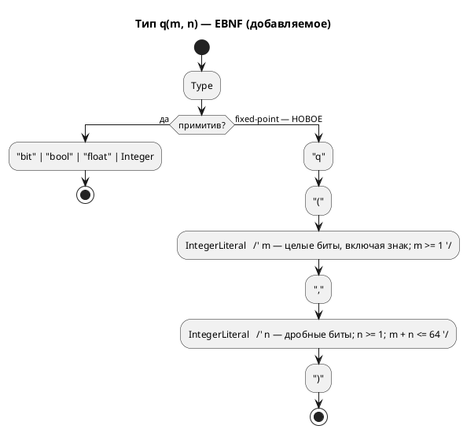

Источник: [docs/features/0061-fixed-point-type.md](https://github.com/Pastor/Takt/blob/3c154a13d979b18312a1250ebfbe3db2fa5247d3/docs/features/0061-fixed-point-type.md)

Полный текст по ссылке. Ниже начало карточки.

# Фича: Fixed-point Q(m.n) как тип языка

- **Номер:** 0061
- **Статус:** ГОТОВО (закрыта 2026-07-19; все задачи…05 реализованы)
- **Зависит от:** **нет** жёстких зависимостей (проверено аналитиком 2026-07-17 — см. [анализ](0061-fixed-point-type.md#анализ)). **Очерёдность:** [расчёт ширины перечисления — вынести в общий слой](0060-enum-width-shared-layer.md) идёт **первой** (Tier 2 против Tier 3) — обе правят `*_type.rs` всех целей, и после 0060 у 0061 появляется образец «факт в общем слое → отображение в цели».
- **Приоритет / Tier:** **Tier 3.** Ничего не сломано (`sv` отвергает `float` **громко** и с подсказкой), обход есть и применяется (целочисленная арифметика с ручным масштабированием — так написан **весь** корпус), **пользователя нет** (`grep float examples/*.lam` → **0**). **Самая дорогая фича очереди при самом низком спросе** — рекомендация аналитика: брать **после** дефектной части очереди.
- **Крейт:** `grammar` (язык: лексер/грамматика/АСД/типы/форматтер + 4 цели), `simulation` (эталонная арифметика и сверка)
- **Связанные issue (анализ):** новая фича (перевод кандидата из `FEATURES.md`); закрывает отложенный **Option R-B** [ADR](0045-sv-backend.md#архитектура-adr)

## Стадии жизненного цикла

Все стадии — **разделы этой карточки**: «Архитектура (ADR)»,
«Анализ», «Разработка», «Тест-план», «Отчёт о тестировании», «Итог».
Отдельным артефактом остаются только исправления —
[`docs/fixes/`](../fixes/README.md) (при необходимости `0061-YY-*`).

## Краткое описание

Цель `sv` запрещает `float` (`SV-003`): в синтезируемом RTL плавающей точки нет.
Fixed-point дал бы вещественную арифметику в аппаратуре, но **язык формата не
выражает**, и генератор был бы вынужден угадать (Q16.16), из-за чего сверка с
симулятором (f64) проваливалась бы by design. То есть это расширение **языка**, а
не генератора, — отдельная фича.

Вынесено закрытой [генератор генерации в SystemVerilog](0045-sv-backend.md) (ADR отверг вариант R-B).

## Архитектура (ADR)

- **Status:** Accepted
- **Date:** 2026-07-17
- **Authors:** Архитектор + Дизайнер языка
- **Related issues:** [Фича](0061-fixed-point-type.md); исполняет отложенное решение [ADR](0045-sv-backend.md#архитектура-adr) (вопрос 4, **Option R-B вынесен в кандидаты**)

### Context

Цель `sv` запрещает вещественный тип диагностикой **`SV-003`**: в синтезируемом
RTL плавающей точки нет, а `real` пригоден только для симуляции (yosys его
отвергает). ADR рассмотрел **Option R-B** (`Rational` →
Q(m.n)) и **отверг его как решение генератора**, вынеся в кандидаты с точной
формулировкой причины:

> «**Язык не выражает формат.** Q(m.n) требует выбора разрядности целой и дробной
> части, правил округления и насыщения — у `float` в Lam этих параметров нет.
> Генератор был бы вынужден **угадать** (например, Q16.16) — то есть молча
> изменить численную семантику модели: симулятор считает в f64, RTL считал бы в
> Q16.16 с иным округлением → сверка с симулятором провалится **не из-за дефекта,
> а by design**.»

Фича закрывает именно этот пробел: даёт языку **выразить формат**.

#### Замер сегодняшнего состояния (пробы 2026-07-17)

`var t: float := 1.5; t := t + 0.25;`

| Цель | Результат |
|---|---|
| `c` | `double t;` |
| `st` | `t : LREAL := 1.5;` |
| `rust` | `t: f64,` |
| `sv` | **`SV-003`** (громкий отказ с подсказкой «используйте целочисленный тип либо цель `c`/`rust`») |

Три программные цели **согласованы на 64 битах** — следствие решения заказчика
`--float-width=64` ([генератор C: отображение типов Array/Bit/Rational](0029-c-type-mapping.md#архитектура-adr)); симулятор тоже f64.
То есть сегодня `float` **непротиворечив везде, кроме `sv`**, где он честно
запрещён.

**Пользователя у фичи сегодня нет:** `grep` по `examples/` даёт **0**
вхождений `float` (подтверждает замер ADR). Фича добавляет **возможность**,
а не чинит боль.

#### Ловушка, обнаруженная проработкой: `>>` отрицательного в C — implementation-defined

Q-арифметика строится на сдвигах. **C11 6.5.7p5**: если левый операнд `>>` имеет
**знаковый** тип и **отрицательное** значение, результат
**implementation-defined**. Проба на этой машине (clang) даёт арифметический сдвиг
(`(-6) >> 1 = -3`, `Q8.8: -1.5*2.0 → -768` — верно), но это **выбор компилятора, а
не гарантия языка**. Цель `c` обязана эмитить код, не опирающийся на
неопределённость, — иначе численная семантика поедет **на чужом компиляторе**, то
есть у пользователя и молча.

Смежно: у цели `st` сдвиг ещё хуже — `SHL`/`SHR` в IEC 61131-3 определены на
**битовых строках**, а арифметика на битовых строках **запрещена** (`CLAUDE.md`,
цель `st`); оператора `<<` нет вовсе. То есть Q-арифметика в ST потребует
преобразований в месте операции — как уже сделано для `&`/`|`.

### Decision Drivers

1. **Численная семантика обязана совпадать у симулятора и всех целей — побитово.**
   Иначе сверка проваливается by design (ровно довод, по которому 0045 отвергла
   R-B). Это главный драйвер: fixed-point без него бессмыслен.
2. **Формат задаёт автор, а не генератор.** Угадывание = молчаливое изменение
   семантики.
3. **Округление и переполнение — часть формата, а не деталь реализации.** Если их
   не зафиксировать нормативно, четыре цели догадаются по-разному (прецедент,
   доказанный при [расчёт ширины перечисления — вынести в общий слой](0060-enum-width-shared-layer.md#архитектура-adr): пустое перечисление
   дало **четыре** разных ответа).
4. **Не платить за то, чем не пользуются.** Пользователя нет (0 `float` в
   корпусе) — значит цена ошибки в дизайне выше цены отсрочки.

### Considered Options

#### Option A. Новый примитив языка `q(m, n)`; `float` не трогаем

`var t: q(8, 8) := 1.5;` — **знаковый**, `m` — целые биты **включая знак**, `n` —
дробные, полная ширина `W = m + n`. Псевдонимы работают штатно
(`type Temp = q(8, 8);` — механизм `Type::Alias` уже есть).

**Pros:**
- Формат выражен явно (драйвер 2); ширина **выводима** и не содержит скрытого бита
  — в отличие от классической записи Q(m.n) с подразумеваемым знаковым битом.
- `float` остаётся как есть: программные цели не трогаются, сверка f64 не рушится.
- `q` — **отдельный тип**, а не «режим `float`»: у них разная арифметика, и
  смешивать их в одном имени значило бы врать.
- Ортогонален целям: `sv` получает синтезируемую дробную арифметику, не теряя
  `SV-003` для `float`.

**Cons:**
- Растёт язык: новый примитив + правила арифметики + приведения.
- Работа в **шести** местах (язык, симулятор, 4 цели) — иначе тип полу-мёртв.

#### Option B. Формат — параметр цели (`--fixed-width=16.16`)

**Pros:** ноль изменений языка.

**Cons:**
- **Нарушает драйвер 2 и принцип проекта**: CLI не должен менять логику автомата
  (прямо записан в `CLAUDE.md` по фиче про `--define`). Одна и та же модель
  считала бы по-разному в зависимости от флага сборки — то есть семантика уехала бы
  из текста модели в командную строку.
- Ровно то «угадывание», которое отверг ADR, только руками пользователя.

#### Option C. `float` с атрибутом формата (`var t: float<8,8>`)

**Pros:** не плодит имён типов.

**Cons:**
- `float<8,8>` **не float**: другая арифметика, другое округление, другой диапазон.
  Одно имя для двух семантик — источник ровно тех тихих расхождений, против
  которых фича и заводится.
- Модель, где часть `float` «с атрибутом», а часть без, читается неоднозначно.

#### Option D. Не делать; оставить `SV-003` (статус-кво)

**Pros:**
- Цена нулевая; обход есть — целочисленная арифметика с ручным масштабированием
  (именно так корпус и написан: 0 `float`).

**Cons:**
- Регуляторы (ПИД и т. п.) на FPGA без дробной арифметики выражаются вручную и
  **молча** — масштаб живёт в голове автора, а не в типе.
- Не закрывает отложенное решение.

### Decision

Принимается **Option A** — с **нормативной** численной семантикой (без неё фича
не имеет смысла, драйвер 1).

**Нормативные правила (обязательны для симулятора и всех целей — побитово):**

1. **Тип:** `q(m, n)` — знаковый, дополнительный код; `m` — целые биты **включая
   знаковый**, `n` — дробные; полная ширина `W = m + n`; `m ≥ 1`, `n ≥ 1`,
   `W ≤ 64`. Представимое значение — `v · 2⁻ⁿ`, где `v : int W`.
2. **Литерал:** вещественный литерал, присваиваемый `q(m, n)`, переводится **на
   этапе компиляции** и точно; непредставимый в формате литерал → **ошибка**, а не
   тихое округление (драйвер 3).
3. **`+`, `−`:** сложение представлений; переполнение — **как у целых типов
   языка** (перенос, wraparound). Насыщение — **не** в этой фиче (кандидат).
4. **`*`:** промежуточное произведение шириной `2W` (точное), затем сдвиг на `n`
   вправо. **Округление — floor (к −∞)**, то есть арифметический сдвиг: самый
   дешёвый в аппаратуре и однозначный.
5. **`/`:** делимое расширяется до `2W` и сдвигается влево на `n`, затем целочисленное
   деление. Синтезируется в **аппаратный делитель** — смежно с кандидатом
   `SV-009`.
6. **Приведения:** `q(m,n)` ↔ целые и `q(m,n)` ↔ `float` — **только явные**.
   Неявное смешение в одном выражении → ошибка: смешение — главный источник тихой
   потери точности.
7. **Цель `c` Не вправе опираться на `>>` знакового отрицательного** (C11 6.5.7p5:
   implementation-defined). Требуется эмиссия, определённая стандартом (деление на
   `2ⁿ` с известным поведением либо работа через беззнаковое представление). Проба
   на clang даёт «правильный» результат — это **не** гарантия.
8. **`float` не меняется** — `SV-003` остаётся в силе для него.

**Версия языка:** язык меняется, но подъёма **нет** — (решение
заказчика 2026-07-15): версия `0.3.0` уже поднята фичей и **не выпущена**
(`CHANGES.md` — раздел «Не выпущено»), поэтому 0061 вносит изменения **в уже
поднятую** версию. Обязанность обосновать изменение языка сводом сохраняется
и исполнена этим ADR.

**свод:** фича меняет синтаксис → EBNF-диаграмма обязательна.

### Consequences

#### Положительные

- Синтезируемая дробная арифметика в цели `sv`; отложенное решение закрыто.
- Формат — в тексте модели, а не в голове автора и не в флаге сборки.
- Семантика нормативна → сверка возможна **по построению**, а не «by design
  провалена».

#### Отрицательные / Action items

- **A-1. Шесть мест или ничего.** Тип обязан появиться в языке, симуляторе и
  **всех четырёх** целях одновременно; иначе `q` — полу-мёртвый тип, а модель с ним
  перестаёт быть переносимой. Это и определяет размер фичи.
- **A-2. Сверка — не «после», а «вместе»**. Требуется **побитовая**
  потактовая сверка `q`-арифметики симулятора со **всеми** целями. Проверка целевого
  языка тут бесполезен: неверная Q-арифметика компилируется и синтезируется.
- **A-3. Ловушка C11 6.5.7p5** — контролем обязан быть тест, а не вера в
  clang.
- **A-4. `st`: сдвигов над числами нет** — `SHL`/`SHR` только над битовыми
  строками, арифметика над ними запрещена, `<<` не существует. Понадобится
  преобразование в месте операции (как уже сделано для `&`/`|`) — объём задачи.
- **A-5. Насыщение (saturation) — вне объёма** (wraparound). Для
  регуляторов оно обычно нужнее переноса → **кандидат**.
- **A-6. Пользователя нет** (0 `float` в корпусе, драйвер 4). Приоритет — **Tier 3**;
  фича не должна опережать в очереди дефекты. Первая же реальная модель с
  регулятором обязана быть заведена как пример **вместе** с фичей — иначе доказывать
  верность будет не на чем (класс «дыра в покрытии»).

#### Acceptance criteria

1. **A1.** `var t: q(8,8) := 1.5;` разбирается; `q(0,8)`, `q(8,0)`, `q(40,40)` →
   ошибки (границы своду).
2. **A2.** Непредставимый литерал (`q(8,8) := 0.001`) → **ошибка**, не тихое
   округление.
3. **A3.** Цель `sv` порождает `logic signed [W-1:0]`, модуль **синтезируется**
   (yosys) и проходит verilator — то есть `SV-003` для `q` **не** срабатывает.
4. **A4.** Побитовая потактовая сверка `q`-арифметики: симулятор = `c` = `rust` =
   `st` = `sv` на **каждом** такте, включая **отрицательные** значения и
   `*`-округление к −∞.
5. **A5.** Цель `c` не содержит `>>` над знаковым отрицательным —
   проверяется грепом порождённого кода **и** тестом на значениях.
6. **A6.** Неявное смешение `q` с `float`/целым → ошибка.
7. **A7.** `float` не изменился: `SV-003` в силе, `c` → `double`, `st` → `LREAL`,
   `rust` → `f64`.
8. **A8.** Корпус (0 `float`) — вывод всех целей **побайтово прежний**.
9. **A9.** Пример с реальной дробной моделью заведён и проходит сценарный проверка
   достижимости.
10. **A10.** Версия языка **не поднята** (цикл 0.3.0 не выпущен);
    README документирует `q(m,n)` с примерами.

## Анализ

### Цель и контекст

ADR отверг fixed-point **как решение генератора** и вынес в кандидаты с точной
причиной: «язык не выражает формат», поэтому генератор угадал бы (Q16.16) и
**молча** изменил численную семантику — сверка с симулятором (f64) провалилась бы
**by design**. Фича закрывает ровно этот пробел: язык получает `q(m, n)`.

ADR принял **Option A** с **нормативной** численной семантикой (своду–8).

### Замер (пробы 2026-07-17)

| Что | Факт |
|---|---|
| `float` сегодня | `c` → `double`, `st` → `LREAL`, `rust` → `f64`, `sv` → **`SV-003`** (громкий отказ с подсказкой) |
| Согласованность | три программные цели и симулятор — **все на 64 битах** (следствие `--float-width=64`) |
| **Пользователь** | **`grep float examples/*.lam` → 0 вхождений** |
| Ловушка C | **C11 6.5.7p5**: `>>` знакового **отрицательного** — implementation-defined. Проба (clang): `(-6) >> 1 = -3`, `Q8.8: -1.5*2.0 → -768` — верно, но это **выбор компилятора**, не гарантия |
| Ловушка ST | `SHL`/`SHR` — только над **битовыми строками**; арифметика над ними **запрещена**; `<<` не существует (`CLAUDE.md`) |
| Синтаксис типов | `Type::Alias(Identifier)` + `[T; N]`; `float` приходит как `Alias("float")` → `TypeNode::Rational` (`type_node.rs:22`) |

### Зависимости фичи

- **Зависит от:** **нет** (жёстких блокировок).
  - **Код.** Фича трогает язык (`lexer`/`grammar.lalrpop`/`ast`/`type_node`),
    симулятор (`eval/`) и **четыре** цели. Пересечения с очередью: с
    [расчёт ширины перечисления — вынести в общий слой](0060-enum-width-shared-layer.md) — по `*_type.rs` **всех**
    целей. Это **не зависимость**, а очерёдность: 0060 правит ветку `Enum`, 0061
    добавляет ветку `Q`. Конфликт слияния тривиален, но **0060 идёт первой**
    (Tier 2 против Tier 3), и после неё у 0061 появляется готовый образец «факт в
    общем слое → отображение в цели».
  - **Смежность.** `/` над `q` синтезируется в аппаратный делитель — то же, о чём
    кандидат `SV-009` ([предупреждение о делителе (`SV-009`) в цели `sv`](0064-sv-divider-warning.md)). Не
    зависимость: 0064 — предупреждение, 0061 без него работает.
  - **Опора.** Детерминизм (закрытая 0048) — критерий A8.
- **Влияние на порядок разработки:** никого не разблокирует. **Аналитик
  рекомендует держать её низко** (критерий 4 своду): фича добавляет
  возможность, а **не чинит боль** — пользователя нет (0 `float` в корпусе), а
  цена самая высокая в очереди (см. «Объём»).

### Приоритет (Tier) — обоснование

**Tier 3.**

- **Ничего не сломано:** `sv` отвергает `float` **громко** и с подсказкой
  («используйте целочисленный тип либо цель `c`/`rust`») — то есть автор узнаёт
  правду в компиляторе Lam, а не от чужого инструмента.
- **Обход есть и применяется:** целочисленная арифметика с ручным масштабированием
  — именно так написан весь корпус (0 `float`).
- **Пользователя нет.** Фича заводится «на вырост» (регуляторы на FPGA).
- Против Tier 2: ни одна фича от неё не зависит; ни один дефект ею не закрывается.

**Это самая дорогая фича очереди при самом низком спросе.** Аналитик обязан
сказать это прямо: 0061 конкурирует за время с Tier 1-дефектом
[цель `c` теряет знак перечисления — переход мёртв молча](../fixes/0005-01-c-enum-signedness.md) (закрывается фичей) и с
десятком дефектов симулятора/генераторов. Решение о том, когда её брать, —
за заказчиком; рекомендация аналитика — **после** дефектной части очереди.

### Объём (почему фича дорогая)

Правило A-1 ADR: **шесть мест или ничего**, иначе `q` — полу-мёртвый тип, а модель
с ним перестаёт быть переносимой между целями.

| Место | Работа |
|---|---|
| Язык | лексер (`q`), грамматика, `ast::Type`, `TypeNode`, вывод типов, форматтер (иначе `format_source` **откажет**) |
| Симулятор | `eval/` — **эталонная** Q-арифметика (побитово) |
| `c` | ловушка C11 6.5.7p5 (свод ADR) |
| `rust` | `iN` + сдвиги (в Rust `>>` знакового **определён** как арифметический — расхождение с C **в пользу** Rust) |
| `st` | сдвигов над числами **нет** — преобразования в месте операции |
| `sv` | `logic signed [W-1:0]`; ради этого фича и заводится |
| `plantuml` | печать типа |

### Требования и проверяемые условия

- **R1. Формат выражен автором.** `q(m, n)`: `m ≥ 1` (включая знак), `n ≥ 1`,
  `m + n ≤ 64`. Нарушение границ → ошибка.
- **R2. Литерал точен или ошибка.** Непредставимый в формате литерал → **ошибка**,
  не тихое округление.
- **R3. Арифметика нормативна:** `+`/`−` — wraparound (как у целых);
  `*` — точное произведение `2W`, затем сдвиг на `n` с округлением **floor (к −∞)**;
  `/` — расширение до `2W`, сдвиг влево на `n`, целочисленное деление.
- **R4. Побитовое совпадение.** Симулятор = `c` = `rust` = `st` = `sv` на каждом
  такте, **включая отрицательные** значения.
- **R5. Приведения только явные** (`q` ↔ целое, `q` ↔ `float`); неявное смешение →
  ошибка.
- **R6. Цель `c` не опирается на implementation-defined** (`>>` знакового
  отрицательного).
- **R7. `float` не меняется:** `SV-003` в силе; `double`/`LREAL`/`f64`.
- **R8. Корпус неизменен** (0 `float`).
- **R9. Форматтер печатает `q(m,n)`** (фича: не добавив печать, ломаем
  `format_source` на файлах с узлом).
- **R10. Версия языка не поднимается** (цикл 0.3.0 **не выпущен**).
- **R11. README документирует тип с примерами**.

### Критерии приёмки и способ проверки

| # | Критерий | Способ проверки |
|---|---|---|
| A1 | `q(8,8)` разбирается; `q(0,8)`/`q(8,0)`/`q(40,40)` — ошибки | Тесты парсера/семантики + контрпримеры |
| A2 | Непредставимый литерал → ошибка | Контрпример `q(8,8) := 0.001` |
| A3 | `sv`: `logic signed [W-1:0]`; **синтезируется** (yosys) и проходит verilator | Проверка цели `sv` (**оба** инструмента — они ловят непересекающиеся классы) |
| A4 | **Побитовая** сверка симулятор = 4 цели, вкл. отрицательные и floor | `conformance_{c,rust,sv}_tests` + прогон `st` |
| A5 | В выводе `c` нет `>>` знакового отрицательного | Греп порождённого + тест на значениях |
| A6 | Неявное смешение → ошибка | Контрпример |
| A7 | `float` не изменился | Существующие тесты `rational_is_sv003_not_real` и пробы |
| A8 | Корпус побайтово прежний | `git diff --exit-code examples/generated` |
| A9 | Пример с дробной моделью проходит проверка достижимости (0030) | `examples_scenario_tests` |
| A10 | Версия **не поднята**; README документирует | Ревью |

### Особенности по обратной функциональности

**Правка строго аддитивна**: добавляется **новый** тип; `float`,
целые, все цели, симулятор и корпус — не задеты (A7/A8). Ни один существующий
`.lam` не меняет смысла: `q` — новое имя, сегодня свободное.

**Ограничение аддитивности:** имя `q` становится занятым. Модель, где `q` —
имя переменной/типа/модели, продолжает работать (тип — отдельная позиция
грамматики), но это надо **проверить**, а не предположить: `Identifier → Type::Alias`
означает, что `q` сегодня **может** быть псевдонимом типа. Проверка.

**Версия языка не поднимается** (R10): 0.3.0 уже поднята фичей и **не
выпущена**, поэтому 0061 вносит изменения в уже поднятую версию (решение заказчика 2026-07-15). Обязанность обосновать изменение языка — исполнена
в ADR.

### Риски и зависимости

- **R-1. Тихое расхождение арифметики** (главный риск; ровно то, из-за чего 0045
  отвергла R-B). Пять реализаций одной семантики (симулятор + 4 цели) — прецедент
  0060 доказывает, что копии расходятся: там **четыре** цели дали **четыре** ответа
  на пустое перечисление, а `c` молча теряла знак. Снижение: (1) нормативные
  своду–8 ADR; (2) **побитовая** сверка A4 как основной критерий; (3) образец
  из [расчёт ширины перечисления — вынести в общий слой](0060-enum-width-shared-layer.md) — факт в общий слой,
  отображение в цель.
- **R-2. C11 6.5.7p5.** Проба на clang «работает» — и именно поэтому опасна:
  дефект проявится на **чужом** компиляторе, у пользователя, молча. Снижение:
  свод ADR + A5 (греп **и** тест на значениях).
- **R-3. Проверка бесполезен как доказательство.** Неверная Q-арифметика
  компилируется и **синтезируется**. Урок в чистом виде: «оба инструмента SV
  приняли молча». Снижение: A4, а не A3.
- **R-4. Соблазн «пока только sv»** (ради чего фича и заводится). Даст
  непереносимую модель. Снижение: A-1 ADR — шесть мест или ничего; A4 требует
  **все** цели.
- **R-5. Доказывать не на чем.** Корпус пуст на `float`; фикстуры авторства
  разработчика проверяют то, что он и задумал. Снижение: A9 — **реальная**
  дробная модель (регулятор) как пример со сценарным контрактом. Класс «дыра в
  покрытии» уже дал дефекты и 0005-01 — здесь он предотвращается заранее.
- **R-6. Насыщение попросят сразу.** Для регуляторов wraparound редко то, что
  нужно. Снижение: свод фиксирует wraparound **явно**, насыщение — кандидат;
  то есть автор не примет умолчание за обещание.

### Побочные находки проработки (вне объёма)

1. **Насыщение (saturation) для `q`** — кандидат (A-5 ADR).
2. **Расхождение `>>` между целями:** в Rust `>>` знакового **определён** как
   арифметический, в C — implementation-defined, в ST его нет вовсе. Это делает
   «одинаковую трансляцию сдвига» невозможной **в принципе** — записано здесь,
   чтобы следующая фича, трогающая сдвиги (`<<` в языке), не открыла это заново.

## Разработка

### Задача

#### Что было

Язык не выражает формат fixed-point — ровно причина, по которой [ADR](0045-sv-backend.md#ар
